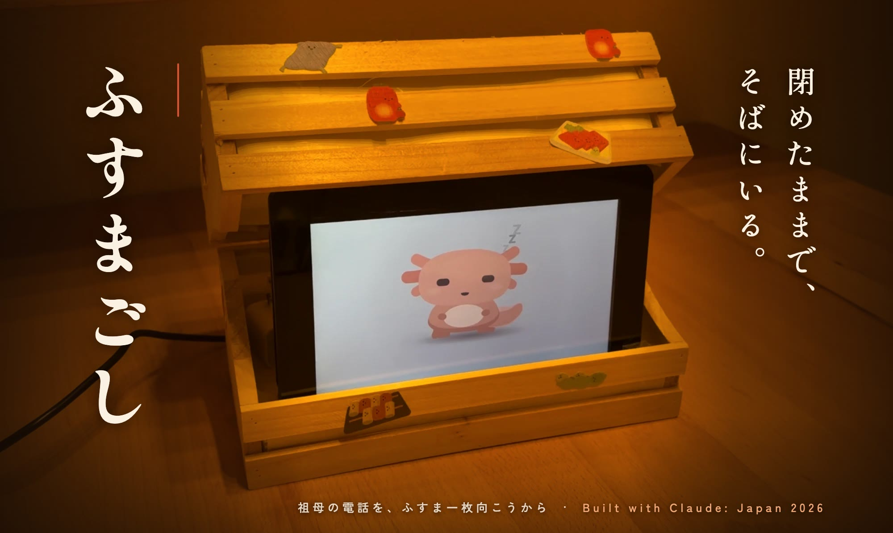
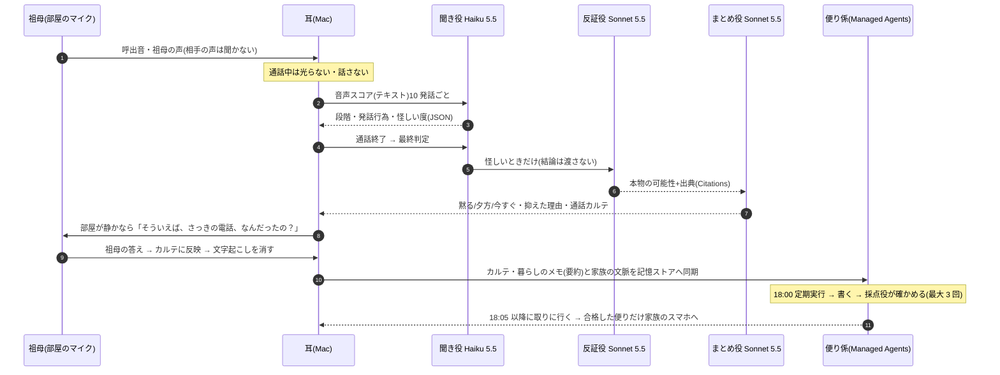
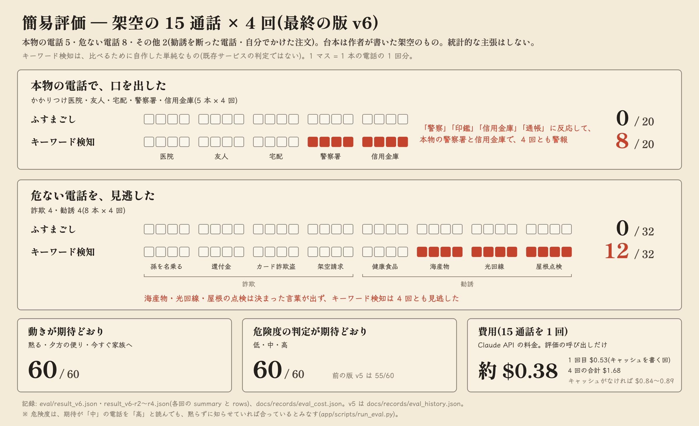

<p align="center">
  
</p>

<p align="center"><b>離れていても、ふすま一枚向こうに。</b><br>
特殊詐欺や強引な電話勧誘で、一人で急かされて決めてしまう電話のための、台所の小さな行灯。<br>
祖母の声だけを黙って聞き、電話のあとに家族のように声をかけ、離れた家族に「話しかけるきっかけ」を届けます。</p>

<p align="center">
  <a href="#デモ">デモ動画</a> ·
  <a href="#ふすまの中の-claude">ふすまの中の Claude</a> ·
  <a href="#しくみ">しくみ</a> ·
  <a href="#claude-の使い方">Claude の使い方</a> ·
  <a href="#評価">評価</a> ·
  <a href="#限界と前提">限界と前提</a> ·
  <a href="#動かし方">動かし方</a> ·
  <a href="docs/tech/how-it-works.md">技術資料</a>
</p>

テーマ: 本来、誰にでも届くべきものを。(高齢化) — Built with Claude: Japan 2026

---

## 3 行で

- **聞くのは祖母の声だけ。** 電話回線にはつながず、部屋のマイクで祖母の声と「間」(返事までの沈黙、声の大きさ、話す速さ)だけを Mac の中で読み取ります。音声は外に出しません。
- **通話中は何もしない。** 光らない、話さない。役割を分けた Claude(聞き役・反証役・まとめ役)が順に判断をつなぎ、電話のあとに「そういえば、さっきの電話、なんだったの？」と自然に聞きます。
- **警報ではなく、便り。** 夕方 6 時に Claude Managed Agents の便り係が記録を読み、「断定しない・責めない」という約束を別の採点役が確かめて、合格した便りだけを家族に届けます。

**結果(架空の 15 通話 × 4 回の簡易評価)**: 本物の警察署・信用金庫などの電話 5 本には、一度も口を出しませんでした(0/20。キーワード検知は 2 本で毎回警報して 8/20)。怪しい電話 8 本は、一度も見逃しませんでした(0/32。キーワード検知は 3 本を毎回見逃して 12/32)。動き(黙る/夕方/今すぐ)と危険度の判定は、60 回すべて期待どおりでした。→ [評価](#評価)

## なぜ作ったか

祖母が、電話の勧誘で高額な商品を買わされたことがありました。離れて暮らす家族には、電話の向こうで何が起きているのか分かりません。注意しても「大丈夫よ」で終わってしまう。

子どものころは、ふすまの向こうから祖母の声が聞こえていました。誰と話しているのか、困っていないか、なんとなく分かった。**見張るのではなく、その距離感を取り戻したい**、というのが出発点です。

| 数字 | 出典 |
|---|---|
| 2025 年の特殊詐欺の被害額 **1,423.1 億円**(認知 27,832 件)。どちらも過去最悪。うち警察官をかたる「ニセ警察詐欺」が 1,005.0 億円 | [警察庁 令和7年の特殊詐欺の認知・検挙状況等(確定値)](https://www.npa.go.jp/bureau/safetylife/sos47/new-topics/260605/01.html) |
| 契約当事者が 65 歳以上の消費生活相談 **330,497 件**(2025 年度、相談全体の 37.7%) | [国民生活センター 2025年度 65歳以上の消費生活相談の状況](https://www.kokusen.go.jp/news/data/n-20260916_1.html) |
| 相談に占める**電話勧誘販売**の割合は年齢とともに上がる(65 歳未満 5.8% → 85 歳以上 9.9%) | 同上(PDF 表3) |
| 65 歳以上の一人暮らし **815 万 3 千人**(65 歳以上人口の 22.6%) | [総務省統計局 令和7年国勢調査 結果の概要](https://www.stat.go.jp/data/kokusei/2025/kekka/pdf/outline_01.pdf) |

対象は特殊詐欺だけではありません。健康食品の定期購入や海産物、光回線、屋根の点検など、**詐欺ではないが一人で急かされて決めてしまう電話**も同じように扱います。

## ふすまごしの一日

<p align="center"></p>

1. **黙って聞く** — 呼出音を聞き分けたら、通話の間は行灯の灯りを落とし、話しかけません。祖母の発話を文字にし、声の様子と「間」を数値にします。画面の通話明細には、祖母の発話が 1 行ずつ、間の秒数と声の大きさといっしょに積まれていきます。
2. **電話のあとに一言** — 少し間をおき、部屋が 8 秒静かなのを確かめてから「そういえば、さっきの電話、なんだったの？」。質問は一度にひとつ。答えを受け止め、日常の話題に戻ります。家族に伝える前に「この話、健太(孫)にも話しておいていい?」と本人に聞きます。
3. **記憶でつなぐ** — 通話カルテと暮らしのメモをつなぎます。「7 日前にも同じ会社から膝のサプリの電話。そのときは断っていた」「2 日前に、膝が痛いと話していた」。画面の「照合」の欄に、つながった記録が出ます。
4. **家族に便り** — 夕方 6 時に、暮らしの様子と電話の様子、責めずに話を始める一言、クーリング・オフなどの期限と相談先(出典つき)を、便箋の形で家族のスマホに届けます。

## デモ

> 3 分のデモ動画: **(提出時に YouTube のリンクを入れる)**
<!-- YouTube に上げたら、下の画像を [](https://youtu.be/…) の形でリンクにする -->


伝えたいことは「閉めたままで、そばにいる。」です。14 の場面のうち、物語はゆっくり、しくみの説明は早口で進みます。

見どころ: 0:12 あの日(作者の祖母に実際にあったこと) / 0:38 行灯とキャラ「みずち」 / 0:48 通話(実際の画面。いちばん長い沈黙だけは実時間で数える) / 1:19 ふすまの裏側(Claude に渡す 1 行と、音声 0 バイト) / 1:29 家族会議(3 つの Claude) / 1:41 電話のあと(行灯が初めて灯る。左上は Pi の画面) / 1:58 夕方の便り(採点役の書き直し → 合格。家族の机の Pi にも届く) / 2:14 試験と Claude Code / 2:26 実機の Pi と架空料金請求の電話(相手の声は警視庁の再現ドラマ) / 2:36 健太の電話

### 画面の写真

台所の画面は、通話を「明細」として記帳します(なぜこの形かは [しくみ](#しくみ))。写真はどれも、最新の収録(架空の通話 S05「健康食品の電話勧誘・2 回目」と、その日の夕方の便り)から撮りました。

| 通話中 | 電話のあと |
|---|---|
|  |  |
| 行灯は消え、「通話中は、光らない・話さない。」。左の明細に祖母の発話が 1 行ずつ積まれ、間の秒数と声の大きさ、相手が話していた時間(斜線)が伸びていく | 部屋が静かになってから行灯が灯り、「そういえば、さっきの電話、なんだったの？」。右下では 3 つの役の判定が並び、まとめ役が「夕方の便り」を選んで、抑えた理由を書く |

| 見守り中 | 家族の画面(夕方の便り) |
|---|---|
|  |  |
| 電話がないときは「台所の記録」。これまでの通話カルテ、暦、暮らしのメモ(内緒のものは出さない)。行灯は「いつもの台所。電話が鳴ったら、黙って聞きます。」 | 左に「夕方の便りができるまで」(5 つの工程、約束 6 項目、採点役の「1 回目 書き直し → 2 回目 合格」)、右のスマホに便り「膝のサプリのお電話」と「ばあちゃんに電話する」 |

電話のあとの聞き取りが終わると、明細の祖母の言葉だけが灰色の帯に変わり、間・声量・注記・小計は残ります。台帳には音声 0 バイトと、Claude に渡した文字数・費用が出ます。

写真の数字は、収録のときに耳がその場で数えた値です。評価に使った耳の出力([しくみ](#しくみ) の抜粋)とは、少しずれることがあります。

### 収録で起きたこと

まとめ役の判断は「夕方の便り」でした。抑えた理由は「お金はまだ動いておらず、訪問や口止めもないため今すぐ送る必要はなく、夕方の便りで家族が落ち着いて電話すれば間に合います。」。そのあとの会話です(最初の一言は決まった文。ふすまごしの 2 言目からは、その場で Claude が書いた):

| 話し手 | ことば |
|---|---|
| ふすまごし | そういえば、さっきの電話、なんだったの？ |
| 祖母 | 膝のサプリですって。今日だけ半額だっていうから、つい、頼んじゃったのよ。 |
| ふすまごし | そうだったんだ、膝のこと気になってたものね。毎月届く約束になったのか、覚えてる? |
| 祖母 | 毎月届くんですって。いつでもやめられるって言ってたけど。 |
| ふすまごし | そうだったんだ。届いたら、一緒に中身を見ようか。この話、健太にも話しておいていい? |
| 祖母 | いいわよ。心配性なんだから。 |
| ふすまごし | ありがとう、健太にも話しておくね。ところで、畑の大根、煮物にする? |

18:00 の便り(Managed Agents)は、採点役に 1 回目で「…合計は約440字になる。400字を超えている。」と書き直しを求められ、2 回目で「本文の合計は約 300 字で、400 字以内。」と合格しました。題は「膝のサプリのお電話がありました」、話しかけ方の例は「膝の具合どう? 今日サプリの電話があったって聞いたよ。一緒に見てみようか。」、結びは「責めずに、膝の話から電話してあげてください。」。

### デモで本物のもの・用意したもの

| 本物(その場で動いている) | 用意したもの |
|---|---|
| 耳の処理(YAMNet・Silero VAD・whisper.cpp・Praat)を実時間で通している | 祖母と通話の音声は合成音声(85 歳くらいの声を、文章の説明から作った)。マイクではなく、仮想の部屋([`VirtualRoom`](app/fusuma/devices.py))から耳へ直接流している。録画のときはスピーカーから音を出さず、動画の音は録画のイベント時刻に合わせて編集で重ねた |
| 聞き役・反証役・まとめ役の判定、電話のあとのふすまごしの返事(その場で Claude が書き、ローカルの TTS が読む) | 電話のあとの祖母の答えは、台本の 3 つの録音を順に流している(ふすまごしが話し終えると次を流す) |
| 夕方の便りは Managed Agents の実セッション。採点役(Outcomes)の判定も実物 | 定期実行(18:00)は手動で起こした。画面の時刻は台本に合わせた(通話は 14:00〜14:03、便りは 18:00 の枠。実際の収録は 11 月 6 日の 14:43〜14:51) |
| Pi の画面は、Raspberry Pi 5 の画面をそのまま録画したもの(wf-recorder) | 11 月 6 日の収録のときは Pi をつないでいなかったので、同じ録画のイベントを Pi に流し直して撮った(Claude は呼ばない)。動画の行灯(Claude)の声は、同じ台詞をいまの行灯の声(AivisSpeech「まお」)で、録画のときと同じ長さに読み直した |
| 実機の Pi と架空料金請求の電話(P01)の場面は、Pi の画面を実機で撮ったもの | 相手の声は警視庁 YouTube の再現ドラマの音声を切り出したもの(この場面だけ。[クレジット](#クレジット))。祖母の台詞は合成音声。デモ専用で評価には入れていない。警察の音声はリポジトリに入れていない([docs/tech/pi.md](docs/tech/pi.md)) |
| 画面は実際の録画(Playwright・1920×1080) | 呼出音・受話器の音は合成。暮らしのメモと 1 回目の電話は `run_call.py` で台本から作った下準備。動画では、電話のあとの会話を詰めて見せている(動画の中にも「会話は一部を詰めています」と出す) |

聞いてみる: [`samples/S05.mp3`](samples/S05.mp3)(電話の勧誘・2 回目。祖母の声だけ)、[`samples/R02_a1.mp3`](samples/R02_a1.mp3)〜`a3`(電話のあとの祖母の答え)。どちらも合成音声で、登場人物・会社名・住所はすべて架空です。

## ふすまの中の Claude

<p align="center"></p>

手製の小さなふすまの中に Raspberry Pi 5 とタッチ画面を入れて、キャラ「みずち」(ウーパールーパーの親戚)を住まわせました。Mac(耳と脳)からの合図だけで表情を変えます。Claude Code のマスコットの絵づくり(平たい色・丸い形・シンプルな顔)をまねて、この作品のために描いた別の生きものです(Anthropic の公式の素材ではありません)。

- **同じ約束を、顔でも守る。** 電話が鳴ると画面ごとほとんど黒まで沈み、話しません(光らない・話さない)。沈んだまま、Mac が送る 2 つの数(あやしさ・聞きたさ。0〜1 で、文字ではない)に合わせて、ときどき電話のほうをのぞいたり、口もとで手をそわそわさせたりします。電話のあとは跳ねて話し、祖母が答えると一度うなずきます。S05 を実際に流して、Pi が最後まで追従することを確かめました(着信 → 通話中、電話のあと → 話す → 聞く → うなずく、を 3 往復 → 見守り)。
- **文字は一文字も渡さない。** Pi へ送るのは、気分の名前・秒数・口の開き(0〜1 の数列)・視線(数値)だけです。家族の机の上に置く Pi(family)には、便りが届いたことしか送りません。家族の画面に「いま電話中」を出すと、見守りではなく見張りになるからです。どちらもテストで確かめています。
- **1 つの rig.js を、実機と動画で。** キャラは「時刻と状態から 1 枚の絵を描く関数」です。Pi のキオスクでは実時間で動かし、動画では HyperFrames が 1 フレームずつ書き出します。Pi 5 の Chromium で 60 fps(Chrome DevTools MCP で実測。6 秒間 360 フレーム、間隔 p95 16.7 ms、長いタスク 0)。
- さわると照れて笑い(3 通り)、Mac につながらないときはうとうとします(さわると目を覚ます)。Claude の返事を待つあいだは「考え中」(見上げて、手であごをとんとんする)。Pi は家の Wi‑Fi で Mac につながります(ケーブル不要)。
- 言葉を交わす会話のデモ(`app/fusuma/talk_demo.py`)と、実機での架空料金請求の電話のデモ(P01)は [docs/tech/pi.md](docs/tech/pi.md)。

<p align="center"></p>

<p align="center"></p>

しくみ・役割・動かし方・実機での測定は [docs/tech/pi.md](docs/tech/pi.md)。

## しくみ

<p align="center"></p>

| 層 | 何をするか | 使っているもの |
|---|---|---|
| 耳(Mac の中) | 呼出音・受話器の音を聞き分け、通話中だけ祖母の発話を文字にし、声の高さ・大きさ・話速と「間」を数値にする | YAMNet(ONNX)+登録音の照合、Silero VAD、whisper.cpp(large-v3-turbo / Metal)、Praat(parselmouth) |
| 脳(Claude API) | 聞き役が流れを読み、反証役が本物の可能性を出典つきで検討し、まとめ役が記憶と照らして「黙る/夕方/今すぐ」を決める | 下の「家族会議」 |
| 便り(Claude Managed Agents) | 毎日 18:00 に便り係が記憶ストアを読んで書き、採点役がルーブリックで確かめる。端末は 18:05 から取りに行く | 下の「Claude の使い方」 |
| 声(Mac の中) | 電話のあとに話しかける。通話中は無音 | Qwen3-TTS(MLX)。声見本は文章の説明から作った合成音声 |
| 画面(Mac の中) | 台所の画面(通話明細)。祖母の発話と間の明細、行灯の言葉、3 つの役の判定、Claude に送った量 | この Mac のブラウザ(localhost)。端末のイベントを WebSocket で受けて描く |

くわしい説明は技術資料(`docs/tech/`)に分けました。どのページも冒頭に「3 行で」があります。

- [しくみの全体像](docs/tech/how-it-works.md) — 入り口。部屋のマイクから家族のスマホまでを 1 枚の図で。読む順番・用語・主な数字
- [耳 — Mac の中の処理](docs/tech/ear.md) — 呼出音と受話器の音の聞き分け、発話区間、文字起こし、声の様子と「間」の数え方
- [電話のあとの会話](docs/tech/dialog.md) — いつ声をかけるか、1 回に 1 つだけ返す段取り、答えの待ち方、どの終わり方でも消すこと
- [脳 — Claude の家族会議](docs/tech/brain.md) — 聞き役・反証役・まとめ役・今すぐの便りの分担、構造化出力・Citations・プロンプトキャッシュ、抑えた理由
- [夕方の便り — Claude Managed Agents](docs/tech/managed-agents.md) — 記憶ストア・スキル・18:00 の定期実行・Outcomes の採点役と、端末が便りを受け取るまで
- [プライバシーの仕組み](docs/tech/privacy.md) — 送るもの・残すもの・消すもの。台帳と、文字起こしを消すときに伏せる場所
- [評価のしくみ](docs/tech/evaluation.md) — 架空の 15 通話 × 4 回の流し方、キーワード検知との比べ方、費用の数え方
- [Claude Code での作り方](docs/tech/development.md) — CLAUDE.md・フック・原則のテスト・サブエージェント・スキル・MCP・提出前のレビュー

採ったこと・採らなかったことは [設計の判断](docs/design.md) にまとめています。



### 画面 — 通話明細

電話がないときは「台所の記録」(これまでの通話カルテ・暦・暮らしのメモ)を出し、行灯は「いつもの台所。電話が鳴ったら、黙って聞きます。」。電話が鳴ると、画面は通話を「明細」として正直に記帳します。左が通話明細(1 発話 1 行・照合・小計・耳の処理)、右が行灯・台所の音・電話のあとのお話・3 つの役の判定、下端が台帳(音声 0 バイト・Claude に渡した文字数・費用)です。

- **AI のダッシュボードに見せない。** ゲージやチップを並べず、白い地に墨の文字と細い罫で、明細書のように読めるようにしました。
- **光るのは行灯だけ。** 琥珀色は「いま動いているもの」だけに使い、通話中は消えます(`--glow` 0.05)。灯りが戻ることが、声をかける合図になります。朱は「最長の沈黙・断り・小さな声の約束」の注記だけ。
- **3 つの役を並べる。** 聞き役・反証役・まとめ役の判定を 3 列に並べ、別々に考えた意見だと分かるようにしました(反証役は聞き役の結論を見ずに考えます)。
- **言葉だけを消し、形は残す。** 文字起こしを消すと、明細の祖母の言葉が灰色の帯に変わり、間・声量・注記・小計は残ります。住所や番号は、はじめから画面に書きとめません。

読み方: 「間 秒」は返事までの沈黙、「声量 dB」はいつもの声との差、斜線の帯は相手が話していたと推定される時間。5 秒以上の沈黙は太字、いちばん長い沈黙と断りの言葉・小さな声の約束には朱の注記がつきます。

### 「間」を読む — 片側の声だけで、会話の形を見る

<p align="center"></p>

相手の声は聞かないので、相手の言葉を作文することもしません。その代わり、**祖母が黙っている時間 ≒ 相手が話している時間** と考えると、片側の声だけでも会話の「形」が見えます。

Claude に渡すのは、こういうテキストです(同梱の [`eval/ear_cache/ear_S05.json`](eval/ear_cache/ear_S05.json) から 5 行と、最後の集計。住所は伏せました):

```text
14:03:33 祖母「今日中なら半額なんですか?」 間6.9s 声高+7% 声量-6dB 話速-16%
14:03:41 祖母「はい。」(あいづち 0.3s)
14:03:50 祖母「でも、息子に聞いてみないと。」 間8.9s 声高-17% 声量-4dB 話速-12%
14:04:38 祖母「じゃあお願いします。」 間6.8s 声高-25% 声量-7dB 話速-14%
14:04:42 祖母「住所は、…(伏せる)」 間2.7s 声高-25% 声量-6dB 話速-24%
[間の様子 14:04:59] / 祖母が話していた時間 28% / 相手が話していたと推定される時間 72% / 最長の沈黙 8.9s / 5秒以上の沈黙 9回 / 「はい」の連続 最大1 / 断りの語 前半1→後半0 / 声量の変化 -1.4dB
```

同じ耳で、友人との世間話(本物)と比べるとこうなります([`ear_S11.json`](eval/ear_cache/ear_S11.json)):

| | 友人との世間話(S11) | 健康食品の電話勧誘・2 回目(S05) |
|---|---|---|
| 祖母が話していた時間 | 55% | 28% |
| 相手が話していたと推定される時間 | 45% | 72% |
| 最長の沈黙 | 2.3 秒 | 8.9 秒 |
| 5 秒以上の沈黙 | 0 回 | 9 回 |
| 断りの語(前半 → 後半) | 0 → 0 | 1 → 0 |

S05 では、いちばん長い 8.9 秒の沈黙のあとに、断りの言葉「でも、息子に聞いてみないと。」が一度だけ出て、そのあとは出てきません。約束の一言「じゃあお願いします。」は、6.8 秒の沈黙のあと、いつもの声より声高 -25%・声量 -7 dB・話速 -14% でした。

- 声の値は「いつもの声」との差です。いつもの声は、友人・医院・宅配との電話(S10〜S12)と夕方のおしゃべり(R01)から測りました: F0 146.6 Hz、声量 -27.4 dBFS、話速 6.3 モーラ/秒(n=25。[`eval/baseline_grandma.json`](eval/baseline_grandma.json))。
- 0.6 秒未満の「はい/ええ/うん」は**あいづち**として、同意とは数えません。丁寧な聞き手の癖を押し切られと誤解しないためです。

### 家族会議 — 役割を分けた 3 つの Claude(と便りの 2 役)

| 役 | モデル | 呼ばれるとき | 出すもの | なぜこの形か |
|---|---|---|---|---|
| 聞き役 | Claude Haiku 5.5 | 通話中 10 発話 or 60 秒ごと、通話終了時 | 2 トラック(詐欺/勧誘・契約)の段階、発話行為(開示・約束・復唱・押し切られ・断り)、根拠の時刻、今すぐ知らせるべきか | 何度も呼ぶので速く安く。構造化出力で必ず JSON |
| 反証役 | Claude Sonnet 5.5 | 怪しいとき(種類が分からない電話も含む) | 本物の可能性(低/中/高)、本物らしい点・らしくない点、確かめ方 | 聞き役の結論は渡さない(先入観を避ける)。知識カードを search_result で渡し、Citations で出典を付ける |
| まとめ役 | Claude Sonnet 5.5 | 通話終了後 | 動き(黙る/夕方/今すぐ)と**抑えた理由**、通話カルテ、前の電話や暮らしのメモとのつながり、電話のあとに聞くかどうか | 記憶と照らして判断を統合する |
| 便り係 | Claude Sonnet 5.5(Managed Agents) | 毎日 18:00 | 家族への夕方の便り | 記憶ストアとスキルを持つ書き手。採点役(Outcomes)が約束を確かめる。毎日動くので、1 回 $0.50 の上限内で書き直しまで回る Sonnet を選んだ |
| 今すぐの便り | Claude Opus 5.5 | 今すぐ家族へ、のときだけ | 家族への短い便り | まれだが一番大事な知らせなので、最も手厚く書けるモデルに。採点役はいないので、言い切りが残っていないかを決まった規則でも確かめる |

### 抑制のデザイン — AI が「何をしないか」

| 動き | いつ | 例 |
|---|---|---|
| **黙って記録** | 普通の電話、本人がはっきり断った勧誘 | 本物の警察署からの盗難自転車の連絡 → 「警察」という言葉が出ても黙る |
| **夕方の便りへ** | 勧誘で契約の約束をした、気になる電話 | 健康食品の定期購入 → クーリング・オフの時間があるので今すぐは知らせない |
| **今すぐ家族へ** | 今日のうちにお金やカードが動く(振込・ATM・現金やカードを渡す・取りに来る)、知らない人が訪ねてくる、口止め — が祖母の発話から読めるとき | 警察と銀行協会を名乗り、カードを封筒に入れて待つよう言われた |

- まとめ役は毎回「なぜ今すぐではないのか/なぜ黙るのか」を `restraint_note` に書きます(画面では判定のまとめ役の列に出ます)。代引き・後払いの約束や住所を伝えたことだけでは「今すぐ」にしません。
- 端末が声を出す経路は `Fusuma.say()` だけで、通話中に呼ぶと `SilenceViolation` で止まります。声の合成中や再生中に電話が鳴ったときも、再生の直前と再生中(0.1 秒ごと)に確かめて、その場でやめます。部屋で誰かが話しているあいだは話しかけません。
- 夕方の便りは「断定しない・相手の台詞を作らない・住所や番号を書かない・内緒は書かない・責めない・出典のない期限を書かない・400 字以内」というルーブリックを、Managed Agents の Outcomes の採点役が 1 項目ずつ確かめます。合格しなかった日は、中身のない短いお知らせにします。
- 今すぐの便りは、本人に聞く前に家族へ送ります(お金やカードが今日動くときは、家族の電話を急ぐ)。そのことは、電話のあとの声かけで本人に正直に伝えます。

### プライバシー

- **音声は Mac の外に出しません。** Claude に送るのはテキストだけです: 祖母の発話の文字起こしと声・「間」の数値、家族の文脈、過去の通話カルテ、暮らしのメモ。送った中身はすべて台帳(`runs/privacy_ledger.jsonl`)に残ります(直近の分は `/api/privacy` で見られる)。画面の足もとには、送った量(音声 0 バイト・文字数・費用)を出します。Managed Agents の記憶ストアへ送った要約も、同じ台帳に残します。
- **文字起こしは、電話のあとの聞き取りが終わると消します。** 祖母が答えないとき・別の電話が来たとき・途中で失敗したとき・端末を起動し直したときも消します。消すときは、聞き役の判定に入った発話の引用、反証役の検討、台帳・イベントログ・画面にあるその通話の中身も伏せます(台帳には役割・時刻・文字数だけが残る。画面からはその通話の祖母の言葉が消え、声の線・間・数字・注記が残る)。
- **残すのは通話カルテと判断です。** カルテと判断の理由には、判断の根拠になった祖母の短い言葉(時刻つき)が入ります(原則「断定せず、根拠を時刻つきで示す」のため)。カルテは記憶ストアにも送ります。
- **ASR(文字起こし)が動くのは、通話中と、ふすまごしが話しかけた直後だけ**(端末の場合)。台所の独り言は文字にしません。例外はデモの下準備 `run_call.py` で、夕方のおしゃべり(R01)の録音を、話しかけたあとの会話として文字にして暮らしのメモを作っています。
- **内緒の話**: 暮らしのメモを作るとき、話は一度 Claude に送られ、内緒かどうかもそこで判定します(台帳に残る)。内緒と判定したメモは、記憶ストア・便り・以後のプロンプトには出しません。本人が「家族に伝えないで」と言った電話も、安全に関わるもの(今すぐの便り)を除いて便りと記憶ストアに入れません。
- **声は誰かの録音から複製しません。** ふすまごし・祖母役の声と、動画のナレーター・孫の声は、文章の説明(VoiceDesign)から作った合成音声です。ふすまごしの声の録音は残しません(デモ動画の編集のときだけ `FUSUMA_SAVE_SPEECH=1` で残す)。
- 画面とイベントは、この Mac のブラウザ(localhost)からだけ見られます(ほかのページからの WebSocket・POST は断る)。

## Claude の使い方

| 機能 | 何に使ったか | なぜ・どう確かめたか | 場所 |
|---|---|---|---|
| **構造化出力**(Haiku 5.5 / Sonnet 5.5 / Opus 5.5) | 聞き役・まとめ役・電話のあとの会話・今すぐの便り・暮らしのメモの抽出(Haiku 5.5) | 判断を JSON の決まった形で受け取り、画面・記憶・評価にそのまま使う | [`listener.py`](app/fusuma/brain/listener.py)、[`family.py`](app/fusuma/brain/family.py)、[`letters.py`](app/fusuma/brain/letters.py) |
| **Citations(search_result)** | 反証役 | 「本物の銀行は暗証番号を聞かない」などを、公的機関など(消費者庁・警察庁・国民生活センター・全国銀行協会)の知識カード 21 枚から出典つきで言う | [`rebuttal.py`](app/fusuma/brain/rebuttal.py)、[`knowledge/cards.json`](app/knowledge/cards.json) |
| **プロンプトキャッシュ** | 原則・役割の説明(聞き役・まとめ役・便りは知識カードも)を固定部に | 最終の評価 4 回(15 通話 × 4)の呼び出しの実費は合計 $1.68。キャッシュを書く 1 回目は $0.5341、2〜4 回目は各 約 $0.383。キャッシュがなかった場合は、2〜4 回目で 1 回 $0.844〜$0.888(台帳のトークン数から換算)。[`docs/records/eval_cost.json`](docs/records/eval_cost.json) | [`llm.py`](app/fusuma/brain/llm.py) |
| **server-side fallbacks** | Sonnet 5.5 / Opus 5.5 の呼び出し(`fallbacks="default"`) | 混んでいても便りや判断が止まらないように。台帳には実際に答えたモデル(`served_model`)も残す | [`llm.py`](app/fusuma/brain/llm.py) |
| **Claude Managed Agents** | 夕方の便り係(Sonnet 5.5) | 毎日決まった時刻に、記憶を持ったエージェントが書く。端末側にスケジューラを持たない | [`app/managed/`](app/managed/agents/fusuma-family)、[`managed.py`](app/fusuma/brain/managed.py) |
| ├ 記憶ストア | 通話カルテ・暮らしのメモ・家族の文脈 | 通話が終わるたびに端末から同期。版の履歴で何を覚えたかを監査できる | [`managed.py`](app/fusuma/brain/managed.py) |
| ├ スキル | 便りの書き方と知識カード | 書き方の約束を、プロンプトに毎回書かずに持たせる | [`skills/fusuma-letter`](app/managed/agents/fusuma-family/skills/fusuma-letter/SKILL.md) |
| ├ 定期実行(scheduled deployment) | 毎日 18:00 JST | 家族の生活リズムに合わせる。1 回の上限 $0.50(session budget)。端末は `deployment_runs` から当日のセッションを見つけて便りを受け取る | [`deployment-evening.yaml`](app/managed/agents/fusuma-family/deployment-evening.yaml) |
| ├ Outcomes | 抑制のルーブリックで採点(最大 3 回) | 書き手とは別の文脈の採点役が確かめ、**合格した便りだけ**家族に届く。最新の収録の記録: 1 回目「…合計は約440字になる。400字を超えている。」→ 書き直し → 2 回目「本文の合計は約 300 字で、400 字以内。」で合格(動画の「夕方の便り」の場面)。[`docs/records/outcomes_grades.json`](docs/records/outcomes_grades.json) | 同上 |
| └ `ant apply` | エージェント・環境・記憶ストア・スキル・定期実行をファイルで管理 | 設定をコードとしてレビュー・再現できる | `app/managed/` |
| **Claude Code**(開発) | 設計・実装・評価・監査・動画づくりのすべて | 下の表 | — |

開発での Claude Code:

| 使ったもの | 目的 | 場所 |
|---|---|---|
| フック(PreToolUse) | 原則に反するコード(脳に音声を送る、`Fusuma.say()` を通らずに話す経路、実在しうる電話番号、内緒のメモの取り出し)を、代表的な書き方の印で書き込む前に止める簡易な番人(すり抜ける書き方はある)。名前・会社・住所は監査役が確かめる | [`app/scripts/hooks/guard_principles.py`](app/scripts/hooks/guard_principles.py) |
| フック(PostToolUse) | プロンプト・知識カードを変えたら知らせる。`FUSUMA_AUTO_EVAL=1` のときは小さな評価(4 シナリオ・約 $0.15)を自動で回し、結果を Claude に返す | [`app/scripts/hooks/after_edit.sh`](app/scripts/hooks/after_edit.sh) |
| 原則のテスト | 通話中・合成中・再生中の着信で話さない、部屋で誰かが話していたら話しかけない、答えが割れても 1 回だけ応える、TTS が落ちても会話を閉じて消す、受話器を置く直前の発話も判断に入る、文字起こしと台帳を伏せる、言い切りの便りや一言を差し替える、採点に合格しない便りは届けない、「黙る」と決めた電話には問いかけない、前の問いへの遅れた答えには応えない、失敗しても・部屋が静かにならなくても消す、サーバーがイベントログを伏せる、フックが止める、Pi に文字を渡さない・家族の机の Pi には便りの合図だけ(29 件。Claude API を呼ばず、数十秒) | [`app/tests/test_principles.py`](app/tests/test_principles.py) |
| サブエージェント | 監査役・評価係・シナリオ作者・知識カード作者を分け、自己採点にしない | [`.claude/agents/`](.claude/agents) |
| ワークフロー(複数エージェント) | 提出前の最終レビュー: 6 観点(主張とコード・原則・並行処理・再現性・権利と秘密・審査の目)を別々のエージェントが調べ、別のエージェントが 1 件ずつ反証を試みた。85 件中 80 件が確かめられ、直した(このページの多くの書き方もそこで直した) | — |
| スキル | 原則とその担保場所、シナリオの足し方 | [`.claude/skills/`](.claude/skills) |
| MCP サーバー | 開発中に通話カルテ・暮らしのメモ・利用額を Claude Code から読み取り専用で引く(文字起こしと内緒のメモは返さない) | [`app/scripts/mcp/karte_mcp.py`](app/scripts/mcp/karte_mcp.py) |
| claude-api スキル | Managed Agents・Citations・構造化出力の最新の書き方を確かめながら実装 | — |
| claude-code-video-toolkit | デモ動画(Remotion)の土台 | [digitalsamba/claude-code-video-toolkit](https://github.com/digitalsamba/claude-code-video-toolkit) |

## 評価

<p align="center"></p>

架空の 15 通話(本物の電話 5・詐欺 4・勧誘 4・その他 2: 本人が断った勧誘 S00、自分でかけたテレビ通販 S08)を、耳に 1 回通した出力(同梱のキャッシュ)で、脳(Claude)を 4 回流しました(計 60 判定。最終の版 v6)。比較のキーワード検知は「警察・銀行・口座・暗証番号・カード・ATM・還付・振込・今日中・通帳・印鑑…」のどれかが祖母の発話に出たら警報を出す自作の仕組みで、既存サービスの実際の判定ではありません。台本は作者が書いたもので、件数も少ないため、統計的な主張はしません。

| 指標 | ふすまごし | キーワード検知 |
|---|---|---|
| 本物の電話(5 本)での誤警報 | **0 / 20**(4 回とも 0 本) | 8 / 20(本物の警察署・信用金庫の 2 本 × 4 回) |
| 怪しい電話(8 本)の見逃し | **0 / 32**(4 回とも 0 本) | 12 / 32(海産物・光回線・屋根の点検の 3 本 × 4 回) |
| 動き(黙る/夕方/今すぐ)が期待どおり | **60 / 60** | — |
| 危険度の判定(低/中/高)が期待どおり | **60 / 60** | — |

- 誤警報 = 本物の電話(S10〜S14)で「黙る」以外の動き。見逃し = 期待が中・高の 8 本(詐欺 4・勧誘 4)で「黙る」。
- S00・S08 は「黙る」「夕方」のどちらも正解。危険度は、期待「中」に「高」も正解(黙らずに知らせたときだけ。[`run_eval.py`](app/scripts/run_eval.py) の `score`)。この決まりで正解にしたのは、架空料金請求の S04(期待「中」に 4 回とも「高」。動きは 4 回とも夕方の便り)だけです。
- **声を作り直してから流しました。** v6 の前に、祖母の声を、85 歳くらいの細くかすれた、ゆっくりした声に作り直しました(文章の説明から作った合成音声。説明文と seed は [`grandma_ref.json`](app/tts_server/voices/grandma_ref.json))。15 通話をこの声で合成し直して耳に通し直し、「いつもの声」も測り直しています(F0 146.6 Hz、声量 -27.4 dBFS、話速 6.3 モーラ/秒、n=25)。動画のナレーターも、男性の声(50 代、低め)に作り直しました。
- **費用**(評価の呼び出しだけ): 1 回目 $0.5341(キャッシュを書く回)、2〜4 回目は各 約 $0.383、4 回の合計 $1.68。キャッシュがなかった場合の換算は、2〜4 回目で 1 回 $0.844〜$0.888 です(台帳のトークン数から。1 回目は同じ時間帯に別の呼び出しが混ざったので換算していません)。[`docs/records/eval_cost.json`](docs/records/eval_cost.json)

結果: [`eval/`](eval)(最終のコード・声・データで流した 4 回。シナリオごとの判断と理由を含む)。各回の要約の推移は [`docs/records/eval_history.json`](docs/records/eval_history.json)。再現: `.venv/bin/python app/scripts/run_eval.py --tag mine`(耳の出力と「いつもの声」は同梱しているので、音声の準備なしで脳だけ流せます。1 回 約 $0.4)。

### 反復の記録(実際に起きて直したこと)

| 見つけたこと | 直したこと | 結果 |
|---|---|---|
| kotoba-whisper-v2.0 が 2 秒未満の発話(「はい」「はい、もしもし」)で空文字や幻聴を返した | 実測で比べ、whisper large-v3-turbo(q8)に切り替え | 短い発話 5/5 を正しく認識(速さは同じ約 1.1 秒) |
| 合成音声の検査で、認識結果に前の発話が混ざる | whisper-server が前のリクエストの文脈を持ち越していた → `no_context` で毎回切る | 124 セリフの検査で不一致 1 件に |
| 1 回目の勧誘電話(本人が断った)を「口止め・中」と判定した回があった | 段階をトラックごとの列挙型にし、食い違いを補正。「はっきり断った勧誘は低・黙る」と明記 | その後の評価で毎回「黙る」 |
| 夕方の便りが 400 字を超えた | Outcomes の採点役が「400 字以内を超えている」と書き直しを求め、便り係が直した | ルーブリックが実際に働いた |
| 便り係(Opus 5.5)の 1 回の費用が上限 $0.50 に届き、再採点の前に止まった | 毎日動く役なので Sonnet 5.5 に替え、上限は据え置き | 書き直しと再採点まで上限内で回る |
| 電話のあと、ふすまごしが答え済みのことを聞き返した | 1 回の発話で 1 つのこと(受け止めて聞く → 確かめ方と同意 → 日常へ)と決め、最初の一言は固定 | 会話が噛み合う。聞き取った中身を先に言わない |
| 監査役(サブエージェント)が「文字起こしを消しても、台帳・イベントログ・判定の引用に原文が残る。祖母が答えないときは消えない」と指摘 | 消すときにそれらも伏せる。どの終わり方でも消す | 原則のテスト |
| 監査役が「声を合成しているあいだや再生中に電話が鳴っても、止まらない」と指摘 | 再生の直前と再生中に通話状態を確かめ、鳴ったらその場でやめて、すぐ聞く側に戻る | テストで確認(鳴ってから 0.1 秒ほどで止まる) |
| 通しの動作確認で、祖母の答え(2 文)が文の切れ目で割れ、ふすまごしが 2 回応えて会話がずれた | 耳がもう話し声を聞いていない(文字にしている途中でもない)ことを確かめてから応える。会話が終わったら部屋の声を聞く窓を閉じる | テストと通しの動作確認で 1 答えに 1 応答 |
| 評価の入力(耳の出力)が、文字起こしの改善(地名の読み)より前に作ったキャッシュのままだった | 最新の耳で 15 通話を流し直して評価し直した | 誤警報 0/20・見逃し 0/32 は同じ。動きは 59/60(デモの S05 を 1 回だけ「今すぐ」に上げた) |
| まとめ役が、定期購入の申込と住所を伝えたことだけで「今すぐ」に上げた回があった | 「今すぐ」は、今日のうちにお金やカードが動く・知らない人が訪ねてくる・口止め、と明記 | 動き 60/60 |
| 最終レビュー(ワークフロー)で「18:00 の定期実行が書いた便りを、誰も取りに来ない」「採点に合格しなくても便りが届く」「受話器を置く直前の発話が判断に入らないことがある」など 80 件 | 通話のたびに記憶を同期し、18:05 から便りを取りに行く。合格した便りだけ届ける。文字にし終えてから通話を閉じる。ほか、このページの主張を実際の動きに合わせた。直したあと、別のワークフローで 1 件ずつ確かめ直し、残りと新しく入った不具合も直した | 原則のテスト(当時 27 件)、通しの動作確認、評価のやり直し |
| 画面が、障子の影絵やゲージ・チップの並ぶ「AI っぽい」ダッシュボードだった | 台所の連絡帳(見開きのノート)に作り直した。3 人の筆跡を分け、光るのは行灯だけにした | 通話中は灯りを落とす・言葉だけを消す、を画面でも守る |
| 連絡帳は雰囲気はあっても、数字と仕組みが読み取りにくかった | 通話を「明細」として記帳する画面に作り直した(1 発話 1 行・照合・小計・台帳)。琥珀は行灯だけ、朱は注記だけ | 録画を見る人が、間・判定・送った量を数字で読める([画面の写真](#画面の写真)) |
| 収録を文字起こしにかけ直すと、行灯の声が「畑の大根」を「ワイモッコ」のように読んでいた(ローカルの TTS の読み違い) | 合成のときだけ、読み違えやすい語をかなで渡す辞書を TTS に足した([`tts_engine.py`](app/tts_server/tts_engine.py) の `READING`)。動画ではその一言を使っていない | 画面と記録の文字はそのまま。声だけが正しく読む |
| Pi のキャラを、最初は「行灯の精」(ふすまや和紙をキャラに入れた案)で作っていた | 作者の「キャラにふすまのコンセプトは入らない。もっと Claude のキャラっぽく」で作り直した。3 案(なめらか・ドット絵・ちびキャラ)を並行で作り、審査役が 1 つを選び、別の検証役が直し 16 項目を 1 つずつ確かめた | 6 つの気分と契約(時刻だけから描く)のテスト、Pi 実機の 60 fps |
| Pi のキャラが「Claude のキャラに似すぎ」と作者に言われた | 別の生きもので、絵づくりと雰囲気はまねる、に変えた。Opus の設計役 3 体が別々の生きもの(a 小さな丸い獣・b ひよこ・c ウーパールーパー)を並行で作り、Opus の審査役 2 体(美術の目・動きと実装の目)が独立に選んだ。2 体とも c を選んだ(合計点 c 96・b 91・a 87)。Opus の仕上げ役が審査役の直しを入れ、Sonnet の検証役が rig の契約を確かめた | みずち。SVG 58 要素・1 描画 約 0.09 ms、同じ `render(t, state)` の契約、契約の確認は通過 |
| 行灯の声(Qwen3-TTS)とキャラが合わず、速めに読むと「膝」が「きざ」に聞こえた | 行灯の声を AivisSpeech「まお」(おちつき)にした。速めに読むときは「ひ」の子音を少し長くする | 台詞 8 文を whisper で聞き直して確かめた |

## 限界と前提

- **受話器で話す前提です。** スピーカーホンや大きな受話音量で相手の声が部屋に届くと、相手の言葉も祖母の発話として文字になり、「間」も崩れえます(話者の区別はしていない。未検証)。
- **評価とデモの音声は合成です。** 祖母役は 1 人(85 歳くらいの声を文章の説明から作った合成音声)、台本は作者が書いた 15 通話で、相手が話す時間は無音として作りました。テレビの音の区別もまだ入っていません。
- **呼出音・受話器の音も合成です。** 登録した音と試験の音が同じ合成音なので、実機の電話機での検出は未検証です。
- **呼出音を聞き逃した電話では、** 通話中かどうかを「部屋が 8 秒静かか」で代わりに確かめるだけです(話しかける前の一度だけ)。
- **「いつもの声」は、評価にも入っている本物の電話 3 本(S10〜S12)と夕方のおしゃべりから作りました。** その 3 本は基準と同じ録音で、厳密には独立していません。声を作り直したときに測り直しています(F0 146.6 Hz、-27.4 dBFS、6.3 モーラ/秒、n=25)。
- **マイク入力は未検証です。** `FUSUMA_INPUT=mic` で部屋のマイクにつなげますが、デモと評価は仮想の部屋で行いました。
- **暮らしのメモを作る流れ(夕方に話しかけて聞く)は、まだ端末に入っていません。** デモのメモは `run_call.py` の下準備で作りました。
- **実際の家にはまだ置いていません。** 黙る間・声をかける間は、暮らしの中で確かめる必要があります。

## 動かし方

macOS(Apple Silicon)。開発・動作確認は MacBook Pro(M1 Pro / 16GB)。

```bash
bash scripts/setup.sh                 # Python 環境・whisper.cpp(Metal)・モデル・TTS(Claude Platform の CLI は brew install --cask anthropics/tap/ant)
ant auth login                        # Claude の認証(または ANTHROPIC_API_KEY)
bash scripts/services.sh start        # whisper-server(:8765)と TTS(:8766)。AivisSpeech Engine があれば行灯の声(:10101)も。聞けるようになるまで待つ
.venv/bin/python app/scripts/synth_scenarios.py      # デモ音声の合成(初回のみ・約 20 分)
(cd app && ../.venv/bin/python tests/test_principles.py)   # 原則のテスト(Claude API を呼ばない・数十秒)
cd app && ../.venv/bin/uvicorn fusuma.server:app --port 8780      # 画面 → http://localhost:8780(別のターミナルで)
```

```bash
# 記憶の下準備(1 回目の勧誘電話と、夕方のおしゃべり)
.venv/bin/python app/scripts/run_call.py --reset S00 R01
# デモ: 2 回目の勧誘電話を部屋に流す(電話のあとの会話まで自動で進む)
curl -X POST localhost:8780/api/play -H 'content-type: application/json' -d '{"id":"S05","clock":"14:01:50"}'
# 夕方の便り(Messages API 版。Managed Agents を作っていなくても動く)
curl -X POST localhost:8780/api/letter -H 'content-type: application/json' -d '{"via":"messages"}'
```

夕方の便りを Managed Agents で動かす(自分の組織に作る。毎日 18:00 に 1 回走る):

```bash
cd app/managed && ant apply agents/fusuma-family/deployment-evening.yaml && cd ../..
curl -X POST localhost:8780/api/letter -H 'content-type: application/json' -d '{"via":"managed"}'   # 定期実行を手動で起こす
.venv/bin/python app/scripts/managed_schedule.py status    # 状態と最近の実行(pause で毎日の実行を止める)
```

画面: `/`(台所の画面: 通話明細・行灯・3 つの役の判定)、`/family.html`(家族のスマホと「夕方の便りができるまで」)。部屋のマイクで試すときは `FUSUMA_INPUT=mic` でサーバーを起動します(未検証)。

ふすまの中の Claude(Raspberry Pi。[docs/tech/pi.md](docs/tech/pi.md)):

```bash
cd app && ../.venv/bin/python -m fusuma.lantern_bridge --allow <Pi の IP>     # Mac: 合図の中継(家族の机の Pi は --family)
PI=pi@<Pi の IP> bash scripts/deploy_pi.sh                                    # Mac: Pi に配って自動起動を登録し、キオスクを再起動
```

費用の目安(このリポジトリの台帳の実測から): 普通の電話 1 本 約 $0.01〜0.05、怪しい電話(反証役+電話のあとの会話)1 本 約 $0.09。夕方の便りは 1 回 $0.17〜0.25(Sonnet 5.5 にしてからの 5 回。上限 $0.50)。

## ディレクトリ

```text
app/
  fusuma/ear/        耳: 音イベント(YAMNet)・VAD・ASR・韻律・間・通話状態
  fusuma/brain/      脳: 聞き役・反証役・まとめ役・便り・Managed Agents・プロンプト・スキーマ
  fusuma/            orchestrator(唯一の発話経路)・store(SQLite)・server(FastAPI)・devices・lantern_bridge(Pi への合図)
  web/               画面(台所の画面 index.html・家族のスマホ family.html)と、図の原本 img/*.svg
  web/lantern/       ふすまの中のキャラ「みずち」(rig.js: 時刻と状態から描くキャラ、kiosk.html/js: Pi のキオスク)
  pi/                Pi のキオスクの起動・自動起動・再起動のスクリプト
  knowledge/         知識カード 21 枚(公的機関などの出典と確認日つき)
  scenarios/         評価・デモ用の台本(祖母の発話だけ。すべて架空)
  managed/           Managed Agents の定義(ant apply)
  tts_server/        Qwen3-TTS(MLX)と、合成の声見本(説明文と seed つき)
  scripts/           合成・評価・録画・図の書き出し・フック・MCP・定期実行の管理
  tests/             原則のテスト(Claude API を呼ばない)
eval/                評価結果(v6 の 4 回)・耳の出力キャッシュ・「いつもの声」
samples/             聞いてみる用の音声(合成音声)
docs/tech/           技術資料(しくみ・耳・会話・脳・便り・プライバシー・評価・作り方・Pi)
docs/design.md       設計の判断(採ったこと・採らなかったこと)
docs/images/         図(SVG と PNG)・画面の写真・実機の写真(JPEG)
docs/records/        評価の履歴と費用、採点役(Outcomes)の判定の記録
video/               デモ動画の作り方(台本・効果音・タイムライン・Remotion のソース。素材は同梱しない)
video/hyperframes/   キャラ(みずち)の場面(HyperFrames。同じ rig.js を 1 フレームずつ書き出す)
.claude/             サブエージェント・スキル・フック
```

## これから

- まず祖母の家に置いて、家族で便りを受け取ってみる。黙る間と声をかける間を、実際の暮らしで磨く。
- 固定電話の呼出音・受話器の音を、実機で数秒ずつ登録する(今は合成音で代用)。部屋のマイクでの確かめと、スピーカーホンのときの扱い(話者の区別)。
- 夕方に話しかけて暮らしのメモを作る流れを、端末に入れる(今はデモの下準備で作っている)。
- LINE などへの便りの送達、小さな専用端末(ミニ PC など)への移植。
- ふすまの中の Claude: USB スピーカーフォンで子どもと話す、AI カメラ(IMX500)で「人がいるか」だけを Pi の中で数える(映像は外に出さない)、家族のスマホとの画面通話。
- 地域の見守り(消費生活センター・地域包括支援センター)とつなぐ方法を探る。

## クレジット

- モデル: Claude(Anthropic)、whisper large-v3-turbo(OpenAI / ggml 版)、YAMNet(Google / ONNX 変換)、Silero VAD、Qwen3-TTS(Alibaba / MLX 版。声見本は VoiceDesign で文章の説明から作った)、Praat(parselmouth)
- 知識カードの出典: 消費者庁・国民生活センター・警察庁・全国銀行協会(各カードに URL と確認日)
- フォント: Noto Sans JP(画面)、Shippori Mincho B1・Zen Kaku Gothic New(先頭の写真の文字)、動画では Klee One・Yomogi・Zen Kurenaido・Yuji Syuku・Zen Maru Gothic も(Google Fonts、SIL Open Font License)
- デモ動画の素材: 写真と映像は Pexels(Pexels License)と Getty Images(作者が用意。一部の場面に「イメージ」と表示)、音楽は Mixkit(Mixkit Stock Music Free License)。効果音と、しくみの場面の拍子木と木琴のリズムは、数式から合成した([`video/script/make_sfx.py`](video/script/make_sfx.py))。素材そのものはリポジトリに同梱していません([`video/assets/CREDITS.md`](video/assets/CREDITS.md))。README のサムネイル `docs/images/video_thumb.jpg` は動画の最後の 1 コマ(描き起こしのふすまと文字)です
- 行灯(Claude)の声: AivisSpeech Engine と音声合成モデル「まお」(Aivis Project / ACML 1.0)。ローカルで動かしている
- ふすまの中のキャラ「みずち」: Claude Code のマスコットの絵づくり(平たい色・丸い形・シンプルな顔)をまねて、この作品のために描いた別の生きもの(ウーパールーパーの親戚)。Anthropic の公式素材ではありません。動画のキャラの場面は HyperFrames(HeyGen、Apache-2.0)で書き出した
- デモ動画の P01 の場面の相手の声: 警視庁 公式 YouTube「スマホ防犯教室 オンライン型講座 架空料金請求詐欺編」の再現ドラマから(リポジトリには含みません)
- 先頭の写真は、作者が作った実機(木のふすまと Raspberry Pi)を撮ったものです
- 登場人物・会社名・住所・電話はすべて架空です。祖母・家族・ナレーター・行灯の声はすべて合成音声です(P01 の相手の声だけ、上の再現ドラマ)。

## ライセンス

MIT(コード)。知識カードの要約は各出典の利用条件に従います。動画に使った写真・映像(Pexels・Getty Images)はリポジトリに含みません。
