<p align="center">
  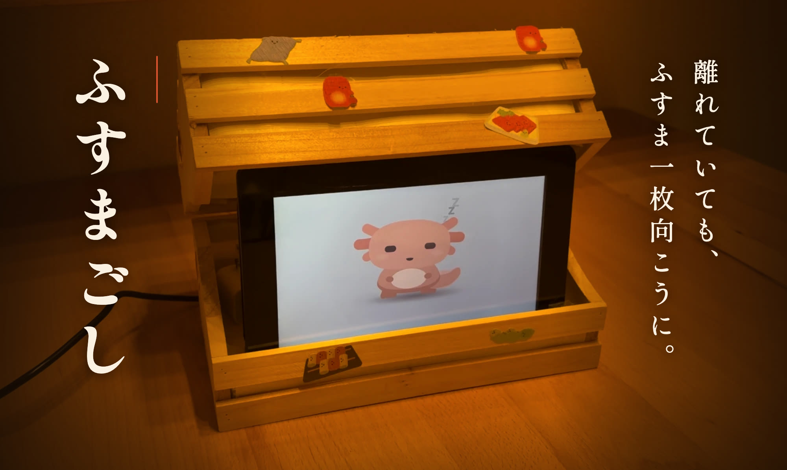
</p>

一人で暮らすおばあちゃんの電話を、**本人の声だけ**黙って聞き、電話が終わってから家族のように「さっきの電話、なんだったの？」と声をかけ、離れた家族には夕方に便りを届ける。特殊詐欺や強引な勧誘で「今日だけ」と急かされ、一人で決めてしまう電話のための、台所の小さな行灯です。

<p align="center">
  <a href="#デモ">デモ</a> ·
  <a href="#しくみ">しくみ</a> ·
  <a href="#claude-の使い方">Claude の使い方</a> ·
  <a href="#動かし方">動かし方</a> ·
  <a href="docs/tech/how-it-works.md">技術資料</a>
</p>

Built with Claude: Japan 2026 / テーマ「本来、誰にでも届くべきものを。」(高齢化)

## 概要

- **祖母の声だけを聞く。** 電話回線にはつながず、部屋のマイクで祖母の声と「間」(返事までの沈黙・声の大きさ・話す速さ)を Mac の中で読み取る。音声は外に出さない。
- **通話中は光らない・話さない。** 3 つの Claude(聞き役・反証役・まとめ役)が判断し、電話が終わって部屋が静かになってから「そういえば、さっきの電話、なんだったの？」と聞く。
- **警報ではなく便り。** 毎日 18:00 に Claude Managed Agents の便り係が記録を読んで家族への便りを書き、別の採点役が合格を出したものだけを届ける。

## なぜ作ったか

祖母が、電話の勧誘で高額な商品を買わされたことがありました。離れて暮らす家族には、電話の向こうで何が起きているか分かりません。注意しても「大丈夫よ」で終わってしまう。

昔は、ふすまの向こうから祖母の声が聞こえて、困っていないかがなんとなく分かりました。録音も見張りもせずに、その「ふすま一枚の距離」をもう一度つくる。それがふすまごしです。

| 数字 | 出典 |
|---|---|
| 2025 年の特殊詐欺の被害額 **1,423.1 億円**(過去最悪) | [警察庁](https://www.npa.go.jp/bureau/safetylife/sos47/new-topics/260605/01.html) |
| 65 歳以上の消費生活相談 **330,497 件**(2025 年度、全体の 37.7%)。電話勧誘販売の割合は年齢とともに上がる(65 歳未満 5.8% → 85 歳以上 9.9%) | [国民生活センター](https://www.kokusen.go.jp/news/data/n-20260916_1.html) |
| 65 歳以上の一人暮らし **815 万 3 千人** | [総務省統計局](https://www.stat.go.jp/data/kokusei/2025/kekka/pdf/outline_01.pdf) |

詐欺だけでなく、健康食品の定期購入・光回線・屋根の点検など、**詐欺ではないが急かされて決めてしまう電話**も対象です。

<p align="center">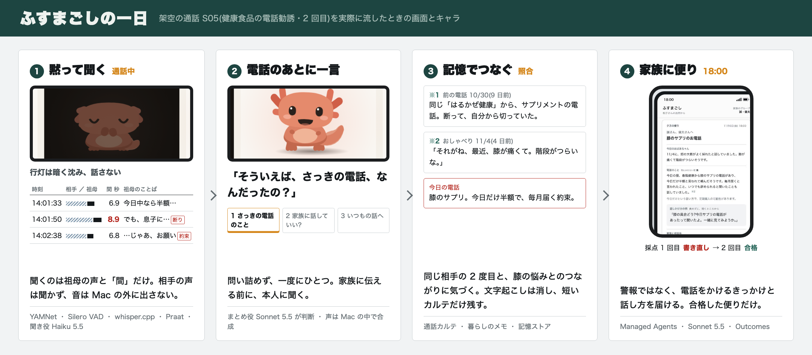</p>

## デモ

3 分のデモ動画: **https://youtu.be/SIDHWUTsMHE**

[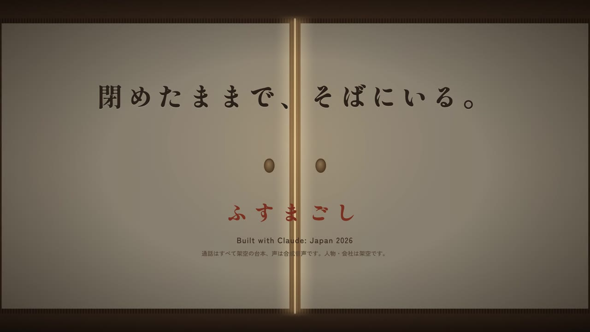](https://youtu.be/SIDHWUTsMHE)

### 画面の写真

架空の通話 S05(健康食品の電話勧誘・2 回目)と、その日の夕方の便りです。

| 通話中 | 電話のあと |
|---|---|
| 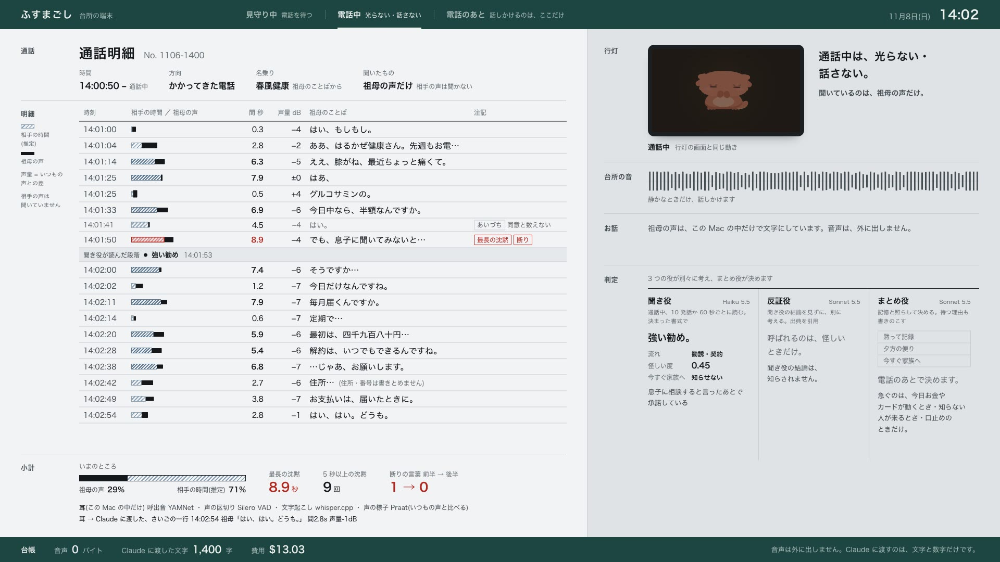 | 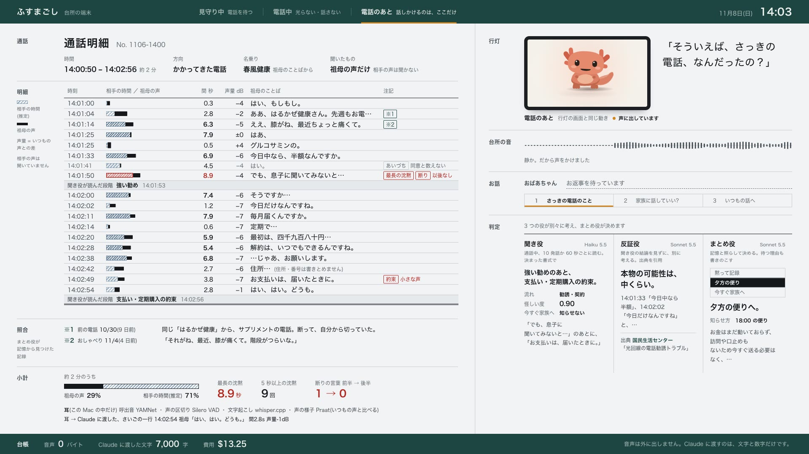 |
| 行灯は暗く沈み、話さない。祖母の発話が 1 行ずつ、間の秒数と声の大きさといっしょに記帳される | 行灯が「そういえば、さっきの電話、なんだったの？」。右下で 3 つの役が判定し、まとめ役が「夕方の便り」を選んだ理由を書く |

| 見守り中 | 家族の画面 |
|---|---|
| 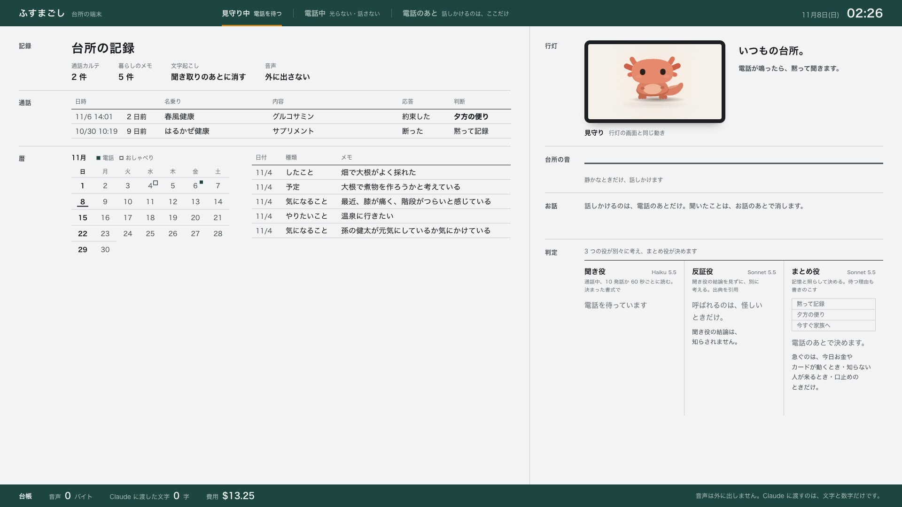 | 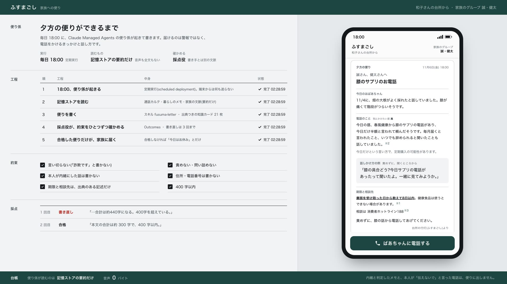 |
| これまでの通話カルテ・暦・暮らしのメモ | 便りができるまで(工程・約束・採点 1 回目 書き直し → 2 回目 合格)と、家族のスマホに届いた便り |

聞き取りが終わると、明細の祖母の言葉は灰色の帯に変わります(間・声量・注記・小計は残る)。

### 収録で起きたこと

まとめ役の判断は「夕方の便り」。理由は「お金はまだ動いておらず、訪問や口止めもないため今すぐ送る必要はなく、夕方の便りで家族が落ち着いて電話すれば間に合います。」。そのあとの会話(ふすまごしの 2 言目からは、その場で Claude が書いた):

| 話し手 | ことば |
|---|---|
| ふすまごし | そういえば、さっきの電話、なんだったの？ |
| 祖母 | 膝のサプリですって。今日だけ半額だっていうから、つい、頼んじゃったのよ。 |
| ふすまごし | そうだったんだ、膝のこと気になってたものね。毎月届く約束になったのか、覚えてる? |
| 祖母 | 毎月届くんですって。いつでもやめられるって言ってたけど。 |
| ふすまごし | そうだったんだ。届いたら、一緒に中身を見ようか。この話、健太にも話しておいていい? |
| 祖母 | いいわよ。心配性なんだから。 |
| ふすまごし | ありがとう、健太にも話しておくね。ところで、畑の大根、煮物にする? |

18:00 の便りは、採点役に 1 回目「…合計は約440字になる。400字を超えている。」で書き直しを求められ、2 回目で合格しました。

### デモで本物のもの・用意したもの

- **本物**: 耳の処理(YAMNet・Silero VAD・whisper.cpp・Praat)、3 つの役の判定と電話のあとの返事(その場で Claude が書く)、Managed Agents の便りと採点、Pi の画面(実機を録画)。
- **用意したもの**: 祖母と通話の音声は合成音声で、マイクではなく仮想の部屋([`VirtualRoom`](app/fusuma/devices.py))から耳へ流した。電話のあとの祖母の答えは台本の録音。18:00 の定期実行は手動で起こした。呼出音・受話器の音は合成。
- **P01(架空料金請求)の場面**だけ、相手の声に警視庁 YouTube の再現ドラマの音声を使った(リポジトリには含めない)。

聞いてみる: [`samples/S05.mp3`](samples/S05.mp3)(祖母の声だけ)、[`samples/R02_a1.mp3`](samples/R02_a1.mp3)〜`a3`(電話のあとの答え)。

## ふすまの中の Claude

<p align="center">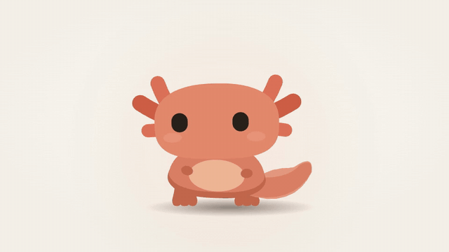</p>

手づくりのふすまに Raspberry Pi 5 とタッチ画面を入れ、キャラ「みずち」(ウーパールーパーの親戚)を住まわせました。Mac から届く合図で表情を変えます。

- 電話が鳴ると画面ごと暗く沈み、話さない。電話のあとは話し、祖母が答えるとうなずく。
- Pi に送るのは気分の名前と数値(口の開き・視線など)だけで、文字は送らない。家族の机の Pi には「便りが届いた」ことだけを送る。
- キャラは「時刻と状態から 1 枚の絵を描く関数」([`rig.js`](app/web/lantern/rig.js))。同じコードを Pi では実時間で、動画では 1 フレームずつ描く。Pi 5 で 60 fps。

<p align="center">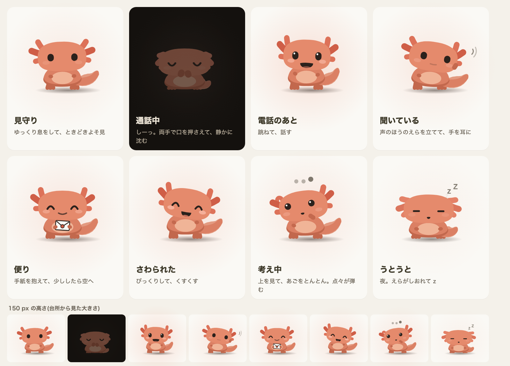</p>

<p align="center">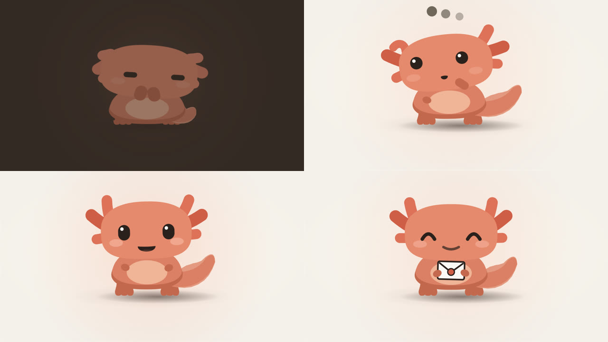</p>

詳しくは [docs/tech/pi.md](docs/tech/pi.md)。

## しくみ

<p align="center">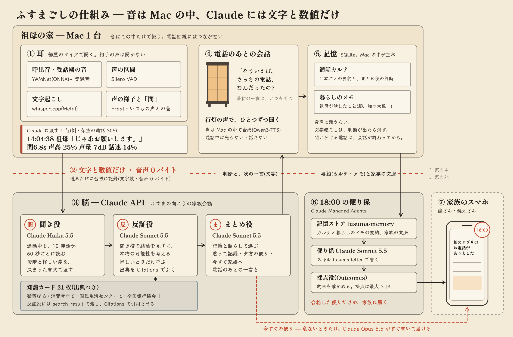</p>

| 層 | 何をするか | 使っているもの |
|---|---|---|
| 耳(Mac) | 呼出音を聞き分け、通話中だけ祖母の発話を文字にし、声と「間」を数値にする | YAMNet、Silero VAD、whisper.cpp(large-v3-turbo)、Praat |
| 脳(Claude API) | 聞き役 → 反証役 → まとめ役で「黙る/夕方/今すぐ」を決める | Haiku 5.5・Sonnet 5.5・Opus 5.5 |
| 便り(Managed Agents) | 18:00 に便り係が書き、採点役が確かめる | 記憶ストア・スキル・定期実行・Outcomes |
| 声と画面(Mac) | 電話のあとに話しかける。台所の画面に明細と判定を出す | ローカル TTS、localhost のブラウザ |

### 「間」を読む

<p align="center">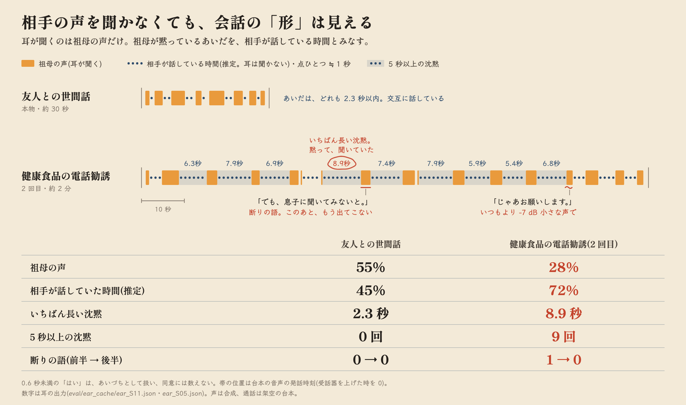</p>

相手の声は聞かないので、**祖母が黙っている時間 ≒ 相手が話している時間**として会話の形を読みます。Claude に渡すのはこういうテキストです([`eval/ear_cache/ear_S05.json`](eval/ear_cache/ear_S05.json) から):

```text
14:03:33 祖母「今日中なら半額なんですか?」 間6.9s 声高+7% 声量-6dB 話速-16%
14:03:50 祖母「でも、息子に聞いてみないと。」 間8.9s 声高-17% 声量-4dB 話速-12%
14:04:38 祖母「じゃあお願いします。」 間6.8s 声高-25% 声量-7dB 話速-14%
[間の様子] 祖母が話していた時間 28% / 相手 72% / 最長の沈黙 8.9s / 5秒以上の沈黙 9回 / 断りの語 前半1→後半0
```

| | 友人との世間話(S11) | 健康食品の勧誘(S05) |
|---|---|---|
| 祖母が話していた時間 | 55% | 28% |
| 最長の沈黙 | 2.3 秒 | 8.9 秒 |
| 5 秒以上の沈黙 | 0 回 | 9 回 |
| 断りの語(前半 → 後半) | 0 → 0 | 1 → 0 |

声の値は「いつもの声」(F0 146.6 Hz、-27.4 dBFS、6.3 モーラ/秒)との差です。0.6 秒未満の「はい」はあいづちとして、同意に数えません。

### 3 つの Claude と便りの役

| 役 | モデル | いつ | 何を出す |
|---|---|---|---|
| 聞き役 | Haiku 5.5 | 通話中 10 発話か 60 秒ごと、終了時 | 段階・発話行為(断り・約束など)・今すぐ知らせるべきか |
| 反証役 | Sonnet 5.5 | 怪しいときだけ | 本物の可能性と、その出典(聞き役の結論は見ない) |
| まとめ役 | Sonnet 5.5 | 通話のあと | 黙る/夕方/今すぐと**抑えた理由**、通話カルテ |
| 便り係 | Sonnet 5.5(Managed Agents) | 毎日 18:00 | 夕方の便り(採点役が確かめる) |
| 今すぐの便り | Opus 5.5 | 今すぐのときだけ | 家族への短い便り |

「今すぐ」は、今日お金やカードが動く・知らない人が訪ねてくる・口止め、が祖母の発話から読めるときだけです。それ以外は夕方の便りか、黙って記録します。

### プライバシー

- Claude に送るのはテキストだけ(音声 0 バイト)。送った中身はすべて台帳 `runs/privacy_ledger.jsonl` に残る。
- 文字起こしは、電話のあとの聞き取りが終わると消す。残すのは短い通話カルテ。
- 内緒と判定したメモは、便りにも記憶ストアにも出さない。
- 声は誰かの録音から複製しない(文章の説明から作った合成音声)。

詳しくは [docs/tech/privacy.md](docs/tech/privacy.md)。

## Claude の使い方

| 機能 | 何に使ったか | 場所 |
|---|---|---|
| 構造化出力 | 聞き役・まとめ役・会話・便りの判断を JSON で受け取る | [`listener.py`](app/fusuma/brain/listener.py)、[`family.py`](app/fusuma/brain/family.py) |
| Citations(search_result) | 反証役が、公的機関などの知識カード 21 枚から出典つきで答える | [`rebuttal.py`](app/fusuma/brain/rebuttal.py)、[`cards.json`](app/knowledge/cards.json) |
| プロンプトキャッシュ | 15 通話を流す費用が $0.844〜0.888 → 約 $0.383 | [`llm.py`](app/fusuma/brain/llm.py) |
| server-side fallbacks | Sonnet・Opus の呼び出しが混雑で止まらないように | [`llm.py`](app/fusuma/brain/llm.py) |
| Managed Agents | 便り係。記憶ストア・スキル・18:00 の定期実行・Outcomes の採点役(最大 3 回) | [`app/managed/`](app/managed/agents/fusuma-family) |
| Claude Code | 設計・実装・監査・動画づくり。フックで原則に反する書き込みを止め、監査と検証はサブエージェントに分けた。作りながら直したことは [iterations.md](docs/records/iterations.md) | [`.claude/`](.claude)、[development.md](docs/tech/development.md) |

## 動かし方

macOS(Apple Silicon)。

```bash
bash scripts/setup.sh                 # Python 環境・whisper.cpp・モデル・TTS
ant auth login                        # Claude の認証(または ANTHROPIC_API_KEY)
bash scripts/services.sh start        # whisper-server(:8765)と TTS(:8766)
.venv/bin/python app/scripts/synth_scenarios.py              # デモ音声の合成(初回のみ・約 20 分)
(cd app && ../.venv/bin/python tests/test_principles.py)     # テスト(Claude API を呼ばない)
cd app && ../.venv/bin/uvicorn fusuma.server:app --port 8780  # 画面 → http://localhost:8780
```

```bash
.venv/bin/python app/scripts/run_call.py --reset S00 R01      # 記憶の下準備
curl -X POST localhost:8780/api/play -H 'content-type: application/json' -d '{"id":"S05","clock":"14:01:50"}'   # デモの電話を流す
curl -X POST localhost:8780/api/letter -H 'content-type: application/json' -d '{"via":"messages"}'               # 夕方の便り
```

Managed Agents で便りを動かす: `cd app/managed && ant apply agents/fusuma-family/deployment-evening.yaml`(毎日 18:00 に走る。止めるときは `app/scripts/managed_schedule.py pause`)。Pi は [docs/tech/pi.md](docs/tech/pi.md)。

費用の目安: 普通の電話 1 本 約 $0.01〜0.05、怪しい電話 約 $0.09、夕方の便り 1 回 $0.17〜0.25。

## ディレクトリ

```text
app/fusuma/      耳(ear/)・脳(brain/)・発話の唯一の経路(orchestrator)・サーバー
app/web/         台所の画面・家族の画面・Pi のキャラ(lantern/)
app/knowledge/   知識カード 21 枚(出典と確認日つき)
app/scenarios/   評価・デモの台本(祖母の発話だけ。すべて架空)
app/managed/     Managed Agents の定義(ant apply)
app/tests/       テスト(Claude API を呼ばない)
eval/            評価結果と耳の出力
docs/tech/       技術資料
video/           デモ動画の作り方(素材は同梱しない)
```

## これから

- 次の帰省のタイミングで祖母の家に置き、家族で便りを受け取ってみます!(使ってくれるといいな)

## ライセンス

MIT(コード)。知識カードの要約は各出典の利用条件に従います。
