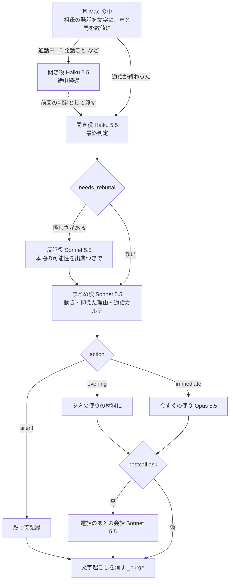
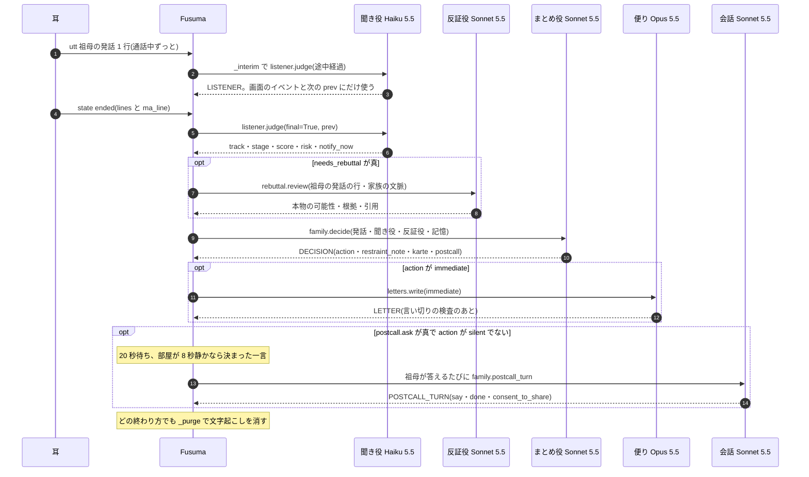
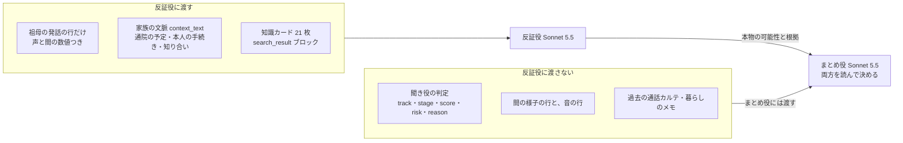
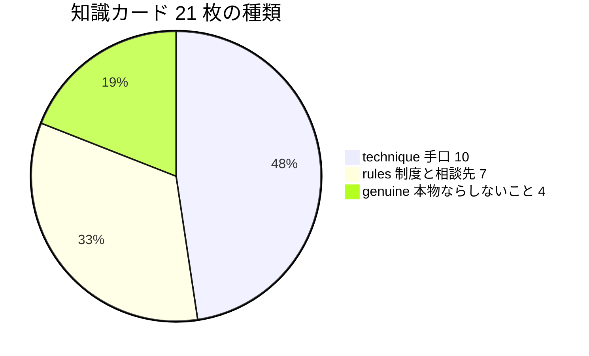
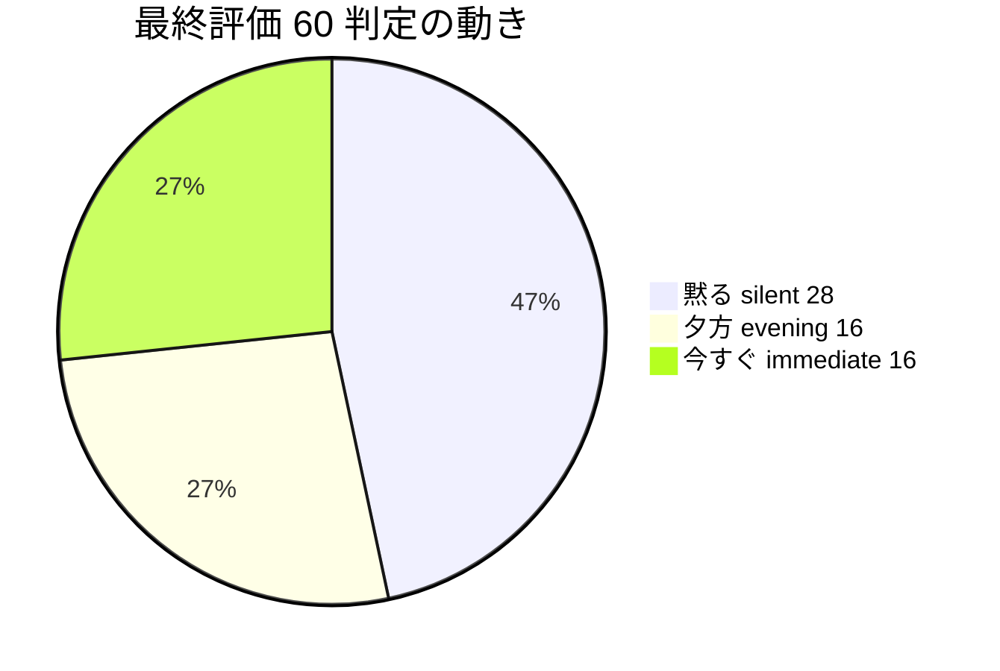
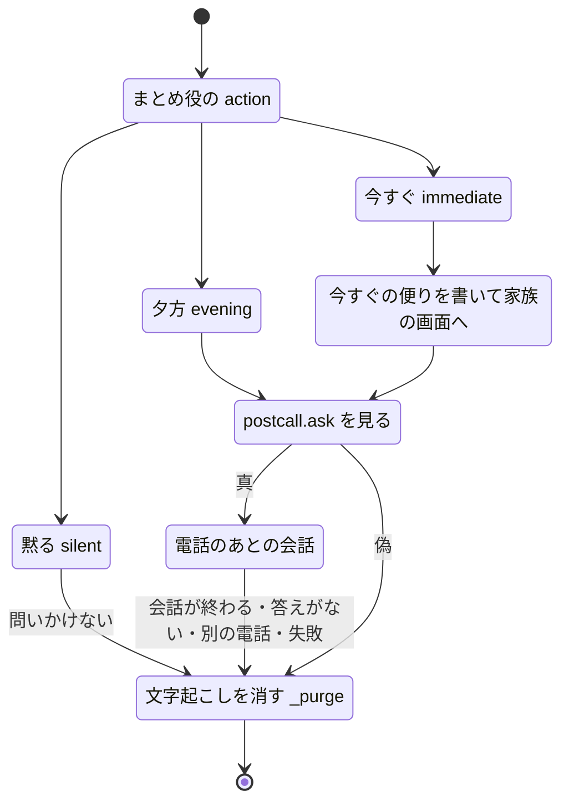
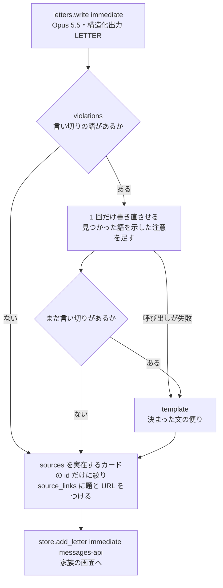
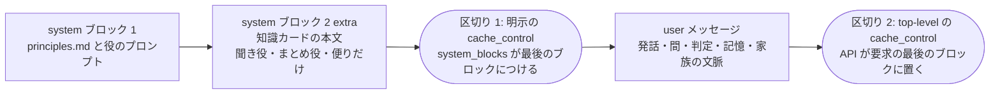
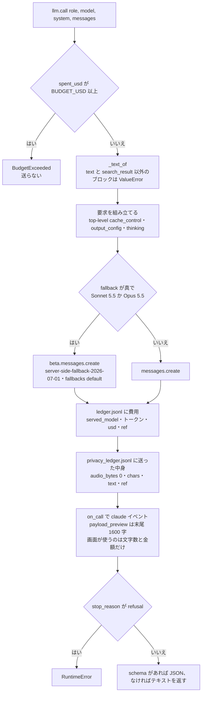

# 脳 — Claude の家族会議

## 3 行で

- 電話が終わると、役割の違う Claude が順に考えます。**聞き役**が話の流れを読み、**反証役**が(怪しさがあるときだけ)「本物の電話かもしれない理由」を公的機関などの資料(知識カード)から探し、**まとめ役**が「黙る/夕方の便り/今すぐ家族へ」を決めて、抑えた理由を書き残します。
- Claude に渡すのはテキストだけです(祖母の言葉を文字にしたもの、声や「間」の数値、家族の文脈、前の電話の記録、暮らしのメモ)。音声は送りません。送った中身は台帳に残り、電話のあとの聞き取りが終わると(答えがないときや途中で失敗したときも)、その通話の分は台帳でも伏せます。
- まとめ役への決まりでは、家族にすぐ知らせるのは、今日のうちにお金やカードが動く・知らない人が訪ねてくる・口止め、のどれかが祖母の言葉から読めるときだけです。架空の 15 通話を 4 回流した評価では、動きは 60 回すべて期待どおり、本物の電話への誤警報は 0 回でした。

---

ここから先はエンジニア向け。対象のコードは [`app/fusuma/orchestrator.py`](../../app/fusuma/orchestrator.py) と [`app/fusuma/brain/`](../../app/fusuma/brain)。夕方の便り(Claude Managed Agents)は [managed-agents.md](managed-agents.md) に分けた。登場する通話・人物・会社名・住所はすべて架空。

## 全体の流れ




- 役どうしは会話を共有しない。前の役の出力を、次の役の user メッセージに書き写して渡す。反証役にだけは聞き役の出力を渡さない(後述)。
- 通話中に脳の出力が使われるのは、画面のイベントと次の判定の材料だけ。端末が声を出す経路は `Fusuma.say()` だけで、通話中に呼ぶと `SilenceViolation` で止まる。

## 役とモデル

| 役(台帳の `role`) | 関数 | モデル([`config.py`](../../app/fusuma/config.py)) | effort | thinking | 出力 | max_tokens | fallbacks | 呼ばれるとき |
|---|---|---|---|---|---|---|---|---|
| 聞き役 `listener` | `listener.judge()` | `MODEL_LISTENER` = `claude-haiku-5-5` | low | disabled | 構造化出力 `LISTENER` | 1500 | なし | 通話中の途中経過と、通話終了時の最終判定 |
| 反証役 `rebuttal` | `rebuttal.review()` | `MODEL_REBUTTAL` = `claude-sonnet-5-5` | medium | 指定なし | 1 行 1 項目のテキスト + Citations | 2500 | `"default"` | 通話終了後、`needs_rebuttal()` が真のとき |
| まとめ役 `family` | `family.decide()` | `MODEL_FAMILY` = `claude-sonnet-5-5` | medium | 指定なし | 構造化出力 `DECISION` | 3000 | `"default"` | 通話終了後、祖母の発話がある通話で毎回 |
| 電話のあとの会話 `postcall` | `family.postcall_turn()` | `MODEL_FAMILY` = `claude-sonnet-5-5` | low | 指定なし | 構造化出力 `POSTCALL_TURN` | 800 | `"default"` | 電話のあと、祖母が答えるたび |
| 便り `letter` | `letters.write()` | `MODEL_LETTER` = `claude-opus-5-5` | medium | 指定なし | 構造化出力 `LETTER` | 2500 | `"default"` | `action` が `immediate` のとき。Messages API 版の夕方の便り(`POST /api/letter` の `via: "messages"`)も |
| 暮らしのメモ `memo` | `family.extract_memo()` | `MODEL_LISTENER` = `claude-haiku-5-5` | low | disabled | 構造化出力 `LIFE_MEMO` | 800 | なし | 暮らしの話からメモを作るとき(今は下準備の [`run_call.py`](../../app/scripts/run_call.py) だけ) |

- 判断を担うのは聞き役・反証役・まとめ役の 3 役。電話のあとの会話と便りは、その判断を受けて動く。
- thinking の「指定なし」は、`thinking` を送らずモデルの既定に任せるという意味。
- モデルは環境変数 `FUSUMA_MODEL_LISTENER` / `FUSUMA_MODEL_REBUTTAL` / `FUSUMA_MODEL_FAMILY` / `FUSUMA_MODEL_LETTER` で差し替えられる。server-side fallbacks は、モデルが `claude-sonnet-5-5` か `claude-opus-5-5` のときだけつく。
- 選んだ理由は `config.py` のコメントにある。聞き役は「通話中に何度も呼ぶ。速く安く、構造化出力」、反証役は「独立文脈で『本物の可能性』。出典つき」、まとめ役は「判断の統合・カルテ・電話のあとの会話」、便りは「今すぐの便り(Messages API)。夕方の便りは Managed Agents の Sonnet 5.5」。

## いつ呼ばれるか



### 通話中 — 聞き役の途中経過

`Fusuma.on_ear()` は祖母の発話(`utt`)が届くたびに、次の条件で `_interim()` を別スレッドで呼ぶ。

```python
n_new = len(st["utts"]) - st["last_judge_n"]
if not st["busy"] and (n_new >= config.LISTENER_EVERY_UTTS or
                       (n_new >= 3 and time.time() - st["last_judge_t"] >= config.LISTENER_EVERY_SEC)):
    st["busy"] = True
    self._bg(self._interim, ev["call_id"])
```

- `LISTENER_EVERY_UTTS = 10`、`LISTENER_EVERY_SEC = 60`。新しい発話が 10 たまるか、前の判定(1 回目は、耳が呼出・発信・通話中を知らせてその通話の記録を始めたとき)から 60 秒たって新しい発話が 3 つ以上あれば呼ぶ。前の途中経過を待っているあいだ(`busy`)は呼ばない。
- 入力は、ここまでの祖母の発話の行(`[音]` の行は入らない)と、最後の発話までの `[間の様子]`(`ma.summary_line()`)、前回の判定。
- 結果は画面のイベント(`listener`、`final: false`)と、次の判定の `prev` にだけ使う。

### 通話の終わり — `Fusuma._finalize()`

1. 祖母の発話の行(`祖母「` を含む行)がなければ、`silent`「発話なし」としてすぐ文字起こしを消す。
2. 聞き役の最終判定。`listener.judge(ev["lines"], ma_line, prev=最後の途中経過, final=True)`。
3. `needs_rebuttal()` が真なら反証役。`rebuttal.review(祖母の発話の行, store.context_text())`。
4. まとめ役。`family.decide(call, 聞き役, 反証役, store)`。返ってきた `karte` に通話 ID・日時・向きを足して SQLite に保存する。
5. `action == "immediate"` なら `letters.write("immediate", ...)`。書けなかったときはエラーを画面に出し、電話のあとの声かけは続ける。
6. `postcall.ask` が真で、かつ `action != "silent"` なら、`POST_CALL_DELAY_SEC`(既定 20 秒)後に `start_dialog()`。そうでなければ `_purge()`。同期モード(`Fusuma(sync=True)`。下準備の `run_call.py`)では会話をせずに `_purge()` する。
7. 途中で例外が出たら(予算切れ・API のエラー・refusal など)、エラーを画面に出して `_purge()`。失敗しても文字起こしは残さない(`test_finalize_error_still_purges`)。

### 反証役を呼ぶ条件 — `needs_rebuttal()`

```python
def needs_rebuttal(lo: dict) -> bool:
    """反証役(本物の可能性を独立に考える役)を呼ぶか。種類が分からない電話でも、怪しさがあれば呼ぶ。"""
    return lo.get("track") in ("scam", "solicitation", "unknown") and (lo.get("risk") != "low" or lo.get("score", 0) >= 0.3)
```

- 普通の電話(`normal`)では呼ばない。`risk` が low でも `score` が 0.3 以上なら呼ぶ。
- 最終評価では、はっきり断った勧誘 S00 と自分でかけた通販 S08 がこの境目にあり、`score` 0.35 の回は呼び、0.25 の回は呼ばなかった。60 判定のうち反証役を呼んだのは 38 回(4 回それぞれ 9・9・10・10 回)。

### かかる時間

評価の記録(`eval/result_v6*.json` の `sec`。`run_eval.py` は通話を並列に流す)では、1 通話の脳の処理(聞き役の最終判定 → 反証役 → まとめ役)にかかった時間は次のとおり。

| | 回数 | 最短 | 最長 | 中央値 |
|---|---|---|---|---|
| 反証役を呼んだ | 38 | 16.6 秒 | 27.6 秒 | 20.35 秒 |
| 呼ばなかった | 22 | 6.8 秒 | 12.6 秒 | 9.2 秒 |

電話のあとの最初の一言は、判断のあと(今すぐの便りを書くときは書き終えてから)`POST_CALL_DELAY_SEC`(20 秒)待ち、部屋が `QUIET_BEFORE_OPENER_SEC`(8 秒)静かなのを確かめてから言う。電話中・別の会話の最中・部屋が静かでないときは同じ間隔で待ち直し、20 回待ち直してもだめなら聞かずに文字起こしを消す。待つあいだにもっと新しい電話が終わっていたら、古い方の電話は聞かずに消す(どちらも `start_dialog()`)。

## 入力 — 耳が作るテキスト

通話について Claude が受け取るのは、耳([`app/fusuma/ear/`](../../app/fusuma/ear))が作ったテキストだけ(音声は送らない)。同梱の [`eval/ear_cache/ear_S05.json`](../../eval/ear_cache/ear_S05.json)(健康食品の電話勧誘・2 回目。デモの通話)の `lines` と `ma_line` から抜粋する(全 18 発話のうち 10 発話)。

```text
14:03:00 [音] 受話器を上げる音
14:03:00 祖母「はい、もしもし。」 間0.3s 声高-6% 声量-4dB 話速+1%
14:03:04 祖母「ああ、春風健康さん、先週もお電話くださったわね。」 間2.8s 声高-25% 声量-2dB 話速+7%
14:03:14 祖母「ええ、膝がね、最近ちょっと痛くて。」 間6.3s 声高-19% 声量-5dB 話速+1%
14:03:33 祖母「今日中なら半額なんですか?」 間6.9s 声高+7% 声量-6dB 話速-16%
14:03:41 祖母「はい。」(あいづち 0.3s)
14:03:50 祖母「でも、息子に聞いてみないと。」 間8.9s 声高-17% 声量-4dB 話速-12%
14:04:11 祖母「毎月届くんですか?」 間7.9s 声高+5% 声量-7dB 話速+6%
14:04:20 祖母「最初は4980円。」 間5.9s 声高+7% 声量-6dB 話速-22%
14:04:38 祖母「じゃあお願いします。」 間6.8s 声高-25% 声量-7dB 話速-14%
14:04:49 祖母「お支払いは、届いたときに」 間3.8s 声高-16% 声量-7dB 話速-9%
14:04:59 [音] 受話器を置く音
[間の様子 14:04:59] / 祖母が話していた時間 28% / 相手が話していたと推定される時間 72% / 最長の沈黙 8.9s / 5秒以上の沈黙 9回 / 「はい」の連続 最大1 / 断りの語 前半1→後半0 / 声量の変化 -1.4dB
```

読み方は、Messages API で呼ぶすべての役の system に入る [`principles.md`](../../app/fusuma/brain/prompts/principles.md) の「入力の読み方」に書いてある。

- 1 行 1 発話。`間` は直前の沈黙で、多くの場合は相手が話していた時間。`声高` `声量` `話速` は「いつもの声」との差。
- `(あいづち 0.3s)` は短い「はい/ええ/うん」など。プロンプトでは「0.6 秒未満」と説明し、耳の `prosody.is_backchannel()` は、前後の句読点やかぎかっこを除いて 4 文字以内で `config.BACKCHANNEL_WORDS` のどれかで始まり、長さが `BACKCHANNEL_MAX_SEC`(0.6 秒)+ VAD の前後の余白 0.15 秒未満の発話をあいづちにする。同意とは数えない。
- `[間の様子]` は通話全体の形(祖母が話していた割合、最長の沈黙、「はい」の連続、断りの語の前半→後半)。
- 音声認識の誤りがありうる。文脈から読み替えてよいが、読み替えたことは根拠に書く。実例: S03 の「封筒に入れて」は「空筒に入れて」と文字になり、まとめ役は `why` に「(「空筒」は聞き違いと読み替えた推測)」と書いた(`eval/result_v6.json`)。

相手の声は聞かないので、入力に相手の台詞はない。台本 [`app/scenarios/scenarios.json`](../../app/scenarios/scenarios.json) も祖母の発話だけで、各行の最初の数字が「直前の沈黙 = 相手が話している時間」になっている。

## 出力 — 構造化出力とスキーマ

反証役以外の 5 つの呼び出しは構造化出力を使う。`llm.call(..., schema=...)` は `output_config={"format": {"type": "json_schema", "schema": schema}, "effort": ...}` をつけて送り、最初の text ブロックを `json.loads()` して返す。スキーマは [`app/fusuma/brain/schemas.py`](../../app/fusuma/brain/schemas.py) にあり、構造化出力の制約に合わせて、すべてのオブジェクトを `additionalProperties: false`・全項目 `required` にしている。値がないことは `null` との `anyOf` で表す。

```python
# schemas.py(抜粋。一部を 1 行にまとめた)
def N(t: dict) -> dict:
    return {"anyOf": [t, {"type": "null"}]}

def obj(props: dict, required: list[str] | None = None) -> dict:
    return {"type": "object", "additionalProperties": False, "required": required or list(props), "properties": props}

STAGES = ["なし", "接触", "信頼形成", "要求", "約束", "口止め", "案内", "強い勧め", "申込の約束", "支払い・定期購入の約束"]

LISTENER = obj({
    "track": {"enum": ["scam", "solicitation", "normal", "unknown"]},
    "stage": {"enum": STAGES},
    "score": NUM,
    "risk": RISK,
    "speech_acts": arr(obj({"t": S, "kind": {"enum": ["disclosure", "promise", "repeat", "pushed_over", "refusal", "backchannel"]}, "text": S})),
    "evidence": arr(obj({"t": S, "note": S})),
    "claimed_caller": N(S), "product": N(S),
    "money": N(obj({"amount": N(NUM), "method": N(S)})),
    "subscription": B, "deadline": N(S), "visit": N(S), "secrecy": B,
    "disclosed": arr(S), "notify_now": B, "reason": S, "to_ask": arr(S),
})
```

| スキーマ | 使う呼び出し | 項目 |
|---|---|---|
| `LISTENER` | 聞き役 | track・stage・score・risk・speech_acts・evidence・claimed_caller・product・money・subscription・deadline・visit・secrecy・disclosed・notify_now・reason・to_ask |
| `DECISION` | まとめ役 | action・headline・why・restraint_note・karte(`KARTE`)・postcall(ask・opener・share_consent_needed) |
| `KARTE` | まとめ役(`DECISION.karte`) | caller_claimed・caller_normalized・category・product・amount・subscription・request・deadline・secrecy・response・stage_max・risk・risk_reason・linked_calls・storyline・life_link・contract・to_ask |
| `POSTCALL_TURN` | 電話のあとの会話 | say・intent・done・consent_to_share・told・diff |
| `LIFE_MEMO` | 暮らしのメモ | items(kind・text・said・secret) |
| `LETTER` | 便り | urgency・title・daily・calls(summary・risk・why)・suggested_talk・deadline・consult・sources・closing |

スキーマで縛れないことはコードで補う。

- `listener.judge()` は `score` を 0〜1 の範囲に収める(スキーマには数値の範囲を書いていない)。
- `listener.normalize()` は段階とトラックの食い違いを直す。docstring のとおり「構造化出力でも意味の整合は保証されないため」。
- 夕方の便り(Managed Agents)の `letter.json` は構造化出力ではない。同じキーの形をスキルで指示し、採点役のルーブリックでキーを確かめる([managed-agents.md](managed-agents.md))。

## 聞き役 — `listener.judge()`

```python
def judge(lines: list[str], ma_line: str = "", prev: dict | None = None, final: bool = False) -> dict:
    head = "【通話が終わりました。最終判定】" if final else "【通話の途中経過】"
    parts = [head, "祖母の発話(時刻順):", *lines]
    if ma_line:
        parts += ["", ma_line]
    if prev:
        keep = {k: prev.get(k) for k in ("track", "stage", "score", "risk", "claimed_caller", "product", "notify_now")}
        parts += ["", "前回の判定: " + json.dumps(keep, ensure_ascii=False)]
    out, _ = llm.call("listener", config.MODEL_LISTENER, _system(),
                      [{"role": "user", "content": "\n".join(parts)}],
                      max_tokens=1500, schema=schemas.LISTENER, effort="low", thinking={"type": "disabled"})
    out["score"] = max(0.0, min(1.0, float(out.get("score", 0))))
    return normalize(out)
```

- system は `principles.md` + `listener.md` と、知識カードのうち technique と rules の 17 枚(本文のテキスト)。
- [`listener.md`](../../app/fusuma/brain/prompts/listener.md) の要点:
  - 2 つのトラックで追う。詐欺(scam)は 接触 → 信頼形成 → 要求 → 約束 → 口止め。勧誘・契約(solicitation)は 案内 → 強い勧め → 申込の約束 → 支払い・定期購入の約束。普通の電話は normal / なし。
  - 発話行為は disclosure(開示)・promise(約束)・repeat(復唱)・pushed_over(押し切られ)・refusal(断り)・backchannel(あいづち)。あいづちは同意と数えない。
  - 「警察」「銀行」という言葉だけで上げない。お金・カード・暗証番号・訪問・口止めの要求が祖母の発話に現れて初めて上げる。
  - はっきり断って終えた勧誘で、お金・訪問・口止め・開示がなければ risk=low(score 0.3 未満)。
  - `notify_now` は 3 つのときだけ真: 詐欺でお金・カード・暗証番号が動きそう/知らない相手の訪問を約束した/口止めに同意した。勧誘で契約したときは、クーリング・オフの時間があるので通常は偽。
- `normalize()` は、track が solicitation なのに勧誘以外の段階(詐欺の段階や「なし」)が返ったら、「約束」「口止め」で発話行為に promise があるときは「申込の約束」に、それ以外は「案内」に寄せる。track が scam なのに詐欺以外の段階が返ったら、強い勧め→要求、申込の約束と支払い・定期購入の約束→約束、それ以外(案内・なし)→接触 に寄せる。normal は「なし」にする。unknown は直さない。

S05 の最終判定(`eval/result_v6.json`、一部の項目と要素を省略):

```json
{
 "track": "solicitation",
 "stage": "支払い・定期購入の約束",
 "score": 0.85,
 "risk": "high",
 "speech_acts": [
  {"t": "14:03:50", "kind": "refusal", "text": "でも、息子に聞いてみないと。"},
  {"t": "14:04:28", "kind": "pushed_over", "text": "解約はいつでもできるんですね。"},
  {"t": "14:04:38", "kind": "promise", "text": "じゃあお願いします。"},
  {"t": "14:04:49", "kind": "promise", "text": "お支払いは、届いたときに"}
 ],
 "evidence": [
  {"t": "14:04:38", "note": "長い沈黙(6.8s)のあと、息子への相談を経ずに承諾"}
 ],
 "claimed_caller": "春風健康",
 "product": "グルコサミン",
 "money": {"amount": 4980, "method": "届いたときに支払い"},
 "subscription": true,
 "deadline": "今日中",
 "visit": null,
 "secrecy": false,
 "notify_now": false
}
```

`notify_now` はまとめ役への材料で、端末はこれだけでは動かない(画面 [`app.js`](../../app/web/js/app.js) の判定の聞き役の列に「今すぐ家族へ 知らせる / 知らせない」と出るだけ)。今すぐの便りを出すのは、まとめ役の `action` が `immediate` のときだけ。実例: S09(屋根の無料点検・訪問の約束)は v6 の 1 回目で聞き役が `notify_now: false` だった(2〜4 回目は true)が、まとめ役は 4 回とも、知らない人が明日訪ねてくる約束を理由に `immediate` にした(1 回目の `restraint_note` は「抑制の判断」の表)。

## 反証役 — `rebuttal.review()`

### 聞き役の結論を渡さない理由

[`rebuttal.md`](../../app/fusuma/brain/prompts/rebuttal.md) は役目をこう書いている。

> あなたは「反証役」です。ほかの判定は知らされません(先入観を避けるため)。祖母の発話列と家族の文脈だけを見て、**この電話が本物・正当なものである可能性**を独立に検討します。誤った心配で祖母と家族の信頼を壊さないための役目です。

[`docs/design.md`](../design.md) でも、判断を一つの AI に任せる案を「先入観に引っ張られる。本物の可能性を独立に考える役が要る」として採らなかった。

独立はプロンプトの約束だけでなく、関数の形で決まっている。`rebuttal.review(lines, context_text)` の引数は祖母の発話と家族の文脈だけで、聞き役の出力を受け取る口がない。聞き役(Haiku 5.5)とはモデルも要求も別で、会話は共有しない。



- 家族の文脈は [`store.py`](../../app/fusuma/store.py) の `DEFAULT_CONTEXT`(例:「先月、自転車の盗難届を警察署に出した」「11月10日(月)10:00 みどり整形外科の予約(膝)」)。プロンプトは、文脈と一致する点を本物らしさの根拠にしてよいとしている。
- 呼ぶかどうかは聞き役の結果で決まるので、呼ばれたこと自体は「怪しさがあった」ことを意味する。ただし反証役が受け取る問いは「この電話が本物・正当なものである可能性を検討し、指定の形式で答えてください」だけ。

### Citations — 知識カードを search_result で渡す

```python
def review(lines: list[str], context_text: str) -> dict:
    cards = knowledge.by_kind("genuine", "technique", "rules")
    user_content = knowledge.as_search_results(cards) + [{
        "type": "text",
        "text": "家族の文脈(本人の予定・手続き・知り合い):\n" + context_text +
                "\n\n祖母の発話(時刻順。相手の声は聞いていない):\n" + "\n".join(lines) +
                "\n\nこの電話が本物・正当なものである可能性を検討し、指定の形式で答えてください。",
    }]
    text, resp = llm.call("rebuttal", config.MODEL_REBUTTAL, llm.system_blocks("principles", "rebuttal"),
                          [{"role": "user", "content": user_content}], max_tokens=2500, effort="medium", fallback=True)
    return parse(resp)
```

```python
# knowledge.py
def as_search_results(cs: list[dict]) -> list[dict]:
    return [{
        "type": "search_result",
        "source": c["source_url"],
        "title": f"{c['title']}({c['source_name']}、{c['checked']} 確認)",
        "content": [{"type": "text", "text": c["text"]}],
        "citations": {"enabled": True},
    } for c in cs]
```

- 21 枚のカードを 1 枚 1 ブロックの `search_result` にして user メッセージの先頭に並べ、最後に家族の文脈と祖母の発話の text ブロックを置く。
- Claude がカードを根拠に書いた部分には、応答の text ブロックに `search_result_location` 型の引用がつく。カード 1 枚の本文を 1 つの text ブロックで渡しているので、`cited_text` はカードの本文まるごとになっていた(最終評価で反証役を呼んだ 38 回に、`parse()` が項目に付けた引用は 184 件。どれも `cited_text` がカードの `text` と同じ)。
- 反証役だけ構造化出力を使わないのは、Claude API の仕様で Citations と構造化出力(`output_config.format`)を同じ要求で使えないため。代わりに `rebuttal.md` で 1 行 1 項目の形を決め、`parse()` で引用ごと構造化する。

```text
本物の可能性: 低|中|高
別の説明: (詐欺以外の説明。なければ「なし」)
本物らしい点: (1 行に 1 つ。複数行可)
本物らしくない点: (1 行に 1 つ。複数行可)
確かめ方: (1〜2 文)
```

### 応答を項目に分ける — `rebuttal.parse()`

- 応答の text ブロックを改行で行に組み立て直し、行頭の見出し(本物の可能性・別の説明・本物らしい点・本物らしくない点・確かめ方)で項目を決める。見出しのない行は直前の項目の続き(複数行の箇条)として扱う。
- その行にかかった引用(`source`・`title`・`cited_text`)をまとめてつける。同じ `cited_text` は 1 つにまとめる。
- 「本物の可能性」は先頭の 1 文字(低・中・高)で `low` / `medium` / `high` にする。読めなければ `medium`。
- `citations` には、本物らしい点・らしくない点の引用を出典(`source`)ごとに 1 件残す。確かめ方の引用は `verify_cites` に入る。

S05 の実際の応答(`raw` の抜粋)と、`parse()` の結果(抜粋):

```text
本物の可能性: 中
別の説明: 祖母さんが「先週もお電話くださった」と受け止めており、健康食品(グルコサミン)の通常の電話勧誘販売(定期購入つき)の可能性がある。…
本物らしい点:
14:03:04「春風健康さん、先週もお電話くださったわね」。祖母さんが相手の社名を認識しており、名乗りがあったと読める…
14:04:49「お支払いは、届いたときに」。お金やカードの番号を先に渡すものではなく、後払いのように聞こえる。…
本物らしくない点:
14:03:33「今日中なら半額」「今日だけなんですね」。期限で決断を急がせる言い方に読める。…
14:04:11〜14:04:20「毎月届くんですか?定期で。最初は4980円」。定期購入への切り替えは、1回限りのつもりで申し込んでしまう相談が高齢者で見られる型に近い。…
確かめ方: 電話のあと、誠さんか健太さんに「健康食品の電話で定期購入を頼んだ」と一度話し、事業者名、2回目以降の値段、解約条件を手元の書面で確かめる。…
```

```json
{
 "genuine_likelihood": "medium",
 "for_genuine": [
  {"text": "14:03:04「春風健康さん、先週もお電話くださったわね」。祖母さんが相手の社名を認識しており、名乗りがあったと読める…",
   "cites": [{"source": "https://www.no-trouble.caa.go.jp/what/telemarketing/",
              "title": "電話勧誘の名乗り義務と再勧誘の禁止(消費者庁 特定商取引法ガイド「電話勧誘販売」、2026-11-05 確認)",
              "cited_text": "事業者は電話勧誘販売をしようとするとき、勧誘に先立って、…"}]}
 ],
 "against_genuine": [
  {"text": "14:04:11〜14:04:20「毎月届くんですか?定期で。最初は4980円」。…",
   "cites": [{"source": "https://www.kokusen.go.jp/news/data/n-20221130_2.html",
              "title": "電話注文で意図せず定期購入に(国民生活センター「テレビショッピングなどをみて電話で注文したら、意図せず『定期購入』に!?」…)",
              "cited_text": "テレビショッピングや新聞広告を見て販売業者に電話で注文した際、…"}]}
 ]
}
```

聞き役は同じ通話を risk=high(score 0.85)と読み、反証役は本物の可能性を「中」(通常の電話勧誘販売の可能性)とした。この 2 つを突き合わせるのがまとめ役の仕事になる。

## 知識カード 21 枚

[`app/knowledge/cards.json`](../../app/knowledge/cards.json) の 21 枚が、手口・制度・数字の唯一の根拠(原則「事実を作らない」)。どのカードも `id`・`kind`・`title`・`text`(要約)・`source_url`・`source_name`・`checked`(確認日。21 枚とも 2026-11-05)・`design_note` を持つ。



| id | 種類 | 題 | 出典 |
|---|---|---|---|
| `rules-cooling-off-telephone` | rules | 電話勧誘販売のクーリング・オフ | 消費者庁 |
| `rules-cooling-off-door-to-door` | rules | 訪問販売のクーリング・オフと再勧誘の禁止 | 消費者庁 |
| `rules-mail-order-no-cooling-off` | rules | 通信販売にはクーリング・オフがない（返品特約） | 国民生活センター |
| `rules-hotline-188` | rules | 消費者ホットライン188 | 消費者庁 |
| `rules-subscription-phone-order` | rules | 電話注文で意図せず定期購入に | 国民生活センター |
| `rules-telemarketing-no-resolicit` | rules | 電話勧誘の名乗り義務と再勧誘の禁止 | 消費者庁 |
| `rules-unsolicited-goods` | rules | 注文していない商品が届いたとき（送り付け） | 消費者庁 |
| `technique-health-food-telemarketing` | technique | 健康食品のしつこい電話勧誘 | 国民生活センター |
| `technique-cash-card-theft` | technique | キャッシュカード詐欺盗（すり替え） | 警察庁 |
| `technique-refund-fraud` | technique | 還付金詐欺（ATMへ誘導） | 警察庁 |
| `technique-oreore` | technique | オレオレ詐欺（家族を名乗る） | 警察庁 |
| `technique-fictitious-billing` | technique | 架空料金請求詐欺 | 警察庁 |
| `technique-fake-police` | technique | ニセ警察詐欺 | 警察庁 |
| `technique-hikari-telemarketing` | technique | 光回線の電話勧誘トラブル | 国民生活センター |
| `technique-seafood-telemarketing` | technique | 海産物の強引な電話勧誘・送り付け | 国民生活センター |
| `technique-secondary-damage` | technique | 被害回復をうたう二次被害 | 消費者庁 |
| `technique-inspection-reform` | technique | 屋根工事などの点検商法 | 国民生活センター |
| `genuine-officials-no-pin-card` | genuine | 自治体や銀行協会の職員は暗証番号を聞かない | 警察庁 |
| `genuine-refund-no-atm` | genuine | ATMでお金が返ってくることはない | 警察庁 |
| `genuine-police-no-phone-investigation` | genuine | 本物の警察は電話で取り調べをしない | 警察庁 |
| `genuine-call-back-official-number` | genuine | 名乗った組織へは自分で調べた番号で確認する | 全国銀行協会 |

渡し方は役ごとに違う([`app/fusuma/brain/knowledge.py`](../../app/fusuma/brain/knowledge.py))。

| 役 | カード | 形 | 関数 |
|---|---|---|---|
| 聞き役 | technique・rules の 17 枚 | system の本文(id・題・本文の箇条) | `as_text()` |
| 反証役 | 21 枚 | user の `search_result` ブロック(Citations) | `as_search_results()` |
| まとめ役・便り | 21 枚 | system の本文 | `as_text()` |
| 夕方の便り係(Managed Agents) | 21 枚 | スキルの `cards.md`(同じ id が同じ順) | — |

- `by_kind()` は指定した種類の順ではなく、ファイルの順に返す。同じ役なら毎回同じカードが同じ並びになり、system の固定部は呼び出しごとに変わらない(キャッシュの前提)。
- `design_note`(どんな発話や場面でそのカードを使うかの開発メモ)は Claude に渡さない(`as_text()` も `as_search_results()` も使わない)。
- 便りの `sources` は `knowledge.card(id)` で実在するカードだけに絞る(後述)。

## まとめ役 — `family.decide()`

### 入力

`family.decide()` が組み立てる user メッセージの中身:

| 項目 | 出どころ |
|---|---|
| 通話 ID・開始時刻・着信/発信・秒数 | 耳の `ended` イベント |
| 祖母の発話(`[音]` の行も含む全行)と `[間の様子]` | 同上 |
| 聞き役の最終判定(JSON をそのまま) | `listener.judge(final=True)` |
| 反証役の意見: `genuine_likelihood`・`alternative`・`how_to_verify` と、本物らしい点/らしくない点の本文(引用は渡さない)。呼ばなかったときは「(反証役は呼ばなかった: 聞き役の判定で、怪しさが低かった)」 | `rebuttal.review()` |
| 過去の通話カルテ(この通話を除き、新しい順に最大 12 件の要約) | `Store.karte_digest()` |
| 暮らしのメモ(内緒でないもの。新しい順に最大 50 件) | `Store.memo_digest()` |
| 家族の文脈 | `Store.context_text()` |

system は `principles.md` + `family.md` と知識カード 21 枚。Sonnet 5.5、effort medium、構造化出力 `DECISION`、max_tokens 3000、server-side fallbacks つき。

### 出力 — `DECISION` と `KARTE`

```python
# schemas.py(抜粋。一部を 1 行にまとめた)
KARTE = obj({
    "caller_claimed": S, "caller_normalized": S,
    "category": {"enum": ["scam", "solicitation", "acquaintance", "public_office", "unknown"]},
    "product": N(S), "amount": N(NUM), "subscription": N(B), "request": N(S), "deadline": N(S), "secrecy": B,
    "response": {"enum": ["refused", "promised", "disclosed", "undecided", "unknown"]},
    "stage_max": {"enum": STAGES},
    "risk": RISK, "risk_reason": S,
    "linked_calls": arr(S), "storyline": N(S), "life_link": N(S),
    "contract": N(obj({
        "type": {"enum": ["telephone_solicitation", "door_to_door", "purchase_visit", "mail_order", "other"]},
        "document_received": N(S),
        "cooling_off_note": S,
    })),
    "to_ask": arr(S),
})

DECISION = obj({
    "action": {"enum": ["silent", "evening", "immediate"]},
    "headline": S,
    "why": S,
    "restraint_note": S,
    "karte": KARTE,
    "postcall": obj({"ask": B, "opener": S, "share_consent_needed": B}),
})
```

[`family.md`](../../app/fusuma/brain/prompts/family.md) のカルテの決まり:

- 1 通話 1 枚。祖母の発話から言えることだけ。相手の台詞は作らない。
- 過去のカルテと同じ名乗り・同じ商品なら `linked_calls` に ID を入れ、`storyline` に時系列で書く。暮らしのメモとつながれば `life_link` に書く(診断めいたことは書かない)。
- 勧誘で契約の約束をしたら `contract` を埋める。クーリング・オフは日付を計算せず、カードの文言どおり「書面を受け取った日から数えて8日以内」と書く。
- `to_ask` は電話のあとに 1 つずつ自然に聞けること(最大 2 つ)。

S05 の出力(`eval/result_v6.json`、一部の項目を省略):

```json
{
 "action": "evening",
 "headline": "健康食品(グルコサミン)の定期購入を電話で承諾し、住所も伝えた。夕方の便りで家族に知らせたい",
 "restraint_note": "お金もカードも今日は動かず、取り消せる段階なので急がず夕方の便りで足りる。",
 "karte": {
  "caller_normalized": "春風健康(健康食品の販売業者を名乗る)",
  "category": "solicitation",
  "product": "グルコサミン(健康食品)",
  "amount": 4980,
  "subscription": true,
  "response": "promised",
  "stage_max": "支払い・定期購入の約束",
  "risk": "high",
  "linked_calls": [],
  "life_link": "14:03:14「膝がね、最近ちょっと痛くて」と自分から話しており、膝の不安に沿った商品の話だった。11月10日(月)10:00にはみどり整形外科の予約がある。",
  "contract": {
   "type": "telephone_solicitation",
   "document_received": null,
   "cooling_off_note": "電話での勧誘で購入を決めたなら電話勧誘販売にあたり、法律で決められた書面を受け取った日から数えて8日以内なら、書面または電磁的記録でクーリング・オフができる。…"
  }
 },
 "postcall": {"ask": true, "opener": "そういえば、さっきの電話、なんだったの?", "share_consent_needed": true}
}
```

- 評価は記憶が空の `Store`(家族の文脈だけ)で流すので、`linked_calls` は空になる。デモでは下準備の `run_call.py --reset S00 R01` で 7 日前の 1 回目の電話(S00)と 2 日前の夕方のおしゃべり(R01)を記憶に積んでから S05 を流すので、まとめ役は前の電話とのつながりと暮らしのメモをカルテに書ける。最新の収録 v4 のカルテは `linked_calls` に 10/30 の電話を入れ、`storyline` に「7日前(10/30)にも同じ名乗りで膝のサプリの電話があり、そのときは祖母が「結構です」と断って自分から切っていた。…」、`life_link` に「11/4に「膝が痛くて階段がつらい」と話していた。…」と書いた。画面はこれを左の「照合」の欄(※1 前の電話・※2 おしゃべり)と、つながる発話の ※ 番号で見せる([how-it-works.md](how-it-works.md) の「画面」の写真)。
- 端末は返ってきた `karte` に `call_id`・`datetime`・`direction` を足して保存する。`action` はそのまま使い、コードで上書きしない。
- `postcall.opener` は使わない。電話のあとの最初の一言は、端末が `config.POSTCALL_OPENER`(「そういえば、さっきの電話、なんだったの？」)を言う。聞き取った中身を先に言わず、本人に話してもらうため。

## 抑制の判断 — 黙る/夕方/今すぐ

まとめ役は `action` を 3 つから選び、選んだ理由を `restraint_note` に一文で書く。決まりは [`family.md`](../../app/fusuma/brain/prompts/family.md) のこの部分(原文のまま):

> - `silent`: 何もしない。普通の電話。記録は最小限。
> - `evening`: 夕方の便り(18:00)に載せる。電話のあとに自然な一言で様子を聞く。
> - `immediate`: 家族にすぐ便りを送る。今日のうちにお金やカードが動く(振込・ATM・現金やカードを渡す・取りに来る)、知らない人が訪ねてくる約束、口止め — のどれかが祖母の発話から読めるとき。
>   商品の申込・代金引換や後払いの約束・住所を伝えたことだけなら、お金はまだ動いていない。クーリング・オフなどで取り消せる段階なら `evening`(夕方の便りを読んだ家族が電話して、一緒に確かめれば間に合う)。
>
> 迷ったら軽い方を選ぶ。ただし安全(お金・訪問・口止め)に関わるときは急ぐ。
>
> 祖母がはっきり断って終えた勧誘で、お金・訪問・口止め・個人情報の開示がないものは `silent`(カルテには残すので、同じ相手からまた電話があれば気づける)。
>
> `restraint_note` に「なぜ今すぐではないのか/なぜ黙るのか」(または「なぜ急ぐのか」)を一文で書く。

- 今すぐの条件(今日のうちにお金やカードが動く・知らない人が訪ねてくる・口止め)は、まとめ役が定期購入の申込と住所を伝えたことだけで「今すぐ」に上げた回があったのを受けて明記したもの([README](../../README.md) の「反復の記録」)。
- 動きはまとめ役(Sonnet 5.5)の出力で、コードは決まりを上書きしない。コードが決めているのは、`silent` の通話には問いかけない(`postcall.ask` が真でも。`test_silent_call_gets_no_postcall_question`)ことと、`immediate` なら今すぐの便りを書くことの 2 つ。決まりが守られているかは評価で確かめる。
- 画面([`app/web/js/app.js`](../../app/web/js/app.js) の `councilRender()`)は、判定のまとめ役の列で「黙って記録・夕方の便り・今すぐ家族へ」の選んだ方を塗り、動き(「夕方の便りへ。」など)の下に `restraint_note` を 52 字まで書き、知らせ方(「18:00 の便り」など)を添える。「抑えた理由」「急ぐ理由」の見出しは付けない。

最終評価(v6 の 1 回目)の実際の `restraint_note`:

| 通話 | 動き | restraint_note |
|---|---|---|
| S13 警察署から盗難自転車の連絡(本物・キーワードの罠) | silent | 本人が出した届けの結果連絡として自然で、お金・訪問・口止めの兆しがないため、問いかけずに静かに流す。 |
| S00 健康食品の電話勧誘(1 回目・断る) | silent | お金も訪問も口止めも読めず、祖母が自分の判断で断って終えているので、問いかけず静かに記録だけ残す。 |
| S05 健康食品の電話勧誘(2 回目・定期購入の申込) | evening | お金もカードも今日は動かず、取り消せる段階なので急がず夕方の便りで足りる。 |
| S06 海産物の電話勧誘 | evening | お金はまだ動かず、訪問や口止めもなく、書面が届いてからでもクーリング・オフを検討できるため、今すぐではなく夕方の便りにする。 |
| S03 キャッシュカード詐欺盗(警察と銀行協会を名乗る) | immediate | カードを渡す訪問が1時間ほど先に迫っていて、夕方の便りでは間に合わないため、先に家族へ知らせます。 |
| S09 屋根の無料点検(訪問の約束) | immediate | お金や口止めはまだありませんが、知らない人が明日訪ねてくる約束があり、夕方の便りでは確認が遅くなるため、今のうちに家族へ知らせます。 |

最終評価の 60 判定の内訳。4 回とも同じで、1 回あたり黙る 7・夕方 4・今すぐ 4。



判断のあとに起きること:



`silent` でもカルテは残る。同じ相手からまた電話があれば、次のまとめ役が `karte_digest()` で気づける。その日のカルテは夕方の便りの材料として記憶ストアにも同期される([managed-agents.md](managed-agents.md))。

## 電話のあとの会話 — `family.postcall_turn()`

- 最初の一言は端末が言う決まった文。祖母が答えるたびに `postcall_turn()` を呼び、次の一言(`say`)を受け取る。system は `principles.md` + `postcall.md`、構造化出力 `POSTCALL_TURN`、effort low、max_tokens 800。
- user メッセージには、カルテ・まとめ役の動き・同意の確認が要るか・暮らしのメモ・ここまでの会話と、何回目の発話かに合わせた指示を入れる。

| ふすまごしの発話 | `postcall_turn()` が足す指示 |
|---|---|
| 1 回目 | (端末の決まった一言。Claude は呼ばない) |
| 2 回目 | 答えを受け止め、カルテの `to_ask` から一番大事なことを 1 つだけ聞く(もう話したことは聞かない) |
| 3 回目 | 受け止めて、確かめ方を押しつけずに提案する。`immediate` なら同意は聞かず「もう家族に知らせた」と正直に伝える。同意の確認が要るなら家族に伝えてよいかを聞く。どちらでもなければ日常の話題に戻して `done=true` |
| 4 回目以降 | 受け止め(同意してくれたらお礼)、暮らしのメモの話題に戻して `done=true` |

- 返ってきた `say` に言い切りや責める言葉があれば(`letters.violations()`)、口にせず「そうだったんだね。教えてくれてありがとう。」に差し替える(`test_spoken_reply_with_assertion_is_replaced`)。
- `told`(祖母が話したことの要点。最新の 1 つだけ残す)・`diff`(カルテとの差)・同意(`consent_to_share` が `unknown` 以外のときだけ更新)は SQLite の通話に `told_by_person`・`diff`・`consent` として保存する。記憶ストアのカルテには `told_by_person` と `consent` が「電話のあと本人が話したこと」「家族に伝える同意」として入る(`diff` は端末にだけ残る)。本人が「伝えないで」(`consent: no`)と言った電話は、`immediate` を除いて夕方の便りと記憶ストアに入れない。
- デモの祖母の答えは台本 R02 の 3 つの録音(「膝のサプリですって。今日だけ半額だっていうから、つい、頼んじゃったのよ。」「毎月届くんですって。いつでもやめられるって言ってたけど。」「いいわよ。心配性なんだから。」)。ふすまごしの返事はその場で Claude が書く。
- 回数の上限はコードにはなく(`postcall.md` が「最大 4 回で終える」と指示する)、`done` を受けて閉じる。答えがなければ `DIALOG_IDLE_SEC`(25 秒。まだ話している途中なら最大 12 秒まで延ばす)で閉じて文字起こしを消す。

## 今すぐの便り — `letters.write()`

`action == "immediate"` のとき、`_finalize()` の中で Opus 5.5 が家族への便りを書く。夕方の便りと違って採点役がいないので、言い切りが残っていないかを決まった規則で確かめる。



見る語は正規表現 `ASSERT` で決めている。

```python
# 言い切り(「詐欺です」「詐欺だ。」「詐欺に違いない」「詐欺と断定した」)と、本人をだまされた人として書く言葉だけを見る。
# 「詐欺と断定はできない」「詐欺だとは限らない」「もし詐欺でしたら」「だまされないように」は通す。
ASSERT = re.compile(r"(?<!「)詐欺(です|でした|だ)(?=[。!！」\s]|$|よ|ね)|詐欺に(違い|間違い)(ない|ありません)|詐欺と断定(する|します|した|しました)"
                    r"|(?<!「)(だまされ|騙され)(た|て(しまっ|い)|ました)")

def violations(letter: dict) -> list[str]:
    """便りの中の言い切り・本人を責める言葉(原則 3・5)。文字列ごとに見る。出典の題は見ない。"""
    texts = _strings({k: v for k, v in letter.items() if k not in ("sources", "source_links", "_meta")})
    return sorted({m.group(0) for t in texts for m in ASSERT.finditer(t)})
```

- `test_assertion_rule_ignores_hedged_wording` で確かめている例: 通すのは「詐欺と断定はできませんが、確かめてください」「詐欺だとは限りません」「もし詐欺でしたら188に」「だまされないように」「オレオレ詐欺の手口に似ています」。止めるのは「これは詐欺です。」「詐欺だ。」「詐欺に違いない」「おばあちゃんはだまされた」。
- 書き直しは 1 回だけ。注意として「(書き直し: 前の案に「…」があった。断定や、本人をだまされた人として書く言葉は使わない)」を user メッセージの末尾に足す。
- `template()` の便りは、題「電話のことで、一緒に確かめてほしいことがあります」(今すぐの便りのとき。ほかは「今日の電話のこと」)、電話ごとの要約はまとめ役の `headline`(言い切りがあれば「気になる電話がありました」)、話しかけ方の例「さっき電話があったみたいだけど、どうだった?」、相談先「消費者ホットライン 188。お金やカードの話なら、警察相談専用電話 #9110。」、出典は `rules-hotline-188` と `genuine-police-no-phone-investigation`。`_meta.template` が真になる(`test_letter_with_assertion_is_replaced`)。
- 決まった文に落ちるのは、書き直しの呼び出しが失敗したときと、書き直しても言い切りが残ったとき。1 回目の呼び出しそのものが失敗したときは便りは出ず、エラーを画面に出して電話のあとの声かけへ進む。
- 便りは本人に聞く前に家族の画面([`app/web/family.html`](../../app/web/family.html))へ出す。電話のあとの会話の 3 回目で「心配だったから、健太にはもう知らせたよ」と本人に正直に伝える(`postcall.md`)。実際のスマホへの送達(LINE など)はまだない([README](../../README.md) の「これから」)。
- `letters.write()` は Messages API 版の夕方の便り(`POST /api/letter` の `via: "messages"`)にも使う。そのときは `consent` が `no` の電話を除く。言い切りの検査と書き直しは、便りの種類によらず同じようにかかる。

## プロンプトの組み立てとプロンプトキャッシュ

どの役も、system を [`llm.system_blocks()`](../../app/fusuma/brain/llm.py) で作る。

```python
def system_blocks(*names: str, extra: str | None = None) -> list[dict]:
    """原則+役割のプロンプト(安定部分)をキャッシュ対象のブロックにする。"""
    text = "\n\n".join(load_prompt(n) for n in names)
    blocks = [{"type": "text", "text": text}]
    if extra:
        blocks.append({"type": "text", "text": extra})
    blocks[-1]["cache_control"] = {"type": "ephemeral"}
    return blocks
```

さらに `llm.call()` は、要求そのものにも `"cache_control": {"type": "ephemeral"}` をつけて送る(top-level の自動キャッシュ)。区切りは 2 か所になる。



| 役 | system ブロック 1 | system ブロック 2(`extra`) | user メッセージ |
|---|---|---|---|
| 聞き役 | principles + listener | カード 17 枚(technique・rules) | 見出し・祖母の発話・間の様子・前回の判定 |
| 反証役 | principles + rebuttal | なし | `search_result` × 21・家族の文脈・祖母の発話の行 |
| まとめ役 | principles + family | カード 21 枚 | 通話の情報・発話・間・聞き役・反証役・過去のカルテ・暮らしのメモ・家族の文脈 |
| 電話のあとの会話 | principles + postcall | なし | カルテ・動き・同意の要否・暮らしのメモ・会話・何回目か |
| 便り | principles + letter | カード 21 枚 | 便りの種類・宛先・暮らしのメモ・カルテ・家族の文脈 |
| 暮らしのメモ | principles | なし | 家族の文脈・祖母の話 |

- 固定部(区切り 1 まで)は役ごとに毎回同じバイト列になる。原則・役の説明・カードだけで、時刻や通話ごとの値は入れていない。
- 区切り 2 は要求の最後まで(user メッセージを含む)を鍵にする。この端末の要求は user メッセージ 1 つだけなので、当たるのは同じ要求をもう一度送ったときだけ。
- 費用は `llm._cost()` が応答の `usage`(トークン数)から計算し、費用台帳に書く。キャッシュの書き込みは入力の 1.25 倍、読み出しは `config.PRICES` の `cache_read` の単価(1M トークンあたり Haiku 5.5 が $0.01、Sonnet 5.5 と Opus 5.5 が $0.20)。

```python
def _cost(model: str, usage) -> float:
    pin, pout, pcache = config.PRICES.get(model, (4.0, 20.0, 0.2))
    inp = (usage.input_tokens or 0) + 1.25 * (getattr(usage, "cache_creation_input_tokens", 0) or 0)
    cached = getattr(usage, "cache_read_input_tokens", 0) or 0
    return (inp * pin + cached * pcache + (usage.output_tokens or 0) * pout) / 1_000_000
```

最終評価の費用([`docs/records/eval_cost.json`](../records/eval_cost.json)。評価のプロセスが自分の呼び出しだけを数えた値。キャッシュなし換算は台帳のトークン数から換算):

| 回 | 呼び出し | 費用 | キャッシュなし換算 | 入力(キャッシュ外) | 読み出し | 書き込み | 出力 |
|---|---|---|---|---|---|---|---|
| v6 | — | $0.5341 | — | — | — | — | — |
| v6-r2 | 39 | $0.3836 | $0.8440 | 156 | 408,278 | 44,841 | 31,598 |
| v6-r3 | 40 | $0.3833 | $0.8881 | 160 | 430,716 | 36,724 | 33,605 |
| v6-r4 | 40 | $0.3836 | $0.8883 | 160 | 430,716 | 36,852 | 33,275 |

- 呼び出しの数は 聞き役 15 + 反証役 9〜10 + まとめ役 15。評価は電話のあとの会話と便りを呼ばない。
- 1 回目(v6)は $0.53。2〜4 回目で読み出しになった要求を初めて送る回なので、そのぶんが書き込みになる。この回の呼び出し数・トークン数・キャッシュなし換算は `null`(`eval_cost.json` の注記: 換算は「その回の呼び出しだけが入った時間帯のときだけ」)。2〜4 回目は約 $0.38 で、キャッシュなし換算($0.84〜0.89)の約 2.2〜2.3 分の 1。
- 2〜4 回目は、1 回目と同じ 15 通話を約 1.5 分おきに流し直したもの(各回の `ts`)。評価では、聞き役の要求(と、前の回にも呼んだ通話の反証役の要求)は前の回とまったく同じなので、区切り 2(要求の最後)まで読み出しで済む。まとめ役は聞き役・反証役の出力が入るぶん毎回少し違う。v6-r2 は入力 45.3 万トークンのうち 90% が読み出しだった。実際の電話の入力は毎回違うので、この差がそのまま実際の節約になるわけではない(下の「限界と注意」)。

## `llm.call()` — 予算・台帳・server-side fallbacks

すべての呼び出しは [`app/fusuma/brain/llm.py`](../../app/fusuma/brain/llm.py) の `call()` を通る。



### テキストしか送らない

`_text_of()` は送る前に中身を 1 つの文字列にする。ブロックの型が `text` と `search_result` 以外なら `ValueError` で止まり、要求は送られない。音声のバイト列やファイルを送る経路はない(PreToolUse フック [`guard_principles.py`](../../app/scripts/hooks/guard_principles.py) も、`brain/` に音声を送る書き方を止める)。

### 予算の上限

```python
spent = spent_usd()
if spent >= config.BUDGET_USD:
    raise BudgetExceeded(f"予算 ${config.BUDGET_USD} に達しました(使用 ${spent:.2f})")
```

- `BUDGET_USD` は既定 $80(環境変数 `FUSUMA_BUDGET_USD`)。`spent_usd()` は費用台帳の `usd` を全部足す。Managed Agents のセッションの費用も `managed._record_cost()` が同じ台帳に足すので、合計に入る。
- 呼ぶ前に確かめるので、上限をまたぐ 1 回は最後まで走る。上限に達したあとの通話は判断できず、`_finalize()` の `except` で文字起こしを消して終わる(エラーとして画面に出る)。
- `GET /api/state` が `spent_usd` と `budget_usd` を返す。画面([`app.js`](../../app/web/js/app.js))は使用額だけを、足もとの台帳の行に `$` で出す(呼び出しのたびに `claude` イベントの `spent` で書き換える)。予算の上限は出さない。

### 2 つの台帳

| 台帳 | ファイル | 1 行の中身 |
|---|---|---|
| 費用 | `runs/ledger.jsonl` | `ts`・`role`・`model`・`served_model`・`sec`・`in`・`out`・`cache_read`・`cache_write`・`usd`・`stop`・`ref` |
| プライバシー | `runs/privacy_ledger.jsonl` | `ts`・`role`・`model`・`to`(`messages`)・`audio_bytes`(常に 0)・`chars`・`text`・`ref`(・`purged`) |

- `text` には送った中身が入る。system は先頭 400 字と「…」だけ、メッセージは全文(`search_result` は `[検索結果:題] 本文` の形)。`GET /api/privacy` で直近の行を読める(いまの画面はこの API を使っていない)。
- `ref` は「どの通話のために送ったか」。orchestrator が `llm.REF`(contextvar)に通話 ID を入れてから呼ぶ。
- 文字起こしを消すとき(`Fusuma._purge()`)、`llm.redact(通話 ID)` がその通話の行の `text` を空にして `purged: true` をつける(役割・時刻・文字数は残す)。消したあとに戻ってきた呼び出しの行も、最初から `text` を空で書く(`_purged`。台帳を伏せることは `test_purge_removes_quotes_ledger_and_logs` で確かめている)。画面の履歴とイベントログ(`runs/events.jsonl`)の原文は `server.Hub.redact()` が伏せる(`test_server_redacts_event_log_and_late_events`)。
- Managed Agents の記憶ストアへ送った要約も、`llm.record_sent()` で同じプライバシー台帳に `to: managed-agents/memory_store` として残る。

### server-side fallbacks

```python
if fallback and model in ("claude-sonnet-5-5", "claude-opus-5-5"):
    resp = client().beta.messages.create(betas=["server-side-fallback-2026-07-01"], fallbacks="default", **kwargs)
else:
    resp = client().messages.create(**kwargs)
```

- `fallback=True` を渡すのは反証役・まとめ役・電話のあとの会話・便りの 4 つ。モデルが要求を断ったとき(`stop_reason` が `refusal`)に、Claude API 側で別のモデルが同じ要求に答え直す仕組みで、`"default"` は、断られた理由の種類に応じて代わりのモデルを API に選ばせる指定(コードはモデルの一覧を持たない)。Haiku 5.5 の 2 つ(聞き役・メモ)はこの経路を通らない。
- 実際に答えたモデルは `resp.model` に入るので、費用台帳に `served_model` として残す。費用は `served_model` の単価で数える(`PRICES` にないモデルなら頼んだモデルの単価)。
- それでも最後が `refusal` なら `RuntimeError`。通話の判断なら `_finalize()` の `except` で文字起こしを消して終わる。
- 一時的なエラーの再試行は SDK の仕組みに任せている(`llm.client()` の `anthropic.Anthropic(max_retries=3, timeout=120)`。タイムアウトは 120 秒)。

## 評価で確かめたこと

架空の 15 通話(本物の電話 5・詐欺 4・勧誘 4・その他 2)を、耳に 1 回通した出力([`eval/ear_cache/`](../../eval/ear_cache))で、脳だけ 4 回流した。[`app/scripts/run_eval.py`](../../app/scripts/run_eval.py) の `brain()` は、記憶が空の `Store`(家族の文脈だけ)で、聞き役の最終判定 → 反証役 → まとめ役 を呼ぶ(途中経過・電話のあとの会話・便りは呼ばない)。

| 回 | 動き | 危険度のラベル | 本物の電話での誤警報 | 怪しい電話の見逃し | キーワード検知の誤警報 | キーワード検知の見逃し | 費用 |
|---|---|---|---|---|---|---|---|
| v6 | 15/15 | 15/15 | 0/5 | 0/8 | 2/5 | 3/8 | $0.5341 |
| v6-r2 | 15/15 | 15/15 | 0/5 | 0/8 | 2/5 | 3/8 | $0.3836 |
| v6-r3 | 15/15 | 15/15 | 0/5 | 0/8 | 2/5 | 3/8 | $0.3833 |
| v6-r4 | 15/15 | 15/15 | 0/5 | 0/8 | 2/5 | 3/8 | $0.3836 |
| 計 | 60/60 | 60/60 | 0/20 | 0/32 | 8/20 | 12/32 | $1.6846 |

- 本物の電話 = S10〜S14(医院・友人・宅配・警察署・信用金庫)。誤警報 = そこで `silent` 以外。
- 怪しい電話 = 期待の危険度が中・高の 8 本(詐欺 S01〜S04、勧誘 S05〜S07・S09)。見逃し = そこで `silent`。
- 動き: 本物は `silent`。怪しい電話は「`immediate` かどうかが期待どおり、かつ `silent` でない」。その他の S00・S08 は `silent` か `evening`。
- 危険度のラベル: 聞き役の `risk` が期待と同じ。期待が medium なら、high でも動きが `silent` でなければ正解(`score()`)。
- キーワード検知: `run_eval.py` の `KEYWORDS`(警察・銀行・信用金庫・口座・暗証番号・キャッシュカード・カード・ATM・還付・振り込・振込・未納・裁判・今日中・誰にも言わない・通帳・印鑑・現金・封筒・取りに来る・お金 の 21 語)のどれかが祖母の発話に出たら警報。比較のために作ったもので、既存サービスの判定ではない。誤警報は S13(警察・印鑑)と S14(信用金庫・通帳・印鑑)、見逃しは S06・S07・S09。
- 結果の全文(シナリオごとの判断と理由)は [`eval/result_v6.json`](../../eval/result_v6.json)・[`-r2`](../../eval/result_v6-r2.json)・[`-r3`](../../eval/result_v6-r3.json)・[`-r4`](../../eval/result_v6-r4.json)。

これまでの評価([`docs/records/eval_history.json`](../records/eval_history.json)。タグ v1〜v6 ごとの合計。各タグは 1 回目と、続けて流し直した `-r2` 以降。v1 は 1 回、v2 は `-r3` までの 3 回):

| 版 | 回数 | 動き | 危険度のラベル | 誤警報 | 見逃し | 費用の合計 |
|---|---|---|---|---|---|---|
| v1 | 1 | 15/15 | 14/15 | 0/5 | 0/8 | $0.68 |
| v2 | 3 | 45/45 | 43/45 | 0/15 | 0/24 | $1.15 |
| v3 | 4 | 59/60 | 56/60 | 0/20 | 0/32 | $1.87 |
| v4 | 4 | 60/60 | 53/60 | 0/20 | 0/32 | $1.58 |
| v5 | 4 | 60/60 | 55/60 | 0/20 | 0/32 | $2.02 |
| v6 | 4 | 60/60 | 60/60 | 0/20 | 0/32 | $1.68 |

判断に効くファイル(`prompts/*.md`・`cards.json`・`schemas.py`)を Claude Code で変えると、PostToolUse フック [`after_edit.sh`](../../app/scripts/hooks/after_edit.sh) が知らせる(`FUSUMA_AUTO_EVAL=1` なら S05・S13・S03・S11 の小さな評価を回す)。API を使わない原則のテストは `cd app && ../.venv/bin/python tests/test_principles.py`(27 件)。

## 限界と注意

- **判断はモデルの出力。** 黙る/夕方/今すぐの決まりはプロンプトにあり、コードが強制するのは「`silent` には問いかけない」と「`immediate` なら便りを書く」だけ。評価は作者が書いた架空の 15 通話(祖母役は合成音声 1 人)で、統計的な主張はできない。
- **キャッシュの効き方は評価と実際の電話で違う。** 区切り 2(top-level の自動キャッシュ)は要求の最後までを書き込むが、実際の電話では user メッセージが毎回違うので、その部分は書き込みの割増を払うだけで読まれない。読み出しが効くのは区切り 1 までの固定部で、それも有効期限内に同じ役を呼んだときだけ(TTL は指定しておらず API の既定)。数分のうちに何度も呼ぶ聞き役と電話のあとの会話は固定部の読み出しが効くが、1 通話に 1 回の反証役・まとめ役・便りは、前の電話から間があけば毎回書き込みになりうる。実際の家で受けた電話での費用はまだ測っていない(端末はまだ実際の家に置いていない。README の「限界と前提」)。
- **反証役のカードは固定部に入っていない。** Citations のために `search_result` を user メッセージに置くので、21 枚のカードは区切り 1 の外にある。
- **反証役の `how_to_verify` に、コードブロックの閉じの記号(バッククォート 3 つ)が混ざる。** `rebuttal.md` は出力の形をコードブロックで示していて、応答もコードブロックで囲まれることが多い。閉じの行(とそのあとの文)は見出しがないので「確かめ方」の続きとして `parse()` に入る(最終評価の 38 回中 37 回。うち 36 回は末尾)。まとめ役の入力に混ざる(最終評価の結果はこの状態で出たもの。いまの画面は「確かめ方」を出さない)。文字起こしを消すと、反証役の出力は `genuine_likelihood` と引いたカードの `source`・`title` だけに削られる(`store.slim_rebuttal()`)。
- **画面に出る反証役の出典は、最初の項目の最初の引用。** 台所の画面の判定の反証役の列には、本物の可能性が高ければ「本物らしい点」、それ以外は「本物らしくない点」の 1 つ目と、その項目に付いた最初の引用の出典を出す(`app.js` の `councilRender()`)。S05(健康食品の電話)の収録では、この引用が「光回線の電話勧誘トラブル」のカードだった(「今日中なら半額」「今日だけ」と期限で急がせる点に付いた引用)。どのカードを引くかは Claude に任せていて、通話と同じ種類の手口のカードになるとは限らない。
- **Haiku 5.5 の 2 役(聞き役・メモ)には server-side fallbacks をつけていない。** 聞き役の最終判定が `refusal` やエラーで失敗すると、その通話は判断できずに文字起こしを消して終わる。
- **今すぐの便りは、1 回目の呼び出しが失敗すると出ない。** 決まった文に落ちるのは書き直しの失敗と、書き直しても言い切りが残ったときだけ。
- **暮らしのメモを作る流れは端末にまだない。** `family.extract_memo()` を使うのは下準備の `run_call.py` だけ([README](../../README.md) の「限界と前提」)。

## 関連ファイル

| ファイル | 中身 |
|---|---|
| [`app/fusuma/orchestrator.py`](../../app/fusuma/orchestrator.py) | `Fusuma.on_ear()`・`_interim()`・`_finalize()`・`needs_rebuttal()`・`start_dialog()`・`_dialog_turn()`・`_purge()`・`say()` |
| [`app/fusuma/config.py`](../../app/fusuma/config.py) | モデル・呼ぶ間隔・待ち時間・予算・単価 |
| [`app/fusuma/brain/llm.py`](../../app/fusuma/brain/llm.py) | `call()`・`system_blocks()`・`spent_usd()`・`_cost()`・`record_sent()`・`redact()` |
| [`app/fusuma/brain/listener.py`](../../app/fusuma/brain/listener.py) | `judge()`・`normalize()` |
| [`app/fusuma/brain/rebuttal.py`](../../app/fusuma/brain/rebuttal.py) | `review()`・`parse()` |
| [`app/fusuma/brain/family.py`](../../app/fusuma/brain/family.py) | `decide()`・`postcall_turn()`・`extract_memo()` |
| [`app/fusuma/brain/letters.py`](../../app/fusuma/brain/letters.py) | `write()`・`violations()`・`template()`・`ASSERT` |
| [`app/fusuma/brain/knowledge.py`](../../app/fusuma/brain/knowledge.py) | `cards()`・`by_kind()`・`card()`・`as_search_results()`・`as_text()` |
| [`app/fusuma/brain/schemas.py`](../../app/fusuma/brain/schemas.py) | 構造化出力の JSON Schema |
| [`app/fusuma/brain/prompts/`](../../app/fusuma/brain/prompts) | `principles.md`・`listener.md`・`rebuttal.md`・`family.md`・`postcall.md`・`letter.md` |
| [`app/knowledge/cards.json`](../../app/knowledge/cards.json) | 知識カード 21 枚 |
| [`app/fusuma/store.py`](../../app/fusuma/store.py) | `karte_digest()`・`memo_digest()`・`context_text()`・`purge_transcript()`・`DEFAULT_CONTEXT` |
| [`app/scripts/run_eval.py`](../../app/scripts/run_eval.py) | 評価(`brain()`・`score()`・`KEYWORDS`) |
| [`app/tests/test_principles.py`](../../app/tests/test_principles.py) | 原則のテスト(API を使わない) |
| [`eval/`](../../eval)・[`docs/records/`](../records) | 評価の結果・耳の出力キャッシュ・費用と履歴の記録 |
