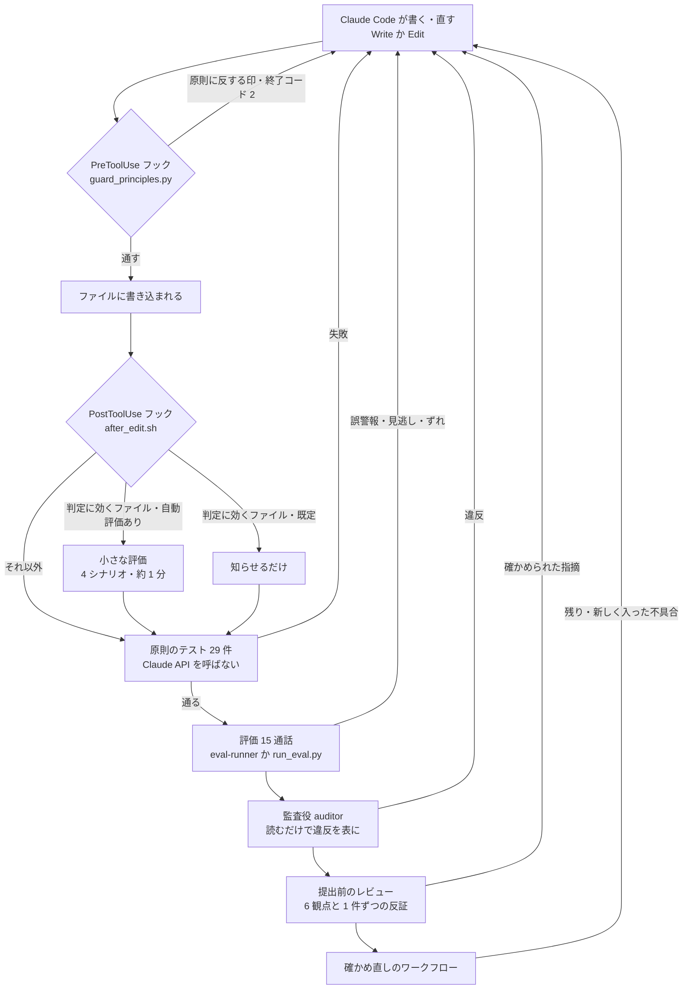
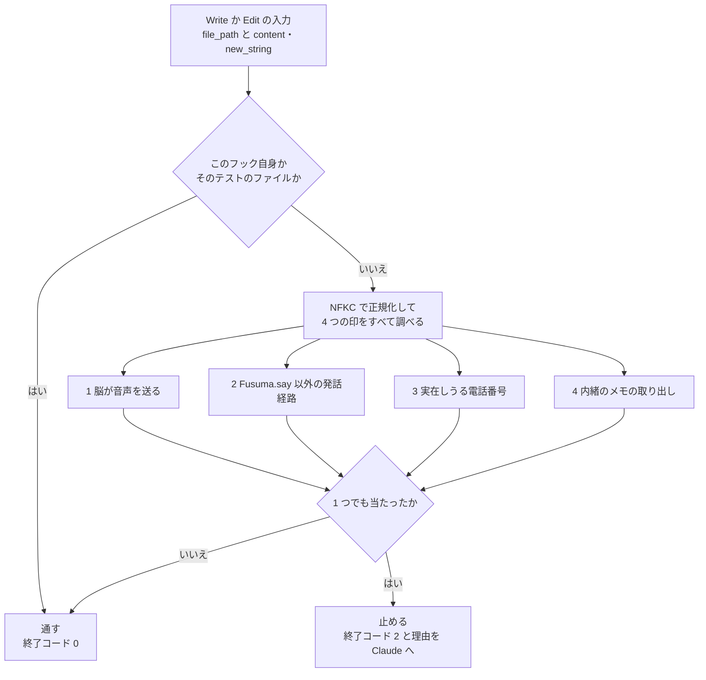
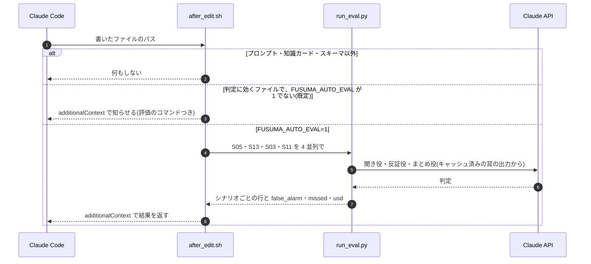
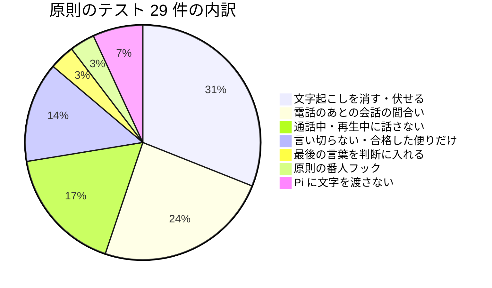
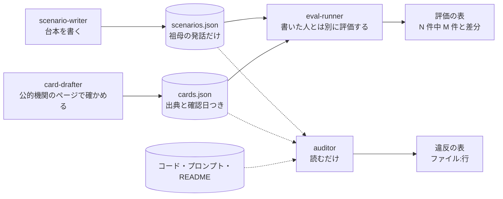
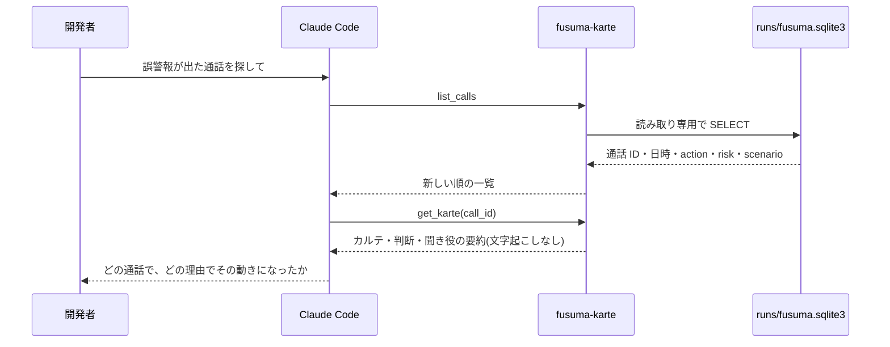
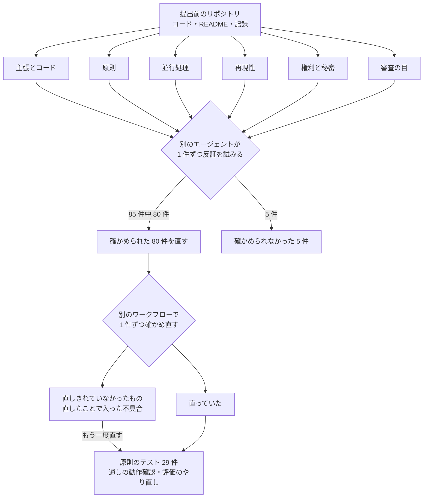
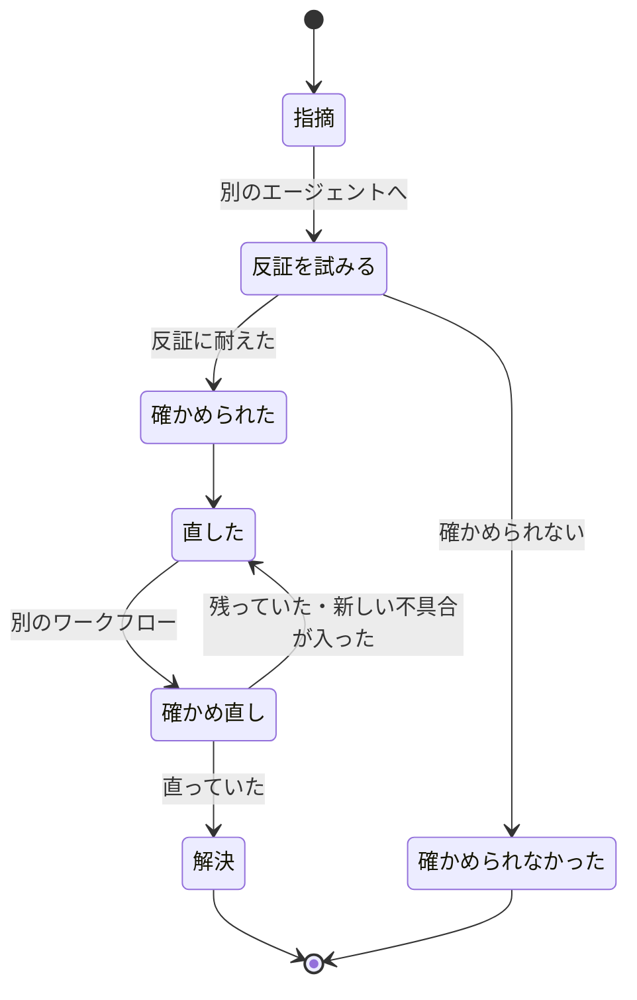

# Claude Code での作り方

## 3 行で

- ふすまごしは、AI のプログラミング助手 Claude Code と一緒に作りました。「通話中は話さない」「音声を外に出さない」などの約束を文章(CLAUDE.md)にし、約束を破る代表的な書き方のコードは、書き込む前に自動で止まるようにしました。
- 変更を入れたら、API の料金がかからない 29 件の確認テストと、架空の 15 通話の評価で、「本物の電話に口を出していないか」「怪しい電話を見逃していないか」を確かめます。
- 提出前には、複数の AI が 6 つの観点で調べ、別の AI がその指摘を 1 件ずつ疑って確かめました。確かめられた 80 件を直し、直したあとも別の流れでもう一度確かめ直しました。

---

ここから下はエンジニア向けです。開発に使った仕組み(CLAUDE.md・フック・原則のテスト・サブエージェント・スキル・MCP サーバー・複数エージェントのレビュー)と、画面・動画に入れた決まりを、リポジトリの中のファイルと関数で示します。CLAUDE.md・フック・テスト・サブエージェント・スキル・MCP サーバーはリポジトリに入っているので、`scripts/setup.sh` のあとにこのリポジトリを Claude Code で開けば、同じ仕組みで開発を続けられます(提出前のレビューに使ったワークフローと、そのやりとりは同梱していません)。全体の入り口は [しくみの全体像](how-it-works.md)。

## 開発のループ

コードを変えたら、上から順に確かめる(2 つのフックは Write・Edit のたびに自動で動き、テストから下は必要に応じて回す)。上ほど速く安く、下ほど広く深い。



| 段階 | 何を確かめるか | アプリの Claude API 呼び出し | 場所 |
|---|---|---|---|
| PreToolUse フック | 原則に反する代表的な書き方を、書き込む前に止める | なし | [app/scripts/hooks/guard_principles.py](../../app/scripts/hooks/guard_principles.py) |
| PostToolUse フック | 判定に効くファイル(プロンプト・知識カード・スキーマ)を変えたことを知らせる。`FUSUMA_AUTO_EVAL=1` なら 4 シナリオを流して結果を返す | 既定はなし(自動の評価は 約 $0.15) | [app/scripts/hooks/after_edit.sh](../../app/scripts/hooks/after_edit.sh) |
| 原則のテスト | 話さない・消す・言い切らない・フックが止める、を 29 件 | なし | [app/tests/test_principles.py](../../app/tests/test_principles.py) |
| 評価 | 15 通話の動き・危険度・誤警報・見逃しと、キーワード検知との比較 | あり(1 回 約 $0.38) | [app/scripts/run_eval.py](../../app/scripts/run_eval.py)、[eval-runner](../../.claude/agents/eval-runner.md) |
| 監査 | CLAUDE.md の約束を破っていないかを、読むだけで調べて表にする | なし | [auditor](../../.claude/agents/auditor.md) |
| 提出前のレビュー | 6 観点の調査と、指摘 1 件ずつの反証。直したあとの確かめ直し | — | 下の 7 章 |

## 1. CLAUDE.md — 作業のはじめに読む約束

リポジトリ直下の [CLAUDE.md](../../CLAUDE.md) は、Claude Code が作業のはじめに読み込む、このリポジトリの決まり。「守ること(破る変更は入れない)」6 つ・「開発の流れ」・「書き方」(日本語・簡潔に)の 3 部に分かれる。原則ごとの担保場所の一覧は、CLAUDE.md から [fusuma-principles スキル](../../.claude/skills/fusuma-principles/SKILL.md) を指している。

「開発の流れ」に書いてあること:

- サービスの起動(`bash scripts/services.sh start`。whisper-server :8765・TTS :8766)と、画面の起動(`cd app && ../.venv/bin/uvicorn fusuma.server:app --port 8780`)
- 判定に効くファイル(`app/fusuma/brain/prompts/*.md`・`app/knowledge/cards.json`・`schemas.py`)を変えると PostToolUse フックが知らせる。全体の評価は `eval-runner` サブエージェントか `run_eval.py`
- 原則のテスト(API を使わない。29 件)
- 提出前に `auditor` サブエージェントで原則の監査
- 記憶の中身は MCP サーバー `fusuma-karte`(読み取り専用)で引ける
- Managed Agents の定義は `app/managed/`(`ant apply`)。毎日 18:00 に走るので、使わないときは `app/scripts/managed_schedule.py pause`

「守ること」の 6 つは、どれもコード・テスト・フック・監査のどこかで確かめている(テストの番号は 3 章の表):

| CLAUDE.md の「守ること」 | コードで守っているところ | 原則のテスト | フック・監査 |
|---|---|---|---|
| 1. 通話中は何もしない。声を出す経路は `Fusuma.say()` だけ | [app/fusuma/orchestrator.py](../../app/fusuma/orchestrator.py) の `Fusuma.may_speak()`・`Fusuma.say()`、[app/fusuma/devices.py](../../app/fusuma/devices.py) の `Speaker.say()`(再生の直前と 0.1 秒ごとに確かめる) | 1〜5・11・13 | PreToolUse(発話経路) |
| 2. 聞くのは祖母の声だけ。Claude に音声を送らない | [app/fusuma/brain/llm.py](../../app/fusuma/brain/llm.py) の `_text_of()` が text と search_result 以外のブロックを送る前に止める | 27(フックの音声の印) | PreToolUse(脳の音声)、auditor |
| 3. 断定しない・相手の台詞を作らない・責めない。手口や数字は知識カードだけ | [principles.md](../../app/fusuma/brain/prompts/principles.md)、[app/fusuma/brain/letters.py](../../app/fusuma/brain/letters.py) の `violations()`、夕方の便りは Outcomes のルーブリック | 15・16・21・23 | auditor |
| 4. 抑制する。本物の電話で誤警報を出さない | [family.md](../../app/fusuma/brain/prompts/family.md) の動き(silent・evening・immediate)と `restraint_note` | 22 | 評価(誤警報の数) |
| 5. 声を複製しない。実在の人の名前・会社・住所・電話番号を使わない | [app/tts_server/tts_engine.py](../../app/tts_server/tts_engine.py) は文章の説明(VoiceDesign)から声見本を作る | 27(電話番号) | PreToolUse(電話番号)、auditor(名前・会社・住所) |
| 6. 文字起こしは聞き取りが終わったら消す。内緒のメモを広げない | `Fusuma._purge()` → [app/fusuma/store.py](../../app/fusuma/store.py) の `Store.purge_transcript()`・`llm.redact()`・[app/fusuma/server.py](../../app/fusuma/server.py) の `Hub.redact()`。メモは `Store.memos(include_secret=False)` | 6・7・9・10・12・17・18・20・24〜26 | PreToolUse(`include_secret`) |
| (約束の前提になる正しさ) | 答えのまとめ方、受話器を置く直前の発話、前の問いへの遅れた答え | 8・14・19 | — |

## 2. フック — 書く前に止め、書いたあとに知らせる

### 2.1 設定

[.claude/settings.json](../../.claude/settings.json) に、Write と Edit のたびに動くフックを 2 つ登録している。

```json
{
  "hooks": {
    "PreToolUse": [
      { "matcher": "Write|Edit",
        "hooks": [{ "type": "command", "command": "python3 \"$CLAUDE_PROJECT_DIR/app/scripts/hooks/guard_principles.py\"" }] }
    ],
    "PostToolUse": [
      { "matcher": "Write|Edit",
        "hooks": [{ "type": "command", "command": "bash \"$CLAUDE_PROJECT_DIR/app/scripts/hooks/after_edit.sh\"", "timeout": 240 }] }
    ]
  }
}
```

- `$CLAUDE_PROJECT_DIR` を使うので、リポジトリをどこに置いても動く。
- PostToolUse の `timeout` は 240 秒。自動の評価(約 1 分)はこの中に収まる。
- 手元だけの設定(`.claude/settings.local.json`)は [.gitignore](../../.gitignore) でリポジトリに入れない。

### 2.2 PreToolUse — 原則の番人(guard_principles.py)

[guard_principles.py](../../app/scripts/hooks/guard_principles.py) は、書き込もうとしている文字列(Write の `content`、Edit の `new_string`)を NFKC で正規化してから、4 種類の「印」を探す。1 つでも当たれば終了コード 2 で終わり、理由を stderr で Claude に返す。書き込みは行われず、Claude はその理由を読んで書き方を変える。



| 止めるもの | 見るファイル | 印 | 通すもの |
|---|---|---|---|
| 1. 脳(Claude 側)が音声を送る | パスに `/fusuma/brain/` を含むファイル | `input_audio`・`audio/wav`・`audio/mpeg`・`"type": "audio"`・`media_type=` に 1 文字おいて続く `audio`(正規表現 `media_type=.audio`)。`open(` や `read(` で `.wav`・`.mp3`・`.m4a` を開く | — |
| 2. `Fusuma.say()` を通らずに声を出す | `/fusuma/` の中の `.py` | `speaker.say(`・`sd.play`・`sounddevice`・`TTS_URL`・`OutputStream`・`.synth(`・`afplay`・`os.system(`・`simpleaudio`・`playsound`・`pyaudio` | `fusuma/devices.py`(Speaker と仮想の部屋)・`fusuma/ear/pipeline.py`(ファイル入力の部屋の音)・`fusuma/config.py`(`TTS_URL` の定義) |
| 3. 実在しうる電話番号 | すべてのファイル(README・台本・このページも) | 全角をそろえ、`+81` を 0 に、かっこ・点・ハイフンの仲間・長音記号・空白をならしてから、0 で始まる 10〜11 桁 | 先頭を `0000` にした架空の番号 |
| 4. 内緒と判定したメモの取り出し | `.py` | `include_secret=True`(`include_secret: bool = True` や辞書の書き方も)・`.memos(True)` | — |

フック自身([guard_principles.py](../../app/scripts/hooks/guard_principles.py))と、わざと止めるべき文字列を持つ [test_principles.py](../../app/tests/test_principles.py) は調べない。

たとえば `app/fusuma/orchestrator.py` に `speaker.say(text)` と書こうとすると、終了コード 2 で止まり、Claude には次の文が返る:

```text
ふすまごしの原則チェックで止めました:
- orchestrator.py で speaker.say( を直接使っています。話す経路は Fusuma.say()(通話中は SilenceViolation、再生中の着信でも止まる)だけにしてください。
```

原則のテストの 27 番(`test_guard_hook`)は、止める 6 通り(0120 で始まる 10 桁の番号、市外局番 03 の形の番号、全角数字と長音記号「ー」で書いた携帯番号の形、`orchestrator.py` での `speaker.say(` の直呼び、`brain/llm.py` の `input_audio`、`brain/managed.py` の `include_secret=True`)と、通す 2 通り(先頭 `0000` の架空の番号、`server.py` の `speak=speaker.say` という渡し方)を確かめる。

限界(上の 2 つはファイル冒頭の説明、3 つ目は [.claude/settings.json](../../.claude/settings.json) の `matcher` から):

- 文字列の印を見るだけで、意味は読まない。すり抜ける書き方はある。
- 名前・会社・住所が実在のものと重なっていないかは判定できない。そこは `auditor` が確かめる。
- 見るのは Write と Edit の入力(`content` と `new_string`)だけ(`matcher` が `Write|Edit`)。Bash などほかの道具での書き換えは見ない。

### 2.3 PostToolUse — 判定に効くファイルを変えたら(after_edit.sh)

[after_edit.sh](../../app/scripts/hooks/after_edit.sh) は、書いたファイルが次のどれかのときだけ反応する(それ以外はすぐ終わる)。

- `*/fusuma/brain/prompts/*.md`(原則・役割のプロンプト)
- `*/knowledge/cards.json`(知識カード)
- `*/fusuma/brain/schemas.py`(構造化出力の形)

既定では評価を回さず、知らせとコマンドを `additionalContext` で Claude に返すだけ(評価は Claude API を使うので、クローンした人のクレジットを黙って使わないため。スクリプトのコメントより)。たとえば `listener.md` を直すと、こう返る:

```json
{"hookSpecificOutput": {"hookEventName": "PostToolUse", "additionalContext": "…/app/fusuma/brain/prompts/listener.md は判定に効くファイルです。小さな評価(約 $0.15)を回すなら FUSUMA_AUTO_EVAL=1 を設定するか、app/scripts/run_eval.py --tag quick --ids S05 S13 S03 S11 を実行してください。"}}
```

`FUSUMA_AUTO_EVAL=1` のときだけ、`run_eval.py --tag hook-<時刻> --ids S05 S13 S03 S11 --workers 4` を回す(Python は `FUSUMA_PYTHON` で変えられる)。耳の出力はキャッシュ済みなので、脳だけが流れる(約 1 分)。



4 本には、3 つの動き(黙る・夕方・今すぐ)と、キーワードの罠(S13)が入っている(正解の動きは [run_eval.py](../../app/scripts/run_eval.py) の `score()` の決め方):

| ID | 台本([scenarios.json](../../app/scenarios/scenarios.json)) | 正解の動き | 見ていること |
|---|---|---|---|
| S05 | 健康食品の電話勧誘(2 回目・定期購入の申込) | 夕方の便り | デモの通話。勧誘の流れを読めているか |
| S13 | 警察署から盗難自転車の連絡(本物・キーワードの罠) | 黙る | 「警察」「印鑑」があっても黙れるか |
| S03 | キャッシュカード詐欺盗(警察と銀行協会を名乗る) | 今すぐ | カードの受け渡しと訪問で急げるか |
| S11 | 友人との世間話(本物) | 黙る | 普通の電話に口を出さないか |

結果は「本物の電話(S13, S11)で silent 以外になっていたら誤警報です。」という一文と一緒に返る。Claude はこれを読んで、次に直すかどうかを決める。

## 3. 原則のテスト(29 件)

[app/tests/test_principles.py](../../app/tests/test_principles.py) は、原則が「コードの動き」として守られているかを、Claude API を呼ばずに確かめる。

```bash
cd app && ../.venv/bin/python tests/test_principles.py     # 1 件ずつ ok / FAIL、最後に「29/29 passed」
```

作り方:

- API を呼ぶ関数(`listener.judge`・`family.decide`・`family.postcall_turn`・`llm.call`)は、テストの中で決まった答えを返す(17 では失敗させる)関数に差し替える。文字起こし(`asr.transcribe`)と声の測定(`prosody.measure`)も差し替えるので、whisper-server と TTS サーバーも要らない。
- 耳は `FakeEar`(通話の状態・部屋が静かか・話し声を聞いている途中か を自由に変えられる)。声は `Speaker(audible=False)` の `synth` だけを差し替え、0.1 秒ごとに確かめる動きは本物のまま使う。
- 台帳は一時ディレクトリに向ける(`llm.PRIVACY = TMP / ...`。本物の台帳には触らない)。サーバーのテストは別のプロセスで、`FUSUMA_RUNS`(一時ディレクトリ)・`FUSUMA_AUDIBLE=0`・`FUSUMA_MANAGED=0` にして動かす。
- 耳を組み立てる 2 件(14 と 24)は YAMNet と Silero VAD のモデルを読み込むので、`scripts/setup.sh` のあとに動かす。
- 1 件でも落ちれば終了コード 1。



| # | テスト | 分類 | 確かめること |
|---|---|---|---|
| 1 | `test_say_refuses_during_call` | 話さない | 耳が通話中なら `Fusuma.say()` は `SilenceViolation` で止まり、TTS を呼ばない |
| 2 | `test_say_refuses_without_ear_when_audible` | 話さない | 耳がない(通話中か分からない)のに音を出す設定なら、話さない(`may_speak()`) |
| 3 | `test_speaker_stops_when_phone_rings_mid_speech` | 話さない | 2 秒の声の再生中、0.3 秒目に電話が鳴ると、話し始めから 0.8 秒以内に止まり `speak_stopped` を出す。声の録音も残さない |
| 4 | `test_speaker_does_not_start_if_call_began_during_synthesis` | 話さない | 声を合成しているあいだに電話が鳴ったら、再生を始めない |
| 5 | `test_dialog_waits_until_other_call_ends` | 間合い | 別の電話の最中なら話しかけず、その通話が終わってから話しかける |
| 6 | `test_dialog_closes_and_purges_when_no_answer` | 消す | 答えがなければ会話を閉じ、文字起こしを消し、部屋の声を聞く窓も閉じる |
| 7 | `test_dialog_answer_then_done_purges` | 消す | 答えを聞いて会話が終わったら、本人が話したこと(`told_by_person`)を残して文字起こしを消す |
| 8 | `test_answer_split_by_pause_is_one_turn` | 間合い | 2 文の答えが 2 秒の間で割れても、言い終わるまで待って 1 回の答えにまとめる |
| 9 | `test_tts_failure_closes_dialog_and_purges` | 消す | 最初の一言で TTS が落ちたら、会話を閉じて消す(`reason=error`) |
| 10 | `test_tts_failure_mid_dialog_closes_and_purges` | 消す | 会話の途中で TTS が落ちても、会話を閉じて消す |
| 11 | `test_opener_waits_while_someone_is_talking` | 間合い | 部屋で誰かが話しているあいだは話しかけず、静かになってから話しかける |
| 12 | `test_older_call_is_not_asked_about` | 間合い | あとから別の電話があったら、古い電話のことは聞かずに消す |
| 13 | `test_ring_cut_unmutes_ear_at_once` | 話さない | 着信で声を途中でやめたら、耳の消音をすぐ解く(電話の第一声を聞き逃さない) |
| 14 | `test_call_end_waits_for_last_words` | 最後の言葉 | 受話器を置く直前の発話(文字にするのに 0.5 秒かかる)も、「通話が終わった」イベントの行に入る |
| 15 | `test_letter_with_assertion_is_replaced` | 言い切らない | 今すぐの便りに、書き直しても「詐欺です」が残ったら、決まった文の便りに差し替える |
| 16 | `test_evening_letter_delivered_only_if_grader_passed` | 言い切らない | 採点の最後が `satisfied` の夕方の便りだけ中身を届け、`max_iterations_reached` なら中身を出さない |
| 17 | `test_finalize_error_still_purges` | 消す | 聞き役の呼び出しが失敗しても、文字起こしを消す |
| 18 | `test_never_quiet_room_purges_without_asking` | 消す | 部屋が静かにならないまま待ちきれなければ、聞かずに消す |
| 19 | `test_late_answer_to_previous_question_is_dropped` | 間合い | 次の問いに進んだあとに届いた、前の問いへの答えには応えない(`answer_dropped`) |
| 20 | `test_no_answer_check_waits_while_she_is_speaking` | 間合い | 答えを話している途中なら会話を閉じず、話し終えてから閉じて消す |
| 21 | `test_spoken_reply_with_assertion_is_replaced` | 言い切らない | 電話のあとの返事に「詐欺です」があれば、口にする前に決まった文に差し替える |
| 22 | `test_silent_call_gets_no_postcall_question` | 間合い | まとめ役が「黙る」と決めた電話には、問いかけの指定があっても問いかけず、消す |
| 23 | `test_assertion_rule_ignores_hedged_wording` | 言い切らない | 「断定はできませんが」「とは限りません」などは通し、「これは詐欺です。」「詐欺に違いない」などは止める |
| 24 | `test_server_redacts_event_log_and_late_events` | 消す | サーバーが画面の履歴と `events.jsonl` のその通話の原文を伏せ、消したあとに届いたイベントも伏せる。別の通話は残す |
| 25 | `test_purge_removes_quotes_ledger_and_logs` | 消す | 消すとき、文字起こし・聞き役の引用・反証役の原文を除き、危険度・段階とカルテは残す。台帳はその通話の行だけ本文を空にする(文字数は残す) |
| 26 | `test_redact_event` | 消す | イベントの種類ごとに、伏せる中身(発話・会話の履歴・送った中身の抜粋・通話の行)が決まっている |
| 27 | `test_guard_hook` | フック | PreToolUse フックが、電話番号の 3 つの書き方・`speaker.say(` の直呼び・`input_audio`・`include_secret=True` を止め、先頭 `0000` の番号と `speak=speaker.say` は通す |
| 28 | `test_lantern_bridge_sends_no_text` | Pi | Pi(ふすまの中の画面)への合図に、話した文・文字起こし・便りの本文が一文字も入らない。送るのは気分の名前・秒数・口の開きだけ |
| 29 | `test_lantern_family_gets_letters_only` | Pi | 家族の机の Pi には、電話中かどうか・話しているかどうかを送らず、便りが届いた合図だけを送る |

## 4. サブエージェント — 書く役と確かめる役を分ける

[.claude/agents/](../../.claude/agents) に 4 つ。書く役と確かめる役を分け、自己採点にしない。それぞれ使える道具を絞り、監査役には直す道具を持たせない(`auditor` は Read・Grep・Glob だけ)。

| 名前 | 使える道具 | 役目 | 決まり |
|---|---|---|---|
| [auditor](../../.claude/agents/auditor.md)(監査役) | Read・Grep・Glob | コード・プロンプト・シナリオ・README が CLAUDE.md の「守ること」に反していないかを監査し、違反を「ファイル:行」つきの表で報告する | 修正はしない。観点は 7 つ(音声を送らない・通話中は話さない・断定しない・相手の台詞を作らない・声を複製しない・架空のデータ・出典) |
| [eval-runner](../../.claude/agents/eval-runner.md)(評価係) | Read・Bash | `run_eval.py` を回し、シナリオごとの期待 → 実際・キーワード検知の警報・誤警報・見逃しを表にする。NG は聞き役・反証役・まとめ役のどこでずれたかを 1 行ずつ書く | 台本を書いた人とは別に実行する。統計的な主張はせず「N 件中 M 件」で書く。前回の結果があれば差分も書く |
| [scenario-writer](../../.claude/agents/scenario-writer.md)(シナリオ作者) | Read・Write・Edit | 評価・デモ用の台本を `scenarios.json` の形式(各行 `[直前の沈黙(秒), 話し方, 祖母の発話]`)で書く | 相手の台詞は書かず、相手が話す時間は「直前の沈黙」で表す(長い勧誘は 6〜9 秒)。話し方は n・p・c・l・w・h・u・b・f の 9 種。本物の電話はキーワードがあっても low にする |
| [card-drafter](../../.claude/agents/card-drafter.md)(知識カード作者) | Read・Write・Edit・WebSearch・WebFetch | `cards.json` の知識カードを、公的機関のページを開いて確かめながら作る・直す | `source_url`・`source_name`・`checked`(確認日)を入れる。確かめられない項目は入れない。直接引用は 40 字以内。ソースにない設計メモは `design_note` に分ける |



ウェブを見られるのは `card-drafter` だけ。知識カードを変えると、PostToolUse フック(2.3)が判定への影響を知らせる。

監査役の指摘から実際に直したことが 2 つある([README の反復の記録](../records/iterations.md)):「文字起こしを消しても、台帳・イベントログ・判定の引用に原文が残る。祖母が答えないときは消えない」と、「声を合成しているあいだや再生中に電話が鳴っても、止まらない」。いまはテスト 3・4・6・13・17・18・24・25 などで確かめている。

## 5. スキル

[.claude/skills/](../../.claude/skills) に 2 つ。決まった手順や、変更の前に読むべき知識を、プロンプトに毎回書かずに持たせる。

| スキル | いつ使うか | 中身 |
|---|---|---|
| [fusuma-principles](../../.claude/skills/fusuma-principles/SKILL.md) | ふすまごしのコード・プロンプト・UI・README を変えるとき、最初に読む | 原則 10 行と、それぞれをどこで担保しているか(`Fusuma.say()`・`Ear._segment()`・`Fusuma._purge()`・`managed.sync_memory()` の `include_secret=False` など)。変更のあとに回すテストと評価のコマンド |
| [scenario-synth](../../.claude/skills/scenario-synth/SKILL.md) | 通話シナリオを足す・直すとき | 6 手順: `scenarios.json` に足す → サービスを起動 → `synth_scenarios.py <ID>` で合成(各行を TTS で読み、whisper で文字に戻して台本と比べ、`sim` が 0.72 未満なら seed を変えて作り直す)→ `ear_file.py` で耳だけ確かめる → `run_eval.py --ids <ID>` で評価に入れる → 本物の電話ならキーワード検知の誤警報(`kw_alert`)も見る |

ほかに使ったスキル:

- **Managed Agents 側のスキル** [fusuma-letter](../../app/managed/agents/fusuma-family/skills/fusuma-letter/SKILL.md)(と `cards.md`)は、Claude Code ではなく、クラウドの便り係が便りを書くときに使う。くわしくは [managed-agents.md](managed-agents.md)。
- **claude-api スキル**(このリポジトリの外のスキル)で、Managed Agents・Citations・構造化出力の最新の書き方を確かめながら実装した(README)。
- **claude-code-video-toolkit** の Remotion テンプレート(product-demo)を土台に、デモ動画を Claude Code で組み立てた([video/README.md](../../video/README.md))。

## 6. MCP サーバー fusuma-karte

開発中に、Claude Code から記憶(SQLite)の中身を読み取り専用で引くための stdio の MCP サーバー([app/scripts/mcp/karte_mcp.py](../../app/scripts/mcp/karte_mcp.py)、`mcp` 2.x の `MCPServer`)。評価やプロンプトを直すとき、カルテや判断を Claude Code が直接確かめるのに使う。[.mcp.json](../../.mcp.json) で登録している。

```json
{ "mcpServers": { "fusuma-karte": { "command": ".venv/bin/python", "args": ["app/scripts/mcp/karte_mcp.py"] } } }
```

| ツール | 引数 | 返すもの |
|---|---|---|
| `list_calls` | `limit`(既定 20) | 最近の通話の ID・日時・端末の判断(`action`)・危険度・シナリオ名(新しい順) |
| `get_karte` | `call_id` | 1 通話のカルテ・まとめ役の判断・聞き役の判定の要約と、日時・向き・長さ・本人が話したこと・同意 |
| `search_kartes` | `query` | カルテに `query` を含む通話(最大 20 件。例「健康」「警察」) |
| `life_memos` | — | 暮らしのメモ(内緒のメモは除く) |
| `api_spend` | — | 費用台帳 `runs/ledger.jsonl` の合計と役割ごとの内訳、予算(`config.BUDGET_USD`。既定 $80) |

守っていること:

- DB は `file:...?mode=ro` の URI で開く(`_db()`)。書き込めない。
- 文字起こし(`lines`)と反証役の結果は返さない。聞き役の判定は `store.slim_listener()` を通し、発話の引用や言い換えが入りうる項目(`speech_acts` の text・`evidence`・`disclosed`・`reason`・`to_ask`)を除く。カルテと判断の理由には、設計どおり根拠になった祖母の短い言葉(時刻つき)が入る。
- `life_memos` は `secret=0` の行だけを返す。内緒のメモは Claude Code にも渡さない。

使い方の例(ファイル冒頭の説明にある「誤警報が出た通話を探して」):



## 7. 提出前のレビュー — 複数エージェントのワークフロー

提出の前に、Claude Code のワークフロー(複数のエージェントを組み合わせて動かす仕組み)で最終レビューをした。6 つの観点ごとに別々のエージェントがリポジトリを調べ、出た指摘の 1 件ずつに、さらに別のエージェントが反証を試みた。85 件のうち 80 件が確かめられ、それを直した。直したあと、別のワークフローで 1 件ずつ確かめ直し、直しきれていなかったものと、直したことで新しく入った不具合も直した([README の反復の記録](../records/iterations.md)の最後の行と、[README の「Claude の使い方」](../../README.md#claude-の使い方)の表)。

観点は 6 つ(README の書き方のまま): 主張とコード・原則・並行処理・再現性・権利と秘密・審査の目。ワークフローの定義、各エージェントのやりとり、指摘の一覧はリポジトリに入れていないので、ここに書けるのは README に残した件数と例までになる。



1 件の指摘の流れ:



見つかった指摘の例(README の反復の記録から)と、いまのコード:

| 指摘 | いまのコード | 確かめ方 |
|---|---|---|
| 18:00 の定期実行が書いた便りを、誰も取りに来ない | 文字起こしを消すたびに記憶ストアへ同期し([server.py](../../app/fusuma/server.py) の `fz.on_purge` に `_sync_memory` を登録)、17:50 に同期し直し、18:05 以降に `managed.fetch_scheduled_letter()` で取りに行く(`_evening_loop()`) | 原則のテストにはない |
| 採点に合格しなくても便りが届く | [managed.py](../../app/fusuma/brain/managed.py) の `gate()` が、採点の最後が `satisfied` の便りだけ中身を通す | テスト 16 |
| 受話器を置く直前の発話が判断に入らないことがある | [pipeline.py](../../app/fusuma/ear/pipeline.py) の `Ear._end_call()` が「通話が終わった」イベントを文字起こしと同じ 1 本のプールに入れ、先に入った発話を文字にし終えてから出す | テスト 14 |
| README の主張が実際の動きとずれている | 書き方を実際の動きに合わせた(README の多くの書き方もそこで直した) | — |

## 8. 画面と動画 — いまのファイルにある決まり

画面([app/web/](../../app/web))と動画の主な決まりと、それがどのファイルにあるかを並べる。画面のどこに何が出るかは [しくみの全体像](how-it-works.md) の「画面」、消え方と書きとめないものは [privacy.md](privacy.md) の 5 章・8 章。

| 画面の決まり | どこで |
|---|---|
| ダッシュボードの形も紙のノートの見立てもやめ、通話を 1 発話 1 行の「明細」として記帳する(白い地・墨の文字・細い罫。琥珀は行灯だけ、朱は注記だけ) | [index.html](../../app/web/index.html)、[fusuma.css](../../app/web/css/fusuma.css) の色と字体の変数、[設計の判断](../design.md) の「画面 — 通話明細」 |
| 画面の光は行灯の灯りだけ。通話中はほぼ消し(`--glow` 0.05)、右の欄の地も沈める。見守り中 0.62、呼出中・発信中 0.3、電話が終わった 0.34、話しているあいだ 0.96、話し終えたあと 0.5 | [app.js](../../app/web/js/app.js) の `GLOW` と `setStatus()`、fusuma.css の `body.incall` |
| 祖母の声は黒の横棒(長さ = 話した時間、高さ = いつもの声との声量の差)、相手の時間は斜線の横棒で描く。相手の言葉は描かない | app.js の `sheetRender()` |
| 住所・番号などは、画面にも書きとめない | app.js の `PRIVATE` |
| 文字起こしを消したら、言葉だけを灰色の帯に替える(間・声の横棒・数字・注記・照合は残す) | app.js の `handle()` の `purged` |
| 無音で終わった通話は、無音の尻尾を数えず、小計は最後の発話までの値 | app.js の `handle()` の `state` |
| まとめ役の判断には、3 択(選んだ方を塗る)と、抑えた理由と、知らせ方を添える(`restraint_note` はスキーマで必須) | app.js の `councilRender()`、[schemas.py](../../app/fusuma/brain/schemas.py) の `DECISION` |
| 電話のあとの会話は 3 段(さっきの電話のこと / 家族に話していい? / いつもの話へ)で見せ、いまの段に印(`turn.intent` を映すだけで、会話の制御には使わない) | app.js の `dialogRender()` |
| 下の帯の台帳に、Claude に送った音声のバイト数(0)・文字数・API の利用額 | app.js の `footRender()` |
| 家族の画面は「警報ではなく、電話をかけるきっかけと話し方」。便りができるまでの 5 つの工程と約束、採点(決め手の一文)を並べ、右に家族のスマホに届いた便りを見せる | [family.html](../../app/web/family.html)、[family.js](../../app/web/js/family.js) の `gist()`・`letterHTML()` |

| 動画の決まり | どこで |
|---|---|
| 3 分・13 場面。場面・音声・字幕の時刻は手で打たず、記録から組み立てる(画面録画のイベント時刻、台本の正解のタイミング `S05.truth.json`・`S11.truth.json`、ふすまごしの声の記録 `runs/speech/speech_log.jsonl`、ナレーションの長さ) | `video/script/build_timeline_v2.py` の docstring |
| ナレーションも合成音声(Qwen3-TTS。文章の説明から作った 50 代の男性の声見本、seed 3104)。技術の場面(ふすまの裏側・家族会議・試験と Claude Code)は台本の `speed` で 1.35〜1.5 倍。速さだけを変え、声の高さは変えない(ffmpeg の rubberband、なければ atempo) | `video/script/narration.json`、`video/script/make_narration.py` の `speed_up()`、[narrator_ref.json](../../app/tts_server/voices/narrator_ref.json) |
| 効果音と、技術の場面の軽いリズム(拍子木と木琴)は数式から作る(素材のライセンスが要らない) | `video/script/make_sfx.py` |
| 画面は、実際に動いているふすまごしを Playwright(ヘッドレス Chromium、1920×1080)で録画する | [app/scripts/record_demo.py](../../app/scripts/record_demo.py) |
| 本物のものと用意したものを分けて書く | [README の「デモで本物のもの・用意したもの」](../../README.md#デモで本物のもの用意したもの) |

動画の作り方の手順は [video/README.md](../../video/README.md)。

## 9. 反復の記録

[README の反復の記録](../records/iterations.md)にある件を、いま守っている場所と並べる。

| 見つけたこと | 直したこと | いま守っているところ |
|---|---|---|
| kotoba-whisper-v2.0 が 2 秒未満の発話で空文字や幻聴を返した | 実測で比べ、whisper large-v3-turbo(q8)に切り替え。短い発話 5/5 を正しく認識(速さは同じ約 1.1 秒) | [scripts/services.sh](../../scripts/services.sh) の `WHISPER_MODEL`。定型の幻聴は [asr.py](../../app/fusuma/ear/asr.py) の `clean()` でも除く |
| 認識結果に前の発話が混ざる | whisper-server が前の文脈を持ち越していた。毎回切る。124 セリフの検査で不一致 1 件に | asr.py の `transcribe()`(`no_context`)、services.sh の `-nc` |
| 本人が断った 1 回目の勧誘を「口止め・中」と判定した回があった | 段階名を列挙型にし(スキーマの `STAGES` は両トラックの段階名と「なし」の一覧。トラックごとの段階名はプロンプトと `normalize()` の `SCAM`・`SOLICIT`)、トラックと食い違う段階は近い段階に寄せる。「はっきり断った勧誘は低(聞き役)・黙る(まとめ役)」と明記 | [schemas.py](../../app/fusuma/brain/schemas.py) の `STAGES`、[listener.py](../../app/fusuma/brain/listener.py) の `normalize()`、[listener.md](../../app/fusuma/brain/prompts/listener.md)、[family.md](../../app/fusuma/brain/prompts/family.md) |
| 夕方の便りが 400 字を超えた | Outcomes の採点役が書き直しを求め、便り係が直した。記録に残る 5 回のうち 4 回が「書き直し → 合格」(約 500 字 → 約 300 字、約 450 字 → 約 330 字、約 480 字 → 約 300 字、最新の収録 v4 は約 440 字 → 約 300 字)。残る 1 回は 1 回目で合格(約 380 字) | [docs/records/outcomes_grades.json](../records/outcomes_grades.json)、ルーブリックの 8 項目目([deployment-evening.yaml](../../app/managed/agents/fusuma-family/deployment-evening.yaml)) |
| 便り係(Opus 5.5)の 1 回の費用が上限 $0.50 に届き、再採点の前に止まった | 毎日動く役なので Sonnet 5.5 に替え、上限は据え置き | [agent.md](../../app/managed/agents/fusuma-family/agent.md) の `model` |
| 電話のあと、答え済みのことを聞き返した | 1 回の発話で 1 つのこと。最初の一言は固定 | [family.py](../../app/fusuma/brain/family.py) の `postcall_turn()`(発話の回数ごとの指示)、`config.POSTCALL_OPENER`、[postcall.md](../../app/fusuma/brain/prompts/postcall.md) |
| 監査役: 消しても台帳・ログ・判定の引用に原文が残る。答えないときは消えない | 消すときにそれらも伏せる。どの終わり方でも消す | `Fusuma._purge()`、テスト 6・17・18・24・25 |
| 監査役: 合成中・再生中に電話が鳴っても止まらない | 再生の直前と再生中に確かめ、鳴ったらやめて、すぐ聞く側に戻る | `Speaker.say()`、テスト 3・4・13 |
| 祖母の答え(2 文)が割れ、2 回応えて会話がずれた | 耳がもう話し声を聞いていない(文字にしている途中でもない)ことを確かめてから応える。会話が終わったら聞く窓を閉じる | `Fusuma._flush_answer()`・`Ear.hearing()`・`Fusuma._end_dialog()`、テスト 8・19・20 |
| 評価の入力(耳の出力)が、文字起こしを直す前のキャッシュのままだった | 最新の耳で 15 通話を流し直して評価し直した | [eval/ear_cache/](../../eval/ear_cache)(作り直すときは `run_eval.py --force-ear`。書き出し先は `runs/eval/` で、同梱のキャッシュより先に読まれる) |
| まとめ役が、定期購入の申込と住所を伝えたことだけで「今すぐ」に上げた回があった | 「今すぐ」は、今日のうちにお金やカードが動く・知らない人が訪ねてくる・口止め、と明記 | [family.md](../../app/fusuma/brain/prompts/family.md) の `immediate` |
| 最終レビューの 80 件 | 7 章のとおり | 原則のテスト(当時 27 件)、通しの動作確認、評価のやり直し |

評価の記録([docs/records/eval_history.json](../records/eval_history.json))を版ごとにまとめると、こうなる。誤警報と見逃しはどの版も 0。版によって変わったのは、動きと危険度のラベルの一致数だった。くわしくは [evaluation.md](evaluation.md)。

| 版 | 回数 | 動き | 危険度のラベル | 本物の電話での誤警報 | 怪しい電話の見逃し | キーワード検知(誤警報・見逃し) |
|---|---|---|---|---|---|---|
| v1 | 1 | 15 / 15 | 14 / 15 | 0 / 5 | 0 / 8 | 2 / 5・3 / 8 |
| v2 | 3 | 45 / 45 | 43 / 45 | 0 / 15 | 0 / 24 | 6 / 15・9 / 24 |
| v3 | 4 | 59 / 60 | 56 / 60 | 0 / 20 | 0 / 32 | 8 / 20・12 / 32 |
| v4 | 4 | 60 / 60 | 53 / 60 | 0 / 20 | 0 / 32 | 8 / 20・12 / 32 |
| v5 | 4 | 60 / 60 | 55 / 60 | 0 / 20 | 0 / 32 | 8 / 20・12 / 32 |
| v6(最終) | 4 | 60 / 60 | 60 / 60 | 0 / 20 | 0 / 32 | 8 / 20・12 / 32 |

v6 の費用は、1 回目 $0.53、2〜4 回目 約 $0.38(キャッシュがなければ 約 $0.84〜0.89。[docs/records/eval_cost.json](../records/eval_cost.json))。

## 10. 手元で回すコマンド

```bash
# 原則のテスト(Claude API を呼ばない)
cd app && ../.venv/bin/python tests/test_principles.py && cd ..

# 小さな評価(4 シナリオ、約 $0.15。PostToolUse フックが知らせるのと同じ組み合わせ)
.venv/bin/python app/scripts/run_eval.py --tag quick --ids S05 S13 S03 S11

# 全体の評価(15 通話、1 回 約 $0.38。耳の出力は同梱のキャッシュを使う)
.venv/bin/python app/scripts/run_eval.py --tag mine

# プロンプト・知識カード・スキーマを変えるたびに、フックに小さな評価を自動で回させる(クレジットを使う)
# after_edit.sh は環境変数 FUSUMA_AUTO_EVAL を見る。Claude Code を起動する前のシェルで設定しておく
export FUSUMA_AUTO_EVAL=1

# 夕方の便り係の定期実行(毎日 18:00)を止める・状態を見る
.venv/bin/python app/scripts/managed_schedule.py pause
.venv/bin/python app/scripts/managed_schedule.py status
```
