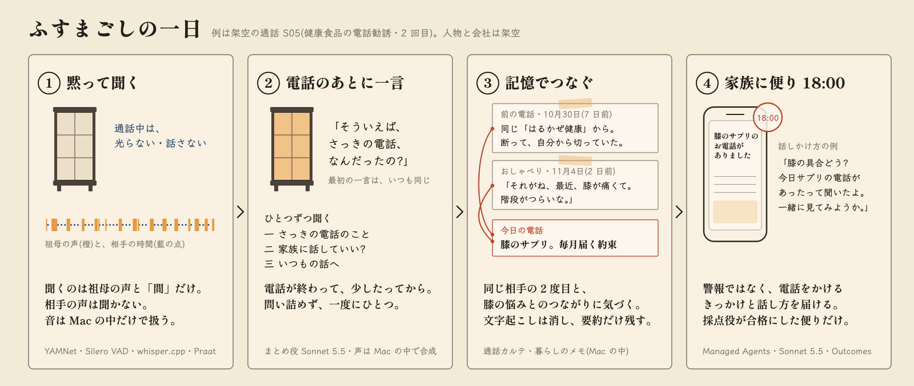
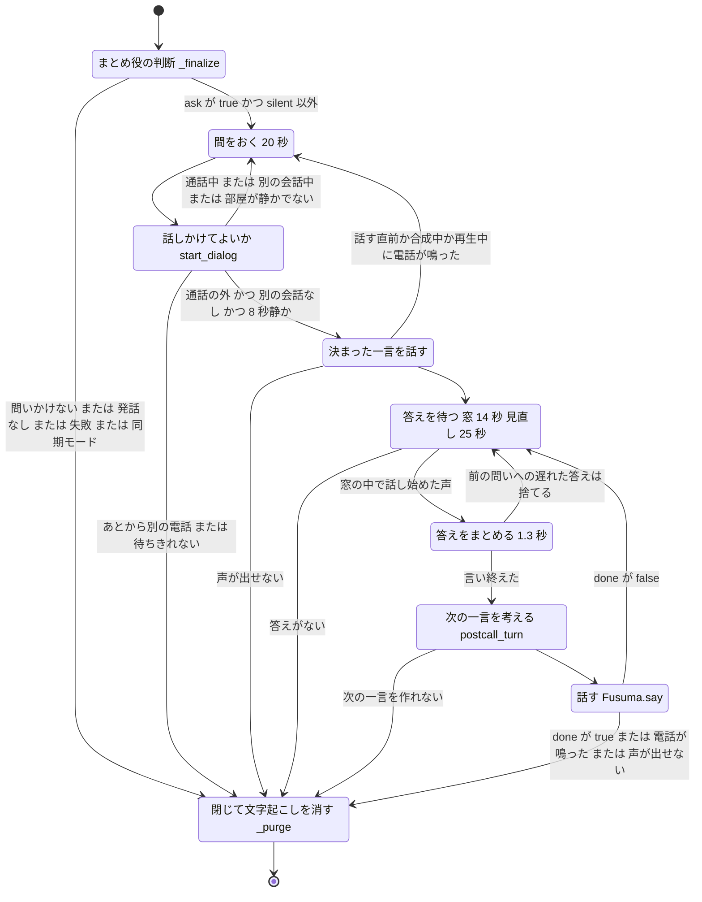
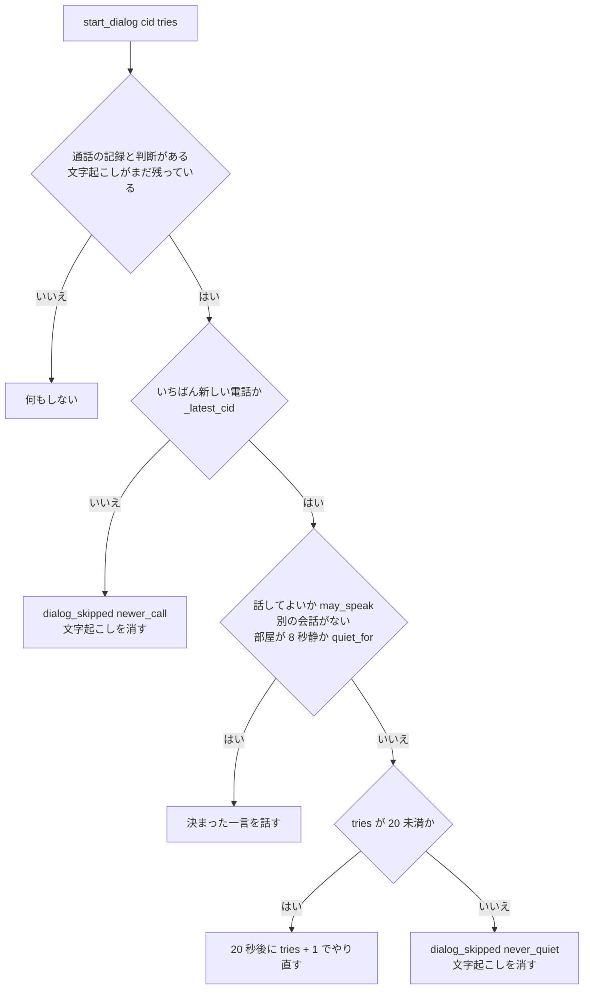
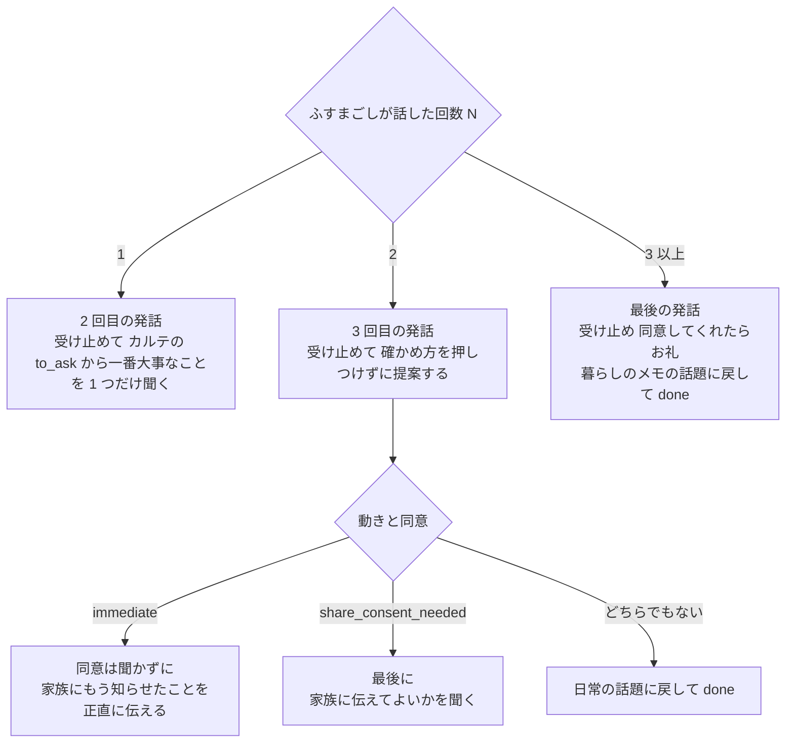
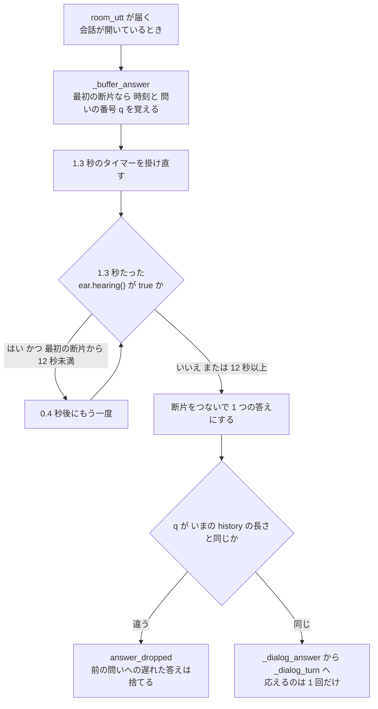
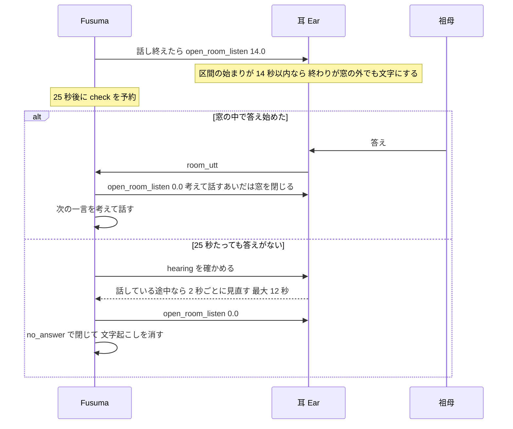
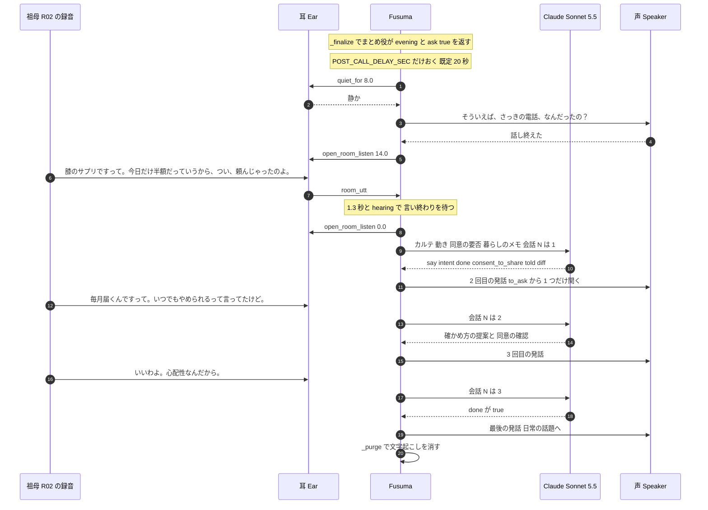
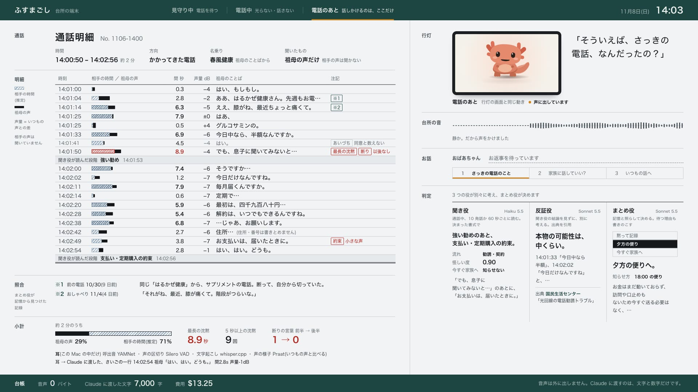
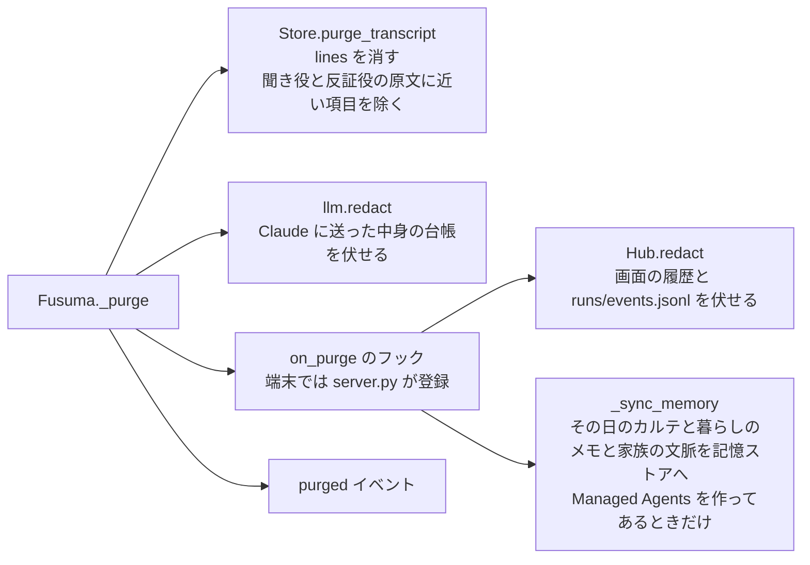
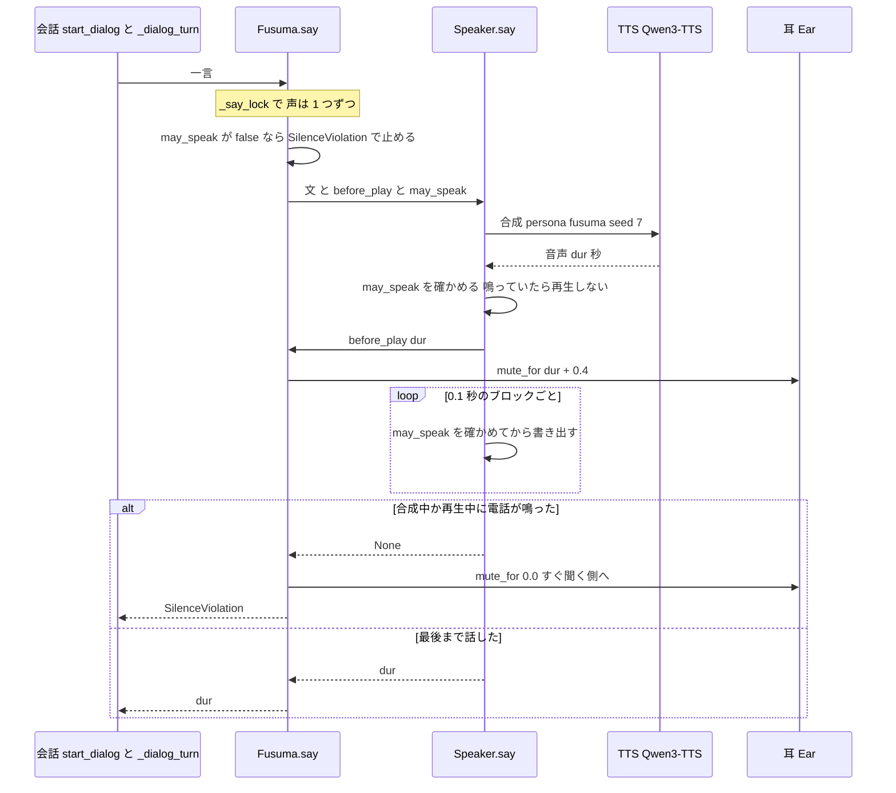

# 電話のあとの会話

## 3 行で

- 電話が終わって少し間をおき、部屋が 8 秒静かなのを確かめてから、ふすまごしが「そういえば、さっきの電話、なんだったの？」と声をかけます。普通の電話には声をかけません。
- 祖母が話し終えるまで待ってから、1 回に 1 つだけ返します(受け止めて 1 つだけ聞く → 確かめ方と、家族に伝えてよいか → 日常の話題へ)。
- どんな終わり方でも、その通話の文字起こしは消します。電話が鳴ったら、話している途中でもその場で黙ります。

---

ここから下はエンジニア向けの詳細です。コードは主に [`orchestrator.py`](../../app/fusuma/orchestrator.py) の `Fusuma` と、[`family.py`](../../app/fusuma/brain/family.py) の `postcall_turn` です。耳の側(聞く窓・半二重・`hearing()`)は [耳 — Mac の中の処理](ear.md)、まとめ役の判断そのものは [脳 — Claude の家族会議](brain.md)、消す仕組みの全体は [プライバシーの仕組み](privacy.md)、夕方の便りは [夕方の便り — Claude Managed Agents](managed-agents.md) にあります。値はすべてコード([`config.py`](../../app/fusuma/config.py) ほか)とリポジトリのデータから取っています。登場人物・会社名・住所はすべて架空で、音声はすべて合成音声です。



## 1. 全体の流れ



| 段 | 関数 | 決まり |
|---|---|---|
| 判断 | `Fusuma._finalize` | まとめ役の `postcall.ask` が true で、動きが `silent` 以外なら会話へ(同期モードでは会話をしない) |
| 間をおく | `Fusuma._later` | `POST_CALL_DELAY_SEC` 既定 20 秒(環境変数 `FUSUMA_POST_CALL_DELAY`) |
| 確かめる | `Fusuma.start_dialog` | もっと新しい電話があれば聞かずに消す。通話中(`may_speak()` が false)・別の会話中・`QUIET_BEFORE_OPENER_SEC` 8 秒静かでない、のどれかなら、`POST_CALL_DELAY_SEC` と同じ間隔(既定 20 秒)でやり直す(最大 20 回) |
| 一言目 | `Fusuma.say` | `POSTCALL_OPENER`「そういえば、さっきの電話、なんだったの？」 |
| 待つ | `Fusuma._await_answer` | 窓 14 秒、`DIALOG_IDLE_SEC` 25 秒で見直し。話している途中なら 2 秒ごとに見直す(最大 12 秒) |
| まとめる | `Fusuma._buffer_answer` / `_flush_answer` | 最後の断片から 1.3 秒。`ear.hearing()` なら 0.4 秒ごとに待ち直す(最初の断片から 12 秒まで) |
| 考える | `family.postcall_turn` | Claude Sonnet 5.5、構造化出力 `POSTCALL_TURN`、回数ごとの指示 |
| 話す | `Fusuma._dialog_turn` → `Fusuma.say` | 言い切り・責める言葉は決まった文に差し替える |
| 消す | `Fusuma._purge` | どの終わり方でも |

## 2. いつ声をかけるか

### 問いかけるかどうか(`_finalize`)

通話の終わり(耳の `ended` イベント)を受けて、`_finalize` が聞き役の最終判定 → (怪しければ)反証役 → まとめ役(`family.decide`)→ 通話カルテ →(動きが `immediate` なら)今すぐの便り、の順に進めます。そのあとで、問いかけるかを決めます。

```python
ask = bool(dec.get("postcall", {}).get("ask")) and dec["action"] != "silent"   # 普通の電話には問いかけない
```

- まとめ役への指示([`family.md`](../../app/fusuma/brain/prompts/family.md))でも「普通の電話には問いかけない(ask=false)」としていますが、コードでも `silent` なら問いかけません(原則のテスト `test_silent_call_gets_no_postcall_question`)
- 問いかけるときは `_later(postcall_delay, start_dialog, cid)` で 20 秒後に予約します
- 問いかけないとき、祖母の発話がない通話、判断の途中で失敗したとき、同期モード(`Fusuma(sync=True)`。下準備の [`run_call.py`](../../app/scripts/run_call.py) が使い、会話をしない)では、その場で文字起こしを消します(7 章)

評価の 4 回([`eval/result_v6.json`](../../eval/result_v6.json) ほか)で、まとめ役は次のように返しました。

| 通話 | 動き | `postcall.ask` | `share_consent_needed` |
|---|---|---|---|
| S05 健康食品の勧誘(2 回目・定期購入の申込) | evening | true | true |
| S03 キャッシュカード詐欺盗 | immediate | true | true |
| S00 勧誘(1 回目・本人が断る)、S08 自分でかけたテレビ通販、S13 本物の警察署 | silent | false | false |

(4 回とも同じ。評価([`run_eval.py`](../../app/scripts/run_eval.py) の `brain`)は聞き役・反証役・まとめ役を直接呼ぶだけで、`Fusuma` を通らないので、電話のあとの会話はしていません。)

### 間をおく(`POST_CALL_DELAY_SEC`)

20 秒は、判断が終わってから数えます。一言目が出るまでには、少なくとも次の時間がかかります。

1. 受話器を置く直前の発話を文字にし終えて、耳が `ended` を出すまで([耳](ear.md) の 9 章)
2. 判断にかかる時間。評価では、聞き役の最終判定・反証役・まとめ役で S05 は 24.0〜27.6 秒、S03 は 21.5〜23.1 秒でした(4 回の `sec`。`run_eval.py` は既定で 3 通話を並べて流す(`--workers 3`)ので、端末とは条件が違う)。今すぐの便りのときは、便りを書き終えるまで待ちます
3. `POST_CALL_DELAY_SEC` の 20 秒
4. 下の確認と、声の合成

### 話しかけてよいか(`start_dialog`)

上から順に確かめます。



- **もっと新しい電話があった**: `_latest_cid` は、判断を始めたいちばん新しい通話の ID です。あとから別の電話があると、「さっきの電話」がどれか分からなくなるので、古い方は聞かずに消します(カルテと夕方の便りには残る。`test_older_call_is_not_asked_about`)
- **通話中**: `may_speak()` は耳の状態が ringing・dialing・in_call なら false です(8 章)。別の電話の最中なら、終わるまで待ちます(`test_dialog_waits_until_other_call_ends`)。その電話が通話になって終わり、判断が始まると `_latest_cid` が変わるので、次の確認で上の「もっと新しい電話」に当たり、前の電話は聞かずに消します(呼出音だけで出なかった電話は判断に進まないので、待ったあとに聞きます)
- **部屋が静かでない**: `ear.quiet_for(8.0)` は、話し声の途中でなく、最後に声がしてから 8 秒たったときに true です。ふすまごし自身の声は数えません(耳の半二重)。設定のコメントには「耳が気づかなかった電話の、聞いている側の沈黙を考えて」とあります(`test_opener_waits_while_someone_is_talking`)
- **待ちきれない**: やり直しは `tries < 20` のあいだで、21 回目の確認でもだめなら聞かずに消します。既定の 20 秒間隔なら、最初の確認から約 400 秒です(`test_never_quiet_room_purges_without_asking`)

### 決まった一言(`POSTCALL_OPENER`)

一言目は [`config.py`](../../app/fusuma/config.py) の `POSTCALL_OPENER`(環境変数 `FUSUMA_POSTCALL_OPENER` で変えられる)で、Claude には作らせません。まとめ役の出力にも `postcall.opener` がありますが、読み上げには使いません。

```text
そういえば、さっきの電話、なんだったの？
```

設定のコメントは「聞き取った中身を先に言わず、本人に話してもらう(尊厳と「覗かない」距離感のため)」です。開発中に、ふすまごしが答え済みのことを聞き返したため、1 回の発話で 1 つのことに絞り、最初の一言を固定しました([README の「反復の記録」](../../README.md))。

会話の記録はこの形で始まります。

```python
self.dialog = {"call_id": cid, "history": [{"who": "fusuma", "text": opener}], "told": [], "consent": "unknown"}
```

一言目を話す直前や、声の合成中・再生中に電話が鳴ったら(`SilenceViolation`)、会話をいったん閉じ(`dialog_closed`、reason `call`)、20 秒後に `start_dialog` からやり直します(`tries` を 1 つ進める)。声が出せないとき(TTS が落ちた など)は、閉じて消します(`test_tts_failure_closes_dialog_and_purges`)。

## 3. 1 回ごとの段取り(`family.postcall_turn`)

祖母の答えがまとまるたびに、`_dialog_turn` が `postcall_turn(karte, decision, history, store)` を呼び、次の一言を作ります。

| 項目 | 値 |
|---|---|
| モデル | `config.MODEL_FAMILY` = `claude-sonnet-5-5`(server-side fallbacks つき。`fallback=True`) |
| システム | [`principles.md`](../../app/fusuma/brain/prompts/principles.md) + [`postcall.md`](../../app/fusuma/brain/prompts/postcall.md)(キャッシュの対象) |
| 出力 | 構造化出力 `schemas.POSTCALL_TURN`([`schemas.py`](../../app/fusuma/brain/schemas.py))、`max_tokens=800`、`effort="low"` |

### Claude に渡すもの

```text
通話カルテ: <カルテの JSON>
まとめ役の動き: <silent / evening / immediate>(immediate のときは「(今すぐの便りを、もう家族に送った)」が付く)
家族に伝える同意の確認が必要か: <immediate のときは False、ほかは decision.postcall.share_consent_needed>
暮らしのメモ:
<Store.memo_digest()。内緒と判定したメモは入らない>

ここまでの会話:
ふすまごし「…」
祖母「…」

ふすまごしの発話はここまで N 回。<回数ごとの指示>
```

### 回数ごとの指示

`N` は、ここまでのふすまごしの発話の数(決まった一言を含む)です。



| N | 指示([`family.py`](../../app/fusuma/brain/family.py) の `plan`。例はコードのまま) |
|---|---|
| 1 | 祖母の答えを受け止め、カルテの `to_ask` から一番大事なことを 1 つだけ聞く(祖母がもう話したことは聞かない) |
| 2 | 受け止めて、確かめ方を押しつけずに提案し(例: 届いたら一緒に書類を見ようか)、続けて、今すぐの便りを送ったなら「同意は聞かずに、家族にもう知らせたことを正直に伝える(例: 心配だったから、健太にはもう知らせたよ)」、同意の確認が要るなら「最後に家族に伝えてよいかを聞く(例: この話、健太にも話しておいていい?)」、どちらでもなければ「日常の話題に戻して done=true」 |
| 3 以上 | 祖母の答えを受け止め(同意してくれたらお礼)、暮らしのメモの話題に戻して done=true |

[`postcall.md`](../../app/fusuma/brain/prompts/postcall.md) は、話し方(1 回 1〜2 文・40 文字くらい・質問は 1 つ・責めない・「だまされた」「詐欺」を使わない)、流れ(① 決まった一言 → ② 受け止めて 1 つ聞く → ③ 確かめ方と同意 → ④ 日常の話題、最大 4 回)、人を取り違えないこと(電話で「息子に聞いてみないと」と言ったなら息子の誠さん)を指示しています。

### 今すぐの便りのとき

動きが `immediate` のとき、`_finalize` は会話を予約する前に、今すぐの便り(`letters.write("immediate", …)`、Claude Opus 5.5)を書いて家族の画面へ出します。そのため `postcall_turn` は次のように変わります。

- `sent = decision.get("action") == "immediate"`
- 「家族に伝える同意の確認が必要か」は、まとめ役が何を返しても `False` として渡す。評価の S03 では、まとめ役は 4 回とも `share_consent_needed: true` を返していますが、会話では同意を聞かない指示になります
- 3 回目の発話で、もう知らせたことを正直に伝える(原則: お金やカードが今日動くときは先に家族へ知らせ、そのことを電話のあとに本人へ正直に伝える)

S03 のまとめ役の `restraint_note`(評価の 1 回目): 「カードを渡す訪問が1時間ほど先に迫っていて、夕方の便りでは間に合わないため、先に家族へ知らせます。」

S03 のあとの祖母の答えとして用意した台本(R03、[`scenarios.json`](../../app/scenarios/scenarios.json)):

```text
警察の人がね、私の口座が詐欺に使われてるって。カードを取り替えないとって。
銀行協会の人が、一時間くらいで来るって…
そうね…健太に、電話してみようかしら。
```

### 返ってくるもの(`POSTCALL_TURN`)

| 項目 | 型 | 使い方(`_dialog_turn`) |
|---|---|---|
| `say` | 文字列 | そのまま読み上げる。言い切りがあれば差し替える(8 章) |
| `intent` | ask_what / ask_detail / ask_consent / reassure / back_to_daily / close | 会話の制御には使わない。`dialog` イベントの `turn` に入り、画面([`app.js`](../../app/web/js/app.js) の `dialogRender()`)が「ひとつずつ聞く」の段取りの、いまの段に赤い下線を引くのに使う(下の表) |
| `done` | 真偽 | true なら、この一言を言い終えたら会話を閉じる |
| `consent_to_share` | yes / no / unknown | unknown 以外なら、その通話の `consent` を更新する |
| `told` | 文字列か null | 祖母がこの会話で話した要点。会話全体の要約なので、最新の 1 つだけ残す(`told_by_person`) |
| `diff` | 文字列か null | 通話の聞き取り(カルテ)と祖母の話の差 |

`told_by_person`・`diff`・`consent` は通話の記録に書き込みます(`Store.upsert_call`)。同意が `no` の電話は、夕方の便り(`letters.write`)にも、Managed Agents の記憶ストアへの同期(`managed.sync_memory`)にも入れません。今すぐの便りにした電話は別で、記憶ストアには送ります。

画面の「ひとつずつ聞く」の段取り(`dialogRender()`)は、いちばん新しい `turn.intent` で決めます。

| `turn.intent`(または会話の状態) | 赤い下線を引く段 |
|---|---|
| まだ `turn` がない(決まった一言のあと)、ask_what、ask_detail | 一 さっきの電話のこと |
| ask_consent | 二 家族に話していい?(一は取り消し線) |
| reassure、back_to_daily、close | 三 いつもの話へ |
| `done` が true(`turn` か `dialog_done`) | 下線なし。3 段とも取り消し線 |

- `turn` を持つ `dialog` イベントは、Claude の答えが返った時点(声を合成する前)に出るので、下線はふすまごしが話し始める前に動きます
- 下線は表示だけです。会話を何回で閉じるか、同意を聞くかは、`postcall_turn` の回数ごとの指示と `done` で決まり、`intent` は見ていません
- 文字起こしを消したあとのイベントログと画面の履歴では、`turn` は `done` と `consent_to_share` だけに伏せます(`redact_event()`)

## 4. 答えを待つ — 1.3 秒と `ear.hearing()`

祖母の答えは文の切れ目で 2 つの発話に割れることがあります。割れたまま応えると、ふすまごしが 2 回応えて会話がずれます(開発中に実際に起きた。[README の「反復の記録」](../../README.md))。そこで、話し終わるまで溜めて 1 回にまとめます。



- **話し終わった** = 最後の断片から 1.3 秒たち、かつ耳がもう話し声を聞いていない(`ear.hearing()` が false。VAD が話し声の途中でなく、文字にしている途中の区間もない)。聞いている途中なら 0.4 秒ごとに待ち直し、最初の断片から 12 秒たったら区切ります
- **応答は 1 つずつ**: `_flush_answer` は `_turn_lock` を取ってから `_dialog_answer` を呼ぶので、次の一言を考えて話し終えるまで、次の答えは待たされます
- **前の問いへの遅れた答え**: 最初の断片が届いたときの会話の長さ(`len(history)`)を `q` として覚えておき、まとめたときに会話が先へ進んでいたら応えずに捨てます(`answer_dropped`)。たとえば、2 つ目の断片が届いたのが、1 つ目の断片への応答を考えている最中だった場合です
- 原則のテスト: `test_answer_split_by_pause_is_one_turn`(R02 の 1 つ目の答えとほぼ同じ 2 文を 2 秒あけて送り、そのあいだ耳が「聞いている途中」なら、つないだ 1 つの答えとして 1 回だけ渡る)、`test_late_answer_to_previous_question_is_dropped`
- 同期モードでは溜めずに、そのまま `_dialog_answer` に渡します

## 5. 聞く窓 14 秒と、答えがないときの見直し

ふすまごしが話し終えるたびに `_await_answer` が、耳の「部屋の声を聞く窓」を 14 秒開け(`ear.open_room_listen(14.0)`)、`DIALOG_IDLE_SEC` 25 秒後の見直し(`check`)を予約します。



- 窓の中かどうかは、耳が**区間の始まり**で決めます([耳](ear.md) の 11 章)。14 秒より遅く話し始めた声は、文字にしません
- `check` は、会話がもう閉じた・会話が別のものになった・会話が先へ進んだ・答えを溜めている途中・次の一言を考えている途中、のどれかなら何もしません(答えに応えたあとの `_await_answer` が、次の見直しを予約し直す)
- まだ話している途中なら(`hearing()`)、2 秒ごとに見直します。見直しは 2 秒ずつ足して 12 秒に達したら打ち切ります。何も聞こえていなければ 25 秒で、話し声が続いていても、話し終えてから遅くとも 37 秒(25 + 12)で閉じます
- 閉じるときは `_end_dialog`(`dialog_closed`、reason `no_answer`)→ `_purge` → `dialog_done` の順です。答えを待っているあいだに別の電話が来たときも、この見直しで閉じます
- 原則のテスト: `test_dialog_closes_and_purges_when_no_answer`、`test_no_answer_check_waits_while_she_is_speaking`

## 6. 実例: S05 のあと(最新の収録 v4)

S05 は、健康食品の勧誘の 2 回目で、祖母が定期購入を申し込んだ電話です(通話の中身は [耳](ear.md) の 12 章)。最新の収録 v4(2026-11-06 14:43〜14:51。端末で S05 を流した)では、聞き役の最終判定が「支払い・定期購入の約束」・怪しい度 0.9、反証役は本物の可能性「中」でした。まとめ役は動き `evening`、`postcall.ask` true、`share_consent_needed` true を返し(抑えた理由は「お金はまだ動いておらず、訪問や口止めもないため今すぐ送る必要はなく、夕方の便りで家族が落ち着いて電話すれば間に合います。」)、カルテの `to_ask` は次の 2 つでした(評価の 4 回でも、S05 の動きと 2 つの真偽は同じ)。

```text
さっきの電話で、毎月届く約束になったのか、いつ届くと言われたか
書面や荷物が届いたら、一緒に中身を見てもいいか
```

会話の流れです(段取りはコードどおり。Claude が返す中身は回ごとに変わります)。祖母の答えは台本 R02 の 3 つの録音で、ふすまごしが話し終えるたびに、`server._auto_answer` が 1.2 秒おいて次の録音を部屋に流します([`server.py`](../../app/fusuma/server.py)。答えは録音なので、ふすまごしの言葉には合わせていません)。





v4 で実際に交わした言葉です。ふすまごしの文は声の記録(`FUSUMA_SAVE_SPEECH=1` で残る `runs/speech/speech_log.jsonl`。リポジトリには入れていない)から、祖母の文は台本 R02 から写しました。時刻は話し始めた時刻で、Mac の時計です(画面と耳の時計はデモの再生で台本の時刻に合わせてあるので、写真の画面は 14:03 のまま)。

```text
14:46:50 ふすまごし「そういえば、さっきの電話、なんだったの？」
         祖母「膝のサプリですって。今日だけ半額だっていうから、つい、頼んじゃったのよ。」
14:47:15 ふすまごし「そうだったんだ、膝のこと気になってたものね。毎月届く約束になったのか、覚えてる?」
         祖母「毎月届くんですって。いつでもやめられるって言ってたけど。」
14:47:41 ふすまごし「そうだったんだ。届いたら、一緒に中身を見ようか。この話、健太にも話しておいていい?」
         祖母「いいわよ。心配性なんだから。」
14:48:06 ふすまごし「ありがとう、健太にも話しておくね。ところで、畑の大根、煮物にする?」
```

- 2 回目(N = 1)は、`to_ask` の 1 つ目から 1 つだけ聞いています
- 3 回目(N = 2)は、受け止め(「そうだったんだ」)→ 確かめ方の提案(「届いたら、一緒に中身を見ようか」)→ 家族に伝えてよいか、の順で、指示どおりです。画面の段取りの下線は、ここで「二 家族に話していい?」に移りました([how-it-works.md](how-it-works.md) の「画面」の写真)
- 4 回目は、同意へのお礼と、暮らしのメモ(11/4 のおしゃべりの「畑の大根」「煮物」)の話題です。Claude は `done` を true、`consent_to_share` を yes で返し、言い終えたあとで文字起こしを消しました(`purged` は 14:48:12)
- 端末に残ったのは、同意 `yes` と、本人が話したことの要点(`told_by_person`)「膝のサプリを今日だけ半額と言われて頼んだ。毎月届くと言われた。いつでも辞められると言っていたと聞いた。健太に話すのはいいと言った。」です
- 誰の名前で同意を聞くかは回によって変わります。声の記録に残る 5 回の会話のうち、11/5 の 1 回は「この話、息子の誠さんにも話しておいていい?」、11/6 の 4 回は「健太にも」でした。`postcall.md` には、同意の聞き方の例として「健太」があり、別に「人を取り違えない(電話で「息子に聞いてみないと」と言ったなら息子の誠さん)」ともあります。v4 でも祖母は通話で「息子に聞いてみないと」と言っていたので、どちらの名前で聞くかは、指示の中で決め切れていません(家族の文脈では、便りをいちばんよく読んで電話をかけるのは孫の健太)

## 7. 終わり方と、文字起こしを消すこと

文字起こし(`lines`)は、電話のあとの聞き取りが終わるまでの一時保存です。**どの終わり方でも `Fusuma._purge` を通ります。**

| 終わり方 | 場所 | 出るイベント | 文字起こし |
|---|---|---|---|
| 祖母の発話がない通話 | `_finalize` | `decision`(silent・「発話なし」) | その場で消す |
| 問いかけない(`ask` が false、または動きが silent) | `_finalize` | — | その場で消す |
| 同期モード(下準備の `run_call.py`) | `_finalize` | — | その場で消す |
| 判断の途中で失敗 | `_finalize` | `error`(finalize) | その場で消す(`test_finalize_error_still_purges`) |
| あとから別の電話 | `start_dialog` | `dialog_skipped`(newer_call) | 消す |
| 21 回確かめても話しかけられない | `start_dialog` | `dialog_skipped`(never_quiet) | 消す |
| 一言目を話す直前・合成中・再生中に電話が鳴った | `start_dialog` | `speak_stopped`(合成のあとで止めたとき)、`dialog_closed`(call) | まだ消さず、20 秒後に確かめ直す(上の 2 つか、会話の終わりで消す) |
| 一言目の声が出せない | `start_dialog` | `error`(say)、`dialog_closed`(error)、`dialog_done`(error) | 消す |
| 答えがない | `_await_answer` の `check` | `dialog_closed`(no_answer)、`dialog_done`(no_answer) | 消す |
| 次の一言を作れない(Claude の失敗・予算の上限 など) | `_dialog_turn` | `error`(postcall)、`dialog_closed`(error)、`dialog_done`(error) | 消す |
| 返事を話す直前・合成中・再生中に電話が鳴った | `_dialog_turn` | `speak_stopped`(合成のあとで止めたとき)、`dialog_closed`(call)、`dialog_done`(call) | 消す(聞けたところまでは、本人が話したこととして記録済み) |
| 返事の声が出せない | `_dialog_turn` | `error`(say)、`dialog_closed`(error)、`dialog_done`(error) | 消す(`test_tts_failure_mid_dialog_closes_and_purges`) |
| 会話を終えた(`done` が true) | `_dialog_turn` | `dialog_done` | 最後の一言を言い終えてから消す(`test_dialog_answer_then_done_purges`) |
| 端末を起動し直した | [`server.py`](../../app/fusuma/server.py) の `_startup` | `purged` | 消えていない通話(`Store.pending_transcripts`)をすべて消す |
| 画面のリセット(`POST /api/reset`) | `server.reset` | `purged`、`reset` | 消してから記録を空にする |

(「消す」ときは、どの場合も `_purge` が、消し終えたところで `purged` イベントを出します。)

`_purge(cid)` がすること:



| 残るもの | 消す・伏せるもの |
|---|---|
| 通話カルテ(根拠の短い言葉が時刻つきで入る)と、まとめ役の判断(動き・見出し・理由・抑えた理由) | 文字起こし `lines` |
| 聞き役の判定の要約(track・stage・score・risk・名乗り・商品・お金・定期購入・期限・訪問・口止め・notify_now。発話行為は時刻と種類だけ) | 聞き役の `evidence`・`disclosed`・`reason`・`to_ask` と、発話行為の引用(`slim_listener`) |
| 反証役の本物らしさの見立てと、引いた知識カードの出典と題 | 反証役の本物らしい点・らしくない点・別の説明・確かめ方・原文(`slim_rebuttal`) |
| 電話のあと本人が話したこと・差・同意、間の数値(`ma`) | 台帳 `runs/privacy_ledger.jsonl` の中身(役割・時刻・文字数は残る)。画面とイベントログの発話・会話・読み上げた文・Claude への送信内容(`redact_event`) |

(場所は [`store.py`](../../app/fusuma/store.py)、[`brain/llm.py`](../../app/fusuma/brain/llm.py)、[`server.py`](../../app/fusuma/server.py)。)

**消したあとに届くもの。** 会話を閉じた直後に文字になった声(閉じる前に話し始めた区間)は、`on_ear` が閉じてから 20 秒のあいだ、その通話の ID を付けて流します。画面とログの側(`Hub`)は消した通話の ID を覚えていて、あとから届いたイベントも伏せます。台帳の側(`llm._purged`)も、消したあとに戻ってきた Claude の呼び出しの中身を残しません。原則のテストは、画面とログの側を `test_server_redacts_event_log_and_late_events` で、台帳にすでにある行を伏せることを `test_purge_removes_quotes_ledger_and_logs` で確かめています。

## 8. 話すことの安全

端末が声を出す経路は `Fusuma.say()` だけです([CLAUDE.md](../../CLAUDE.md) の原則 1)。



- **`may_speak()`**: 耳があるなら、状態が ringing・dialing・in_call のどれでもないこと。耳がない(通話中か分からない)のに音を出す設定なら、話さない側に倒します。許すのは、音を出さない文字だけのシミュレーション(`_speak` がない)だけです(`test_say_refuses_without_ear_when_audible`)
- **通話中に呼ばれたら**: `SilenceViolation("通話中は話さない")`。TTS も呼びません(`test_say_refuses_during_call`)
- **合成のあいだに電話が鳴ったら**: 合成は数秒かかることがあるので、再生の直前にもう一度確かめ、鳴っていれば再生を始めません(`test_speaker_does_not_start_if_call_began_during_synthesis`)
- **再生中に電話が鳴ったら**: [`devices.py`](../../app/fusuma/devices.py) の `Speaker.say` は、自分専用の出力ストリームに 0.1 秒ずつ書き、書く前に毎回 `may_speak()` を確かめます。鳴ったら `abort()` して `None` を返します。部屋の音(デモの `VirtualRoom` の再生)は止めません。音を出さない設定(`FUSUMA_AUDIBLE=0`)でも同じ 0.1 秒ごとに確かめます。テストでは、音を出さない設定で 2 秒の声を話させ、0.3 秒後に鳴らして、`say` を呼んでから 0.8 秒以内に止まることを確かめています(`test_speaker_stops_when_phone_rings_mid_speech`)
- **止めたあと**: 耳の消音をすぐ解いて(`mute_for(0.0)`)電話の第一声を聞き逃さないようにし、`speak_stopped` イベントを出して、`SilenceViolation("話している途中で電話が鳴ったので、やめた")` で会話の側に知らせます(`test_ring_cut_unmutes_ear_at_once`)
- **気づくまでの遅れ**: 呼出音が状態に反映されるのは、耳の音イベントの判定(0.96 秒の窓を 0.48 秒ごと)で ring が出たときです。その周期ぶんの遅れのあと、次の 0.1 秒のブロックの前に止まります
- **自分の声は聞かない**: 再生の直前に `ear.mute_for(dur + 0.4)`([耳](ear.md) の 10 章)
- **声を残さない**: 話した音声を残すのは `FUSUMA_SAVE_SPEECH=1` のときだけ(デモ動画の編集用。`runs/speech`)
- **言い切り・責める言葉を口にしない**: `_dialog_turn` は、`postcall_turn` の `say` を [`letters.py`](../../app/fusuma/brain/letters.py) の `violations` で確かめ、「詐欺です」「詐欺に違いない」「だまされた」などの言い切りがあれば「そうだったんだね。教えてくれてありがとう。」に差し替えます(`test_spoken_reply_with_assertion_is_replaced`)。「詐欺と断定はできない」「だまされないように」のような言い方は通します(`test_assertion_rule_ignores_hedged_wording`)
- **ほかの経路を足させない**: `fusuma/` の中で `speaker.say(`・`sd.play`・`sounddevice`・`TTS_URL`・`OutputStream`・`.synth(` などを直接使う書き方は、Claude Code の PreToolUse フック([`guard_principles.py`](../../app/scripts/hooks/guard_principles.py))が書き込む前に止めます(`devices.py`・`ear/pipeline.py`・`config.py` は除く。代表的な書き方の印で見る簡易な番人で、すり抜ける書き方はある。`test_guard_hook`)

## 9. 限界(コードとデータから分かること)

- **最大 4 回は指示で、コードの打ち切りではない。** 会話を閉じるのは、Claude が `done` を true で返したときと、7 章のほかの終わり方です。答えがなければ、ふすまごしが話し終えてから遅くとも 37 秒で閉じます
- **聞くのは、いちばん新しい電話のことだけ。** あとから別の電話があると、前の電話は聞かずに消します(カルテと便りには残る)
- **8 秒の静けさでは言い切れない。** 耳が呼出音を聞き逃した電話では、受話器のこちら側が 8 秒より長く黙ることもあり、その沈黙のあいだに話しかけてしまいえます。S05 の最長の沈黙は 8.9 秒でした
- **窓の中の声は、誰の声でも祖母の答えとして扱う。** 話者は区別していません。窓は話し終えてから 14 秒だけで、それより遅く話し始めた答えは文字にならず、25 秒で見直して閉じます
- **今すぐの便りが書けなかったとき。** `_finalize` は便りの失敗(`error`、immediate_letter)のあとも会話を続けます。`postcall_turn` は動きだけを見て `sent` を決めるので、その場合も「もう知らせた」前提の指示になります
- **デモの答えは録音。** R02・R03 の答えは台本の録音で、ふすまごしの言葉に合わせて変わりません
- **実際の家ではまだ試していない。** 黙る間・声をかける間は、暮らしの中で確かめる必要があります(README の「限界と前提」)

## 10. 試し方

- 原則のテスト(Claude API も whisper-server・TTS も使わない。27 件): `cd app && ../.venv/bin/python tests/test_principles.py`([`test_principles.py`](../../app/tests/test_principles.py))。この文書に出てきた `test_` で始まる名前は、すべてここにあります
- 端末で会話を起こす: `POST /api/dialog/{call_id}` が `start_dialog` を呼びます(判断があり、文字起こしがまだ残っている通話だけ。いちばん新しい電話でなければ、2 章のとおり聞かずに文字起こしを消します)。一言目は決まった文ですが、祖母が答えると `postcall_turn` で Claude を呼びます。デモの通話は `POST /api/play`(README の「動かし方」)で、聞き役・反証役・まとめ役と電話のあとの会話まで Claude を呼びます。どちらもクレジットを使います
