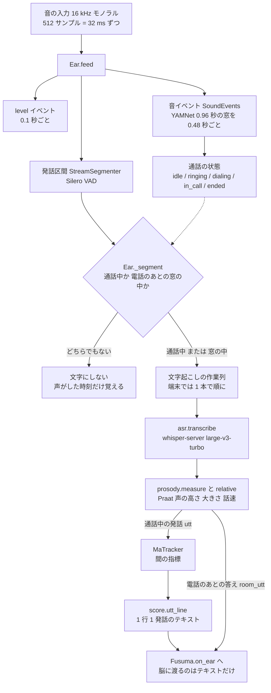
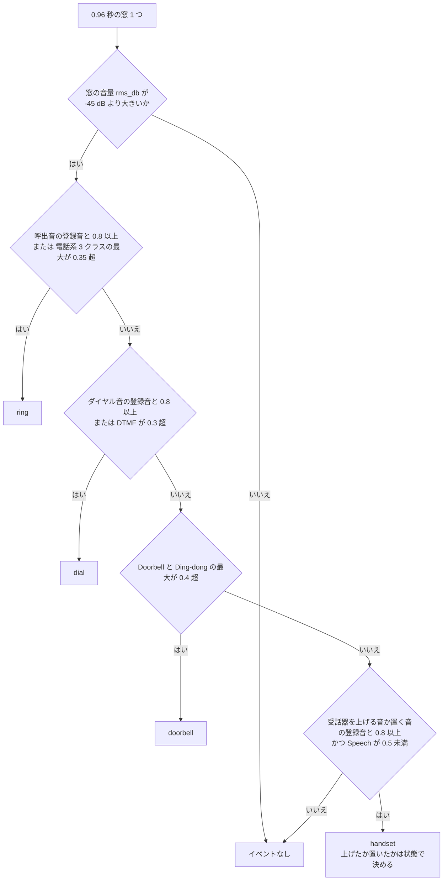
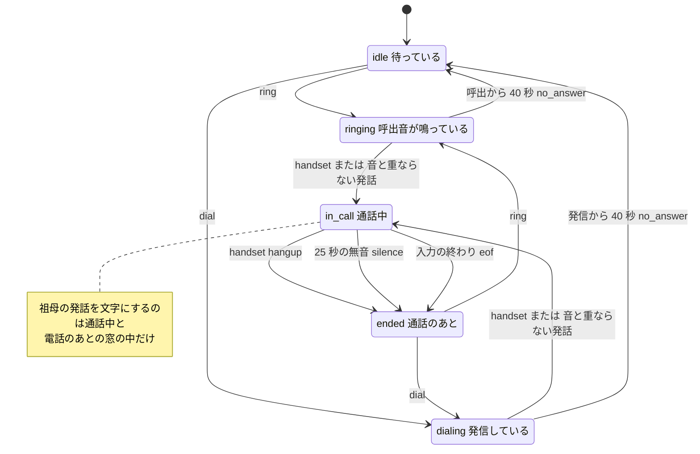
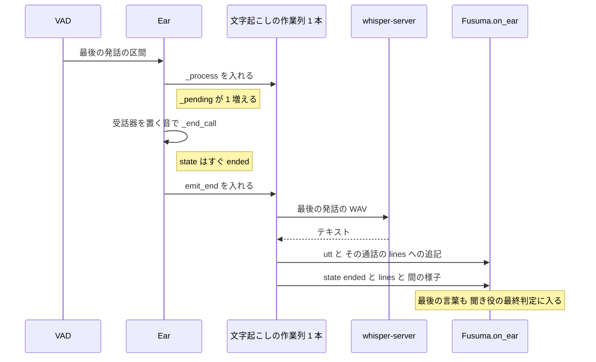
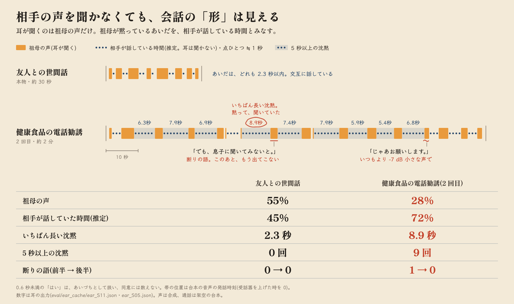
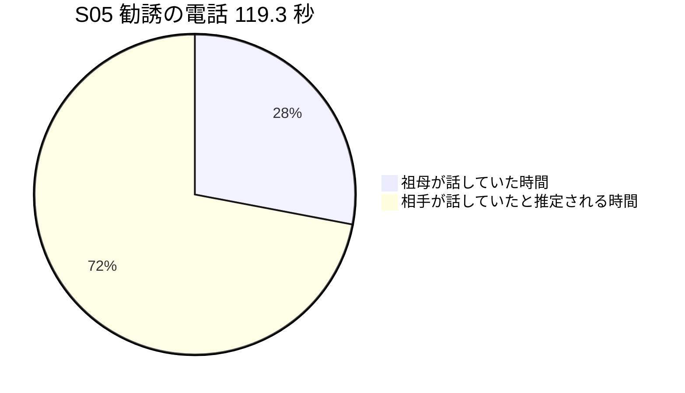
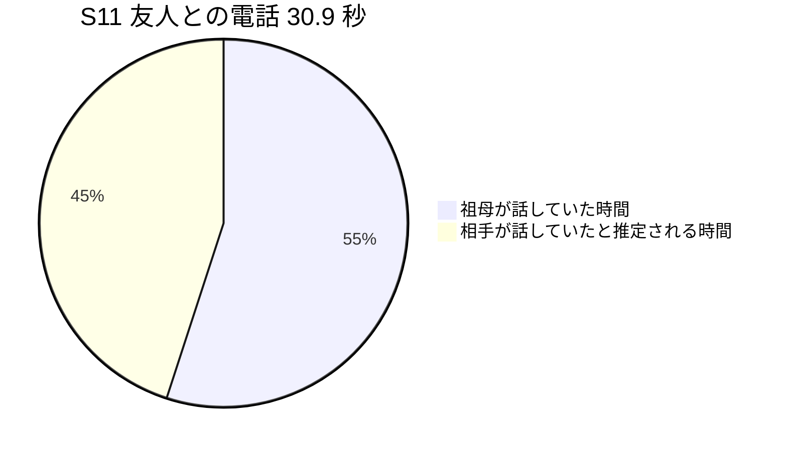
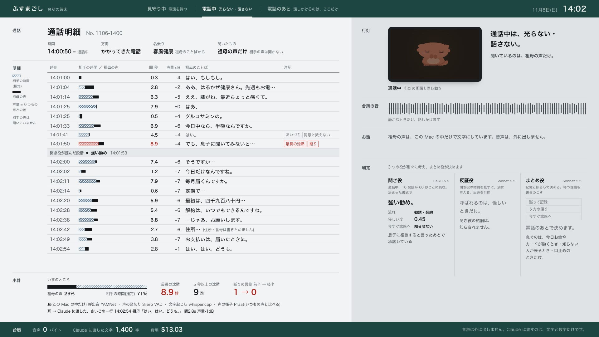

# 耳 — Mac の中の処理

## 3 行で

- 部屋の音を 32 ミリ秒ずつ聞き、呼出音と、受話器の音か話し始めた声から「いま電話中か」を見分けます。電話回線にはつなぎません。
- 祖母の声を文字にするのは、電話中と、電話のあとにふすまごしが話しかけた直後だけです。電話中は、声の高さ・大きさ・話す速さを「いつもの声」と比べ、返事までの沈黙(「間」)を数えます。
- 耳から Claude に渡るのは、この文字と数値を並べたテキストだけです。音声は Mac の外に出ません。

---

ここから下はエンジニア向けの詳細です。値はすべてコード([`app/fusuma/config.py`](../../app/fusuma/config.py) ほか)と同梱のデータ([`eval/ear_cache/`](../../eval/ear_cache))から取っています。登場人物・会社名・住所はすべて架空で、音声はすべて合成音声です。全体の流れは [しくみの全体像](how-it-works.md)、耳の出力を読む Claude の側は [脳 — Claude の家族会議](brain.md)、電話のあとに話しかける側は [電話のあとの会話](dialog.md)、文字起こしを消す仕組みは [プライバシーの仕組み](privacy.md) にあります。

## 1. 全体の流れ


(構成図は見取り図です。この文書の数値は、同梱の [`eval/ear_cache/ear_S05.json`](../../eval/ear_cache/ear_S05.json) から取っています。)



| 段 | 場所 | 要点 |
|---|---|---|
| 入力 | [`devices.py`](../../app/fusuma/devices.py) `VirtualRoom.run`、[`pipeline.py`](../../app/fusuma/ear/pipeline.py) `Ear.run_mic` / `Ear.run_file` | 16 kHz(`config.SR`)、512 サンプル(`vad.CHUNK`、32 ms)ずつ `Ear.feed` に渡す |
| 音イベント | [`sed.py`](../../app/fusuma/ear/sed.py) `SoundEvents.run` / `classify` | YAMNet(ONNX)。0.96 秒の窓、0.48 秒ごと。登録音との照合を併用 |
| 発話区間 | [`vad.py`](../../app/fusuma/ear/vad.py) `StreamSegmenter.feed` | Silero VAD。しきい値 0.5 / 0.35、無音 18 チャンク(576 ms。設定は 600 ms)で区間を閉じる |
| 文字起こし | [`asr.py`](../../app/fusuma/ear/asr.py) `transcribe` / `clean` | whisper.cpp の whisper-server(large-v3-turbo)。`no_context`、語彙の prompt |
| 声の様子 | [`prosody.py`](../../app/fusuma/ear/prosody.py) `measure` / `relative` / `is_backchannel` | Praat(parselmouth)。「いつもの声」との差。0.6 秒のあいづちの規則 |
| 間 | [`ma.py`](../../app/fusuma/ear/ma.py) `MaTracker.summary` / `summary_line` | 話していた割合、沈黙、「はい」の連続、断りの語、声量の変化 |
| テキスト | [`score.py`](../../app/fusuma/ear/score.py) `utt_line` / `event_line` | Claude に渡す 1 行 1 発話の形 |
| 状態 | [`pipeline.py`](../../app/fusuma/ear/pipeline.py) `Ear` | 呼出 → 通話中 → 通話のあと。25 秒・40 秒・3.0 秒の決まり |

耳は判断をしません([`ear/__init__.py`](../../app/fusuma/ear/__init__.py))。出すのはイベント(dict)だけです。端末では、受け取るのは [`orchestrator.py`](../../app/fusuma/orchestrator.py) の `Fusuma.on_ear` です(評価の `run_eval.py` や `ear_file.py` では、それぞれのスクリプトが受け取ります)。

## 2. 入力と 32 ミリ秒の刻み

`Ear.feed(chunk)` は 512 サンプル(32 ms)を受け取るたびに、次の順で処理します。

1. 直近の音を `ring`(長さ 0.96 秒 + 512 サンプル = 15,872 サンプル)に足し、耳の時計 `t` を 32 ms 進める
2. 0.1 秒ごとに `level` イベント(その 32 ms の音量 dB と、いまの状態)を出す。画面(台所の画面の右)の「台所の音」の線に使う
3. `t` が `next_sed` に達したら(最初は 0.96 秒、以後 0.48 秒ごと)、直近 0.96 秒で音イベントを判定する(`_sed`)
4. VAD に渡し、閉じた発話区間があれば `_segment` へ
5. 時間切れを確かめる(`_timeouts`)

入力は 3 通りあります。

| 入力 | 使う場面 | 中身 |
|---|---|---|
| `VirtualRoom.run`([`devices.py`](../../app/fusuma/devices.py)) | デモ(既定の `FUSUMA_INPUT=virtual`) | 流し込んだ 16 kHz の録音を実時間で 32 ms ずつ渡す。何も鳴っていないときは小さな雑音(標準偏差 0.0006 の正規分布)。同じ音をスピーカーからも鳴らす |
| `Ear.run_mic` | `FUSUMA_INPUT=mic`(未検証) | sounddevice の 16 kHz・モノラル・ブロック 512 の入力 |
| `Ear.run_file` | 評価の耳の出力づくり([`run_eval.py`](../../app/scripts/run_eval.py) の `ear_lines`。キャッシュがないときか `--force-ear` のときだけ)、[`ear_file.py`](../../app/scripts/ear_file.py)、下準備の [`run_call.py`](../../app/scripts/run_call.py) | ファイルを最後まで渡し、VAD の残りを `flush`、通話中なら `_end_call(reason="eof")` |

端末([`server.py`](../../app/fusuma/server.py))は `Ear(..., realtime=True)` で作り、文字起こしを 1 本だけの作業列(`ThreadPoolExecutor(max_workers=1)`)で順に流します。`run_eval.py`・`ear_file.py`・`run_call.py` は `realtime` を付けずに(`False`)作るので、作業列を使わず、区間ごとにその場で文字にします。

## 3. 音イベント — YAMNet と登録音([`sed.py`](../../app/fusuma/ear/sed.py))

YAMNet(AudioSet の 521 クラス)を ONNX で CPU 実行します(`onnxruntime`、`intra_op_num_threads = 2`)。0.96 秒の窓 1 つから、521 クラスのスコアと 1024 次元の埋め込みが出ます。耳は各窓の最初のフレーム(`frames[0]`)だけを使います。スコアは確率としては扱いません(モジュールの説明)。

### 使うクラス(`IDX`)

クラス名は [`scripts/setup.sh`](../../scripts/setup.sh) が取ってくる `yamnet_class_map.csv` のものです。

| キー | id | YAMNet のクラス名 | 使い方 |
|---|---|---|---|
| `speech` | 0 | Speech | 受話器の音の判定で「話し声ではない」(0.5 未満)を確かめる |
| `telephone` | 383 | Telephone | 呼出音: 3 クラスの最大値が 0.35 を超える |
| `bell` | 384 | Telephone bell ringing | 同上 |
| `ringtone` | 385 | Ringtone | 同上 |
| `dtmf` | 386 | Telephone dialing, DTMF | 発信: 0.3 を超える |
| `doorbell` | 349 | Doorbell | 玄関のチャイム: 2 クラスの最大値が 0.4 を超える |
| `ding_dong` | 350 | Ding-dong | 同上 |
| `television` | 518 | Television | `classify` の戻り値の `tv`(Television と Music の大きい方)になるだけ。イベント・判定・テキストには使っていない |
| `music` | 132 | Music | 同上 |
| `dial_tone` | 387 | Dial tone | 定義だけ(判定には使っていない) |
| `beep` | 475 | Beep, bleep | 定義だけ |
| `click` | 485 | Clicking | 定義だけ |

### 登録音との照合

汎用クラスだけに頼らず、家の電話の音を数秒登録して照合します。

- `SoundEvents.__init__` が `data/sfx/` の `ring_16k.wav`・`pickup_16k.wav`・`hangup_16k.wav`・`dial_16k.wav` を読み、あれば `enroll` する
- `enroll(name, wav16)`: 登録音を YAMNet に通し、-50 dB より大きいフレームの埋め込み(1024 次元)を平均し、長さ 1 にそろえてテンプレートにする
- `match(frame)`: 入力の埋め込みとテンプレートのコサイン類似度
- 登録音は、[`synth_scenarios.py`](../../app/scripts/synth_scenarios.py) の `write_enrollment_sfx` が `data/sfx/` に書く合成音です(`data/` はリポジトリに含めず、手元で作ります)。呼出音は 1300 Hz と 1630 Hz を 16 Hz で切り替えて 1 秒鳴り、2 秒休む電子音(`sfx_ring`。登録音は 3 回分)、受話器の音は 2 回のクリック(`sfx_pickup` / `sfx_hangup`)、ダイヤル音は DTMF(`sfx_dial`)です。呼出音と受話器の音は、シナリオの音と同じ関数で作っています。ダイヤル音だけは、シナリオ(S08)で使う番号とは別の架空の番号(`FAKE_ENROLL`)で作り、登録と試験を分けています

### 1 つの窓の判定(`classify`、`thr=0.8`)

上から順に見て、最初に当たったものを `event` にします。



登録音の類似度のしきい値 `thr=0.8` について、`classify` の説明には「閾値 thr は実機で調整」とあります(実機の電話機での検出は未検証。14 章)。イベントが出た窓は `sound_marks` に `(始まり, 終わり, 種類)` で残り、あとで「その発話区間は、実は音だったのではないか」を確かめるのに使います(8 章の `_overlaps_sound`)。

## 4. 発話区間 — Silero VAD([`vad.py`](../../app/fusuma/ear/vad.py))

`StreamSegmenter` は 32 ms ずつ Silero VAD の確率を出し、区間が閉じたら `Segment(start, end, audio)` を返します。

| 値 | 設定 | 意味 |
|---|---|---|
| `CHUNK` | 512 サンプル(32 ms) | VAD に渡す単位 |
| `VAD_THRESHOLD` | 0.5 | 話し始め(`thr_on`)。確率が 0.5 以上で区間を開く |
| `thr_off` | 0.35(= 0.5 − 0.15) | 話し終わり。区間の中で 0.35 未満のチャンクを無音として数える(0.35 以上に戻ると数え直す) |
| `VAD_MIN_SILENCE_MS` | 600 | `int(600 / 32)` = 18 チャンク(576 ms)続けて無音なら区間を閉じる |
| `VAD_MIN_SPEECH_MS` | 160 | 0.16 秒より短い区間は捨てる |
| `VAD_PAD_MS` | 80 | 話し始めの 80 ms 前から切り出す |
| 末尾 | 2 チャンク(64 ms) | 閉じるとき、無音を 2 チャンクだけ残して切る |

- `mute_until(t)`: 受け取った音の時刻(VAD が数える累積時間。耳の時計と同じ刻み)が `t` に達するまで、確率を 0 として扱う(10 章の半二重)。新しい区間は開かず、開いていた区間ではそのあいだのチャンクを無音として数える(18 チャンク続けば閉じる)
- `flush()`: ファイルの終わりで、開いたままの区間を閉じる
- `torch.set_num_threads(1)`

**「間」の測り方への影響。** 発話の間(`pre_pause`)は「この区間の始まり − 前の区間の終わり」で測ります。区間には前に 80 ms、後ろに 64 ms(2 チャンク)の余白が付くので、そのぶん(約 0.14 秒)間は短めに出ます。S05 の 2 つ目以降で台本の行の頭にあたる発話(1 文が分かれた後半を除く)では、耳の間は台本で入れた無音より 0.1〜0.3 秒短くなっています(5 章の表)。

**短い切れ目の扱い。** VAD の確率が 0.35 未満の時間が 18 チャンク(約 0.58 秒)に届かない切れ目では、区間は分かれません。逆に文の途中でもそれだけ続けば、1 文が 2 つの発話に分かれます。余白のぶん、分かれたときの耳の間は 0.4 秒台から出ます。S05 では「はあ、グルコサミンの。」が「はぁ。」と「グルコサミンの」(間 0.5 秒)に分かれました。

## 5. 文字起こし — whisper.cpp([`asr.py`](../../app/fusuma/ear/asr.py))

| 項目 | 値 | 場所 |
|---|---|---|
| サーバー | whisper.cpp v1.7.6 の `whisper-server`(Metal)。`127.0.0.1:8765` | [`scripts/setup.sh`](../../scripts/setup.sh)、[`scripts/services.sh`](../../scripts/services.sh) |
| モデル | `ggml-large-v3-turbo-q8_0.bin` | 同上 |
| 起動の引数 | `-l ja -nc --host 127.0.0.1 --port 8765 -t 6` | [`scripts/services.sh`](../../scripts/services.sh) |
| 送り先 | `config.ASR_URL` = `http://127.0.0.1:8765/inference` | [`config.py`](../../app/fusuma/config.py) |
| 要求の引数 | `response_format=json`、`language=ja`、`no_timestamps=true`、`no_context=true`、`temperature=0.0`、`prompt=config.ASR_PROMPT` | `transcribe` |
| 前処理 | 区間の前後に 0.15 秒の無音を足し、16 kHz・16 bit の WAV にして送る。待ち時間の上限 60 秒 | `transcribe`(上限は `_client` の `timeout=60`) |

語彙の手がかり(`config.ASR_PROMPT`):

```text
電話での会話。今日中、半額、定期購入、解約、還付金、暗証番号、キャッシュカード、口座、銀行協会、信用金庫、整形外科、みどり町。
```

返ってきた文字は `clean` で整えます。

- 改行と空白を取り除く
- かな・カタカナ・漢字・英数字が 1 つもなければ空にする
- 無音や雑音で出がちな定型の幻聴(`HALLUCINATIONS` の 5 つ。「ご視聴ありがとうございました」「チャンネル登録」など)を含めば空にする
- 2〜8 文字の同じ並びが 3 回以上続いたら、2 回までに縮める

空になった区間は発話として出しません。文字起こしが例外で落ちたときは `error` イベント(`where: asr`)を出し、通話の追跡は続けます。

**なぜこの形か。** [`scripts/services.sh`](../../scripts/services.sh) のコメントに「kotoba-whisper-v2.0 は 2 秒未満の発話で空文字を返したため(実測)、large-v3-turbo を採用」とあります。`no_context` は、whisper-server が前のリクエストの文脈を持ち越し、前の発話が混ざったのを止めるためです(起動の引数 `-nc` と、要求ごとの `no_context=true` の両方を渡しています。経緯は [README の「反復の記録」](../../README.md))。

**実例: S05 の台本と耳の出力。** 台本([`scenarios.json`](../../app/scenarios/scenarios.json) の S05。各行は「直前の無音(秒)・話し方・発話」)を合成音声で読み、耳に通した結果([`ear_S05.json`](../../eval/ear_cache/ear_S05.json))です。

| 台本の発話 | 台本の間(秒) | 耳の文字起こし | 耳の間(秒) |
|---|---|---|---|
| はい、もしもし。 | 0.7(受話器の音のあと) | はい、もしもし。 | 0.3(注) |
| ああ、はるかぜ健康さん。先週もお電話くださったわね。 | 3.0 | ああ、春風健康さん、先週もお電話くださったわね。 | 2.8 |
| ええ、膝がね、最近ちょっと痛くて。 | 6.5 | ええ、膝がね、最近ちょっと痛くて。 | 6.3 |
| はあ、グルコサミンの。 | 8.0 | はぁ。 / グルコサミンの | 7.9 / 0.5 |
| 今日中なら、半額なんですか。 | 7.0 | 今日中なら半額なんですか? | 6.9 |
| はい。(あいづち) | 0.5 | (出ていない) | — |
| はい。(あいづち) | 4.5 | はい。(あいづち 0.3s) | (行に出ない) |
| でも、息子に聞いてみないと… | 9.0 | でも、息子に聞いてみないと。 | 8.9 |
| そうですか…今日だけなんですね。 | 7.5 | そうですか。 / 今日だけなんですね。 | 7.4 / 1.2 |
| はい。(あいづち) | 0.6 | (出ていない) | — |
| 毎月届くんですか。定期で… | 8.0 | 毎月届くんですか? / 定期で。 | 7.9 / 0.6 |
| 最初は、四千九百八十円… | 6.0 | 最初は4980円。 | 5.9 |
| 解約は、いつでもできるんですね。 | 5.5 | 解約はいつでもできるんですね。 | 5.4 |
| …じゃあ、お願いします。 | 7.0 | じゃあお願いします。 | 6.8 |
| 住所は、…(伏せる) | 3.0 | 住所は、…(伏せる。番地の数字を別の音に聞き違えた) | 2.7 |
| お支払いは、届いたときに。 | 4.0 | お支払いは、届いたときに | 3.8 |
| はい、はい。どうも。 | 3.0 | はい、はい、どうも。 | 2.8 |

(注)最初の発話の 0.3 秒は、無音を測った値ではありません。発話から通話中にしたときの決まった値です(8 章)。住所の発話は、この文書では例としても伏せます(ほかの章の引用も同じ)。

読み取れること:

- 語彙の手がかりにある「今日中」「半額」「解約」はそのまま出ている。一方、住所の番地は別の音に聞き違えた。Claude 側の原則([`principles.md`](../../app/fusuma/brain/prompts/principles.md))には「音声認識の誤りがありえます」と書いてある
- 「はるかぜ」は「春風」、「四千九百八十円」は「4980円」と書き換わる
- 台本のあいづち「はい。」3 回のうち、出力に残ったのは 1 回だけ。残り 2 回は直前の発話から 0.5 秒・0.6 秒しか空いていない。区間を閉じるには確率 0.35 未満が約 0.58 秒続く必要があり、それより短いかほぼ同じなので、前の発話と同じ区間に入り、その区間の文字起こしにも「はい」が出なかったと考えられる(区間の切れ目はキャッシュに残していないので、推定)
- 台本の 17 の発話が、区間の分かれ方で 18 の発話になった(`n_utts` = 18)

## 6. 声の様子 — Praat と「いつもの声」([`prosody.py`](../../app/fusuma/ear/prosody.py))

`measure(audio16)` が 1 区間を測ります。

| 値 | 求め方 |
|---|---|
| `f0` | parselmouth の `to_pitch_ac(time_step=0.01, pitch_floor=75, pitch_ceiling=500)`。有声のフレームの中央値(Hz) |
| `db` | 20 ms ごとの RMS を dB にし、いちばん大きいフレームから 25 dB 以内のフレームだけで平均した値 |
| `voiced_ratio` | 有声のフレームの割合 |
| `dur` | 区間の長さ(秒。VAD の前後の余白を含む) |

`relative(feat, text, base)` が「いつもの声」との差にします。

| 値 | 式 | Claude に渡す表示(`utt_line`。例は S05 の 14:04:38 の行) |
|---|---|---|
| `f0_rel` | `f0 / base.f0 − 1` | `声高-25%`(百分率を整数に丸める) |
| `db_rel` | `db − base.db` | `声量-7dB`(整数に丸める) |
| `rate` | `morae(text) / dur`。区間が 0.3 秒より長く、3 モーラ以上のときだけ | — |
| `rate_rel` | `rate / base.rate − 1` | `話速-14%` |

`morae(text)` は pykakasi でひらがなにして数えます。小さい「ゃゅょぁぃぅぇぉゎ」は数えず、「ー」は 1、数字は 1 文字 2 モーラとして数えます。値がないものは表示しません。たとえば S05 の「はぁ。」は 3 モーラ未満なので、話速が出ていません。

**「いつもの声」(`Baseline`)。**

- 読む場所: `pipeline.baseline_path()`。`runs/baseline_grandma.json` があればそれ、なければ同梱の [`eval/baseline_grandma.json`](../../eval/baseline_grandma.json)
- 同梱の値: F0 146.6 Hz、声量 −27.4 dB、話速 6.31 モーラ/秒(`n` = 25 は F0 を測れた区間の数)。たとえば「声高-25%」は、いつもの 146.6 Hz に対して約 110 Hz
- 作り方: [`calibrate_baseline.py`](../../app/scripts/calibrate_baseline.py) が S11(友人)・S10(医院)・S12(宅配)・R01(夕方のおしゃべり)を VAD で切り、0.8 秒以上の区間の F0 と声量の中央値、4 モーラ以上の区間の話速の中央値をとる
- 注意: S10〜S12 は評価にも入っている通話です(同じ録音なので、厳密には独立していない。スクリプトの説明にも書いてある)
- ファイルがないときの既定値は F0 160.0 Hz、声量 −24.0 dB、話速 7.0 モーラ/秒
- `Ear` を作るときに 1 回読むだけです。`Baseline.update()`(重み 0.15 の移動平均)は用意されていますが、いまのコードからは呼ばれていないので、動いているあいだに基準は変わりません

## 7. あいづち — 0.6 秒の規則

丁寧な聞き手は短い「はい」を何度も挟みます。これを同意と数えると、押し切られと取り違えます。そこで短い「はい/ええ/うん」はあいづちとして別に扱います(`prosody.is_backchannel`)。

- 前後の「、。！？!?…「」」と空白を取り除いた文字が 4 文字以下で
- `config.BACKCHANNEL_WORDS`(はい・ええ・うん・そう・はあ・ああ・へえ・ほう)のどれかで始まり
- 区間の長さが `BACKCHANNEL_MAX_SEC` 0.6 秒 + 0.15 秒(VAD の前後の余白の分)= 0.75 秒より短い

あいづちと判定した発話は、こう扱われます。

| どこで | 扱い |
|---|---|
| Claude に渡す行(`utt_line`) | `14:03:41 祖母「はい。」(あいづち 0.3s)` のように、間や声の値を付けずに出す |
| Claude の原則([`principles.md`](../../app/fusuma/brain/prompts/principles.md))と聞き役([`listener.md`](../../app/fusuma/brain/prompts/listener.md)) | どちらも、あいづちを同意と数えないように指示している |
| 間の指標(`MaTracker`) | 「はい」の連続(`yes_streak`)には数える。声量の変化(`volume_trend_db`)からは除く。話していた割合・沈黙(`pre_pause`)・発話の数には、ふつうの発話と同じく入る |

S05 の注意点が 2 つあります。

- 「はぁ。」は小さい「ぁ」で書き起こされたので、あいづちの語「はあ」に当たらず、普通の発話として扱われた
- 台本のあいづち 3 回のうち 2 回は、出力に出ていない(5 章のとおり、前の発話と同じ区間に入ったと考えられる)。あいづちとしても数えられていない

## 8. 通話の状態([`pipeline.py`](../../app/fusuma/ear/pipeline.py))



| いまの状態 | きっかけ | 次の状態 | 時刻 | 関数 |
|---|---|---|---|---|
| idle / ended | `ring` | ringing(着信の通話を作る) | 窓の始まり | `_on_sound`、`_new_call` |
| idle / ended | `dial` | dialing(発信の通話を作る) | 窓の始まり | 同上 |
| ringing / dialing | `handset` | in_call(「受話器を上げる音」) | 窓の始まり + 0.4 秒 | `_on_sound` |
| ringing / dialing | 音のしるしと重ならない発話区間 | in_call(受話器の音を聞き逃しても、話し始めたら通話中) | 区間の始まり − 0.3 秒 | `_segment` |
| ringing / dialing | 呼出(発信)から 40 秒 | idle(`no_answer`) | — | `_timeouts` |
| in_call | `handset`(通話開始から 3.0 秒より後、かつ最後の発話の終わりより後) | ended(`hangup`) | 窓の始まり + 0.4 秒 | `_on_sound`、`_end_call` |
| in_call | 話し声がなく、最後の発話の終わり(発話がまだなければ通話の始まり)から `LONG_SILENCE_END_SEC` 25 秒を超えた | ended(`silence`) | その時点 | `_timeouts` |
| in_call | ファイルの終わり | ended(`eof`) | その時点 | `run_file` |

**受話器を置いた音の見分け方。** 0.96 秒の窓を 0.48 秒ずつずらして判定するので、同じ受話器の音が続く 2 つの窓に現れえます。「上げた音」と「置いた音」はどちらも `handset` として出て、どちらかは状態で決めます。呼出中・発信中なら上げた音、通話中なら置いた音です。ただし通話が始まって 3.0 秒以内の `handset` は置いた音とみなしません。また、最後の発話が終わる前の `handset` も置いた音とみなしません。

**音と発話の取り違えを防ぐ(`_overlaps_sound`)。** 直近 12 個の音のしるし(ring・dial・handset・doorbell)のどれかと、発話区間の 45% より長く重なり、しかも区間が 2.5 秒より短ければ、その区間は音そのものとみなします。その区間では通話を始めず、文字にもしません。

**通話の ID と記録。** ID は、呼出音(発信音)と判定した窓の始まりの時刻を `%Y%m%d-%H%M` にしたものに、4 桁の 16 進数(`uuid4` の先頭)を付けたものです。in_call に入ると `lines` に「[音] 受話器を上げる音」(発信なら「[音] ダイヤル音(発信)」)を、終わると「[音] 受話器を置く音」を足します。この 2 行は、受話器の音を聞き逃して発話から通話中にしたときや、25 秒の無音・ファイルの終わりで閉じたときにも入ります。区別はイベントの `sound`(受話器の音で通話中にしたときだけ `pickup`)と `reason` にだけ残り、同梱のキャッシュ(`ear_*.json`)には保存していません。

S05 の ID は `20261106-1402-b348`(呼出音を聞いたのは 14:02 台)、通話の始まり(`started`)は 14:03:00、終わりの行は 14:04:59、長さは 119.3 秒です。最初の発話の間 0.3 秒は、発話から通話中にしたときの決まった値(通話の始まり = 区間の始まり − 0.3 秒)と同じです。同梱の 15 通話はどれも最初の間が 0.3 秒で、台本で受話器の音のあと 2.0 秒おいてから話す S08 も 0.3 秒です。このため、同梱の通話は受話器を上げる音ではなく、最初の発話で通話中になったと考えられます(14 章)。

**ended のあと。** idle に戻す処理はなく、次の呼出音か発信音まで ended のままです。ended と idle では、電話のあとの窓の中で話し始めた声だけを文字にします(11 章)。

**画面。** 台所の画面([`app.js`](../../app/web/js/app.js))は `state` イベントを受けて `setStatus()` を呼び、`GLOW` の値で行灯の明るさ(CSS の `--glow`)を変えます。idle は 0.62、ringing と dialing は 0.3、in_call は 0.05(ほぼ消える)、ended は 0.34、ふすまごしが話しているあいだ(`speak` イベント)は 0.96、話し終えたあとは 0.5 です。ringing・dialing・in_call のあいだは、右の欄の地も沈めます(`body.incall`)。`level` イベントは右の「台所の音」の線に使うだけです。

`reason` が silence の ended は、画面では扱いを変えます(`handle()` の `state` の処理)。25 秒の無音は相手が話していた時間ではないので、明細の終わりを最後の発話の終わりから 2 秒のところにし、小計は ended の `ma` ではなく、最後の `utt` に付いていた `ma`(最後の発話の終わりで計算したもの)のまま使います。最新の収録 v4 の S05 では、ended の `ma` が 141.5 秒・祖母 24% だったのに対し、画面は最後の発話の時点の 116.5 秒・祖母 29%(相手 71%)を出しました(手元のイベントログ `runs/events.jsonl`)。受話器を置く音(hangup)で終わった通話では、ended の `ma` で集計を置き換えます。

## 9. 受話器を置く直前の言葉を落とさない

「…じゃあ、お願いします。」と言ってすぐ受話器を置くと、その発話を文字にし終わる前に「通話が終わった」が出てしまい、最後の言葉が判断から漏れます(README の「反復の記録」で、最終レビューが見つけた不具合の一つ)。そこで `_end_call` は、状態はすぐ ended にしますが、終わりのイベントを出す処理(`emit_end`)は文字起こしと同じ作業列の最後に入れます。作業列は 1 本なので、先に入った区間が先に終わります(作業列のない `realtime=False` では、区間をその場で文字にしているので、`emit_end` もその場で呼びます)。



- `_process` は、区間を切った時点の通話(`call`)と間の記録(`ma`)に結びつけて文字にします。文字にしているあいだに電話が終わって次の電話が始まっても、次の電話には混ざりません
- `_pending` は文字にしている途中の区間の数で、`hearing()` が使います(11 章)
- 原則のテスト `test_call_end_waits_for_last_words`([`test_principles.py`](../../app/tests/test_principles.py)): 文字起こしに 0.5 秒かかる区間のあと、文字にし終わる前に受話器を置いても、ended の `lines` に「じゃあ、お願いします。」が入ることを確かめる

## 10. 半二重 — 自分が話しているあいだは聞かない

ふすまごしが話すとき、`Fusuma.say` は再生の直前に `ear.mute_for(dur + 0.4)` を呼びます(`dur` は合成した声の長さ)。耳は `vad.mute_until(t + dur + 0.4)` で、そのあいだ VAD の確率を 0 として扱います。

| 止まるもの | 止まらないもの |
|---|---|
| VAD の新しい区間(自分の声を祖母の答えとして文字にしない) | 音イベントの判定(話している最中の呼出音にも気づく) |
| 「最後に声がした時刻」(`last_voice_end`)の更新(自分の声で「部屋が静かでない」にならない) | `level` イベント |

- 呼出音に気づくと状態が ringing になり、スピーカーは次の 0.1 秒のブロックの前に再生をやめます。やめたときは `ear.mute_for(0.0)` ですぐ聞く側に戻り、電話の第一声を聞き逃しません(`test_ring_cut_unmutes_ear_at_once`)。話す側の仕組みは [電話のあとの会話](dialog.md) の「話すことの安全」に書きます
- デモの仮想の部屋では、ふすまごしの声はスピーカーに出るだけで、耳の入力には入りません。マイク入力(`FUSUMA_INPUT=mic`、未検証)では自分の声が部屋に響くので、この仕組みが効きます

## 11. 電話のあとに聞く窓

端末で ASR が動くのは、通話中と、ふすまごしが話しかけた直後だけです。台所の独り言は文字にしません。例外はデモの下準備 [`run_call.py`](../../app/scripts/run_call.py) で、夕方のおしゃべり(R01)を `open_room_listen(10_000, tag="chat")` で文字にして、暮らしのメモを作っています(README の「プライバシー」)。

| 耳の状態 | 区間の始まり | 文字にするか | 種類 |
|---|---|---|---|
| in_call | 音と重ならない | する | `utt`(間の指標に入る) |
| in_call | 音と重なる(8 章の `_overlaps_sound`) | しない | — |
| idle / ended | 窓の中(音と重なる区間は除く) | する | `room_utt`(電話のあとの答え) |
| idle / ended | 窓の外 | しない(声がした時刻だけ覚える) | — |
| ringing / dialing | 音と重ならない | in_call にしてから文字にする | `utt` |
| ringing / dialing | 音と重なる | しない | — |

- 窓を開け閉めするのは会話の側([`orchestrator.py`](../../app/fusuma/orchestrator.py))です。`open_room_listen(14.0)` で「いまから 14 秒」の窓を開け、`open_room_listen(0.0)` で閉じます(閉じたときは「いま」までが窓)
- **窓の中かどうかは区間の始まりで決めます**(`in_room = seg.start <= room_until`)。区間は閉じてから届くので、終わりで判定すると、窓の中で話し始めた長い答えを落とします。窓の中で話し始めた答えは、終わりが窓の外でも全部文字にします
- `room_utt` は間の指標に入れず、`pre_pause` は 0、通話中の「最後の発話の終わり」も動かしません。`tag` は窓を開けたときの印で、電話のあとの会話では既定の `postcall` です(`run_call.py` の R01 では `chat`)
- `hearing()`: VAD が話し声の途中か、文字にしている途中の区間がある(`_pending > 0`)。会話の側が「祖母がまだ答えている途中か」を見るのに使います
- `quiet_for(seconds)`: 話し声の途中でなく、最後に声がしてから `seconds` 秒たったか。`last_voice_end` は、文字にしたかどうかに関係なく、すべての区間で更新します。電話のあとに話しかける前の「部屋が 8 秒静かか」(`QUIET_BEFORE_OPENER_SEC`)に使います

## 12. 「間」の指標([`ma.py`](../../app/fusuma/ear/ma.py))

耳は相手の声を聞きません。そこで、**祖母が黙っている時間 ≒ 相手が話している時間** とみなします。相手の言葉は作らず、分かるのは会話の「形」だけです。誰が場を握っているか、沈黙の長さ、「はい」の連続、断りの語が消えていくか、です。



(図は見取り図です。下の表の数値は、同梱のキャッシュ `ear_S05.json`・`ear_S11.json` の `ma` から取っています。)

### 定義(`MaTracker.summary`)

`pre_pause` は「この発話区間の始まり − 前の発話区間の終わり」です(最初の発話は通話の始まりから。0 未満は 0、0.1 秒に丸める)。

| 指標 | 定義 | S05 勧誘 2 回目 | S11 友人 |
|---|---|---|---|
| `elapsed` | 通話の始まり(in_call)からの秒数 | 119.3 | 30.9 |
| `self_ratio` | 祖母の発話区間の長さ(`dur`。前後の余白を含む)の合計 ÷ `elapsed`。祖母が話していた割合 | 0.28 | 0.55 |
| `other_ratio_est` | 1 − `self_ratio`。相手が話していたと推定される割合 | 0.72 | 0.45 |
| `max_gap` | 2 つ目以降の発話の `pre_pause` の最大(秒) | 8.9 | 2.3 |
| `long_gaps` | 2 つ目以降の発話で、`pre_pause` が 5.0 秒以上の数 | 9 | 0 |
| `yes_streak` | あいづち、または「はい・ええ・うん」で始まる発話が続いた最大の数 | 1 | 1 |
| `refusal_early` / `refusal_late` | 発話を前半(`len // 2` 個。0 なら 1)と後半に分け、それぞれで断りの語を含む発話の数 | 1 / 0 | 0 / 0 |
| `volume_trend_db` | あいづちを除いた声量(`db_rel`)の、最後の 3 つの平均 − 最初の 3 つの平均。4 つ以上あるときだけ | −1.4 | −0.9 |
| `n_utts` | 発話の数 | 18 | 8 |

断りの語(`REFUSAL`): 結構です・けっこうです・いりません・要りません・いらない・考えておき・相談・聞いてみないと・かけ直し・掛け直し・やめておき・お断り・今はちょっと・失礼します。

指標は発話のたびに計算し直し(`u["ma"] = ma.summary(seg.end)`)、通話中の聞き役の途中経過に使います。通話が終わると、終わりの時刻で計算し直して ended イベントの `ma` と `ma_line` に入れます。`ma_line`(`summary_line`)の割合は `int()` で切り捨てて表示します。





画面(台所の画面の左の通話明細)は、この指標を 1 発話 1 行で描きます。黒の横棒が祖母の声、斜線の横棒が相手の時間で、5 秒以上の沈黙は秒数を太字にします。



(S05 の通話中。時刻は画面の時計で 14:02 ごろ(デモの再生では、耳と画面の時計を台本の時刻に合わせる)。通話の途中なので、小計は「いまのところ」の値です。)

### 評価で Claude に渡った S05 のテキスト

[`eval/ear_cache/ear_S05.json`](../../eval/ear_cache/ear_S05.json) の `lines` と `ma_line` です(住所の発話だけ伏せて写す)。評価([`run_eval.py`](../../app/scripts/run_eval.py) の `brain`)では、聞き役の最終判定(`listener.judge`)にこの行がそのまま入ります。

```text
14:03:00 [音] 受話器を上げる音
14:03:00 祖母「はい、もしもし。」 間0.3s 声高-6% 声量-4dB 話速+1%
14:03:04 祖母「ああ、春風健康さん、先週もお電話くださったわね。」 間2.8s 声高-25% 声量-2dB 話速+7%
14:03:14 祖母「ええ、膝がね、最近ちょっと痛くて。」 間6.3s 声高-19% 声量-5dB 話速+1%
14:03:25 祖母「はぁ。」 間7.9s 声高-30% 声量+0dB
14:03:25 祖母「グルコサミンの」 間0.5s 声高+12% 声量+4dB 話速-3%
14:03:33 祖母「今日中なら半額なんですか?」 間6.9s 声高+7% 声量-6dB 話速-16%
14:03:41 祖母「はい。」(あいづち 0.3s)
14:03:50 祖母「でも、息子に聞いてみないと。」 間8.9s 声高-17% 声量-4dB 話速-12%
14:04:00 祖母「そうですか。」 間7.4s 声高+46% 声量-6dB 話速+20%
14:04:02 祖母「今日だけなんですね。」 間1.2s 声高-24% 声量-7dB 話速-26%
14:04:11 祖母「毎月届くんですか?」 間7.9s 声高+5% 声量-7dB 話速+6%
14:04:14 祖母「定期で。」 間0.6s 声高+31% 声量-7dB 話速+2%
14:04:20 祖母「最初は4980円。」 間5.9s 声高+7% 声量-6dB 話速-22%
14:04:28 祖母「解約はいつでもできるんですね。」 間5.4s 声高+5% 声量-6dB 話速-6%
14:04:38 祖母「じゃあお願いします。」 間6.8s 声高-25% 声量-7dB 話速-14%
14:04:42 祖母「住所は、…(伏せる)」 間2.7s 声高-25% 声量-6dB 話速-24%
14:04:49 祖母「お支払いは、届いたときに」 間3.8s 声高-16% 声量-7dB 話速-9%
14:04:54 祖母「はい、はい、どうも。」 間2.8s 声高+5% 声量-1dB 話速-33%
14:04:59 [音] 受話器を置く音
[間の様子 14:04:59] / 祖母が話していた時間 28% / 相手が話していたと推定される時間 72% / 最長の沈黙 8.9s / 5秒以上の沈黙 9回 / 「はい」の連続 最大1 / 断りの語 前半1→後半0 / 声量の変化 -1.4dB
```

### S05 の数え方

18 の発話を、前半 9・後半 9 に分けて数えます。

| # | 時刻 | 発話 | 間(秒) | 5 秒以上 | 断りの語 | 半分 |
|---|---|---|---|---|---|---|
| 1 | 14:03:00 | はい、もしもし。 | 0.3 | (最初は数えない) | | 前半 |
| 2 | 14:03:04 | ああ、春風健康さん、… | 2.8 | | | 前半 |
| 3 | 14:03:14 | ええ、膝がね、… | 6.3 | ○ | | 前半 |
| 4 | 14:03:25 | はぁ。 | 7.9 | ○ | | 前半 |
| 5 | 14:03:25 | グルコサミンの | 0.5 | | | 前半 |
| 6 | 14:03:33 | 今日中なら半額なんですか? | 6.9 | ○ | | 前半 |
| 7 | 14:03:41 | はい。(あいづち) | (行に出ない) | | | 前半 |
| 8 | 14:03:50 | でも、息子に聞いてみないと。 | 8.9(最長) | ○ | 聞いてみないと | 前半 |
| 9 | 14:04:00 | そうですか。 | 7.4 | ○ | | 前半 |
| 10 | 14:04:02 | 今日だけなんですね。 | 1.2 | | | 後半 |
| 11 | 14:04:11 | 毎月届くんですか? | 7.9 | ○ | | 後半 |
| 12 | 14:04:14 | 定期で。 | 0.6 | | | 後半 |
| 13 | 14:04:20 | 最初は4980円。 | 5.9 | ○ | | 後半 |
| 14 | 14:04:28 | 解約はいつでもできるんですね。 | 5.4 | ○ | | 後半 |
| 15 | 14:04:38 | じゃあお願いします。 | 6.8 | ○ | | 後半 |
| 16 | 14:04:42 | 住所は、…(伏せる) | 2.7 | | | 後半 |
| 17 | 14:04:49 | お支払いは、届いたときに | 3.8 | | | 後半 |
| 18 | 14:04:54 | はい、はい、どうも。 | 2.8 | | | 後半 |

- 5 秒以上の沈黙は 9 回、最長は 8.9 秒(#8 の前)。#7 のあいづちの間は行に出ませんが、計算には入ります(○ の数が `long_gaps` の 9 と同じなので、#7 の間は 5 秒未満)
- 断りの語は前半に 1 回(#8「聞いてみないと」)、後半は 0 回。「断りが消えていく」形
- 「はい」の連続: #1・#3・#7・#18 はどれも単独なので、最大 1
- 声量の変化: あいづちを除いた最初の 3 つ(#1〜#3)と最後の 3 つ(#16〜#18)の平均の差。表示は整数に丸めているので、行の値から計算し直すと少しずれる

### ほかの通話との比べ

| | S11 友人(本物) | S13 警察署(本物) | S05 勧誘 2 回目 | S03 カード詐欺 |
|---|---|---|---|---|
| 通話の長さ | 30.9 秒 | 42.6 秒 | 119.3 秒 | 64.1 秒 |
| 祖母が話していた時間 | 55% | 40% | 28% | 31% |
| 最長の沈黙 | 2.3 秒 | 5.8 秒 | 8.9 秒 | 7.8 秒 |
| 5 秒以上の沈黙 | 0 回 | 1 回 | 9 回 | 4 回 |
| 「はい」の連続 最大 | 1 | 1 | 1 | 1 |
| 断りの語 前半→後半 | 0→0 | 0→0 | 1→0 | 0→0 |
| 声量の変化 | −0.9 dB | +4.1 dB | −1.4 dB | −1.1 dB |
| 発話の数 | 8 | 7 | 18 | 10 |

(各 [`eval/ear_cache/ear_<ID>.json`](../../eval/ear_cache) の `ma` から。)

間だけでは決めません。本物の警察署の S13 にも 5.8 秒の沈黙があります。聞き役は発話の中身と間を合わせて読みます。たとえば評価の 1 回目([`eval/result_v6.json`](../../eval/result_v6.json))の S05 で、聞き役は 14:04:38 の根拠に「長い沈黙(6.8s)のあと、息子への相談を経ずに承諾」と書いています。

## 13. Claude に渡るテキストと、耳が出すイベント

1 行 1 発話の形(`score.utt_line`):

```text
時刻 祖母「発話」 間X.Xs 声高±N% 声量±NdB 話速±N%
時刻 祖母「はい。」(あいづち 0.3s)
時刻 [音] 受話器を上げる音
```

- 音の行(`event_line`)に用意された名前: 電話の呼出音・受話器を上げる音・受話器を置く音・ダイヤル音(発信)・玄関のチャイム。耳が `lines` に書く音の行は、通話の始まりの「受話器を上げる音」か「ダイヤル音(発信)」と、終わりの「受話器を置く音」だけです(`_set_state`・`_end_call`。呼出音とチャイムの行は書かない)
- `utt_line` には「(テレビの音の可能性)」を付ける分岐がありますが、`_process` は `tv` をいつも `False` にしているので、いまは付きません
- 送る直前に、脳の側の `llm._text_of`([`brain/llm.py`](../../app/fusuma/brain/llm.py))が、テキスト(と知識カードの search_result)以外のブロックを `ValueError` で止めます。プライバシー台帳の `audio_bytes` はいつも 0 です

聞き役を呼ぶ間隔は耳ではなく、イベントを受ける側([`orchestrator.py`](../../app/fusuma/orchestrator.py) の `Fusuma.on_ear`)が決めます。発話が届いたときに確かめ、前の判定から新しい発話が 10 個(`LISTENER_EVERY_UTTS`)たまったとき、または 3 個以上たまって前の呼び出し(1 回目は、呼出音か発信音で通話を見つけたとき)から 60 秒(`LISTENER_EVERY_SEC`)たったときに途中経過を、通話の終わり(ended)に最終判定を頼みます。

| イベント `type` | いつ | 主な中身 |
|---|---|---|
| `level` | 0.1 秒ごと | `t`、`db`(その 32 ms の音量)、`state` |
| `state` | 状態が変わったとき | `state`、`clock`、`call_id`、`direction`、`sound`、`sed`(`phone`・`sims`・`top`) |
| `state`(ended) | 通話の終わり(文字にし終えてから) | `reason`(hangup / silence / eof)、`ma`、`ma_line`、`lines`、`started`、`duration` |
| `state`(idle) | 40 秒応答がないとき | `reason`: `no_answer` |
| `utt` | 通話中の発話 | `text`、`clock`、`pre_pause`、`dur`、`f0`、`db`、`f0_rel`、`db_rel`、`rate_rel`、`backchannel`、`ma`、`line` |
| `room_utt` | 電話のあとの窓の中の発話 | `text`、`clock`、`tag` |
| `sound` | 玄関のチャイム | `event`: `doorbell` |
| `error` | 文字起こしの失敗 | `where`: `asr` |

## 14. 限界(コードとデータから分かること)

- **音は合成で、実機は未検証。** 呼出音・受話器の音の登録音も、試験の音も、同じ作り方の合成音です。マイク入力も未検証です
- **受話器の音で通話が始まった・終わった例が、記録にない。** 8 章のとおり、同梱の 15 通話はどれも最初の発話の間が 0.3 秒で、最初の発話で通話中になったと読めます。端末で流したデモの通話も、手元のイベントログ(`runs/events.jsonl`。リポジトリには入れていない)に残る 10 回とも、in_call の `sound` は空(最初の発話で通話中にした)、ended の `reason` は silence(最後の発話から 25 秒の無音)でした。受話器を上げる音・置く音の照合(`handset`)が効いたことは、どちらの記録からも確かめられません
- **無音で終わると、25 秒が相手の時間に入る。** ended の `ma` と `ma_line` は終わりの時刻で計算するので、最後の発話からの 25 秒も「相手が話していたと推定される時間」に数えます。聞き役の最終判定とまとめ役に渡る `[間の様子]` の行と、SQLite に残す `ma` はこの値です(v4 の S05 では祖母 24%)。画面だけは最後の発話までの値(同じ通話で 29%)を出すので、画面と Claude への入力で数字がずれます(8 章の「画面」)
- **発信の取り違え。** S08(祖母が自分でテレビ通販に電話する)の台本はダイヤル音で始まりますが、同梱の出力では `direction` が `incoming`、最初の行が「受話器を上げる音」です。通話は `ring` でしか着信として作られないので(`_on_sound`)、どれかの窓が呼出音と判定されたことになります。`classify` は ring の条件を dial より先に見るので、ダイヤル音の窓が両方の条件に当たれば dial にはなりません(どの窓だったかはキャッシュに残っていない)。聞き役への指示の「冒頭に発信の音」は、この通話のテキストには出ていません(評価では S08 は 4 回とも「黙る」で、期待の範囲)
- **あいづちの取りこぼし。** 前の発話とのあいだの切れ目が区間を閉じるほど長くない(約 0.58 秒)あいづちは、前の発話と同じ区間に入り、文字にも数にも出ないことがあります(S05 では台本の 3 回のうち 2 回が出ていない。5 章)。「はぁ」のような表記のゆれも、あいづちに数えません
- **文の途中の言いよどみも「間」になる。** VAD で約 0.58 秒以上の切れ目があると文が分かれ、その間も相手の時間として数えます(S05 の耳の間で 0.5 秒・0.6 秒・1.2 秒)。5 秒未満なので `long_gaps` には入りません
- **文字起こしの誤り。** S05 の住所の番地(伏せる)、S13「盗難届」→「盗難都道」と「署に」→「書に」、S03「封筒」→「空筒」(各 `ear_*.json`)
- **語彙の手がかりに、台本の語が入っている。** `config.ASR_PROMPT` の 12 語のうち 10 語(今日中・半額・解約・還付金・暗証番号・口座・銀行協会・信用金庫・整形外科・みどり町)は、台本にもそのまま出てくる語です。同梱の文字起こしは、この手がかりを付けて作ったものです。手がかりが認識をどれだけ助けているか(手がかりにない語や、実際の会話でも同じように認識されるか)は、このリポジトリでは測っていません
- **テレビの音は区別していない。** `classify` は YAMNet の Television と Music のスコアを `tv` として計算しますが、イベントにも判定にもテキストにも使っていません
- **話者を区別しない。** スピーカーホンや大きな受話音量で相手の声が部屋に届くと、相手の言葉も祖母の発話として文字になり、間も崩れえます(README の「限界と前提」)
- **呼出音を聞き逃した電話は文字にならない。** 状態が idle(または ended)のままなので、通話として作られず、Claude の判断にも入りません。そのとき電話のあとの声かけを止められるのは「部屋が 8 秒静かか」だけです([電話のあとの会話](dialog.md))
- **「いつもの声」は固定。** 評価にも入っている S10〜S12 と R01 から作り、動いているあいだは更新しません

## 15. 試し方

- 耳だけを通す(Claude を呼ばない): リポジトリ直下で `.venv/bin/python app/scripts/ear_file.py data/scenarios/S05_16k.wav --start 14:02:50`([`ear_file.py`](../../app/scripts/ear_file.py))。[`scripts/setup.sh`](../../scripts/setup.sh) で取ったモデル(YAMNet など)、whisper-server(`bash scripts/services.sh start`)、[`synth_scenarios.py`](../../app/scripts/synth_scenarios.py) で合成したシナリオの音声(`data/scenarios/`)が要ります(登録音 `data/sfx/` も同じスクリプトが作ります。登録音がなければ、YAMNet のクラスのスコアだけで判定します)
- 原則のテスト(Claude API も whisper-server・TTS も使わない): `cd app && ../.venv/bin/python tests/test_principles.py`([`test_principles.py`](../../app/tests/test_principles.py))。`Ear` を作るテストがある(`test_call_end_waits_for_last_words` と、`server.py` を読み込む `test_server_redacts_event_log_and_late_events`)ので、YAMNet のモデル(`models/yamnet/`)は要ります。耳に関わるのは `test_call_end_waits_for_last_words`(受話器を置く直前の発話)と `test_ring_cut_unmutes_ear_at_once`(途中でやめたらすぐ聞く側へ)
- 評価([`run_eval.py`](../../app/scripts/run_eval.py) の `ear_lines`)は、`runs/eval/ear_<ID>.json` か同梱の [`eval/ear_cache/`](../../eval/ear_cache) があればそれを読み、耳を流し直しません(耳を流すのは、どちらもないときと `--force-ear` のときだけ)。脳の側は Claude を呼ぶので、クレジットを使います
