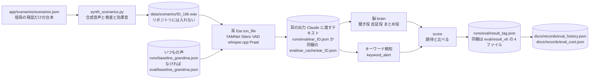
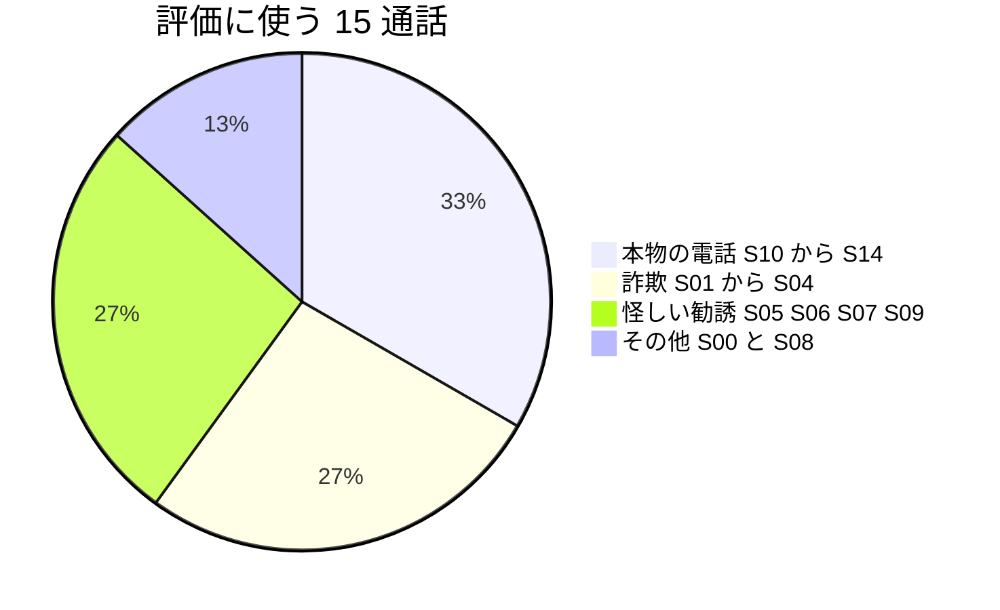
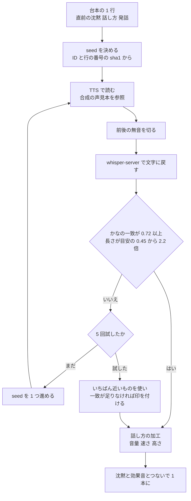
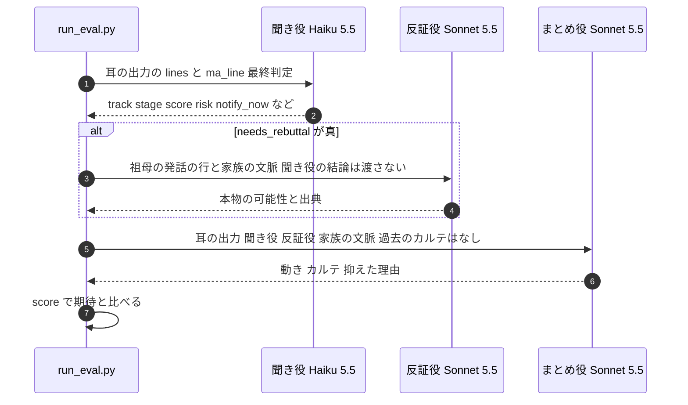
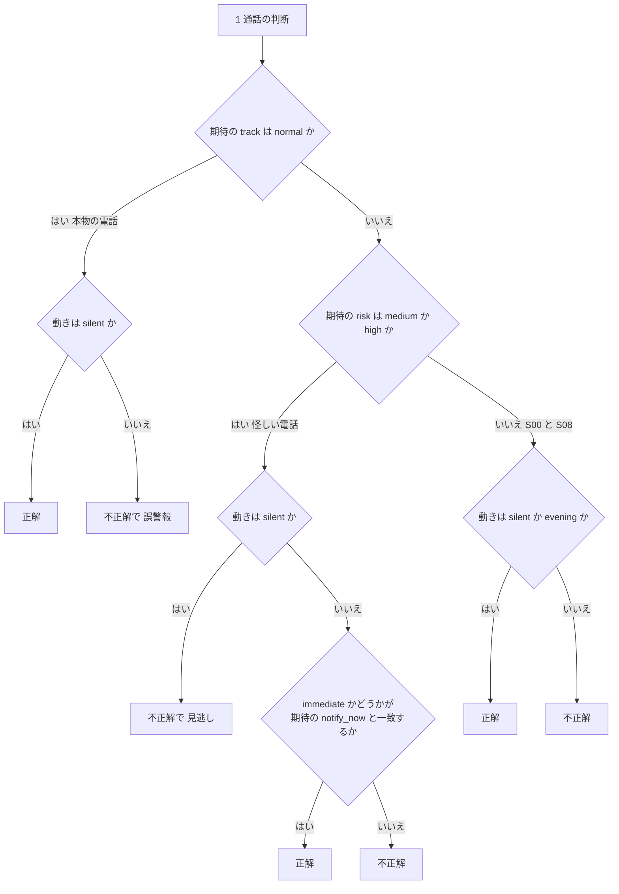
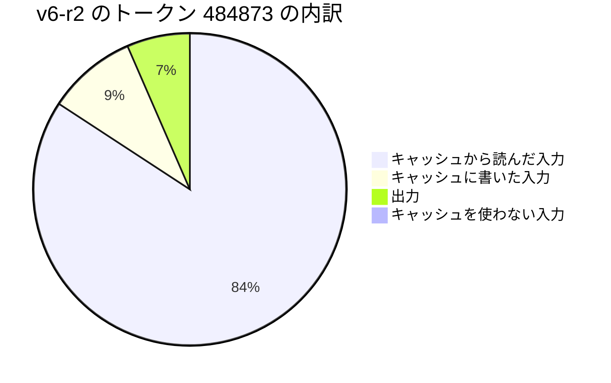

# 評価のしくみ

## 3 行で

- 作者が書いた架空の 15 本の電話(祖母の発話だけの台本)を合成音声にし、耳に一度通した出力(文字と「間」の数値)を固定して、Claude の判断だけを 4 回流しました。
- 本物の電話 5 本に口を出したのは 0/20 回、怪しい電話 8 本を見逃したのは 0/32 回でした。比べるために作ったキーワード検知は 8/20 回と 12/32 回です。動き(黙る・夕方・今すぐ)と危険度のラベルは、60 回すべて期待どおりでした。
- 声は合成で、台本も件数も作者が用意した小さなものなので、統計的な主張はしません。費用は 1 回(15 通話)あたり約 $0.38 でした(4 回のうち最初の回は $0.53)。

---

ここから下はエンジニア向けです。数値・しきい値・ファイル名は、リンク先のコードとデータの値です。登場する人・会社・住所・番号はすべて架空で、祖母の声は合成音声です。耳の処理のくわしい説明は [ear.md](ear.md)、聞き役・反証役・まとめ役の中身は [brain.md](brain.md)、全体の流れは [how-it-works.md](how-it-works.md) にあります。

## 1. 全体の流れ



| 段 | 何をするか | コード・データ |
|---|---|---|
| 台本 | 祖母の発話だけの台本と、期待(track・risk・notify_now) | [app/scenarios/scenarios.json](../../app/scenarios/scenarios.json) |
| 合成 | 台本を合成音声と効果音で 1 本の音声にする。1 セリフずつ文字に戻して確かめる | [app/scripts/synth_scenarios.py](../../app/scripts/synth_scenarios.py) |
| 耳 | 音声を耳に通し、Claude に渡すテキストを作ってキャッシュする | [app/scripts/run_eval.py](../../app/scripts/run_eval.py) の `ear_lines()`、[eval/ear_cache/](../../eval/ear_cache) |
| 脳 | 聞き役 → (怪しければ)反証役 → まとめ役 | `run_eval.py` の `brain()` |
| 採点 | 期待と比べ、キーワード検知とも並べる | `run_eval.py` の `score()`・`keyword_alert()` |
| 結果 | 1 回分を 1 ファイルに | [eval/result_v6.json](../../eval/result_v6.json)・[result_v6-r2.json](../../eval/result_v6-r2.json)・[result_v6-r3.json](../../eval/result_v6-r3.json)・[result_v6-r4.json](../../eval/result_v6-r4.json) |
| 記録 | 回ごとの集計と費用 | [docs/records/eval_history.json](../records/eval_history.json)、[docs/records/eval_cost.json](../records/eval_cost.json) |

## 2. シナリオ — 架空の 15 通話

### 台本の形

台本は祖母(和子さん・81 歳・一人暮らし。息子の誠と孫の健太は関東在住。すべて架空)の発話だけで、相手の台詞は書きません。1 行は `[直前の沈黙(秒), 話し方, 祖母の発話]` で、直前の沈黙が「相手が話している時間」です。ほかに `["ring", 回数]`・`["pickup"]`・`["hangup", 秒]`・`["dial", …]` の音の行があります。話し方は `n` 普通・`p` 丁寧・`c` 明るい・`l` 笑い・`w` 不安・`h` ためらい・`u` 押されて小声・`b` あいづち・`f` はっきり断る です(`scenarios.json` の `_doc`)。

デモの主役 S05(健康食品の電話勧誘・2 回目)の台本(住所の行だけ伏せる):

```json
["ring", 3], ["pickup"],
[0.7, "n", "はい、もしもし。"],
[3.0, "n", "ああ、はるかぜ健康さん。先週もお電話くださったわね。"],
[6.5, "p", "ええ、膝がね、最近ちょっと痛くて。"],
[8.0, "n", "はあ、グルコサミンの。"],
[7.0, "h", "今日中なら、半額なんですか。"],
[0.5, "b", "はい。"],
[4.5, "b", "はい。"],
[9.0, "h", "でも、息子に聞いてみないと…"],
[7.5, "u", "そうですか…今日だけなんですね。"],
[0.6, "b", "はい。"],
[8.0, "u", "毎月届くんですか。定期で…"],
[6.0, "u", "最初は、四千九百八十円…"],
[5.5, "u", "解約は、いつでもできるんですね。"],
[7.0, "u", "…じゃあ、お願いします。"],
[3.0, "u", "住所は、…(伏せる)"],
[4.0, "u", "お支払いは、届いたときに。"],
[3.0, "n", "はい、はい。どうも。"],
["hangup", 1.2]
```

### 15 通話と期待

期待は作者が `expected` に書いたものです。本物の電話は、警察・銀行などの語が出ても `low` にしています(シナリオ作者のサブエージェントの指示、[.claude/agents/scenario-writer.md](../../.claude/agents/scenario-writer.md))。

| ID | 区分 | 内容 | 向き・時刻 | 祖母の発話 | 沈黙の合計(秒) | 期待 track | 期待 risk | 期待 notify_now | 備考 |
|---|---|---|---|---|---|---|---|---|---|
| S00 | その他 | 健康食品の電話勧誘(1回目・断る) | 着信 10:20 | 6 | 25.6 | `solicitation` | `low` | `false` | 7 日前(`day_offset: -7`)。S05 と同じ会社 |
| S05 | 勧誘 | 健康食品の電話勧誘(2回目・定期購入の申込) | 着信 14:03 | 17 | 83.8 | `solicitation` | `high` | `false` | デモの主役(`hero`) |
| S01 | 詐欺 | オレオレ詐欺(孫を名乗る) | 着信 11:10 | 10 | 42.6 | `scam` | `high` | `true` | |
| S02 | 詐欺 | 還付金詐欺(役所を名乗りATMへ) | 着信 10:05 | 9 | 41.6 | `scam` | `high` | `true` | |
| S03 | 詐欺 | キャッシュカード詐欺盗(警察と銀行協会を名乗る) | 着信 15:40 | 8 | 41.6 | `scam` | `high` | `true` | |
| S04 | 詐欺 | 架空料金請求(本人が断る) | 着信 13:15 | 7 | 34.1 | `scam` | `medium` | `false` | |
| S06 | 勧誘 | 海産物の電話勧誘 | 着信 16:30 | 9 | 44.1 | `solicitation` | `medium` | `false` | |
| S07 | 勧誘 | 光回線の乗り換え勧誘 | 着信 17:05 | 7 | 38.1 | `solicitation` | `medium` | `false` | |
| S08 | その他 | テレビショッピングに自分で電話して注文 | 発信 20:10 | 5 | 21.0 | `solicitation` | `low` | `false` | 台本はダイヤル音で始まる |
| S09 | 勧誘 | 屋根の無料点検(訪問の約束) | 着信 09:40 | 7 | 32.1 | `solicitation` | `medium` | `true` | |
| S10 | 本物 | かかりつけ医院の予約確認(本物) | 着信 09:15 | 5 | 15.6 | `normal` | `low` | `false` | |
| S11 | 本物 | 友人との世間話(本物) | 着信 19:20 | 8 | 12.8 | `normal` | `low` | `false` | |
| S12 | 本物 | 宅配の再配達(本物) | 着信 12:30 | 4 | 11.1 | `normal` | `low` | `false` | |
| S13 | 本物 | 警察署から盗難自転車の連絡(本物・キーワードの罠) | 着信 11:45 | 6 | 23.1 | `normal` | `low` | `false` | `keyword_trap` |
| S14 | 本物 | 信用金庫から書類不備の連絡(本物・キーワードの罠) | 着信 14:50 | 5 | 18.1 | `normal` | `low` | `false` | `keyword_trap` |



「怪しい電話」は期待の risk が `medium` か `high` の 8 本(詐欺 4・勧誘 4)です。S00(本人がはっきり断った勧誘)と S08(自分でかけた通販の注文)は、誤警報にも見逃しにも数えません。

評価は `kind` が `call` の 15 本だけを流します(`run_eval.py` の `SCEN`)。部屋のシナリオ 3 本は採点しません。

| ID | 内容 | 使いみち |
|---|---|---|
| R01 | 夕方のおしゃべり(暮らしのメモ)。期待は「大根が採れた・膝が痛い・温泉に行きたい」 | 「いつもの声」の材料([calibrate_baseline.py](../../app/scripts/calibrate_baseline.py))と、デモの下準備の暮らしのメモ([run_call.py](../../app/scripts/run_call.py)) |
| R02 | S05 のあとの祖母の答え 3 つ | デモで、ふすまごしが話し終えるたびに 1 つずつ流す([server.py](../../app/fusuma/server.py) の `answers_for`) |
| R03 | S03 のあとの祖母の答え 3 つ | 同上 |

## 3. 音声の作り方 — `synth_scenarios.py`

[app/scripts/synth_scenarios.py](../../app/scripts/synth_scenarios.py) が、台本から 1 本の通話音声を作ります。15 通話と部屋のシナリオ 3 本で、祖母のセリフは 124 行です。

### 声: 文章の説明から作った合成音声

祖母役の声は、誰かの録音から作っていません。Qwen3-TTS の VoiceDesign(`mlx-community/Qwen3-TTS-12Hz-1.7B-VoiceDesign-8bit`)で、文章の説明から声見本を 1 つ作り、全セリフは Base モデル(`mlx-community/Qwen3-TTS-12Hz-1.7B-Base-8bit`)がその合成の声見本を参照して読みます([app/tts_server/tts_engine.py](../../app/tts_server/tts_engine.py) の `design_all()`・`synth()`)。

| 項目 | 値([app/tts_server/voices/grandma_ref.json](../../app/tts_server/voices/grandma_ref.json)) |
|---|---|
| 説明(`instruct`) | 85歳くらいの日本人のおばあさんの声。声は細く、かすれていて、少し震える。ゆっくり、やさしく、のんびりと話す。田舎で一人暮らしをしている、年を重ねた祖母。 |
| 声見本に読ませた文(`ref_text`) | はい、もしもし。ええ、元気にしてますよ。今日はね、畑の大根がよく採れたの。 |
| seed | 4102(`--exact-seed 4102` で作り直せる) |

`design_all()` は、声見本の長さが目安(1 文字 0.17 秒+句読点 1 つ 0.35 秒)の 0.6〜1.7 倍に入るまで、seed を変えて最大 6 回作ります(6 回とも外れたら最後のものを使う。`--exact-seed` を渡したときは 1 回だけ)。使った seed は `voices/<名前>_ref.json` に残ります。

**v6 の前に、声を作り直しました。** いまの声見本(上の説明と seed 4102)は、最終評価 v6 の前に作り直したものです。続けて 15 通話と部屋のシナリオ 3 本をすべてこの声で合成し直し(下の検査)、「いつもの声」(4 章)と耳の出力のキャッシュ([eval/ear_cache/](../../eval/ear_cache))も作り直してから、v6 の 4 回を流しました。v5 までの回(2026-11-05)は、作り直す前の声の耳の出力で流したものです。ふすまごしの声(fusuma)は作り直していません。

### 1 セリフずつ: 読む、文字に戻す、確かめる



| 何を | 値 | 関数 |
|---|---|---|
| seed | `int(sha1(f"{ID}-{行の番号}")[:6], 16) % 100000`。行の番号は音の行も数えた台本の中の位置。だめなら 1 ずつ足して最大 5 回 | `build()`・`synth_line()` |
| TTS への入力 | 読み違えやすい語だけ読みを差し替える(`READING`: 今日中→きょうじゅう、解約→かいやく、S08 の商品の番号「三の、一の、二番」→さんの、いちの、にばん、ほかに住所の番地の読み 1 つ。この文書では伏せる)。台本と比べる文は漢字のまま | `tts()` |
| TTS の結果のキャッシュ | `data/tts_cache/`。鍵は声の名前・声見本のハッシュ・入力文・seed の sha1 | `tts()` |
| 無音の切り方 | -42 dB より小さい前後を切り、前に 0.03 秒・後ろに 0.06 秒残す | `trim_silence()` |
| 文字に戻す | whisper-server(`127.0.0.1:8765`)に 16 kHz で送る。`no_context`・`temperature 0.0`・語彙の手がかりつき(このファイルの `ASR_PROMPT`。耳の `config.ASR_PROMPT` から「みどり町」を除いた語の並び) | `asr()` |
| 一致 | 数字・漢数字・「円」と一部の記号を除き、句読点を落としてかなにしてから、`difflib.SequenceMatcher` の比をとる(「四千九百八十円」と「4980円」のような書き方の揺れを比べないため) | `similarity()`・`kana()` |
| 長さの目安 | 0.16 秒 × かなの数 + 0.25 秒 | `synth_line()` |
| 合格 | 一致 0.72 以上、かつ長さが目安の 0.45〜2.2 倍。5 回とも外れたら、いちばん近いものを使う。最後の `ok` は一致(0.72 以上)だけで決め、足りない行には警告の印を付けて表示する | `synth_line()`・`build()` |

いまの声で合成し直したときの記録(手元の `runs/synth_v2.log`。リポジトリには入れていない)では、124 行のうち一致が 0.72 に届かなかったのは 1 行でした(S06 の「お歳暮に、ねえ…」が「お総切れに、ねえ。」と文字に戻り、一致 0.533)。行ごとの結果(`data/scenarios/<ID>.truth.json`)もリポジトリには入れていません。

### 話し方の加工

| 話し方 | 意味 | 音量(dB) | 速さ(倍) | 高さ(半音) |
|---|---|---|---|---|
| `n` | 普通 | 0.0 | 1.00 | 0.0 |
| `p` | 丁寧 | 0.0 | 0.98 | 0.0 |
| `c` | 明るい | +1.5 | 1.04 | +0.6 |
| `l` | 笑い | +1.5 | 1.03 | +0.6 |
| `w` | 不安 | -2.0 | 1.00 | +0.2 |
| `h` | ためらい | -3.5 | 0.94 | -0.4 |
| `u` | 押されて小声 | -7.5 | 0.88 | -1.2 |
| `b` | あいづち | -4.5 | 1.00 | -0.3 |
| `f` | はっきり断る | +1.0 | 1.00 | 0.0 |

`STYLE` の値です(`style_fx()`)。速さも高さも変えない `n`・`f` は音量だけを掛けます。それ以外は ffmpeg の rubberband(フォルマントを保つ)で加工し、rubberband のない ffmpeg では `asetrate`・`atempo` で代わりに加工します。

### 呼出音・受話器の音・ダイヤル音

すべて合成です。実際の家では実機の音を数秒登録して使う想定です(コードのコメント)。

| 音 | 作り方 | 関数 |
|---|---|---|
| 呼出音 | 1,300 Hz と 1,630 Hz を 16 Hz で切り替え、2,600 Hz を少し足す。1 秒鳴って 2 秒休むを台本の回数だけ繰り返し、最後の休みを 1.4 秒短くする | `sfx_ring()` |
| 受話器を上げる・置く | 1,500〜5,000 Hz の帯域のノイズの減衰と 90 Hz の低い音を合わせたクリック 2 つ | `sfx_pickup()`・`sfx_hangup()`・`_click()` |
| ダイヤル音 | DTMF。1 桁 0.1 秒と 0.08 秒の間。番号は架空の `FAKE_DIAL = "0000271828"` | `sfx_dial()` |
| 部屋の環境音 | 400 Hz 以下に絞ったノイズと、小さな白色ノイズ | `room_tone()` |

番号は先頭を `0000` にして、実在の番号と重ならないようにしています。耳に登録するダイヤル音は別の番号 `FAKE_ENROLL = "0000314159"` で作り、登録と試験を分けています(`write_enrollment_sfx()`)。呼出音と受話器の音は、登録音も試験の音も同じ関数で作っています。台本の `["dial", "0120"]` の 2 つ目の値は使わず、ダイヤル音はいつも `FAKE_DIAL` です。

1 本の組み立て: 0.8 秒の無音 → 呼出音 → 0.9 秒 → 受話器を上げる音 →(直前の沈黙 → セリフ)を繰り返す →(台本の秒数の無音 → 受話器を置く音)→ 1.5 秒 → 環境音を足して ±0.98 で切る。発信(S08)は、呼出音と 0.9 秒の代わりに、ダイヤル音と 2.5 秒の無音です。

### できるファイル

| ファイル | 中身 |
|---|---|
| `data/scenarios/<ID>.wav` | 24 kHz。画面のデモでスピーカーから鳴らす |
| `data/scenarios/<ID>_16k.wav` | 16 kHz・16 bit。耳の入力 |
| `data/scenarios/<ID>.truth.json` | 正解のタイミング(音の行、各セリフの始まり・終わり・沈黙・話し方・seed・文字に戻した結果・一致・長さ) |
| `data/scenarios/<ID>_a<k>.wav` | 電話のあとの答え(R02・R03)。1 行ずつ別のファイル |
| `data/sfx/{ring,pickup,hangup,dial}.wav` | 耳に登録する音 |

`data/` は [.gitignore](../../.gitignore) でコミットから外しています。聞いてみる用の合成音声は `samples/`(S00・S03・S05・S13・R02 の答え 3 つの mp3)にあります。

## 4. 耳のキャッシュと「いつもの声」

### キャッシュ

評価は、耳の出力を 1 回だけ作って使い回します。`run_eval.py` の `ear_lines()` は次の順に探します。

1. `runs/eval/ear_<ID>.json`(手元で作ったもの)
2. `eval/ear_cache/ear_<ID>.json`(リポジトリに同梱したもの)
3. どちらもなければ、`data/scenarios/<ID>_16k.wav` を `Ear.run_file()` に通して 1 に書く(`--force-ear` のときはいつもこれ)

そのため、音声の準備がなくても脳だけを流し直せます。耳はファイルを実時間ではなく一気に処理し、時計は、シナリオの `time` と `day_offset` で決まる時刻の 10 秒前から始めます。キャッシュの中身は `call_id`・`started`・`direction`・`duration`・`lines`(Claude に渡す行)・`ma`(「間」の数値)・`ma_line` です。

### 例: S05

[eval/ear_cache/ear_S05.json](../../eval/ear_cache/ear_S05.json) の `lines` と `ma_line`(耳から Claude に渡るのは、このテキストと、通話 ID・開始時刻・向き・長さだけ。住所の発話だけ伏せて写す):

```text
14:03:00 [音] 受話器を上げる音
14:03:00 祖母「はい、もしもし。」 間0.3s 声高-6% 声量-4dB 話速+1%
14:03:04 祖母「ああ、春風健康さん、先週もお電話くださったわね。」 間2.8s 声高-25% 声量-2dB 話速+7%
14:03:14 祖母「ええ、膝がね、最近ちょっと痛くて。」 間6.3s 声高-19% 声量-5dB 話速+1%
14:03:25 祖母「はぁ。」 間7.9s 声高-30% 声量+0dB
14:03:25 祖母「グルコサミンの」 間0.5s 声高+12% 声量+4dB 話速-3%
14:03:33 祖母「今日中なら半額なんですか?」 間6.9s 声高+7% 声量-6dB 話速-16%
14:03:41 祖母「はい。」(あいづち 0.3s)
14:03:50 祖母「でも、息子に聞いてみないと。」 間8.9s 声高-17% 声量-4dB 話速-12%
14:04:00 祖母「そうですか。」 間7.4s 声高+46% 声量-6dB 話速+20%
14:04:02 祖母「今日だけなんですね。」 間1.2s 声高-24% 声量-7dB 話速-26%
14:04:11 祖母「毎月届くんですか?」 間7.9s 声高+5% 声量-7dB 話速+6%
14:04:14 祖母「定期で。」 間0.6s 声高+31% 声量-7dB 話速+2%
14:04:20 祖母「最初は4980円。」 間5.9s 声高+7% 声量-6dB 話速-22%
14:04:28 祖母「解約はいつでもできるんですね。」 間5.4s 声高+5% 声量-6dB 話速-6%
14:04:38 祖母「じゃあお願いします。」 間6.8s 声高-25% 声量-7dB 話速-14%
14:04:42 祖母「住所は、…(伏せる)」 間2.7s 声高-25% 声量-6dB 話速-24%
14:04:49 祖母「お支払いは、届いたときに」 間3.8s 声高-16% 声量-7dB 話速-9%
14:04:54 祖母「はい、はい、どうも。」 間2.8s 声高+5% 声量-1dB 話速-33%
14:04:59 [音] 受話器を置く音
[間の様子 14:04:59] / 祖母が話していた時間 28% / 相手が話していたと推定される時間 72% / 最長の沈黙 8.9s / 5秒以上の沈黙 9回 / 「はい」の連続 最大1 / 断りの語 前半1→後半0 / 声量の変化 -1.4dB
```

1 行の形は `時刻 祖母「発話」 間(直前の沈黙)s 声高(いつもの声との差)% 声量 dB 話速 %` です。短い「はい/ええ/うん」など(`config.BACKCHANNEL_MAX_SEC` は 0.6 秒。判定では VAD の前後の余白として 0.15 秒を足す)は、`(あいづち 秒)` として値を付けずに出します([app/fusuma/ear/score.py](../../app/fusuma/ear/score.py) の `utt_line()`、[app/fusuma/ear/prosody.py](../../app/fusuma/ear/prosody.py) の `is_backchannel()`、[app/fusuma/ear/ma.py](../../app/fusuma/ear/ma.py) の `summary_line()`)。

台本と耳の出力を比べると、合成と耳の両方を通った分のずれが見えます:

| 台本 | 耳の出力 | 見えること |
|---|---|---|
| `[3.0, "n", "ああ、はるかぜ健康さん。…"]` | 「ああ、春風健康さん、…」 | ひらがなの社名が漢字になった |
| `[8.0, "n", "はあ、グルコサミンの。"]` | 「はぁ。」間7.9s と「グルコサミンの」間0.5s | 1 行が 2 つの発話に分かれた |
| `[7.0, "h", "今日中なら、半額なんですか。"]` | 「今日中なら半額なんですか?」間6.9s | 台本の沈黙 7.0 秒が、間 6.9 秒として測られた |
| `[0.5, "b", "はい。"]`・`[4.5, "b", "はい。"]`・`[0.6, "b", "はい。"]` | 14:03:41 の「はい。」1 つだけ | あいづち 3 回のうち 2 回が出力にない(直前の発話との間が 0.5 秒・0.6 秒。[ear.md](ear.md) の「限界」) |
| `[6.0, "u", "最初は、四千九百八十円…"]` | 「最初は4980円。」 | 数字の書き方が変わる(合成の検査は数字を比べない) |
| `[3.0, "u", "住所は、…(伏せる)"]` | 「住所は、…(伏せる)」 | 番地の数字を別の音に聞き違えた |
| 話し方 `u` の 7 行 | 9 つの発話に分かれ、声量はどれも -6〜-7 dB | 押されて小声(-7.5 dB の加工)が、声量の差として出ている |

ほかの通話の聞き違いの例: S13「盗難届」→「盗難都道」、「署に」→「書に」。S03「封筒」→「空筒」。S08「羽毛布団」→「うめお布団」。評価は、これらの聞き違いを含んだテキストのまま流しています。

### 15 通話の「間」

`ma` の値です。台本の沈黙の最長も並べます。

| ID | 区分 | 通話の長さ(秒) | 発話の数 | 祖母が話した割合 | 最長の沈黙(秒) | 5 秒以上の沈黙 | 断りの語 前半→後半 | 声量の変化(dB) | 台本の沈黙の最長(秒) |
|---|---|---|---|---|---|---|---|---|---|
| S00 | その他 | 40.5 | 8 | 31% | 7.3 | 2 | 0→3 | -1.1 | 7.5 |
| S05 | 勧誘 | 119.3 | 18 | 28% | 8.9 | 9 | 1→0 | -1.4 | 9.0 |
| S01 | 詐欺 | 69.5 | 13 | 34% | 6.3 | 4 | 0→0 | -2.9 | 6.5 |
| S02 | 詐欺 | 64.1 | 11 | 32% | 6.9 | 5 | 0→0 | -4.1 | 7.0 |
| S03 | 詐欺 | 64.1 | 10 | 31% | 7.8 | 4 | 0→0 | -1.1 | 8.0 |
| S04 | 詐欺 | 53.2 | 8 | 33% | 7.8 | 3 | 0→3 | +2.2 | 8.0 |
| S06 | 勧誘 | 64.4 | 11 | 28% | 7.3 | 5 | 0→0 | -1.1 | 7.5 |
| S07 | 勧誘 | 56.1 | 10 | 26% | 7.9 | 5 | 0→0 | -5.2 | 8.0 |
| S08 | その他 | 35.2 | 6 | 37% | 5.8 | 1 | 0→0 | +0.2 | 6.0 |
| S09 | 勧誘 | 49.1 | 8 | 31% | 6.9 | 3 | 0→0 | -3.0 | 7.0 |
| S10 | 本物 | 30.4 | 6 | 42% | 4.8 | 0 | 0→0 | -0.4 | 5.0 |
| S11 | 本物 | 30.9 | 8 | 55% | 2.3 | 0 | 0→0 | -0.9 | 2.5 |
| S12 | 本物 | 22.3 | 5 | 41% | 3.9 | 0 | 0→0 | +1.3 | 4.0 |
| S13 | 本物 | 42.6 | 7 | 40% | 5.8 | 1 | 0→0 | +4.1 | 6.0 |
| S14 | 本物 | 39.1 | 8 | 44% | 6.0 | 1 | 0→0 | +0.2 | 6.0 |

本物の 5 本は、祖母が話した割合が 40〜55%・最長の沈黙が 2.3〜6.0 秒・5 秒以上の沈黙が 0〜1 回でした。怪しい 8 本は 26〜34%・6.3〜8.9 秒・3〜9 回です。ただし、この差は台本の沈黙の長さ(作者が決めたもの。最長は本物で 2.5〜6.0 秒、怪しい電話で 6.5〜9.0 秒)から来ています。

もう 1 つ: S08 の台本はダイヤル音で始まる発信ですが、キャッシュの `direction` は `incoming` で、最初の行は「受話器を上げる音」です。15 本とも `incoming` になっています(理由の見立ては [ear.md](ear.md) の「限界」)。

### いつもの声

声高・声量・話速は、「いつもの声」との差で出します([app/fusuma/ear/prosody.py](../../app/fusuma/ear/prosody.py) の `relative()`)。同梱の値は [eval/baseline_grandma.json](../../eval/baseline_grandma.json) で、声を作り直したあとに測り直したものです(手元の `runs/baseline_grandma.json` を写したもの。v6 の 4 回はこの値で流した耳の出力を使う)。

| 項目 | 値 | 使い方 |
|---|---|---|
| `f0` | 146.6 Hz | 声高 = 発話の F0 の中央値 ÷ 146.6 − 1 |
| `db` | -27.4 dBFS | 声量 = 発話の強さ − (-27.4) |
| `rate` | 6.31 モーラ毎秒 | 話速 = 発話のモーラ毎秒 ÷ 6.31 − 1(0.3 秒より長く、3 モーラ以上の発話だけ) |
| `n` | 25 | F0 が取れた発話区間の数 |

作り方は [app/scripts/calibrate_baseline.py](../../app/scripts/calibrate_baseline.py) です。S11・S10・S12・R01 の音声を VAD で区切り、0.8 秒以上の区間の F0・強さ・話速(4 モーラ以上)の中央値をとります。S10〜S12 は評価にも入っている同じ録音なので、厳密には独立していません(docstring と README の「限界と前提」)。`calibrate_baseline.py` で作り直すと `runs/baseline_grandma.json` に書かれ、同梱の値より先に使われます(`pipeline.baseline_path()`)。`Baseline.update()` はありますが呼ばれておらず、動いているあいだは固定です。

## 5. 脳の流し方 — `brain()`



| 役 | 関数 | モデル | 設定 |
|---|---|---|---|
| 聞き役 | `listener.judge(…, final=True)` | `claude-haiku-5-5` | `effort="low"`、thinking なし、`max_tokens=1500`、構造化出力 `schemas.LISTENER` |
| 反証役 | `rebuttal.review()` | `claude-sonnet-5-5` | `effort="medium"`、`max_tokens=2500`、知識カードを `search_result` で渡して Citations。server-side fallbacks つき |
| まとめ役 | `family.decide()` | `claude-sonnet-5-5` | `effort="medium"`、`max_tokens=3000`、構造化出力 `schemas.DECISION`。server-side fallbacks つき |

- 反証役を呼ぶのは、聞き役の track が `scam`・`solicitation`・`unknown` のどれかで、risk が `low` でないか score が 0.3 以上のとき(`orchestrator.needs_rebuttal()`)。
- 流すのは、通話が終わったときの判断だけです。通話中の途中判定、電話のあとの会話、便りは流しません。
- 評価用の記憶(`runs/eval/eval.sqlite3`)は毎回 `store.reset()` で空にします。残るのは家族の文脈だけです(`family_context` の表。空のときに `store.DEFAULT_CONTEXT` から入れ、`reset()` では消さない)。`brain()` はカルテもメモも書き込まないので、15 通話はどれも「過去のカルテなし」「暮らしのメモなし」で判断されます。
- 耳は順番に流し(whisper-server を共有するため)、脳は `--workers`(既定 3)本で並べて流します。
- `_purge()` は通りません。結果のファイルには、聞き役・反証役・まとめ役の出力がそのまま入ります(`raw`)。

## 6. 採点の規則 — `score()`

[app/scripts/run_eval.py](../../app/scripts/run_eval.py) の `score()` の全文です。

```python
def score(sc: dict, r: dict, kw: list[str]) -> dict:
    exp = sc["expected"]
    lo, dec = r["listener"], r["decision"]
    act = dec["action"]
    genuine = exp["track"] == "normal"
    risky = exp["risk"] in ("medium", "high")
    return {
        "id": sc["id"], "title": sc["title"], "expected_risk": exp["risk"], "expected_notify": exp["notify_now"],
        "track": lo["track"], "risk": lo["risk"], "score": lo["score"], "action": act,
        "genuine_likelihood": (r["rebuttal"] or {}).get("genuine_likelihood"),
        "kw_hits": kw, "kw_alert": bool(kw),
        # 判定が合っているか(リスクの段階)
        "risk_ok": lo["risk"] == exp["risk"] or (exp["risk"] == "medium" and lo["risk"] in ("medium", "high") and act != "silent") ,
        # 動きが合っているか: 本物 → 黙る / 怪しい → 知らせる / 今すぐの要否
        "action_ok": (act == "silent") if genuine else ((act == "immediate") == exp["notify_now"] and act != "silent") if risky
                     else act in ("silent", "evening"),
        "false_alarm": genuine and act != "silent",
        "kw_false_alarm": genuine and bool(kw),
        "missed": risky and act == "silent",
        "kw_missed": risky and not kw,
        "headline": dec["headline"], "restraint_note": dec["restraint_note"], "sec": r["sec"],
    }
```

| 項目 | 規則 |
|---|---|
| `action_ok`(動き) | 本物(期待の track が `normal`): 動きが `silent` なら正解。怪しい(期待の risk が `medium` か `high`): `silent` でなく、`immediate` かどうかが期待の `notify_now` と一致すれば正解。そのほか(S00・S08): `silent` か `evening` なら正解 |
| `risk_ok`(危険度のラベル) | 聞き役の最終判定の risk が期待と同じなら正解。期待が `medium` のときは、`medium` か `high` で、動きが `silent` でなければ正解 |
| `false_alarm`(誤警報) | 本物の電話で、動きが `silent` 以外 |
| `missed`(見逃し) | 怪しい電話で、動きが `silent` |
| `kw_false_alarm` | 本物の電話で、キーワードが 1 つでも当たった |
| `kw_missed` | 怪しい電話で、キーワードが 1 つも当たらなかった |

採点する危険度は聞き役の判定(`lo["risk"]`)で、まとめ役のカルテの `risk` ではありません。今すぐかどうかは、まとめ役の動き(`action`)で見ます。聞き役の `notify_now` は採点に使いません。



1 回の集計(`main()` の抜粋):

```python
genuine = [r for r in rows if r["expected_risk"] == "low" and r["id"] in ("S10", "S11", "S12", "S13", "S14")]
risky = [r for r in rows if r["expected_risk"] in ("medium", "high")]
summary = {
    "tag": args.tag, "n": len(rows), "action_ok": sum(r["action_ok"] for r in rows), "risk_ok": sum(r["risk_ok"] for r in rows),
    "genuine_n": len(genuine), "false_alarm": sum(r["false_alarm"] for r in genuine), "kw_false_alarm": sum(r["kw_false_alarm"] for r in genuine),
    "risky_n": len(risky), "missed": sum(r["missed"] for r in risky), "kw_missed": sum(r["kw_missed"] for r in risky),
    ...
```

「N 件中 M 件」で数え、統計的な主張はしません(`run_eval.py` の docstring)。

## 7. 比べる相手 — キーワード検知

既存のサービスの判定の中身は公開されていないので、比べる相手は一般的な作り方の例として自作しました(`run_eval.py` のコメント)。

```python
KEYWORDS = ["警察", "銀行", "信用金庫", "口座", "暗証番号", "キャッシュカード", "カード", "ATM", "還付", "振り込", "振込", "未納",
            "裁判", "今日中", "誰にも言わない", "通帳", "印鑑", "現金", "封筒", "取りに来る", "お金"]

def keyword_alert(lines: list[str]) -> list[str]:
    text = " ".join(re.findall(r"祖母「(.*?)」", " ".join(lines)))
    return [k for k in KEYWORDS if k in text]
```

- 見るのは、耳の出力のうち `祖母「…」` の中だけです。21 語のどれかを含めば警報です。
- 部分一致なので、「キャッシュカード」は「カード」にも当たります。
- 動きや危険度は出さないので、比べるのは誤警報と見逃しだけです。

## 8. 最終の結果 — v6 の 4 回

v6 は、最終のコード・声・データで流した 4 回です(`-r2`〜`-r4` は同じ版の流し直し)。4 回とも同じ耳の出力を使っています(聞き役が引いた発話の時刻と文言は、同梱の [eval/ear_cache/](../../eval/ear_cache) と合う。違うのは、聞き役が S13 の聞き違いを読み替えて引いたところだけ)。

### まとめ

| 回 | 終わった時刻(`ts`) | 動き | 危険度のラベル | 誤警報 | 見逃し | キーワード検知の誤警報 | キーワード検知の見逃し | 費用(USD) |
|---|---|---|---|---|---|---|---|---|
| v6 | 2026-11-06 02:30:21 | 15/15 | 15/15 | 0/5 | 0/8 | 2/5 | 3/8 | 0.5341 |
| v6-r2 | 2026-11-06 02:31:45 | 15/15 | 15/15 | 0/5 | 0/8 | 2/5 | 3/8 | 0.3836 |
| v6-r3 | 2026-11-06 02:33:16 | 15/15 | 15/15 | 0/5 | 0/8 | 2/5 | 3/8 | 0.3833 |
| v6-r4 | 2026-11-06 02:34:46 | 15/15 | 15/15 | 0/5 | 0/8 | 2/5 | 3/8 | 0.3836 |
| 計 | | **60/60** | **60/60** | **0/20** | **0/32** | 8/20 | 12/32 | 1.6846 |

### シナリオごと: 危険度と動き(v6 / r2 / r3 / r4)

| ID | 期待の危険度 | 期待の動き | 聞き役の危険度 | まとめ役の動き | 危険度 OK | 動き OK |
|---|---|---|---|---|---|---|
| S00 | 低 | 黙る か 夕方 | 低 / 低 / 低 / 低 | 黙る / 黙る / 黙る / 黙る | 4/4 | 4/4 |
| S05 | 高 | 夕方 | 高 / 高 / 高 / 高 | 夕方 / 夕方 / 夕方 / 夕方 | 4/4 | 4/4 |
| S01 | 高 | 今すぐ | 高 / 高 / 高 / 高 | 今すぐ / 今すぐ / 今すぐ / 今すぐ | 4/4 | 4/4 |
| S02 | 高 | 今すぐ | 高 / 高 / 高 / 高 | 今すぐ / 今すぐ / 今すぐ / 今すぐ | 4/4 | 4/4 |
| S03 | 高 | 今すぐ | 高 / 高 / 高 / 高 | 今すぐ / 今すぐ / 今すぐ / 今すぐ | 4/4 | 4/4 |
| S04 | 中 | 夕方 | 高 / 高 / 高 / 高 | 夕方 / 夕方 / 夕方 / 夕方 | 4/4 | 4/4 |
| S06 | 中 | 夕方 | 中 / 中 / 中 / 中 | 夕方 / 夕方 / 夕方 / 夕方 | 4/4 | 4/4 |
| S07 | 中 | 夕方 | 中 / 中 / 中 / 中 | 夕方 / 夕方 / 夕方 / 夕方 | 4/4 | 4/4 |
| S08 | 低 | 黙る か 夕方 | 低 / 低 / 低 / 低 | 黙る / 黙る / 黙る / 黙る | 4/4 | 4/4 |
| S09 | 中 | 今すぐ | 中 / 中 / 中 / 中 | 今すぐ / 今すぐ / 今すぐ / 今すぐ | 4/4 | 4/4 |
| S10 | 低 | 黙る | 低 / 低 / 低 / 低 | 黙る / 黙る / 黙る / 黙る | 4/4 | 4/4 |
| S11 | 低 | 黙る | 低 / 低 / 低 / 低 | 黙る / 黙る / 黙る / 黙る | 4/4 | 4/4 |
| S12 | 低 | 黙る | 低 / 低 / 低 / 低 | 黙る / 黙る / 黙る / 黙る | 4/4 | 4/4 |
| S13 | 低 | 黙る | 低 / 低 / 低 / 低 | 黙る / 黙る / 黙る / 黙る | 4/4 | 4/4 |
| S14 | 低 | 黙る | 低 / 低 / 低 / 低 | 黙る / 黙る / 黙る / 黙る | 4/4 | 4/4 |

黙る = `silent`、夕方 = `evening`、今すぐ = `immediate`。低・中・高 = `low`・`medium`・`high`。

### シナリオごと: score・反証役・時間(v6 / r2 / r3 / r4)

| ID | 聞き役の track | 聞き役の score | 反証役の「本物の可能性」 | 1 通話の時間(秒) |
|---|---|---|---|---|
| S00 | 勧誘 | 0.35 / 0.25 / 0.35 / 0.35 | 中 / — / 中 / 中 | 20.2 / 8.9 / 19.0 / 18.5 |
| S05 | 勧誘 | 0.85 / 0.85 / 0.85 / 0.85 | 中 / 低 / 中 / 中 | 24.0 / 24.6 / 27.6 / 25.4 |
| S01 | 詐欺 | 0.95 / 0.95 / 0.92 / 0.9 | 低 / 低 / 低 / 低 | 21.2 / 22.4 / 20.0 / 20.8 |
| S02 | 詐欺 | 0.92 / 0.92 / 0.95 / 0.92 | 低 / 低 / 低 / 低 | 18.8 / 19.7 / 20.3 / 20.0 |
| S03 | 詐欺 | 0.95 / 0.95 / 0.95 / 0.95 | 低 / 低 / 低 / 低 | 22.0 / 21.5 / 21.5 / 23.1 |
| S04 | 詐欺 | 0.82 / 0.82 / 0.82 / 0.72 | 低 / 低 / 低 / 低 | 18.9 / 18.9 / 20.4 / 20.4 |
| S06 | 勧誘 | 0.72 / 0.7 / 0.72 / 0.72 | 中 / 中 / 中 / 中 | 20.6 / 20.1 / 23.0 / 20.8 |
| S07 | 勧誘 | 0.55 / 0.62 / 0.55 / 0.55 | 低 / 低 / 低 / 低 | 20.6 / 19.2 / 19.3 / 19.1 |
| S08 | 勧誘 | 0.25 / 0.35 / 0.35 / 0.35 | — / 高 / 高 / 高 | 9.2 / 18.1 / 17.3 / 16.7 |
| S09 | 勧誘 | 0.55 / 0.6 / 0.6 / 0.6 | 低 / 低 / 低 / 低 | 23.4 / 16.6 / 17.9 / 21.7 |
| S10 | 普通 | 0.05 / 0.05 / 0.05 / 0.05 | — / — / — / — | 7.6 / 8.2 / 8.2 / 7.8 |
| S11 | 普通 | 0.05 / 0.05 / 0.05 / 0.05 | — / — / — / — | 7.2 / 6.8 / 7.6 / 6.8 |
| S12 | 普通 | 0.05 / 0.05 / 0.05 / 0.05 | — / — / — / — | 11.7 / 12.6 / 11.7 / 8.0 |
| S13 | 普通 | 0.1 / 0.1 / 0.1 / 0.1 | — / — / — / — | 11.1 / 10.8 / 9.9 / 9.4 |
| S14 | 普通 | 0.1 / 0.1 / 0.1 / 0.1 | — / — / — / — | 9.5 / 9.3 / 9.2 / 9.4 |

「—」は反証役を呼ばなかった回です。時間は `brain()` の 1 通話分(いくつかの通話を並べて流したときの値)です。

### シナリオごと: キーワード検知(4 回とも同じ)

| ID | 区分 | 当たった語 | 数え方 |
|---|---|---|---|
| S00 | その他 | (なし) | 数えない |
| S05 | 怪しい | 今日中 | 警報(見逃しではない) |
| S01 | 怪しい | 銀行・今日中・誰にも言わない・取りに来る・お金 | 警報 |
| S02 | 怪しい | ATM・還付 | 警報 |
| S03 | 怪しい | 警察・銀行・口座・暗証番号・カード・誰にも言わない | 警報 |
| S04 | 怪しい | カード・未納・裁判・今日中 | 警報 |
| S06 | 怪しい | (なし) | 見逃し × 4 |
| S07 | 怪しい | (なし) | 見逃し × 4 |
| S08 | その他 | (なし) | 数えない |
| S09 | 怪しい | (なし) | 見逃し × 4 |
| S10 | 本物 | (なし) | — |
| S11 | 本物 | (なし) | — |
| S12 | 本物 | (なし) | — |
| S13 | 本物 | 警察・印鑑 | 誤警報 × 4 |
| S14 | 本物 | 信用金庫・通帳・印鑑 | 誤警報 × 4 |

### 読みどころ

- **動きは、15 通話とも 4 回すべて同じでした。** 危険度のラベルも 4 回すべて同じです。S04(架空料金請求・本人が断る)は期待「中」に対して 4 回とも「高」で、規則(期待が中なら、中か高で黙るでなければ正解)により正解です。
- **カルテの危険度は採点していません。** v6-r3・v6-r4 の S05 では、聞き役が「高」、まとめ役のカルテの `risk` が「中」でした。
- **今すぐかどうかは、まとめ役が決めています。** S09(屋根の点検の訪問の約束)では、v6 の回だけ聞き役の `notify_now` が `false` でしたが、まとめ役の動きは 4 回とも `immediate` でした。
- **score は確率ではありません**([docs/design.md](../design.md)「聞き役の判定の目安」)。S00 は 4 回中 3 回 0.35 で、聞き役のプロンプトの目安(はっきり断って終えた勧誘は score 0.3 未満)より高い値でした。危険度は 4 回とも「低」で正解ですが、score が 0.3 以上だった 3 回は反証役が呼ばれています。S08 も 4 回中 3 回が 0.35 で反証役が呼ばれ、3 回とも「本物の可能性: 高」でした。
- **本物の 5 本は、聞き役の段階で落ち着いています。** 4 回とも track は `normal`、score は 0.05〜0.1 で、反証役は呼ばれていません(`normal` は `needs_rebuttal()` の対象外)。
- **時間は反証役を呼ぶかどうかで分かれます。** 呼ばない通話は 6.8〜12.6 秒、呼んだ通話は 16.6〜27.6 秒でした。
- **キーワード検知も文字起こしに左右されます。** S03 の「封筒」は「空筒」と聞き違えたので当たっていません(ほかの語で警報は出ています)。

### 例: S05・S13・S09 の判断(v6 の回)

S05(期待: 高・夕方)のまとめ役の `restraint_note` は「お金もカードも今日は動かず、取り消せる段階なので急がず夕方の便りで足りる。」でした。評価の記憶は空なので、カルテの `storyline` は「祖母の発話によると、先週(14:03:04「先週もお電話くださったわね」)にも同じ名乗りの電話があった。過去のカルテは残っておらず、そのときの様子は不明。…」となっています。S00 とのつながりは、評価では確かめていません。

S13(本物の警察署。キーワード検知は「警察」「印鑑」で警報)のまとめ役の `restraint_note` は「本人が出した届けの結果連絡として自然で、お金・訪問・口止めの兆しがないため、問いかけずに静かに流す。」でした。カルテの `risk_reason` には「なお「署」を「書」と聞き取った誤認識は文脈から読み替えた。」とあり、聞き違いを読み替えたことを根拠に書いています(原則のプロンプト [principles.md](../../app/fusuma/brain/prompts/principles.md) の指示)。

S09(屋根の点検。キーワード検知は 1 語も当たらず見逃し)のまとめ役の `restraint_note` は「お金や口止めはまだありませんが、知らない人が明日訪ねてくる約束があり、夕方の便りでは確認が遅くなるため、今のうちに家族へ知らせます。」でした。

## 9. 履歴 — `eval_history.json`

[docs/records/eval_history.json](../records/eval_history.json) の 20 回を、終わった時刻の順に並べました。キーワード検知は 20 回とも誤警報 2/5・見逃し 3/8 です。

| 回 | 終わった時刻(`ts`) | 動き | 危険度のラベル | 誤警報 | 見逃し | 費用(USD) |
|---|---|---|---|---|---|---|
| v1 | 2026-11-05 02:36:16 | 15/15 | 14/15 | 0/5 | 0/8 | 0.6790 |
| v2 | 2026-11-05 02:38:30 | 15/15 | 15/15 | 0/5 | 0/8 | 0.3781 |
| v2-r2 | 2026-11-05 02:40:27 | 15/15 | 14/15 | 0/5 | 0/8 | 0.3695 |
| v2-r3 | 2026-11-05 02:42:06 | 15/15 | 14/15 | 0/5 | 0/8 | 0.4015 |
| v3 | 2026-11-05 04:00:53 | 15/15 | 15/15 | 0/5 | 0/8 | 0.6068 |
| v3-r2 | 2026-11-05 04:02:18 | 14/15 | 14/15 | 0/5 | 0/8 | 0.3861 |
| v3-r3 | 2026-11-05 04:03:54 | 15/15 | 13/15 | 0/5 | 0/8 | 0.4465 |
| v3-r4 | 2026-11-05 04:05:17 | 15/15 | 14/15 | 0/5 | 0/8 | 0.4331 |
| v4 | 2026-11-05 04:07:26 | 15/15 | 14/15 | 0/5 | 0/8 | 0.4232 |
| v4-r2 | 2026-11-05 04:08:48 | 15/15 | 14/15 | 0/5 | 0/8 | 0.3551 |
| v4-r3 | 2026-11-05 04:10:13 | 15/15 | 12/15 | 0/5 | 0/8 | 0.4215 |
| v4-r4 | 2026-11-05 04:11:43 | 15/15 | 13/15 | 0/5 | 0/8 | 0.3837 |
| v5 | 2026-11-05 10:17:30 | 15/15 | 14/15 | 0/5 | 0/8 | 0.7307 |
| v5-r2 | 2026-11-05 10:18:57 | 15/15 | 14/15 | 0/5 | 0/8 | 0.3847 |
| v5-r3 | 2026-11-05 10:20:32 | 15/15 | 14/15 | 0/5 | 0/8 | 0.4834 |
| v5-r4 | 2026-11-05 10:22:08 | 15/15 | 13/15 | 0/5 | 0/8 | 0.4177 |
| v6 | 2026-11-06 02:30:21 | 15/15 | 15/15 | 0/5 | 0/8 | 0.5341 |
| v6-r2 | 2026-11-06 02:31:45 | 15/15 | 15/15 | 0/5 | 0/8 | 0.3836 |
| v6-r3 | 2026-11-06 02:33:16 | 15/15 | 15/15 | 0/5 | 0/8 | 0.3833 |
| v6-r4 | 2026-11-06 02:34:46 | 15/15 | 15/15 | 0/5 | 0/8 | 0.3836 |

版ごとの合計:

| 版 | 回数 | 動き | 危険度のラベル | 誤警報 | 見逃し | 費用(USD) |
|---|---|---|---|---|---|---|
| v1 | 1 | 15/15 | 14/15 | 0/5 | 0/8 | 0.6790 |
| v2 | 3 | 45/45 | 43/45 | 0/15 | 0/24 | 1.1491 |
| v3 | 4 | 59/60 | 56/60 | 0/20 | 0/32 | 1.8725 |
| v4 | 4 | 60/60 | 53/60 | 0/20 | 0/32 | 1.5835 |
| v5 | 4 | 60/60 | 55/60 | 0/20 | 0/32 | 2.0165 |
| v6 | 4 | 60/60 | 60/60 | 0/20 | 0/32 | 1.6846 |
| 計 | 20 | 299/300 | 281/300 | 0/100 | 0/160 | 8.9852 |

- 20 回とも、誤警報 0・見逃し 0 でした。動きが期待と違ったのは 300 判定のうち 1 回(v3-r2)です。
- 危険度のラベルは 12/15〜15/15 のあいだで揺れ、4 回とも 15/15 になったのは v6 だけです。
- 各版で何を変えたかは、このファイルには残っていません(`prompt_files` はファイル名の一覧で、20 回とも同じ 6 ファイル。中身の違いは記録していない)。変えたことは README の「反復の記録」に文章で残っています。
- v5 までの 16 回は、作り直す前の声の耳の出力で流したものです(3 章)。v6 の 4 回だけが、いまの声と耳の出力で流した回です。v5(危険度のラベル 55/60)と v6(60/60)のあいだでは、声・耳の出力・「いつもの声」も変わっているので、上がった理由をどれか 1 つに分けることはできません。
- 費用は、v1・v3・v5・v6 の最初の回が $0.53〜0.73、`-r2`〜`-r4` の回が $0.36〜0.48 でした(v2 と v4 の最初の回は $0.38・$0.42)。

## 10. 費用 — `eval_cost.json`

[docs/records/eval_cost.json](../records/eval_cost.json) の値です。

| 回 | 費用(USD) | 呼び出し | キャッシュなしの換算(USD) | 倍 | 入力 | 出力 | キャッシュ読み | キャッシュ書き |
|---|---|---|---|---|---|---|---|---|
| v6 | 0.5341 | 記録なし | 記録なし | — | — | — | — | — |
| v6-r2 | 0.3836 | 39 | 0.8440 | 2.20 | 156 | 31,598 | 408,278 | 44,841 |
| v6-r3 | 0.3833 | 40 | 0.8881 | 2.32 | 160 | 33,605 | 430,716 | 36,724 |
| v6-r4 | 0.3836 | 40 | 0.8883 | 2.32 | 160 | 33,275 | 430,716 | 36,852 |
| 計 | 1.6846 | | 2.6204(r2〜r4) | | | | | |

トークンの数は、その回のすべてのモデルを合わせたものです。



- `usd` は、評価のプロセスが自分の呼び出しだけを数えた値です(`run_eval.py` の `_count()` を `llm.on_call()` に登録。ファイルの `note` も同じ説明)。夕方の便り(Managed Agents)の費用は入りません。
- いまの `run_eval.py` は summary にモデルごとのトークン数(`tokens`)も書きますが、同梱の `eval/result_v6*.json` の summary には入っていません。上の表のトークン数は `eval_cost.json` の値です。
- `usd_without_cache` は、台帳のトークン数から、キャッシュがなかった場合の費用を換算した値です。その回の呼び出しだけが入った時間帯のときだけ出しています(ファイルの `note`)。v6 は記録がありません。
- 呼び出しの数は、聞き役 15 + まとめ役 15 + 反証役です。反証役は v6-r2 で 9 回(S00 で呼ばなかった)、v6-r3・v6-r4 で 10 回でした。v6 はこのファイルに記録がありませんが、結果から数えると反証役は 9 回(S08 で呼ばなかった)なので 39 回です。
- キャッシュ: `llm.system_blocks()` が、system の固定部(原則と役割の説明。聞き役とまとめ役は知識カードも)の最後のブロックに `cache_control` を付けます。反証役の知識カードは system ではなく、メッセージの `search_result` で渡します。`llm.call()` は、リクエストにも `cache_control: {"type": "ephemeral"}` を付けます([app/fusuma/brain/llm.py](../../app/fusuma/brain/llm.py))。v6-r2〜r4 では、キャッシュを使わなかった入力は 39〜40 回の呼び出しで 156〜160 トークンでした。
- v6 は続けて流した 4 回の 1 回目で、ほかの 3 回($0.3833〜0.3836)より高い $0.5341 でした。2〜4 回目で読み出しになった要求を初めて送る回なので、そのぶんがキャッシュの書き込みになります(v6 のトークン数は記録がないので、内訳は確かめていません)。

費用の数え方(`llm._cost()`。100 万トークンあたりの単価は `config.PRICES`):

```text
費用 = (入力 + 1.25 × キャッシュ書き) × 入力の単価 + キャッシュ読み × キャッシュの単価 + 出力 × 出力の単価
```

| モデル | 入力 | 出力 | キャッシュ読み |
|---|---|---|---|
| `claude-haiku-5-5` | 0.10 | 0.50 | 0.01 |
| `claude-sonnet-5-5` | 2.00 | 10.00 | 0.20 |
| `claude-opus-5-5` | 4.00 | 20.00 | 0.20 |

Sonnet と Opus の呼び出しは server-side fallbacks つきです。評価では、実際に答えたモデルは台帳 `runs/ledger.jsonl` の `served_model` にだけ残り、同梱の結果には入っていません。費用は、答えたモデルが `config.PRICES` にあればその単価で数えます(`llm.call()`)。

## 11. 流し直すには

評価の脳の側は Claude API を呼ぶので、費用がかかります(v6 では 1 回 $0.38〜0.53。[docs/records/eval_cost.json](../records/eval_cost.json))。

```bash
# 脳だけを流す(同梱の耳の出力と「いつもの声」を使う)
.venv/bin/python app/scripts/run_eval.py --tag mine
# 一部だけ
.venv/bin/python app/scripts/run_eval.py --tag quick --ids S05 S13
# 耳から作り直す(whisper-server と TTS サーバー、合成したシナリオの音声が要る)
bash scripts/services.sh start
.venv/bin/python app/scripts/synth_scenarios.py
.venv/bin/python app/scripts/run_eval.py --tag fresh --force-ear
```

- 結果は `runs/eval/result_<tag>.json` に出ます。同梱の `eval/result_v6*.json` は、最終の 4 回分です。
- `--force-ear` で作った耳の出力は `runs/eval/ear_<ID>.json` に書かれ、以後は同梱のキャッシュより先に読まれます。
- プロンプト・知識カード・スキーマを変えると、PostToolUse フック([app/scripts/hooks/after_edit.sh](../../app/scripts/hooks/after_edit.sh))が知らせます。`FUSUMA_AUTO_EVAL=1` のときだけ、S05・S13・S03・S11 の小さな評価(約 $0.15)を回します。
- 評価係のサブエージェント([.claude/agents/eval-runner.md](../../.claude/agents/eval-runner.md))は、台本を書いた人とは別に評価を流し、期待と違ったシナリオについて、聞き役・反証役・まとめ役のどこで判断がずれたかを書きます。

## 12. 限界

- **声は合成で、1 人分です。** 祖母役は文章の説明から作った 1 つの声(seed 4102)で、話し方の違いは音量・速さ・高さの加工だけです。実際の高齢者の声やマイクでの録音では確かめていません。
- **台本と期待は作者が書きました。** 15 通話の台本・期待・家族の文脈は、どれも作者が用意したものです。相手の話す時間は台本の沈黙で表し、怪しい電話の沈黙を長く、本物の電話の沈黙を短く書いています(4 章の表)。スピーカーホンなどで相手の声が入る場面はありません。
- **件数が少ないです。** 15 通話 × 4 回です。4 回は同じ耳の出力に対する脳の判断のゆらぎを見たもので、独立した 60 件ではありません。統計的な主張はしません。
- **「いつもの声」と評価が重なっています。** 基準は S10・S11・S12 と R01 から作りました。S10〜S12 は評価にも入っています。
- **家族の文脈が本物の電話と合うように書いてあります。** `store.DEFAULT_CONTEXT` に、みどり整形外科の予約(S10)、友人のよし子さんと火曜日の体操教室(S11)、自転車の盗難届(S13)、みどり信用金庫での定期預金の手続き(S14)が入っています。まとめ役と反証役はこの文脈を読みます。どれだけ判断を助けたかは切り分けていません。
- **文字起こしの語彙の手がかりに、台本の語が入っています。** `config.ASR_PROMPT` は「今日中・半額・定期購入・解約・還付金・暗証番号・キャッシュカード・口座・銀行協会・信用金庫・整形外科・みどり町」を含みます([ear.md](ear.md) の「限界」)。
- **電話の音は合成で、登録と試験が同じ作り方です。** ダイヤル音だけは番号を変えています。S08 の発信は、耳の出力では着信になりました。
- **耳は 1 回だけ流しました。** 文字起こしの揺れなど、耳の側のゆらぎは 4 回の中に入っていません。
- **記憶をまたぐ判断は評価していません。** 評価の記憶は毎回空です。S05 は、7 日前の S00 のカルテなしで判断しています。記憶のつながりは、デモ([run_call.py](../../app/scripts/run_call.py) で S00・R01 を記憶に積んでから、画面で S05 を流す)で見せているだけです。
- **評価するのは、通話が終わったときの判断だけです。** 通話中の途中判定・電話のあとの会話・便りは `score()` の対象外です。夕方の便りの約束については、Outcomes の採点役の記録([docs/records/outcomes_grades.json](../records/outcomes_grades.json))が 5 つのセッション分あり、4 つは 1 回目が書き直し(理由にはどれも 400 字超えが入る)で 2 回目に合格、1 つは 1 回目で合格しています。最新の収録 v4 は「合計は約440字」で書き直し、2 回目に「約 300 字で、400 字以内」で合格しました([managed-agents.md](managed-agents.md) の「採点の記録」)。
- **比べる相手は自作です。** キーワード検知は 21 語の部分一致で、既存のサービスの判定ではありません。
- **4 回は短い時間に続けて流しました。** 終わった時刻が 2026-11-06 の 02:30〜02:34 の 4 回で、2〜4 回目はプロンプトの大半がキャッシュから読まれています(出力は回ごとに違います。score や反証役の見立てが回によって変わっています)。
