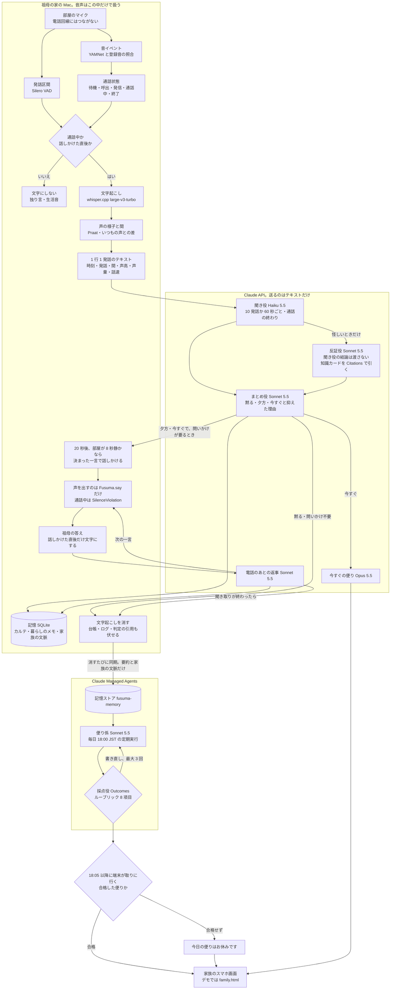
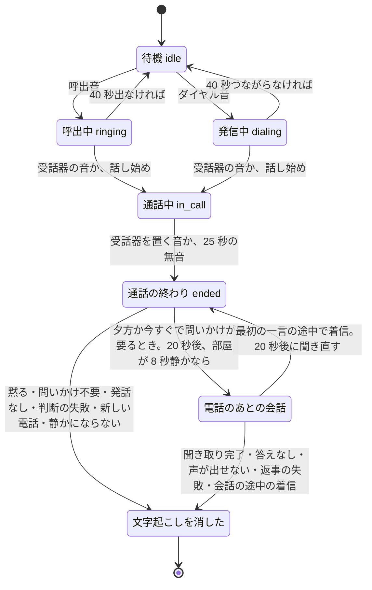
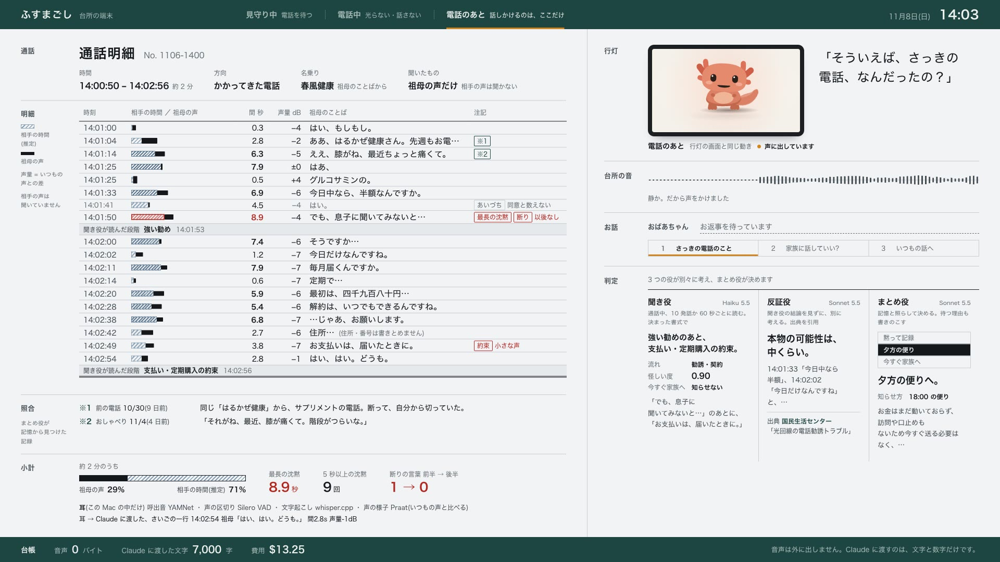
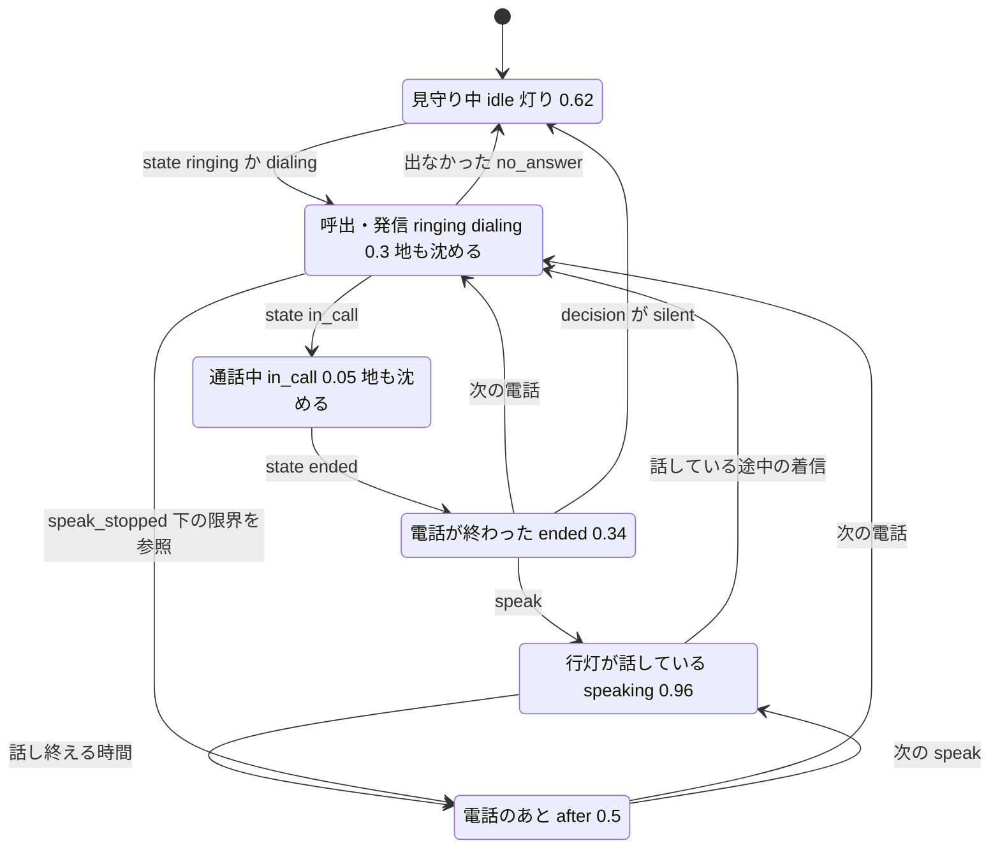
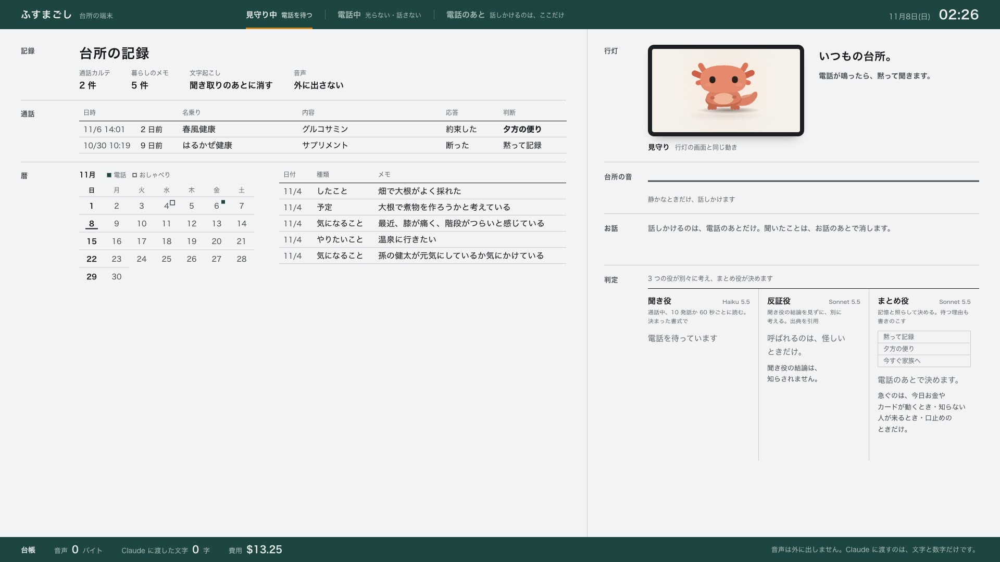
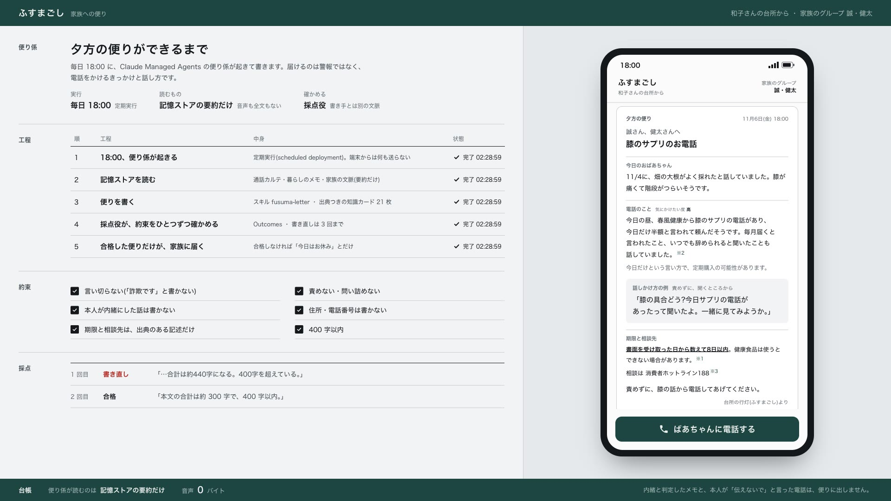
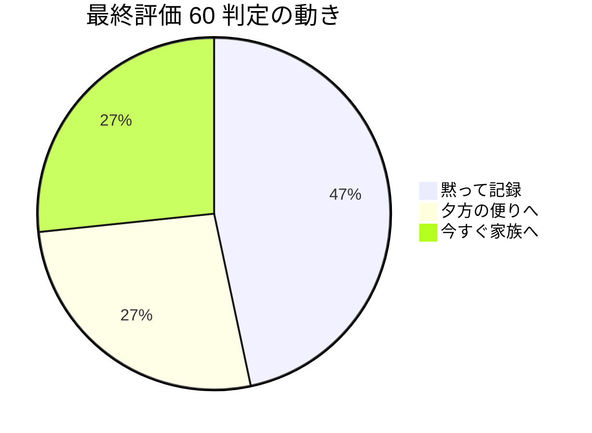
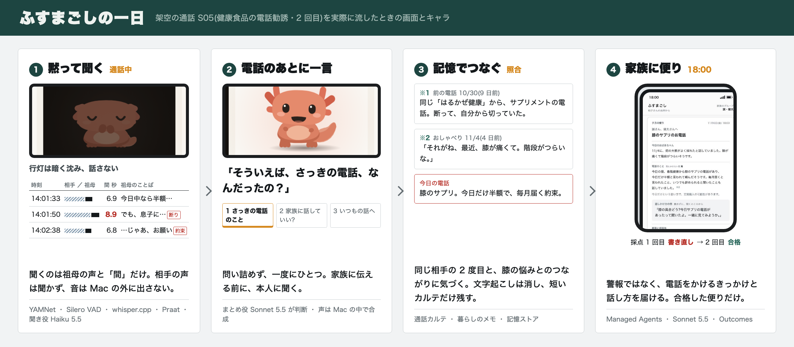

# しくみの全体像

## 3 行で

- ふすまごしは、台所に置く小さな行灯です(いまは Mac と、その画面)。部屋のマイクで祖母の声だけを聞き、電話回線にはつなぎません。音声は Mac の外に出さず、Claude には文字と数値だけを送ります。
- 通話中は光らず、話しません。電話が終わると、役割を分けた Claude が「黙る・夕方に知らせる・今すぐ知らせる」を決め、必要なときだけ「そういえば、さっきの電話、なんだったの？」と家族のように聞きます。
- 夕方 6 時には、クラウドの便り係が記録を読んで家族への便りを書き、別の採点役が「断定しない・責めない」などの約束を確かめます。合格した便りだけを家族向けの画面に出します(LINE などへの送り届けはこれから)。

---

ここから下はエンジニア向けです。このページは技術資料(`docs/tech/`)の入り口で、全体を 1 枚の図で示し、読む順番・用語・主な数字をまとめます。数字・しきい値・モデル名は、リンク先のコードとデータから取っています。登場する人・会社・住所はすべて架空で、祖母の声は合成音声です。

## 1 枚で見る — 部屋のマイクから家族のスマホまで



図の読み方:

- **音声は Mac の枠から出ない。** Claude API へ渡るのはテキストだけ。「1 行 1 発話のテキスト」(と通話全体の「間の様子」の 1 行)、電話のあとの会話、判断の材料(聞き役・反証役の判定、カルテ・暮らしのメモ・家族の文脈・知識カード)。[app/fusuma/brain/llm.py](../../app/fusuma/brain/llm.py) の `_text_of()` が、text と search_result 以外のブロックを送る前に `ValueError` で止める。
- **文字にするのは、通話中と、ふすまごしが話しかけた直後だけ。** [app/fusuma/ear/pipeline.py](../../app/fusuma/ear/pipeline.py) の `Ear._segment()` がそれ以外の発話区間を捨てる。
- **声を出す出口は 1 つ。** [app/fusuma/orchestrator.py](../../app/fusuma/orchestrator.py) の `Fusuma.say()` だけが話し、呼出中・発信中・通話中は `SilenceViolation` で止まる(`Fusuma.may_speak()`)。合成中・再生中に電話が鳴ったときも、[app/fusuma/devices.py](../../app/fusuma/devices.py) の `Speaker.say()` が再生の直前と 0.1 秒ごとに確かめてやめる。
- **文字起こしは、どの終わり方でも消す。** `Fusuma._purge()` が、文字起こし・聞き役の引用・反証役の原文・台帳の本文・画面とイベントログの原文を伏せる。残るのは通話カルテと判断、それに聞き役・反証役の判定の要約。聞き役の判定からは、発話の引用や言い換えが入りうる `evidence`・`disclosed`・`reason`・`to_ask` と発話行為の `text` を除く(段階・危険度・発話行為の種類などが残る)。反証役の結果は、本物の可能性と引いたカードの題だけを残す([app/fusuma/store.py](../../app/fusuma/store.py) の `slim_listener()`・`slim_rebuttal()`)。
- **Managed Agents へ送るのは要約だけ。** [app/fusuma/brain/managed.py](../../app/fusuma/brain/managed.py) の `sync_memory()` が、その日のカルテと、暮らしのメモ・家族の文脈を記憶ストアに書く。内緒と判定したメモと、本人が「伝えないで」と言った電話(今すぐの便りにしたものを除く)は送らない。同期は、Managed Agents を作ってあるとき(`ant apply` で `claude-lock.json` ができていて、`FUSUMA_MANAGED` が未設定か `1` のとき)に、文字起こしを消すたびと 17:50 に走る([app/fusuma/server.py](../../app/fusuma/server.py) の `managed_enabled()`・`_sync_memory()`・`_evening_loop()`)。夕方の便りを手動で起こすとき(`managed.evening_letter()`)も、先に同期する。

### どこで何が動くか

| 場所 | 動くもの | 受け取るもの |
|---|---|---|
| 祖母の家の Mac | 耳(YAMNet・Silero VAD・whisper.cpp・Praat)、声(Qwen3-TTS)、記憶(SQLite)、画面(FastAPI と WebSocket。この Mac の localhost からだけ見られる) | 部屋の音(マイク)。電話回線にはつながない |
| Claude API | 聞き役・反証役・まとめ役・電話のあとの返事・今すぐの便り(ほかに、Managed Agents を使わない夕方の便り(Messages API 版)と、デモの下準備での暮らしのメモの抽出) | テキストだけ。送った中身は台帳 `runs/privacy_ledger.jsonl` に残り、文字起こしを消すときにその通話の本文を伏せる |
| Claude Managed Agents | 記憶ストア `fusuma-memory`・便り係 `fusuma-family`・採点役(Outcomes)・毎日 18:00 の定期実行 | カルテと暮らしのメモの要約、家族の文脈 |

### 役とモデル

| 役 | モデル([config.py](../../app/fusuma/config.py)) | 呼ばれるとき | 出すもの | コード |
|---|---|---|---|---|
| 聞き役 | `claude-haiku-5-5` | 通話中、10 発話ごと(または 3 発話以上たまって 60 秒)と通話の終わり | 2 トラック(詐欺・勧誘)の段階、発話行為、怪しい度、危険度(低・中・高)、今すぐ知らせるべきか(JSON) | [listener.py](../../app/fusuma/brain/listener.py) `judge()` |
| 反証役 | `claude-sonnet-5-5` | 通話の終わりに、怪しいときだけ | 本物の可能性(低・中・高)、本物らしい点・らしくない点、確かめ方(出典つき) | [rebuttal.py](../../app/fusuma/brain/rebuttal.py) `review()` |
| まとめ役 | `claude-sonnet-5-5` | 通話の終わり | 動き(silent・evening・immediate)、抑えた理由、通話カルテ、問いかけの要否(JSON) | [family.py](../../app/fusuma/brain/family.py) `decide()` |
| 電話のあとの返事 | `claude-sonnet-5-5` | 祖母が答えるたび | 次の一言、本人が話したこと、家族に伝える同意(JSON) | family.py `postcall_turn()` |
| 今すぐの便り | `claude-opus-5-5` | まとめ役が「今すぐ」と決めたとき | 家族への短い便り(JSON) | [letters.py](../../app/fusuma/brain/letters.py) `write()` |
| 夕方の便り係 | `claude-sonnet-5-5`(Managed Agents) | 毎日 18:00 JST | `letter.json` | [agent.md](../../app/managed/agents/fusuma-family/agent.md) |

ほかに 2 つの呼び出しがある。Managed Agents を使わない夕方の便り(`POST /api/letter` の `"via": "messages"`)は、今すぐの便りと同じ `letters.write()`(Opus 5.5)で書く。デモの下準備の暮らしのメモの抽出(`family.extract_memo()`)は聞き役と同じ Haiku 5.5。Messages API で呼ぶ役のモデルは、環境変数 `FUSUMA_MODEL_LISTENER`・`FUSUMA_MODEL_REBUTTAL`・`FUSUMA_MODEL_FAMILY`・`FUSUMA_MODEL_LETTER` で変えられる(便り係のモデルは agent.md の `model`)。


構成図は見取り図です。数値は、このページの表と、同梱の耳の出力 [eval/ear_cache/ear_S05.json](../../eval/ear_cache/ear_S05.json) から写した下の「実例」を見てください。

## 読む順番(5 分)

各ページの冒頭にも「3 行で」があるので、最初の 5 分はそこだけ読んでもよい。

| 順 | ページ | 目安 | 分かること |
|---|---|---|---|
| 1 | このページの図・「画面」・「主な数字」 | 1 分 | 全体の流れ、画面のどこに何が出るか、評価の結果 |
| 2 | [ear.md](ear.md) | 1 分 | 耳。呼出音・受話器の音の聞き分け、発話区間、文字起こし、声の様子と「間」の数値(Mac の中) |
| 3 | [brain.md](brain.md) | 1 分 | 脳。聞き役・反証役・まとめ役・今すぐの便りの分担、構造化出力・Citations・プロンプトキャッシュ、「抑えた理由」 |
| 4 | [dialog.md](dialog.md) | 1 分 | 電話のあとの会話。いつ声をかけるか、1 回ごとの段取り、答えの待ち方と閉じ方、`Fusuma.say()` だけが話す仕組み |
| 5 | [managed-agents.md](managed-agents.md) | 1 分 | 夕方の便り。記憶ストア・スキル・18:00 の定期実行・Outcomes の採点役 |
| 6 | [privacy.md](privacy.md) | 時間があれば | 送るもの・残すもの・消すもの。台帳と伏せ方 |
| 7 | [evaluation.md](evaluation.md) | 時間があれば | 架空の 15 通話 × 4 回の評価、キーワード検知との比較、費用 |
| 8 | [development.md](development.md) | 時間があれば | Claude Code での作り方。CLAUDE.md・フック・原則のテスト・サブエージェント・スキル・MCP・提出前のレビュー |

## 1 本の電話の一生

耳の状態(`idle` から `ended` まで。[pipeline.py](../../app/fusuma/ear/pipeline.py))と、そのあとの会話・消去([orchestrator.py](../../app/fusuma/orchestrator.py))をつなげると、こうなる。



- 呼出音・受話器の音は、YAMNet のクラスのスコアと、登録した音の埋め込みとのコサイン類似度で聞き分ける([sed.py](../../app/fusuma/ear/sed.py) の `SoundEvents.classify()`)。呼出音は登録音との類似度 0.8 以上か、電話の音のクラスのスコアが 0.35 を超えたとき。受話器の音は、登録した上げる音・置く音との類似度 0.8 以上で、話し声のスコアが 0.5 未満のとき。どちらも音量が -45 dB を超える窓だけを見る。受話器の音を聞き逃しても、呼出・発信のあとに話し始めれば通話中とみなす(`Ear._segment()`)。
- 通話中に聞き役が読む途中経過は、画面に出し、次の判定(次の途中経過と最終判定)に「前回の判定」として渡すだけ。通話中に端末は光らず、話さない(`Fusuma.on_ear()`・`Fusuma._interim()`、[listener.py](../../app/fusuma/brain/listener.py) の `judge(prev=…)`)。
- 通話が終わると、聞き役の最終判定 → 怪しければ反証役 → まとめ役 の順に呼ぶ(`Fusuma._finalize()`)。今すぐの便りは、本人に聞く前に書いて記憶に残し、家族向けの画面に出す。
- 受話器を置く直前の発話も、文字にし終えてから「通話の終わり」を出す(`Ear._end_call()` が文字起こしと同じ 1 本のプールに入れる)。
- 話しかけられない(別の電話の最中・別の会話の最中・部屋が静かでない)ときは 20 秒ごとに最大 20 回待ち直し、それでも話しかけられなければ聞かずに消す。最初の一言の途中で電話が鳴ったときは、いったん会話を閉じて、20 秒後に聞き直す(`Fusuma.start_dialog()`)。

## 実例 — 架空の通話 S05(健康食品の電話勧誘・2 回目)

耳が Claude に渡したテキスト([eval/ear_cache/ear_S05.json](../../eval/ear_cache/ear_S05.json) の `lines` 全 20 行から抜粋。最後の行は `ma_line`、通話全体の「間の様子」):

```text
14:03:00 [音] 受話器を上げる音
14:03:04 祖母「ああ、春風健康さん、先週もお電話くださったわね。」 間2.8s 声高-25% 声量-2dB 話速+7%
14:03:33 祖母「今日中なら半額なんですか?」 間6.9s 声高+7% 声量-6dB 話速-16%
14:03:41 祖母「はい。」(あいづち 0.3s)
14:03:50 祖母「でも、息子に聞いてみないと。」 間8.9s 声高-17% 声量-4dB 話速-12%
14:04:38 祖母「じゃあお願いします。」 間6.8s 声高-25% 声量-7dB 話速-14%
14:04:59 [音] 受話器を置く音
[間の様子 14:04:59] / 祖母が話していた時間 28% / 相手が話していたと推定される時間 72% / 最長の沈黙 8.9s / 5秒以上の沈黙 9回 / 「はい」の連続 最大1 / 断りの語 前半1→後半0 / 声量の変化 -1.4dB
```

- 「間」は直前の沈黙。祖母が黙っている時間を、相手が話している時間とみなす。相手の言葉は作らない。
- 声の値は「いつもの声」([eval/baseline_grandma.json](../../eval/baseline_grandma.json)。声の高さ 146.6 Hz・声量 -27.4 dB・話速 6.31 モーラ/秒)との差。祖母の声を作り直したあと、最終評価 v6 の前に測り直した値([evaluation.md](evaluation.md) の 3 章・4 章)。
- 文字起こしには誤りが残る(例: S13 では台本の「盗難届」が「盗難都道」に、「署に」が「書に」になった)。プロンプト([principles.md](../../app/fusuma/brain/prompts/principles.md))は、誤りがありうることと、読み替えたら根拠に書くことを指示している。

同じ耳の出力で、本物の電話 2 本と並べる(耳の出力は [eval/ear_cache/](../../eval/ear_cache)、判断は最終評価の 4 回 [eval/result_v6.json](../../eval/result_v6.json)・[-r2](../../eval/result_v6-r2.json)・[-r3](../../eval/result_v6-r3.json)・[-r4](../../eval/result_v6-r4.json)):

| | S05 健康食品の勧誘(2 回目) | S13 警察署からの連絡(本物) | S11 友人との世間話(本物) |
|---|---|---|---|
| 祖母が話していた時間 | 28% | 40% | 55% |
| 最長の沈黙 | 8.9 秒 | 5.8 秒 | 2.3 秒 |
| 5 秒以上の沈黙 | 9 回 | 1 回 | 0 回 |
| 断りの語(前半→後半) | 1 → 0 | 0 → 0 | 0 → 0 |
| キーワード検知 | 警報(今日中) | 警報(警察・印鑑) | なし |
| 聞き役の危険度 | 高(4 回とも) | 低(4 回とも) | 低(4 回とも) |
| まとめ役の動き | 夕方の便り(4 回とも) | 黙る(4 回とも) | 黙る(4 回とも) |

まとめ役が書いた「抑えた理由」(v6 の 1 回目):

- S05(夕方の便り): 「お金もカードも今日は動かず、取り消せる段階なので急がず夕方の便りで足りる。」
- S13(黙る): 「本人が出した届けの結果連絡として自然で、お金・訪問・口止めの兆しがないため、問いかけずに静かに流す。」
- S03 キャッシュカード詐欺盗(今すぐ。このときは「なぜ急ぐのか」を書く): 「カードを渡す訪問が1時間ほど先に迫っていて、夕方の便りでは間に合わないため、先に家族へ知らせます。」

## 画面 — 台所の画面と、家族の画面

画面は 2 枚です。どちらもこの Mac のサーバー([server.py](../../app/fusuma/server.py)、ポート 8780)が出すページで、WebSocket `/ws` で端末のイベントを受けて描き直します。1920×1080 の舞台を、窓の大きさに合わせて縮めて出します(`fit()`)。決めたことと理由は [設計の判断](../design.md) の「画面 — 通話明細」。



(S05 のデータで、電話のあとに行灯が最初の一言を話しているところ。)

### 台所の画面 — `/`([index.html](../../app/web/index.html)・[fusuma.css](../../app/web/css/fusuma.css)・[app.js](../../app/web/js/app.js))

通話を 1 発話 1 行の「明細」として記帳します。白い地に墨の文字と細い罫。琥珀色は行灯(いま動いているもの)だけ、朱は注記だけに使います。左が通話明細、右が行灯・台所の音・お話・判定、上下の帯がいまの様子と台帳です。

| 場所 | 描くもの | 動かすイベント(`handle()`) |
|---|---|---|
| 上の帯 | 状態の 3 段(見守り中 電話を待つ / 電話中 光らない・話さない / 電話のあと 話しかけるのは、ここだけ)と、日付・時計(イベントの `clock`。デモでは台本の時刻) | `state`・`utt`(時計)、`decision`(黙るなら見守り中へ)、`speak`・`speak_stopped` |
| 左上の見出し | 「通話明細」と通話の番号、時間と長さ、かかってきた / かけた電話、名乗り(聞き役の `claimed_caller`。「祖母のことばから」と添える)、「聞いたもの 祖母の声だけ」 | `state`(ringing・dialing で新しい通話、ended で終わりの時刻)、`listener` |
| 左の明細 | 1 行 = 祖母の 1 発話(時刻・相手の時間と祖母の声の横棒・直前の間の秒数・いつもの声との声量の差 dB・ことば・注記)。斜線の横棒は相手が話していた時間(推定)、黒の横棒は祖母の声(長さ = 話した時間、高さ = 声の大きさ)。5 秒以上の間は秒数を太字に、6 秒以上でいちばん長い沈黙に朱の「最長の沈黙」。あいづちは灰色で「同意と数えない」。行が多いときは行を詰め、それでも入らなければ古い行を畳む(`fitRows()`) | `utt`、`state` |
| 明細の注記 | 聞き役が断り(`refusal`)とした最後の発話に「断り」(通話が終わると「以後なし」)。そのあとの約束(`promise`)が、いつもより 6 dB 以上小さければ「約束 小さな声」 | `listener` |
| 明細の区切りの行 | 聞き役の段階が変わるたびに、そのとき最後の発話のあとに「聞き役が読んだ段階 …」と時刻 | `listener` |
| 左の照合 | まとめ役のカルテに前の電話(`linked_calls`)か暮らしとのつながり(`life_link`)があれば、前のカルテと暮らしのメモから ※1・※2 の行を足し、つながる発話の注記にも同じ番号を付ける(`refsBuild()`) | `decision`(続けて `GET /api/state` を読み直す) |
| 左の小計 | 「約 N 分のうち」(通話中は「いまのところ」)の祖母の声と相手の時間の割合、最長の沈黙・5 秒以上の沈黙の回数・断りの言葉 前半→後半。その下に耳の処理(YAMNet・Silero VAD・whisper.cpp・Praat)と、耳から Claude に渡したさいごの一行 | `utt`(`ma` と `line`)、`state`(ended) |
| 右の行灯 | 行灯のディスプレイ(Raspberry Pi の画面)をそのまま描き、中のキャラ「みずち」を Pi と同じ [`rig.js`](../../app/web/lantern/rig.js) で、中継([lantern_bridge.py](../../app/fusuma/lantern_bridge.py))と同じ決め方で動かす(`lanternOn()`)。画面の明るさは CSS の `--glow` で決め、ringing・dialing・in_call のあいだは右の欄の地も沈める(`body.incall`) | `state`、`listener`、`thinking`、`decision`、`speak`、`dialog`、`room_utt`、`letter` |
| 行灯の言葉 | 状態ごとの決まった文(「通話中は、光らない・話さない。」など)。ふすまごしが話すと、その一言を文ごとに改行して大きく出す | `state`、`speak` |
| 台所の音 | 直近 90 回分の音量の線。ふすまごしが話すと「静か。だから声をかけました」 | `level`、`speak` |
| お話 | 祖母のさいごのお返事(まだなら「お返事を待っています」)と、3 段「さっきの電話のこと / 家族に話していい? / いつもの話へ」。いまの段に印、済んだ段は薄く([dialog.md](dialog.md) の 3 章)。通話中は「祖母の声は、この Mac の中だけで文字にしています。」 | `dialog`(`turn.intent`)、`dialog_done`、`purged` |
| 判定の 3 列 | 聞き役は段階・流れ・怪しい度・今すぐ家族へ(知らせる / 知らせない)と、断りとそのあとの約束の引用(なければ根拠の 1 つ目)。反証役は本物の可能性と最初の項目と出典。まとめ役は 3 択(選んだ方を塗る)・動き・抑えた理由・知らせ方(「18:00 の便り」など)。考えているあいだは列を強調する | `listener`、`thinking`、`rebuttal`、`decision`、`purged` |
| 下の帯(台帳) | 音声 0 バイト・Claude に渡した文字数・費用と、「音声は外に出しません。Claude に渡すのは、文字と数字だけです。」 | `claude` |
| 知らせ | 「夕方の便りを書いています」、便りを家族に送った、便りが止まった(あとの 2 つは通話中は出さない) | `thinking`(letter)、`letter`、`error` |

イベントの側から見ると(`handle()` の `switch`):

| イベント | 台所の画面で動くところ |
|---|---|
| `state` | ringing・dialing で新しい通話を始める(明細を空にして、時刻と向きを書く)。状態の 3 段・時計・行灯の明るさと言葉。ended で明細を二重線で締め、通話の長さを書く。前の電話の遅れて届いた ended は捨てる |
| `level` | 台所の音の線 |
| `utt` | 明細の行、小計とさいごの一行 |
| `listener` | 聞き役の列、名乗り、段階の区切りの行、断りと約束の注記 |
| `thinking` | rebuttal・family なら、その列に考えている途中の一文(反証役は「本物かもしれない理由を、出典にあたって探しています」、まとめ役は「前の電話と、暮らしのメモを照らしています」)を書き、列を強調する。letter なら知らせ |
| `rebuttal` | 反証役の列 |
| `decision` | まとめ役の列。続けて照合の欄。silent なら見守り中へ |
| `dialog` | お返事と、いまの段(`turn.intent`) |
| `speak` | 行灯の言葉を大きく、灯りを 0.96 に。台所の音の下に「静か。だから声をかけました」 |
| `speak_stopped`・`dialog_done` | 電話のあとへ戻す / 段を全部済みにする |
| `purged` | 言葉だけを消す([privacy.md](privacy.md) の 5 章) |
| `letter` | 知らせ「今すぐの便り(夕方の便り)を家族に送りました ─ 題」。通話中は出さない |
| `claude` | 台帳の文字数と金額 |
| `error` | 便りが止まったときの知らせ(letter・evening・memory_sync・immediate_letter。通話中は出さない) |
| `reset` | ページを読み直す |
| `managed`・`hello` ほか | 使わない(`managed` は家族の画面が使う) |

行灯の明るさ(`setStatus()` の `GLOW`)と、状態の移り方:



- 照合の行は、前のカルテの名乗り・商品・対応と、暮らしのメモの本人の言葉(`said`)で書く。前の電話の 2 行目は、前のカルテの `response` から決まった文を選ぶ(refused なら「断って、自分から切っていた。」)。日付の横の「N 日前」は、画面の日付との差。一度決めた照合は、文字起こしを消したあとも変えない
- 電話がないとき(ページを開いてから、まだ電話がないあいだ)の左は「台所の記録」で、`GET /api/state` から通話カルテの件数・暮らしのメモの件数、これまでの電話(6 件まで)、その月の暦(電話の日とおしゃべりの日に印)、暮らしのメモ(内緒でないものを 7 件まで)を描く(`indexRender()`)。一度電話があると、ページを読み直すまでその電話の明細を出したままにする



- 文字起こしを消すと(`purged`)、明細の言葉だけが灰色の帯に替わり、間・声の横棒・声量・注記・照合・小計の数字は残る。消え方と、画面に書きとめないもの(住所・番号など)は [privacy.md](privacy.md) の 5 章と 8 章
- 無音で終わった通話(`state` ended の `reason` が silence)では、明細の終わりを最後の発話の 2 秒あとにし、小計は最後の発話までの値を使う(25 秒の無音を相手の時間に数えない。[ear.md](ear.md) の 8 章)
- WebSocket をつないだときにサーバーが送る直近のイベント(`hello`)は使わない。途中で開いたページは、次のイベントから描く

画面の限界(app.js から読めること):

- 1 本の電話ずつ描く前提です。`listener`・`rebuttal`・`decision` は `call_id` を見ないので、判断の途中で次の電話が始まると、前の電話の判定が新しい電話の明細に入ります(`state` の ended と `purged` だけは、いま描いている通話か確かめる)
- 呼出中・通話中でも、`decision`(silent)が届くと見守り中に、`speak_stopped` が届くと電話のあとの表示に切り替わり、行灯が明るくなります。`speak_stopped` は着信で声を途中でやめたときに出るので、呼出音の直後に起きえます(次の `state`、たとえば in_call で戻る)。声は `Fusuma.say()` が止めるので、話しはしません
- 画面の動きを確かめるテストはありません(原則のテストは Python の側だけ)

### 家族の画面 — `/family.html`([family.html](../../app/web/family.html)・[family.css](../../app/web/css/family.css)・[family.js](../../app/web/js/family.js))



台所の画面と同じ作法で描きます。左は「夕方の便りができるまで」: 便り係の説明(実行 毎日 18:00 / 読むもの 記憶ストアの要約だけ / 確かめる 採点役)、5 つの工程(18:00 に便り係が起きる → 記憶ストアを読む → スキル fusuma-letter で書く → 採点役が約束をひとつずつ確かめる → 合格した便りだけが届く)と状態(実行中 / 完了と時刻)、約束 6 項目、採点(回ごとに「書き直し」か「合格」と、その回の決め手の一文)。右は家族のスマホで、届いた便りを並べ、下に「ばあちゃんに電話する」。

| イベント | 動くところ(family.js の `handle()`) |
|---|---|
| `thinking`(who が letter) | 工程 1 を実行中に。採点を空にし、約束の印を外す |
| `managed` | `synced`・`session` で工程 2、道具の write・edit で工程 3、`grading` で工程 4 と「採点役が、約束をひとつずつ確かめています」、`grade` で採点に 1 行足す(書き直しなら工程 3 に戻す)、`done` で説明の全文から決め手を拾い直し、工程 5 まで完了にする |
| `letter` | `GET /api/state` から便りを読み直し、新しい便りまで送る。工程 5 まで完了 |
| `error`(letter・evening・memory_sync) | 採点の場所に「止まりました」と理由 |

便りの中身と、採点の決め手の拾い方は [managed-agents.md](managed-agents.md) の「家族の画面」。

## 用語集

| 言葉 | 意味 | コードでは |
|---|---|---|
| 間(ま) | 祖母が黙っている時間。片側の声しか聞かないので、多くの場合「相手が話している時間」とみなす。発話ごとの直前の沈黙と、通話全体の形(祖母が話していた割合・最長の沈黙・5 秒以上の沈黙の回数・「はい」の連続・断りの語の前半→後半・声量の変化)で表す | 発話の `pre_pause`、[ma.py](../../app/fusuma/ear/ma.py) の `MaTracker.summary()`・`summary_line()` |
| あいづち | 0.6 秒未満の短い「はい・ええ・うん・そう」など。丁寧な聞き手の癖なので、同意とは数えない | `config.BACKCHANNEL_MAX_SEC`、[prosody.py](../../app/fusuma/ear/prosody.py) の `is_backchannel()`(発話区間の前後の余白として 0.15 秒を足して判定し、4 文字以内) |
| 通話カルテ | 1 通話 1 枚の要約。名乗り・種類・商品・金額・定期かどうか・求められたこと・期限・口止め・祖母の対応・最大の段階・危険度と理由・前の電話とのつながり・暮らしとのつながり・契約とクーリング・オフの注意・電話のあとに聞くこと。根拠になった祖母の短い言葉が時刻つきで入る。文字起こしを消したあとも残る | [schemas.py](../../app/fusuma/brain/schemas.py) の `KARTE`、`family.decide()`、記憶ストアへは `managed._karte_md()` |
| 暮らしのメモ | 祖母が話した暮らしのこと(こんなことした・やってみたい・気になってる・予定)。本人の言葉(`said`)と、内緒かどうか(`secret`)を持つ。内緒と判定したメモは、記憶ストア・便り・以後のプロンプトに出さない。メモを作る流れはまだ端末に入っておらず、デモのメモは [run_call.py](../../app/scripts/run_call.py) の下準備で作った | `schemas.LIFE_MEMO`、`family.extract_memo()`、[store.py](../../app/fusuma/store.py) の `Store.memos(include_secret=False)`・`Store.memo_digest()` |
| 夕方の便り | 毎日 18:00(日本時間)に Managed Agents の便り係が書く、家族への便り。採点役がルーブリック 8 項目で確かめ(最大 3 回)、合格した便りだけが届く。合格しなかった日は、中身のない短いお知らせ(題は「今日の便りはお休みです」)に差し替える | [deployment-evening.yaml](../../app/managed/agents/fusuma-family/deployment-evening.yaml)、`managed.fetch_scheduled_letter()`・`managed.gate()` |
| 今すぐの便り | 今日のうちにお金やカードが動く・知らない人が訪ねてくる・口止め、が祖母の発話から読めたときだけ、通話の直後に Opus 5.5 が書く便り。本人に聞く前に家族向けの画面に出し、そのことを電話のあとに本人へ伝える。採点役がいないので、言い切りが残っていないかを決まった規則でも確かめ、残れば 1 回書き直させ、それでも残れば決まった文に差し替える | `letters.write("immediate", …)`・`letters.violations()`・`letters.template()` |
| 反証役 | 「この電話が本物・正当である可能性」を独立に考える役(Sonnet 5.5)。聞き役の結論は渡さず、祖母の発話と家族の文脈だけを渡す。知識カードを search_result で受け取り、Citations で出典を付けて答える。種類が詐欺・勧誘・不明で、危険度が低以外か怪しい度 0.3 以上のときだけ呼ぶ | `rebuttal.review()`、orchestrator.py の `needs_rebuttal()` |
| 抑えた理由 | まとめ役が毎回一文で書く「なぜ今すぐではないのか・なぜ黙るのか(今すぐのときは、なぜ急ぐのか)」。画面では、判定のまとめ役の列で、選んだ動き(3 択のうち塗った方)の下に書く(52 字で切る) | `schemas.DECISION` の `restraint_note`、[family.md](../../app/fusuma/brain/prompts/family.md)、[app.js](../../app/web/js/app.js) の `councilRender()` |

ほかの言葉:

| 言葉 | 意味 |
|---|---|
| 聞き役 | 通話の流れを 2 つのトラック(詐欺: 接触→信頼形成→要求→約束→口止め / 勧誘: 案内→強い勧め→申込の約束→支払い・定期購入の約束)と、祖母の発話行為(開示・約束・復唱・押し切られ・断り・あいづち)で追う役。Haiku 5.5 |
| まとめ役 | 通話のあと、聞き役・反証役の意見と記憶(過去のカルテ・暮らしのメモ・家族の文脈)を合わせて、動き・抑えた理由・カルテを決める役。Sonnet 5.5 |
| 便り係・採点役 | Managed Agents の上の書き手(エージェント `fusuma-family`)と、書き手とは別の文脈で確かめる Outcomes の grader |
| 台帳 | Claude に送った中身(テキストだけ)の記録 `runs/privacy_ledger.jsonl` と、費用の記録 `runs/ledger.jsonl` |
| キーワード検知 | 評価で比べるための自作の仕組み。祖母の発話に 21 語(警察・銀行・口座・暗証番号・カード・ATM・還付・今日中・通帳・印鑑・現金・お金 など)のどれかが出たら警報を出す。既存サービスの実際の判定ではない([run_eval.py](../../app/scripts/run_eval.py) の `KEYWORDS`・`keyword_alert()`) |

## 主な数字

| 項目 | 値 | 出典 |
|---|---|---|
| 評価の規模 | 架空の 15 通話(本物 5・詐欺 4・勧誘 4・その他 2)× 4 回 = 60 判定。耳の出力は 1 回分を同梱し、脳(Claude)を 4 回流した | [eval/result_v6.json](../../eval/result_v6.json) ほか 3 回分 |
| 動き(黙る・夕方・今すぐ)が期待どおり | 60 / 60 | 同上 |
| 危険度のラベル(低・中・高)が期待どおり | 60 / 60 | 同上 |
| 本物の電話 5 本での誤警報 | 0 / 20(キーワード検知 8 / 20) | 同上 |
| 怪しい電話 8 本の見逃し | 0 / 32(キーワード検知 12 / 32) | 同上 |
| 評価 1 回(15 通話・呼び出し 39〜40 回)の費用 | 約 $0.38(プロンプトを変えた直後の 1 回目は $0.53) | [docs/records/eval_cost.json](../records/eval_cost.json) |
| キャッシュがなかった場合の換算 | 約 $0.84〜0.89 / 回(約 2.2〜2.3 倍。台帳のトークン数から換算できた 2〜4 回目の値) | 同上 |
| Claude に送った音声 | 0 バイト(台帳の `audio_bytes` は常に 0) | [llm.py](../../app/fusuma/brain/llm.py) |
| 原則のテスト | 27 件(Claude API を呼ばない) | [app/tests/test_principles.py](../../app/tests/test_principles.py) |
| 知識カード | 21 枚(手口 10・取引のルール 7・本物の見分け方 4。各カードに出典と確認日) | [app/knowledge/cards.json](../../app/knowledge/cards.json) |
| 夕方の便り | 毎日 18:00 JST。1 回の上限 $0.50、採点は最大 3 回、本文 400 字以内 | [deployment-evening.yaml](../../app/managed/agents/fusuma-family/deployment-evening.yaml) |

60 判定の動きの内訳(4 回とも同じ。黙る 7・夕方 4・今すぐ 4 が 4 回):



主なしきい値:

| 何を | 値 | どこで |
|---|---|---|
| あいづちとみなす長さ | 0.6 秒未満(発話区間の前後の余白 0.15 秒を見込み、区間の長さ 0.75 秒未満で判定) | `config.BACKCHANNEL_MAX_SEC`、`prosody.is_backchannel()` |
| 聞き役の途中経過 | 10 発話ごと、または 3 発話以上たまって 60 秒 | `config.LISTENER_EVERY_UTTS`・`LISTENER_EVERY_SEC`、`Fusuma.on_ear()` |
| 受話器の音がなくても通話の終わりとみなす無音 | 最後の発話(まだなければ通話の始まり)から 25 秒 | `config.LONG_SILENCE_END_SEC`、`Ear._timeouts()` |
| 呼出・発信のまま通話にならないとき、待機に戻すまで | 40 秒 | `Ear._timeouts()` |
| 電話のあと話しかけるまで | まとめ役の判断(今すぐのときは便りも)が済んでから 20 秒(`FUSUMA_POST_CALL_DELAY` で変えられる) | `config.POST_CALL_DELAY_SEC`、`Fusuma._finalize()` |
| 話しかける前に、部屋が静かな時間 | 8 秒 | `config.QUIET_BEFORE_OPENER_SEC` |
| 話しかけられないときの待ち直し | 20 秒ごとに最大 20 回。それでもだめなら聞かずに消す | `Fusuma.start_dialog()` |
| 話しかけたあと、声を文字にする窓 | 話し終えてから 14 秒(その間に話し始めた声なら、終わりが窓の外でも文字にする) | `Fusuma._await_answer()`・`Ear._segment()` |
| 答えの言い終わり | 最後の断片から 1.3 秒。まだ話していれば、最初の断片から最大 12 秒まで待つ | `Fusuma._buffer_answer()`・`Fusuma._flush_answer()` |
| 答えがなければ会話を閉じる | 25 秒(まだ話している・文字にしている途中なら、2 秒ずつ最大 12 秒延ばす) | `config.DIALOG_IDLE_SEC`、`Fusuma._await_answer()` |
| 再生中に着信を確かめる間隔 | 0.1 秒 | `Speaker.say()` |
| 夕方の便りを取りに行く | 18:05 以降、2 分ごと(17:50 に記憶を同期し直す) | server.py の `_evening_loop()` |
| API の予算の上限 | $80(費用台帳 `runs/ledger.jsonl` の合計がこの額に達したら、呼び出しの前に `BudgetExceeded` で止める。`FUSUMA_BUDGET_USD` で変えられる) | `config.BUDGET_USD`、`llm.call()` |

## 前提と限界(短く)

- 受話器で話す前提。スピーカーホンで相手の声が部屋に届くと、相手の言葉も祖母の発話として文字になりうる(話者の区別はしていない。未検証)。
- 評価とデモの音声は合成。台本は作者が書いた 15 通話で、件数も少ないので統計的な主張はしない。呼出音・受話器の音も合成で、実機の電話機とマイク入力(`FUSUMA_INPUT=mic`)は未検証。
- 端末で流したデモの通話は、手元のイベントログ(`runs/events.jsonl`。リポジトリには入れていない)に残る 10 回とも、受話器を置く音ではなく 25 秒の無音で終わりになった(`reason` が silence)。画面はこのとき無音の尻尾を描かない(上の「画面」)。
- 家族のスマホへの送達(LINE など)はまだない。デモでは同じ Mac の `/family.html` を家族のスマホ画面として使う。


