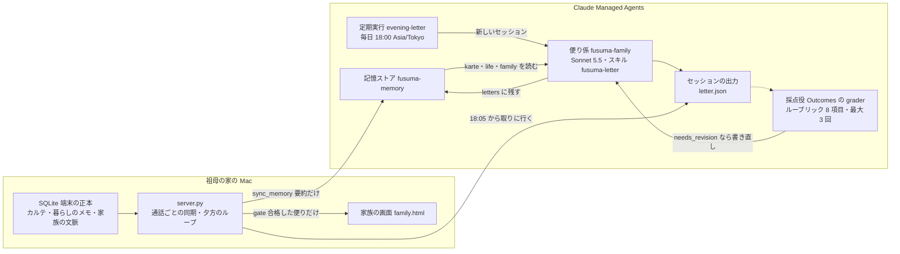
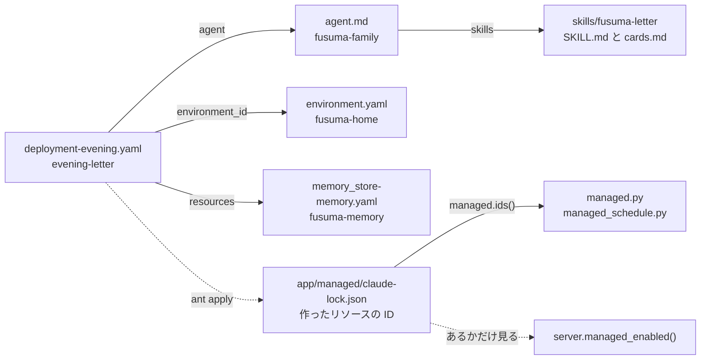
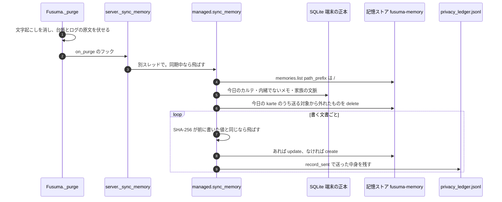
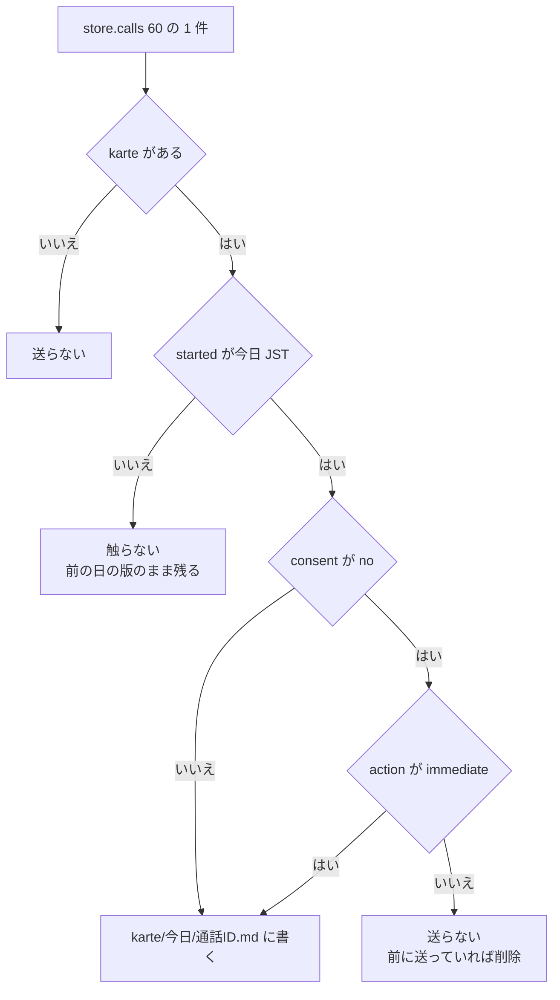
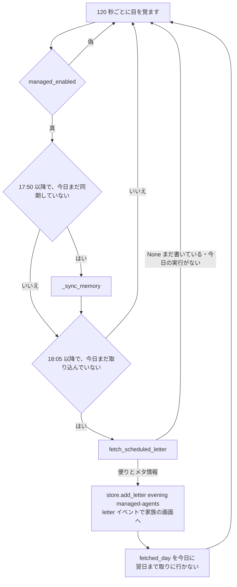
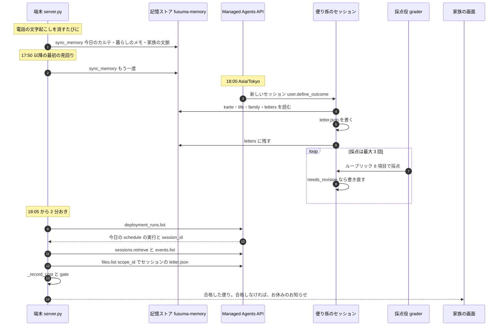
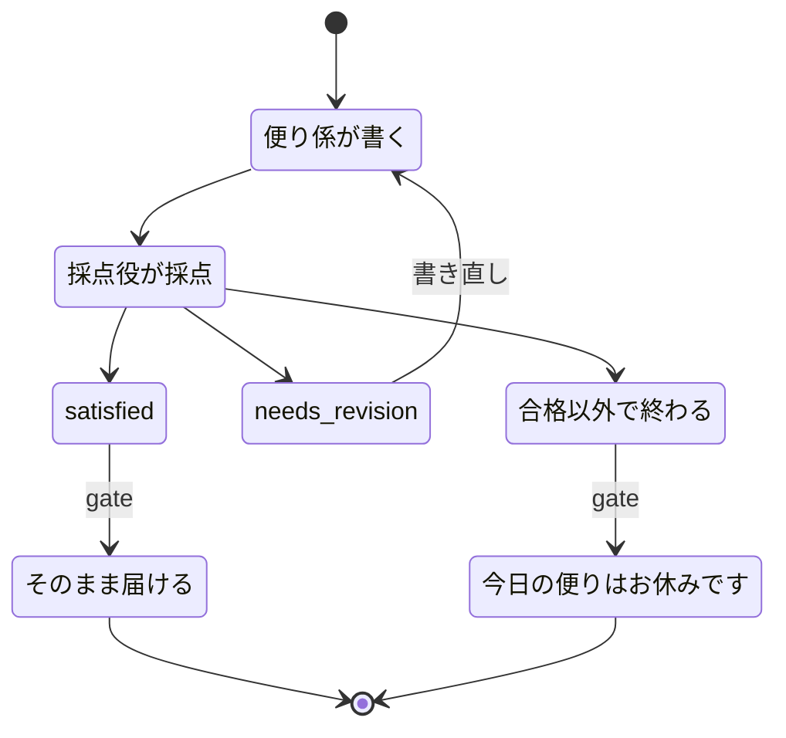
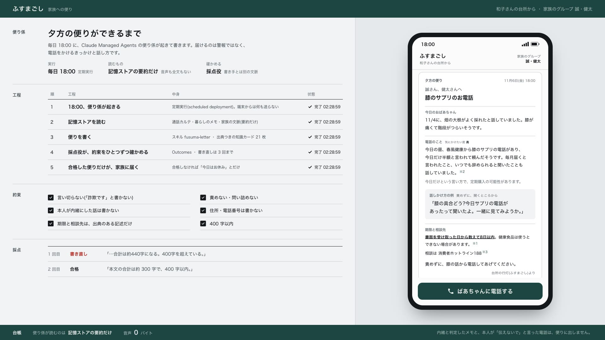
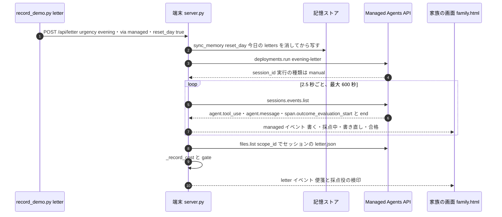

# 夕方の便り — Claude Managed Agents

## 3 行で

- 毎日 18:00(日本時間)に、クラウドの「便り係」(Claude Sonnet 5.5)が、その日の通話カルテと暮らしのメモを読み、離れて暮らす家族への便りを書きます。
- 書いた便りは別の「採点役」が 8 つの約束(断定しない・責めない・内緒は書かない・400 字以内 など)で確かめ、足りなければ書き直させます(採点は最大 3 回)。合格した便りだけが家族の画面に届き、合格しなかった日は中身のない短いお知らせになります。
- 祖母の家の Mac は、電話のたびに要約だけをクラウドの記憶ストアへ写し、18:05 から便りを取りに行きます。音声・文字起こし・内緒の話は送らず、「家族に伝えないで」と言われた電話も送りません(今すぐ知らせた、安全に関わる電話を除く)。

---

ここから先はエンジニア向け。リソースの定義は [`app/managed/agents/fusuma-family/`](../../app/managed/agents/fusuma-family)、端末側のコードは [`app/fusuma/brain/managed.py`](../../app/fusuma/brain/managed.py)・[`app/fusuma/server.py`](../../app/fusuma/server.py)・[`app/scripts/managed_schedule.py`](../../app/scripts/managed_schedule.py)。電話ごとの判断(Claude API)は [brain.md](brain.md)。登場する通話・人物・会社名・住所はすべて架空。

## 全体像




1. 端末の SQLite が正本。通話の文字起こしを消すたびに、その日のカルテ・暮らしのメモ・家族の文脈を記憶ストアへ鏡写しにする(`managed.sync_memory()`)。17:50 以降の最初の見回りでもう一度写す。
2. 18:00 に定期実行(scheduled deployment)が便り係のセッションを起こす。最初のイベントは `user.define_outcome`(課題とルーブリック)。
3. 便り係はスキルに従って `letter.json` を書き、記憶ストアの `letters/` にも残す。採点役が 8 項目で採点し、足りなければ書き直させる。
4. 端末は 18:05 から 2 分おきに当日の実行を探し、終わっていれば `letter.json` を受け取って `gate()` に通し、家族の画面へ出す。

## リソースはファイルで定義する — `ant apply`

```text
app/managed/
├── agents/fusuma-family/
│   ├── agent.md                   便り係(エージェント)。frontmatter が設定、本文がシステムプロンプト
│   ├── environment.yaml           作業場(環境)
│   ├── memory_store-memory.yaml   記憶ストア
│   ├── skills/fusuma-letter/      スキル(SKILL.md・cards.md)
│   └── deployment-evening.yaml    定期実行(スケジュール・予算・Outcomes)
└── claude-lock.json               ant apply が書く ID の控え(.gitignore。公開リポジトリには入っていない)
```



| ファイル | リソース | `name` | 要点 |
|---|---|---|---|
| `agent.md` | エージェント | `fusuma-family` | `claude-sonnet-5-5`・effort medium。道具は read・glob・grep・write・edit だけ。スキル `fusuma-letter` |
| `environment.yaml` | 環境 | `fusuma-home` | cloud。networking は limited で、パッケージマネージャーも MCP サーバーも許可しない |
| `memory_store-memory.yaml` | 記憶ストア | `fusuma-memory` | `description` に置き方(karte/・life/・family/・letters/)を書く |
| `skills/fusuma-letter/` | スキル | `fusuma-letter` | 便りの書き方(`SKILL.md`)と知識カード 21 枚(`cards.md`) |
| `deployment-evening.yaml` | 定期実行 | `evening-letter` | cron `0 18 * * *`・`Asia/Tokyo`・予算 1 回 $0.50・`user.define_outcome`(ルーブリック 8 項目・`max_iterations: 3`) |

作り方は README の「動かし方」のとおり。

```bash
cd app/managed && ant apply agents/fusuma-family/deployment-evening.yaml && cd ../..
```

- 定期実行のファイルを渡すと、そこから参照しているエージェント・環境・記憶ストアと、エージェントが参照するスキルも、依存の順に作る(変わっていれば更新する)。参照はすべて相対パスで書いてあり、ID は `ant apply` が埋める。
- 作ったリソースの ID は、コマンドを走らせた場所の `claude-lock.json`(= `app/managed/claude-lock.json`)に残る。組織ごとの ID なので `.gitignore` に入れてあり、クローンした人は自分の組織に作る。
- エージェントを変えるときは、ファイルを直して `ant apply` し直す([CLAUDE.md](../../CLAUDE.md))。設定はコードとしてレビューでき、同じものを作り直せる。
- 端末は `managed.ids()` で lock を読む。`resources` のキー(`./agents/fusuma-family/…`)から先頭と拡張子を落とした名前で ID を引く。コードが使うのは `ids()["memory_store-memory"]` と `ids()["deployment-evening"]` の 2 つ。
- `server.managed_enabled()` は、環境変数 `FUSUMA_MANAGED`(既定 `1`)が `1` で、かつ lock があるときだけ真。呼ぶたびに確かめるので、サーバーを起動したあとに `ant apply` しても使い始める。

```python
def ids() -> dict:
    res = json.loads(LOCK.read_text())["resources"]
    return {k.replace(BASE, "").split(".")[0].replace("skills/", ""): v["id"] for k, v in res.items()}
```

### 便り係 — `agent.md`

```yaml
# agent.md の frontmatter(description の行は省略)
name: fusuma-family
model: {id: claude-sonnet-5-5, effort: medium}   # 毎日動くので Sonnet 5.5(1 回 $0.50 の上限内で書き直しと再採点まで回る)
tools:
  - type: agent_toolset_20260401
    default_config: {enabled: false}
    configs:
      - {name: read, enabled: true, permission_policy: {type: always_allow}}
      - {name: glob, enabled: true, permission_policy: {type: always_allow}}
      - {name: grep, enabled: true, permission_policy: {type: always_allow}}
      - {name: write, enabled: true, permission_policy: {type: always_allow}}
      - {name: edit, enabled: true, permission_policy: {type: always_allow}}
      - {name: bash, enabled: false}
      - {name: web_fetch, enabled: false}
      - {name: web_search, enabled: false}
skills:
  - ./skills/fusuma-letter
```

- 道具は既定ですべて切り(`default_config: {enabled: false}`)、記憶ストアとスキルのファイルを読み書きする 5 つだけを許す。bash・web_fetch・web_search は使わない。
- 使う道具は `always_allow`。定期実行のセッションには許可を返すクライアントがつながっていないので、許可を待つ設定だとそこで止まったままになる。
- モデル: 最初は Opus 5.5 だったが、1 回の費用が上限 $0.50 に届いて再採点の前に止まったので、Sonnet 5.5 に替えた(上限は据え置き。[README](../../README.md) の「反復の記録」)。
- 本文(システムプロンプト)は、ふすまごしの便り係としての役目と守ること。「材料は記憶ストアにある通話カルテと暮らしのメモだけです。あなたは音声も通話の全文も持っていません。」としたうえで、断定しない/相手の台詞を作らない・住所と電話番号を書かない・内緒は書かない/責めない/期限・制度・数字は `cards.md` にあるものだけで、日付を計算しない/心配のない日は暮らしの様子だけの短い便りでよい、を挙げ、書き方と出力の形はスキルに任せる。

### 作業場 — `environment.yaml`

```yaml
# 便り係の作業場。外へは一切つながない(記憶ストアとスキルだけで書く)。
name: fusuma-home
config: {type: cloud, networking: {type: limited, allow_package_managers: false, allow_mcp_servers: false}}
```

`limited` は許可したものだけを通す設定で、`allowed_hosts` を書いておらず、パッケージマネージャーと MCP サーバーも許していないので、外へ出る先はない(ファイルのコメント:「外へは一切つながない」)。

### 記憶ストア — `memory_store-memory.yaml`

```yaml
name: fusuma-memory
description: |
  ふすまごしの記憶(祖母の家の端末が書き込む)。
  karte/<日付>/<通話ID>.md に通話カルテ(1 通話 1 ファイル。祖母の発話に基づく要約だけ。音声や通話の全文は入っていない)。
  life/<日付>.md に暮らしのメモ(祖母が話したこと。secret: true は家族に伝えない)。
  family/context.md に家族の文脈と伝える範囲のルール。
  letters/<日付>.md にこれまでの便り。
```

- 定期実行の `resources` で、毎回のセッションに付く。セッションの中ではファイルとして見えるので、便り係は read・glob・grep で読み、write・edit で `letters/` に書く。
- `description` は便り係が読む説明として、置き方を書いている。

| パス | 書く側 | 中身 |
|---|---|---|
| `/karte/<日付>/<通話ID>.md` | 端末 | 通話カルテ。1 通話 1 ファイル(`managed._karte_md()`) |
| `/life/<日付>.md` | 端末 | 内緒でない暮らしのメモ(新しい順に最大 50 件) |
| `/family/context.md` | 端末 | 家族の文脈と伝える範囲のルール(`Store.context_text()`) |
| `/letters/<日付>.md` | 便り係 | 書いた便りを読みやすい文にしたもの(同じことを繰り返し書かないため)。端末は `reset_day` のときだけ消す |

### スキル — `skills/fusuma-letter`

- [`SKILL.md`](../../app/managed/agents/fusuma-family/skills/fusuma-letter/SKILL.md): 読むもの(`karte/`・`life/`・`family/context.md`・`letters/`・`cards.md`)、書き方 6 つ(暮らしの様子から/断定しない・相手の台詞を作らない・住所と電話番号を書かない/気になった理由は祖母の言葉や間の様子で短く/責めずに話を始められる一言/期限と相談先は `cards.md` だけで日付を計算しない/全体で 400 字以内)、出力の形。
- [`cards.md`](../../app/managed/agents/fusuma-family/skills/fusuma-letter/cards.md): 知識カード 21 枚。[`app/knowledge/cards.json`](../../app/knowledge/cards.json) と同じ id が同じ順で並ぶ。カードの内容は [brain.md](brain.md) の「知識カード 21 枚」。
- 書き方の約束をプロンプトに毎回書かずに持たせるため、スキルに分けた(README「Claude の使い方」)。

出力は `/mnt/session/outputs/letter.json` に次の形で書く(SKILL.md)。Messages API 版の便りの構造化出力 `LETTER` と同じキーだが、ここは構造化出力ではないので、ルーブリックの 1 番でキーを確かめる。

```json
{"urgency": "evening", "title": "…", "daily": ["…"], "calls": [{"summary": "…", "risk": "low|medium|high", "why": "…"}],
 "suggested_talk": "…", "deadline": "… または null", "consult": "… または null", "sources": ["cards.md のカード id"], "closing": "…"}
```

### 定期実行 — `deployment-evening.yaml`

```yaml
# 夕方の便り: 毎日 18:00(日本時間)に新しいセッションを起こす。手動実行(ant beta:deployments run)はデモ用。
# 便りは「抑制のルーブリック」を、独立した採点役(Outcomes の grader)に見てもらい、最大 3 回書き直す。
name: evening-letter
agent: ./agent.md
environment_id: ./environment.yaml
resources:
  - ./memory_store-memory.yaml
schedule: {type: cron, expression: "0 18 * * *", timezone: Asia/Tokyo}
budget: {type: limit, max_list_cost: {amount: "50", currency: USD}}   # 1 回あたり最大 $0.50
initial_events:
  - type: user.define_outcome
    description: |
      今日の夕方の便りを書く。記憶ストアの karte/ と life/ のうち、いちばん新しい日付のものが「今日」。
      fusuma-letter スキルに従い、/mnt/session/outputs/letter.json に便りを書き、記憶ストアの letters/ にも残す。
    max_iterations: 3
    rubric:
      type: text
      content: |
        # 夕方の便り ルーブリック(抑制の約束)
        1. /mnt/session/outputs/letter.json が 1 つあり、JSON として読める。キーは urgency, title, daily, calls, suggested_talk, deadline, consult, sources, closing。
        2. daily は記憶ストアの life/ にある祖母の話だけで、secret: true の項目を含まない。
        3. calls の各 summary は断定しない(「詐欺です」「間違いなく」「だまされた」を使わない)。
        4. 相手の台詞を作っていない(カルテにない内容を、相手が言ったこととして書いていない)。
        5. 住所・電話番号・番地を書いていない。
        6. suggested_talk は、責めず問い詰めない、家族が電話で最初に言える一言になっている。
        7. deadline と consult は cards.md の記述に沿っていて、日付を計算していない。sources に使ったカード id がある。
        8. title から closing まで、本文の合計が 400 字以内。
```

- `schedule`: cron の `0 18 * * *` を `Asia/Tokyo` で読む。毎日 18:00(日本時間)に新しいセッションができる。端末側にスケジューラはない。
- `budget`: `max_list_cost.amount` は最小単位(セント)の文字列で、`"50"` は $0.50。1 セッションの上限になる。
- `initial_events`: `user.define_outcome` だけで始める。`description` が課題、`rubric` が採点の基準、`max_iterations: 3` が採点の回数の上限(ファイルのコメントでは「最大 3 回書き直す」)。上限に届いた採点の結果は `max_iterations_reached` で、端末の `gate()` は合格として扱わない(`test_evening_letter_delivered_only_if_grader_passed`)。採点役は書き手とは別の文脈で、ルーブリックの 8 項目に照らして採点する(実際の記録でも、説明は項目ごとに満たしているかを書いている)。
- 「今日」は記憶ストアのいちばん新しい日付と決めている。端末は同期のたびに `life/<今日>.md` を書くので、その日に同期が済んでいれば今日になる。
- ルーブリックの 2(内緒を含まない)は端末側でも守っている。端末はそもそも内緒のメモを送らない(次の節)。

## 端末から記憶ストアへ — `managed.sync_memory()`

### いつ写すか

| きっかけ | 呼び出し | 動き |
|---|---|---|
| 通話の文字起こしを消したとき(どの終わり方でも) | `Fusuma._purge()` → `on_purge` のフック `server._sync_memory()` | 別スレッドで `managed.sync_memory(store)`。`server._sync_lock` を取れない(この行か次の行の同期が走っている)ときは、その回は飛ばす |
| 17:50 以降の最初の見回り | `server._evening_loop()` → `_sync_memory()` | 18:00 の定期実行の前に、その日の状態を写し直す |
| 便りを手動で頼んだとき | `managed.evening_letter()` | `sync_memory(store, reset_day=...)` が終わってから定期実行を起こす |

文字起こしを消したあとに写すので、電話のあとの会話で本人が答えた同意(`consent`)が分かった状態で送る。`managed.sync_memory()` 自体も `managed._sync_lock` で 1 つずつ走る(手動の便りの同期と重なったら、終わるのを待ってから写す)。



### どの通話を送るか

```python
day = day or datetime.now(JST).strftime("%Y-%m-%d")      # 定期実行(Asia/Tokyo)と同じ日付で
existing = {m.path: m for m in cl.beta.memory_stores.memories.list(mid, path_prefix="/") if getattr(m, "type", "") == "memory"}
shareable = [c for c in store.calls(60) if c.get("karte") and (c.get("started") or "").startswith(day)
             and (c.get("consent") != "no" or c.get("action") == "immediate")]   # 「伝えないで」と言われた電話は送らない
keep = {f"/karte/{day}/{c['call_id']}.md" for c in shareable}
for path, m in list(existing.items()):
    stale_karte = path.startswith(f"/karte/{day}/") and path not in keep
    if stale_karte or (reset_day and path == f"/letters/{day}.md"):
        cl.beta.memory_stores.memories.delete(m.id, memory_store_id=mid)
        existing.pop(path)
```



- `day` は `datetime.now(JST)` の日付で、定期実行の `Asia/Tokyo` とそろえている。カルテの `started` は端末の時計なので、端末の時計は日本時間が前提(`server._letter()` のコメント)。
- 対象は今日の通話だけ。前の日のカルテは、その日に書いたまま記憶ストアに残る。
- 今日の `karte/` にあって送る対象から外れたもの(あとで `consent: no` になった通話、`store.reset()` で消えた通話)は削除する。
- `reset_day=True` なら、今日の `letters/<今日>.md` も消す(docstring:「デモを最初からやり直すとき」)。消さなければ、同じ日の前の回に便り係が書いた便りを、次のセッションが「これまでの便り」として読む。

### 送るもの・送らないもの

| 送る | 送らない |
|---|---|
| カルテの要約(`_karte_md()`): 日時・向き・端末の判断とその理由(`restraint_note`)・要約(`headline`)・電話のあと本人が話したこと・家族に伝える同意と、カルテの 16 項目(caller_normalized・category・product・amount・subscription・request・deadline・secrecy・response・stage_max・risk・risk_reason・linked_calls・storyline・life_link・contract) | 音声・文字起こし(`lines`)・聞き役と反証役の出力。カルテの `caller_claimed`・`to_ask` と、電話のあとの会話の `diff` |
| 内緒でない暮らしのメモ(`store.memos(include_secret=False)`。時刻・種類・要約・本人の言葉) | 内緒と判定したメモ(PreToolUse フック [`guard_principles.py`](../../app/scripts/hooks/guard_principles.py) も `include_secret=True` の書き込みを止める) |
| 家族の文脈(`store.context_text()`) | 本人が「伝えないで」と言った電話(`consent: no`。`immediate` を除く) |

カルテの根拠(`risk_reason`・`storyline` など)には、祖母の短い言葉が時刻つきで入る。判断の根拠を時刻つきで示すという原則のためで、文字起こしを消してもカルテには残す([CLAUDE.md](../../CLAUDE.md) の守ること 6)。

### 例 — S05 のカルテ

評価の S05(健康食品の電話勧誘・2 回目)のまとめ役の出力([`eval/result_v6.json`](../../eval/result_v6.json))を `_karte_md()` の形にすると、`/karte/2026-11-06/20261106-1402-b348.md` は次の文書になる。評価では電話のあとの会話をしないので、「電話のあと本人が話したこと」「家族に伝える同意」の行はない(会話をした通話では、要約の行のあとに入る)。

````markdown
# 通話カルテ 20261106-1402-b348

- 日時: 2026-11-06T14:03:00
- 向き: 着信
- 端末の判断: evening(理由: お金もカードも今日は動かず、取り消せる段階なので急がず夕方の便りで足りる。)
- 要約: 健康食品(グルコサミン)の定期購入を電話で承諾し、住所も伝えた。夕方の便りで家族に知らせたい

```json
{
 "caller_normalized": "春風健康(健康食品の販売業者を名乗る)",
 "category": "solicitation",
 "product": "グルコサミン(健康食品)",
 "amount": 4980,
 "subscription": true,
 "request": "定期購入の申込。お支払いは商品が届いたときに行う約束",
 "deadline": "今日中(「今日中なら半額」)",
 "secrecy": false,
 "response": "promised",
 "stage_max": "支払い・定期購入の約束",
 "risk": "high",
 "risk_reason": "14:03:33「今日中なら半額なんですか?」「今日だけなんですね」と期限で急がされたように読める。…",
 "linked_calls": [],
 "storyline": "祖母の発話によると、先週(14:03:04「先週もお電話くださったわね」)にも同じ名乗りの電話があった。…",
 "life_link": "14:03:14「膝がね、最近ちょっと痛くて」と自分から話しており、膝の不安に沿った商品の話だった。…",
 "contract": {
  "type": "telephone_solicitation",
  "document_received": null,
  "cooling_off_note": "電話での勧誘で購入を決めたなら電話勧誘販売にあたり、法律で決められた書面を受け取った日から数えて8日以内なら、…"
 }
}
```
````

(長い値は「…」で省略した。)

### 変わっていなければ書かない

```python
for path, content in docs.items():
    h = hashlib.sha256(content.encode()).hexdigest()
    if path in existing and _synced.get(path) == h:
        continue                                   # 前に書いた中身と同じ
    if path in existing:
        cl.beta.memory_stores.memories.update(existing[path].id, memory_store_id=mid, content=content)
    else:
        cl.beta.memory_stores.memories.create(mid, path=path, content=content)
    _synced[path] = h
    written.append(path)
    llm.record_sent("memory-sync", f"{path}\n{content}", to="managed-agents/memory_store",
                    ref=path.rsplit("/", 1)[-1][:-3] if path.startswith("/karte/") else None)
```

- 文書ごとに SHA-256 をとり、このプロセスが前に書いた値(`_synced`)と同じで、記憶ストアにもその文書があれば書かない。通話のたびに同期しても、中身が変わった文書だけが更新される。
- すでにある文書は `update`、ないものは `create`。
- 書いた文書は 1 つずつプライバシー台帳 `runs/privacy_ledger.jsonl` に `role: memory-sync`・`to: managed-agents/memory_store` で残る。カルテの文書は `ref` に通話 ID が入る。`GET /api/privacy` でも読める。
- 書いた文書があれば `managed` の `synced` イベントを出す(家族の画面は「便りができるまで」の工程 2 を実行中にする。台所の画面はこのイベントを使わない)。
- 記憶ストアは変更ごとに版(memory_versions)が残るので、何を覚えさせたかをあとから監査できる。`sync_memory()` の docstring のとおり、消した文書の版も残る。

## 夕方のループ — `server._evening_loop()`

サーバーの起動時に別スレッドで動き始め、120 秒ごとに目を覚ます。

```python
def _evening_loop() -> None:
    """17:50 に記憶を同期し直し、18:05 以降は定期実行の便りを取りに行く(取り込んだら翌日まで何もしない)。"""
    synced_day = fetched_day = None
    while not stop_evt.wait(120):
        if not managed_enabled():
            continue
        now = datetime.now(JST)
        day = now.strftime("%Y-%m-%d")
        try:
            if (now.hour, now.minute) >= (17, 50) and synced_day != day:
                _sync_memory()
                synced_day = day
            if (now.hour, now.minute) >= (18, 5) and fetched_day != day:
                from .brain import managed
                got = managed.fetch_scheduled_letter(store, emit=hub.emit, day=day)
                if got:
                    body, meta = got
                    calls = [c["call_id"] for c in store.calls(50) if c.get("karte") and (c["started"] or "").startswith(day)]
                    lid = store.add_letter("evening", body, "managed-agents", calls)
                    hub.emit({"type": "letter", "id": lid, "letter": body, "via": "managed-agents", "meta": meta})
                    fetched_day = day
        except Exception as e:
            hub.emit({"type": "error", "where": "evening", "message": f"{type(e).__name__}: {e}"})
```



1 日の流れ:



### 定期実行の便りを探す — `managed.fetch_scheduled_letter()`

```python
imported = {((l.get("body") or {}).get("_meta") or {}).get("session_id") for l in store.letters(50)}
for run in cl.beta.deployment_runs.list(deployment_id=ids()["deployment-evening"]):
    sid = getattr(run, "session_id", None)
    trig = getattr(getattr(run, "trigger_context", None), "type", None)
    created = getattr(run, "created_at", None)
    if not sid or sid in imported or trig != "schedule" or created is None:
        continue
    if isinstance(created, str):
        created = datetime.fromisoformat(created.replace("Z", "+00:00"))
    if created.astimezone(JST).strftime("%Y-%m-%d") != day:
        continue
    if cl.beta.sessions.retrieve(sid).status in ("running", "rescheduling"):
        return None                                 # まだ書いている。少しあとでまた来る
    evals = _watch(cl, sid, lambda e: None, timeout=60)
    return _finish(cl, sid, evals, emit, "schedule")
return None
```

- 定期実行の実行記録(deployment run)を順に見て、`trigger_context.type` が `schedule`・`created_at` が今日(JST)・`session_id` がある・まだ取り込んでいない、の 4 つがそろったものを使う。手動実行(`manual`)は拾わない。
- 取り込んだかどうかは、最近 50 通の便りの `_meta.session_id` で見る。同じセッションを 2 回取り込まない。加えてループの `fetched_day` で、取り込んだ日は翌日まで探さない。
- セッションが `running` か `rescheduling` ならまだ書いている。`None` を返し、2 分後にまた見に行く。今日の実行が見つからないときも `None`。
- 終わっていれば `_watch()`(最大 60 秒)でイベントを読み、採点の結果(`span.outcome_evaluation_end` の `iteration`・`result`・`explanation`)を集める。

### 受け取り — `managed._finish()`

1. `sessions.retrieve()` で状態と `usage` を読む。
2. `_fetch_letter()`: Files API の `files.list(scope_id=セッション ID)` で、名前が `letter.json` で終わるファイルを探して受け取る(2 秒おきに 6 回まで)。`scope_id` での絞り込みには `managed-agents-2026-04-01` の beta ヘッダーが要るので `betas=BETA` を明示している。写しを `runs/letters/<時刻>_managed.json` に置く。見つからなければ採点の結果の最後に `no_letter` を足す。
3. `_record_cost()`: セッションの `usage.list_cost`(最小単位の整数の文字列なら 100 で割ってドル)を、費用台帳 `runs/ledger.jsonl` に `role: managed-evening-letter` で足す。
4. 画面へ `managed` の `done` イベント(セッション ID・きっかけ・採点・状態・usage・コンソールの URL)。
5. `gate()` に通し、`_meta` にセッション ID ときっかけ(`schedule` / `manual`)を入れて返す。

## 合格した便りだけを届ける — `gate()`

```python
def gate(letter: dict, evals: list[dict]) -> dict:
    """採点役が合格(satisfied)を出した便りだけを家族に届ける。合格しなかった日は、中身のない短いお知らせにする。"""
    last = evals[-1]["result"] if evals else None
    meta = {**(letter.get("_meta") or {}), "grade": last, "iterations": len(evals)}
    if last == "satisfied":
        return {**letter, "_meta": meta}
    return {"urgency": "evening", "title": "今日の便りはお休みです",
            "daily": ["便り係が書いた便りを、採点役が約束(断定しない・責めない・内緒は書かない…)で確かめきれなかったので、今日は中身を届けません。"],
            "calls": [], "suggested_talk": "今日はどうだった?", "deadline": None, "consult": None, "sources": [], "closing": "",
            "_meta": {**meta, "held": True}}
```



- 見るのは最後の採点の結果だけ。`satisfied` なら便りをそのまま、それ以外(採点の上限に届いた `max_iterations_reached`・`letter.json` がなく `_finish()` が足した `no_letter`・採点の結果がない など)なら中身のないお知らせにする。お知らせには暮らしの様子も電話のことも入れない(`test_evening_letter_delivered_only_if_grader_passed`)。
- `_meta` に `grade`(最後の結果)と `iterations`(採点の回数)が入る。家族の画面([`app/web/js/family.js`](../../app/web/js/family.js))は、合格なら便りの最後に「採点役 書き直し 1 回のあと合格 ・ 別の Claude が、届ける前に確かめました」(1 回で合格なら「採点役 合格」)、お休みのお知らせなら「採点役が合格を出さなかったので、中身は届けていません。」と書く(次の節)。
- Managed Agents の夕方の便りの品質は採点役に任せていて、端末で決まった規則の検査(`letters.violations()`)はかけない。その検査がかかるのは、Messages API で書く便り(今すぐの便りと、`via: "messages"` の夕方の便り)と、電話のあとのふすまごしの一言([brain.md](brain.md))。

## 家族の画面 — `family.html` と `family.js`



(S05 の日の便り。左下の採点は、1 回目「…合計は約440字になる。400字を超えている。」、2 回目「本文の合計は約 300 字で、400 字以内。」)

[`app/web/family.html`](../../app/web/family.html) の左は「夕方の便りができるまで」、右は家族のスマホです(台所の画面と同じ、明細書の作法で描く)。どちらも `/ws` のイベントで描き直します([`app/web/js/family.js`](../../app/web/js/family.js) の `handle()`。イベントごとの対応表は [how-it-works.md](how-it-works.md) の「画面」)。

### 左 — 便りができるまで

- 5 つの工程(18:00、便り係が起きる / 記憶ストアを読む / 便りを書く / 採点役が、約束をひとつずつ確かめる / 合格した便りだけが、家族に届く)の状態の欄に、いまの工程は「実行中」、済んだ工程は「完了」と時刻を書く(`step()`)。`thinking`(letter)で 1、`managed` の `synced`・`session` で 2、便り係の道具が write・edit なら 3(read・glob などは 2)、`grading` で 4、`done` か `letter` で 5 まで済み。書き直しの採点が届くと 3 に戻る
- 「約束」の欄は、ルーブリック 8 項目のうち 6 つを家族向けの言葉にしたもの(言い切らない・責めない・内緒は書かない・住所と電話番号は書かない・期限と相談先は出典のある記述だけ・400 字以内)。JSON の形と「相手の台詞を作らない」は載せていない。最後の採点が合格なら、6 項目に印を付ける
- 採点: 採点 1 回につき 1 行、「N 回目」と「書き直し」か「合格」、その回の決め手の一文(64 字まで)

決め手の一文は、採点役の説明から `gist()` が拾います。説明は英語の前置き(「An independent grader found …」と項目名と「(met):」など)のあとに日本語の本文が続くので、前置きを落とし、本文を「。」で区切ってから選びます。

| 採点 | 選び方 | v4 で出た文 |
|---|---|---|
| 合格(`satisfied`) | 「数字 + 字」と「以内」を両方含む最初の文(先頭の「(8)」のような番号は落とす)。なければ最初の文 | 本文の合計は約 300 字で、400 字以内。 |
| 書き直し | 「合計」と「数字 + 字」を含む文と、「超え」を含む別の文が両方あれば、前の文の「合計」から先に「超え」の文をつなげ、頭に「…」を付ける。なければ「超え」を含む文、「満たしていません」か「ただし」を含む文、最初の文の順 | …合計は約440字になる。400字を超えている。 |

- 書き直しの文は、採点役の 2 つの文を、記録のままつないだもの(言い換えはしない)
- 採点のたびに届く `grade` イベントの説明は、`_watch()` が先頭 400 字に切っている。字数の文がそこまでに入っていないことがあり、v4 の 1 回目は `grade` の時点では「項目8を満たさない。」が出た。セッションの終わりの `done` で説明の全文(`evaluations`)が届くと、拾い直して上の文になる

### 右 — 家族のスマホと便り

便りを古いものから並べ、新しい便りが届くと `GET /api/state` から読み直して、その便りまで送ります(`load()`)。いちばん下に「ばあちゃんに電話する」のボタン(デモでは押すと「発信中…」と出るだけ)。1 通の便り(`letterHTML()`)の中身:

| 部分 | 中身 |
|---|---|
| 種類と日時 | 便りの種類(夕方の便り・今すぐの便り)と、月日・曜日・時刻。夕方の便りの時刻はいつも 18:00、今すぐの便りは書いた時刻 |
| 宛名 | 家族の文脈から「息子の」「孫の」などに続く名前を拾い、息子を先に並べる(既定の文脈なら「誠さん、健太さんへ」)。拾えなければ「家族のみなさんへ」 |
| 題 | `title` |
| 今日のおばあちゃん | `daily` |
| 電話のこと | 電話ごとに `summary` と `why`。見出しに「気にかけたい度」(`risk` の低・中・高) |
| 話しかけ方の例 | `suggested_talk` を「責めずに、聞くところから」と添えた囲みに |
| 期限と相談先 | 期限(`deadline`。「… 日以内」の部分に下線)と相談先(`consult`) |
| 結びと署名 | `closing` と「台所の行灯(ふすまごし)より」 |
| 出典 | `sources` のカードの出典の機関名と題(※1 から順に) |
| 採点役 | 合格なら「採点役 書き直し N 回のあと合格 ・ 別の Claude が、届ける前に確かめました」。お休みのお知らせなら「採点役が合格を出さなかったので、中身は届けていません。」 |

便りの下には、Managed Agents の便りなら「便り係(Claude Managed Agents)が、記憶ストアの要約だけを読んで書きました」、端末が Messages API で書いた便りなら「端末から送った便りです」と添えます。

v4 で届いた便り(抜粋): 題「膝のサプリのお電話がありました」、話しかけ方の例「膝の具合どう? 今日サプリの電話があったって聞いたよ。一緒に見てみようか。」、相談先「消費者ホットライン188」、結び「責めずに、膝の話から電話してあげてください。」。

## 採点の記録 — `docs/records/outcomes_grades.json`

[`docs/records/outcomes_grades.json`](../records/outcomes_grades.json) は、手元のイベントログ `runs/events.jsonl` から、`managed` イベントのうち採点(`stage: grade`)とセッションの終わり(`stage: done`)の行だけを写したもの。`grade` の行は採点のたびに画面へ流したイベント(説明は先頭 400 字)、`done` の行はセッションの終わりにまとめた全文。

記録に残るセッションは 5 つ。11/6 の 3 つは手動実行(`trigger: manual`)、11/5 の 2 つは、きっかけを記録に残す前のもの。

| セッション | 日時 | 1 回目 | 2 回目 | 1 回目の決め手 |
|---|---|---|---|---|
| `sesn_01WtdkdzTrWqoXPPUDwLHrS2` | 11/5 03:16〜03:19 | 書き直し | 合格(およそ 300 字) | 合計は約 500 字で、400 字を超えた |
| `sesn_01176tMhpRgFsWyLTBTBGY69` | 11/5 03:24〜03:27 | 書き直し | 合格(約 330 字) | why を含めると約 450 字。カルテから来た一文の根拠が弱い |
| `sesn_015VMvVzJ765zqySv7QqzRmx` | 11/6 14:29〜14:30 | 合格(約 380 字) | — | — |
| `sesn_0174o94yfwZQGjxTjSSQCnLj` | 11/6 14:32〜14:34 | 書き直し | 合格(約 300 字) | 約 480 字。話しかけ方の例の「月曜の病院」を、日付を計算した誤りと指摘 |
| `sesn_01EUpwJDZZ2X1NCcZwb9XPdb`(最新の収録 v4) | 11/6 14:49〜14:51 | 書き直し | 合格(約 300 字) | 合計は約 440 字で、400 字を超えた |

v4 のセッションの採点(`done` の全文から抜粋)。1 回目:

> ただし項目8を満たさない。title から closing までの本文を数えると、title 約15字、daily 約63字、summary 約80字、why 約101字、suggested_talk 約60字、deadline 約85字、consult 約12字、closing 約21字で、合計は約440字になる。400字を超えている。calls の why が長いのが主な原因。

2 回目:

> (6) suggested_talk「膝の具合どう? 今日サプリの電話があったって聞いたよ。一緒に見てみようか。」は責めず問い詰めず、最初の一言として使える。(7) deadline の「書面を受け取った日から数えて8日以内」と、健康食品は使うとできない場合がある点は cards.md と一致する。日付は計算していない。(…)(8) 本文の合計は約 300 字で、400 字以内。

- 書き直しになった 4 回とも、1 回目の理由に 400 字超えが入っている。プロンプト(SKILL.md の「全体で 400 字以内」)だけでは守られなかった約束を、別の文脈の採点役が見つけて書き直させた記録になっている
- 11/5 の 2 つ目のセッションは、字数に加えて、`summary` の「先週も同じ会社から電話があり、そのときは断ったそうです」を「カルテの storyline や linked_calls に由来するとみられ」、本人が話した記録にはないとして「根拠は弱め」と指摘した
- 11/6 14:32 のセッションの「月曜の病院」は、家族の文脈(`store.DEFAULT_CONTEXT`)に「11月10日(月)」とある予定から来たとみられる。2026-11-10 は火曜日なので、曜日のずれは文脈の側にある

## デモで使った手動実行

デモ動画の夕方の便りは Managed Agents の実際のセッションで、採点役の判定も実物。ただし 18:00 の定期実行は待たずに手動で起こした([README](../../README.md) の「デモで本物のもの・用意したもの」)。最新の収録 v4 では、2026-11-06 14:49 に起こしたセッション `sesn_01EUpwJDZZ2X1NCcZwb9XPdb` が、書き直し 1 回で合格した(前の節)。

```bash
# README「動かし方」: 定期実行を手動で起こす
curl -X POST localhost:8780/api/letter -H 'content-type: application/json' -d '{"via":"managed"}'
```

録画([`app/scripts/record_demo.py`](../../app/scripts/record_demo.py) の `letter`)は家族の画面(`/family.html`)を録りながら `{"urgency": "evening", "via": "managed", "reset_day": true}` を送り、イベントログ `runs/events.jsonl` に `letter` イベントが出るまで待つ。



- `POST /api/letter` は、`via: "managed"` で `managed_enabled()` が偽(lock がない、または `FUSUMA_MANAGED=0`)なら 409 を返す。処理は別スレッドで、失敗すれば `error` イベントになり、家族の画面に「止まりました」と出る。
- `managed.evening_letter()` は `sync_memory(store, reset_day=...)` → `deployments.run()` → `_watch()`(最大 600 秒)→ `_finish(..., "manual")`。`_watch()` は 2.5 秒ごとにイベントを読み、道具の使用(`agent.tool_use` の名前と対象)・便り係の発言(先頭 300 字)・採点の開始と結果(説明は先頭 400 字)を画面へ流す。セッションが `requires_action` 以外の理由で idle になるか、terminated / error になったら終わる。
- 便りは `store.add_letter(urgency, body, "managed-agents", 今日の通話 ID)` で保存し、家族の画面へ出す。家族の画面は夕方の便りを、実際に書いた時刻ではなく、消印 18:00・「夕方六時の便り」として描く(`family.js` の `letterHTML()`。手動で起こした便りも同じ)。
- 手動実行は定期実行を止めていても使える(`managed_schedule.py` の docstring)。手動実行の記録は `fetch_scheduled_letter()` が拾わないので、同じ日の定期実行の便りと重ならない。

## 定期実行を止める — `app/scripts/managed_schedule.py`

定期実行は 1 回ごとに費用がかかる(上限 $0.50 / 回)。使わないときは止める([CLAUDE.md](../../CLAUDE.md))。

```bash
.venv/bin/python app/scripts/managed_schedule.py status     # 状態と、最近の実行(手動 / 定期)
.venv/bin/python app/scripts/managed_schedule.py pause      # 毎日 18:00 の実行を止める(手動実行はできる)
.venv/bin/python app/scripts/managed_schedule.py unpause    # 次の 18:00 から再開する(止めていたあいだの分は走らない)
```

- `pause` / `unpause` は `deployments.pause()` / `deployments.unpause()` を呼び、続けて `status` と同じ表示をする。
- `status` は `deployments.retrieve()` の状態(止めていれば `paused_reason` の種類も)と、最近 8 件の実行(日本時間の作成時刻・`manual` / `schedule`・`session_id` か失敗の種類)を出す。
- 環境変数 `FUSUMA_MANAGED=0` で止まるのは端末側の同期と取り込み(と `POST /api/letter` の手動実行。409 を返す)だけで、クラウドの定期実行は止まらない。定期実行を止めるのは `pause`。
- 止めているあいだも端末は 18:05 から見に行くが、今日の定期実行が見つからないので何もしない。

## 費用と予算

- 1 セッションの上限は定期実行の `budget`($0.50)。agent.md のコメントのとおり、Sonnet 5.5 なら書き直しと再採点までこの上限内で回る。
- 使った額は `_record_cost()` で端末の費用台帳に足すので、端末の予算 `BUDGET_USD`(既定 $80)の合計にも入る。ただし定期実行はクラウドで起きるので、端末の予算の確認(`llm.call()` が呼ぶ前に行う)では止まらない。止めるのは `pause`。手動実行(`evening_letter()`)も `llm.call()` を通らないので、端末の予算では止まらない。

## 限界と注意

- **端末が動いていないと、その日の便りは届かない。** その日に一度も同期しないまま(電話のあとの同期も 17:50 以降の同期もないまま)18:00 になると、記憶ストアのいちばん新しい日付は前の日のままで、便り係はそれを「今日」として読みうる。18:05 以降その日のうちに端末が取りに行けなければ、その日の便りは取り込まれない(`fetch_scheduled_letter()` は今日の実行しか見ない)。
- **定期実行そのものが失敗した日は、何も届かない。** `session_id` のない実行は飛ばすので、お休みのお知らせも出ない。`managed_schedule.py status` で失敗の種類が見られる。
- **同期は間引かれることがある。** 端末側の同期の最中にもう一度呼ばれると、その回は飛ばす。各同期はその日の状態の鏡写しなので、次に同期が走ったとき(次の電話のあと、またはその日まだなら 17:50 以降の見回り)に追いつく。それより先に 18:00 の定期実行が走ると、その電話は便りに入らないことがある。
- **消した文書も版の履歴に残る。** あとで `consent: no` になった通話のカルテは記憶ストアから消すが、前の版は memory_versions に残る。このコードは版の redact をしていない。
- **`_synced` はプロセスの中だけ。** サーバーを起動し直した直後の同期は、中身が同じでも文書ごとに `update` を呼び、プライバシー台帳にも送った記録がもう一度残る。
- **前の日の文書は、端末からは消えない。** `sync_memory()` が消すのは、今日のカルテの入れ替えと、`reset_day` のときの今日の便りだけ。前の日に書いたカルテ・便り・暮らしのメモは残り、便り係は `letters/` を「これまでの便り」として読む。デモの収録 v4 の前には、前日(11/5)の試し運転で書いたカルテ・便り・暮らしのメモを記憶ストアから外した(端末のコードではなく、別に消した)。記憶ストアは変更ごとに版を残すので、外した文書も版の履歴には残っている。
- **家族の画面はこの Mac の localhost。** `family.html` に出すだけで、スマホへの送達(LINE など)はまだない(README の「これから」)。「ばあちゃんに電話する」のボタンは、押すと 2.5 秒だけ「発信中…」と出るだけで、電話はかけない。
- **便箋の ※ は並び順で付ける。** 期限に ※1、1 件目の電話に ※2、相談先に ※3 を付け、出典は `sources` の順に ※1 から並べる。どのカードがどの文の根拠かは確かめていない(v4 の便りは `sources` が「電話勧誘販売のクーリング・オフ」「電話注文で意図せず定期購入に」「消費者ホットライン188」の順で、番号と中身が合っていた)。
- **採点役のことばは拾った一文。** `gist()` は決まった規則で 1 文を選ぶだけで、採点役が挙げたほかの指摘(根拠の弱さ・曜日など)は画面に出ない。全文は `docs/records/outcomes_grades.json` にある。
- **費用の記録はモデル名を決め打ち。** `_record_cost()` は `model: claude-sonnet-5-5` と書く。agent.md のモデルを替えたら合わせる。

## 関連ファイル

| ファイル | 中身 |
|---|---|
| [`app/managed/agents/fusuma-family/agent.md`](../../app/managed/agents/fusuma-family/agent.md) | 便り係(モデル・道具・スキル・システムプロンプト) |
| [`app/managed/agents/fusuma-family/environment.yaml`](../../app/managed/agents/fusuma-family/environment.yaml) | 作業場(外へつながない) |
| [`app/managed/agents/fusuma-family/memory_store-memory.yaml`](../../app/managed/agents/fusuma-family/memory_store-memory.yaml) | 記憶ストア |
| [`app/managed/agents/fusuma-family/skills/fusuma-letter/`](../../app/managed/agents/fusuma-family/skills/fusuma-letter) | スキル(`SKILL.md`・`cards.md`) |
| [`app/managed/agents/fusuma-family/deployment-evening.yaml`](../../app/managed/agents/fusuma-family/deployment-evening.yaml) | 定期実行(cron・タイムゾーン・予算・Outcomes のルーブリック・`max_iterations`) |
| [`app/fusuma/brain/managed.py`](../../app/fusuma/brain/managed.py) | `ids()`・`sync_memory()`・`_karte_md()`・`evening_letter()`・`fetch_scheduled_letter()`・`_watch()`・`_finish()`・`_fetch_letter()`・`gate()`・`_record_cost()` |
| [`app/fusuma/server.py`](../../app/fusuma/server.py) | `managed_enabled()`・`_sync_memory()`・`_evening_loop()`・`POST /api/letter`(`_letter()`) |
| [`app/scripts/managed_schedule.py`](../../app/scripts/managed_schedule.py) | 定期実行の `status` / `pause` / `unpause` |
| [`app/scripts/record_demo.py`](../../app/scripts/record_demo.py) | デモの録画(手動実行で便りを起こす) |
| [`app/web/family.html`](../../app/web/family.html)・[`app/web/js/family.js`](../../app/web/js/family.js) | 家族の画面(便りができるまでの 5 つの手順・採点役のことば `gist()`・便箋の便り `letterHTML()`) |
| [`docs/records/outcomes_grades.json`](../records/outcomes_grades.json) | 採点役の判定の記録 |
