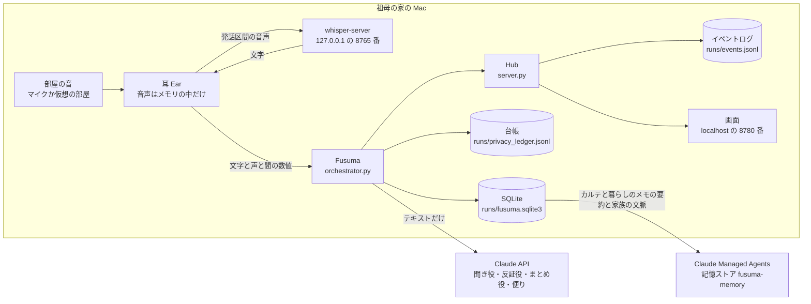
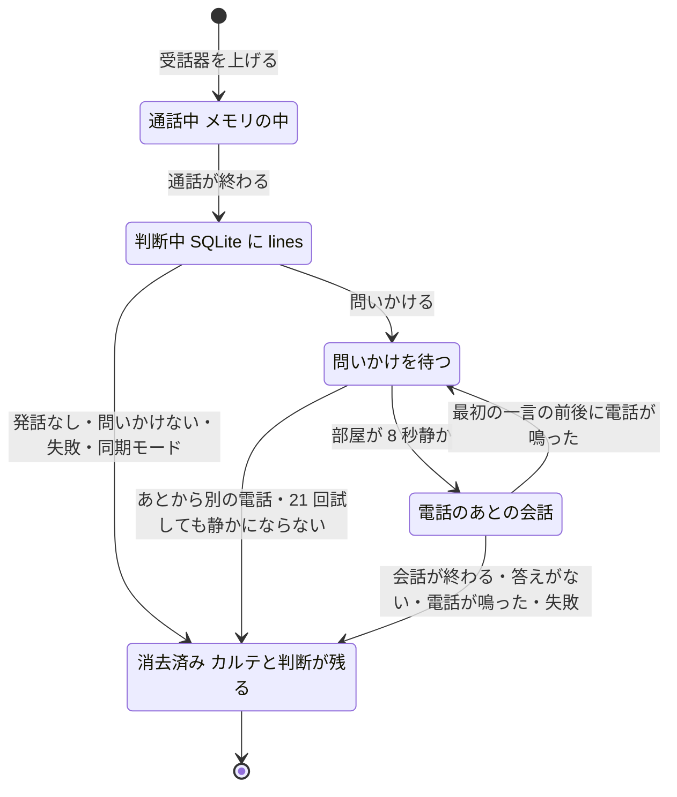
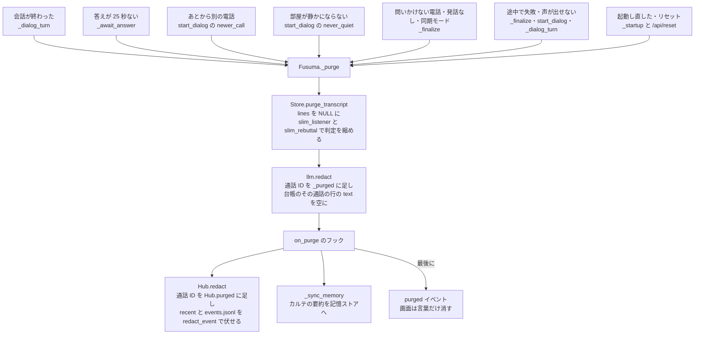
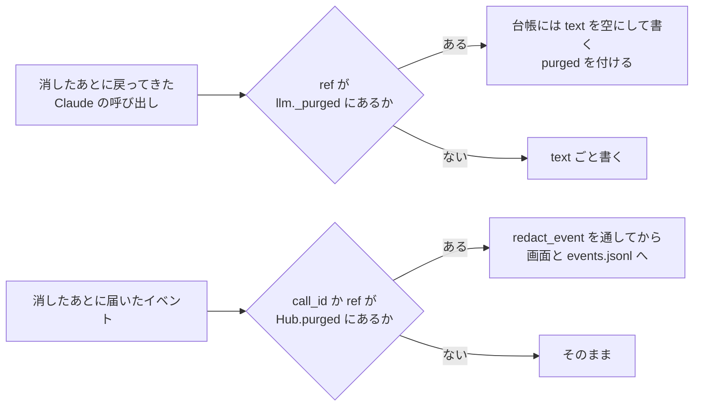
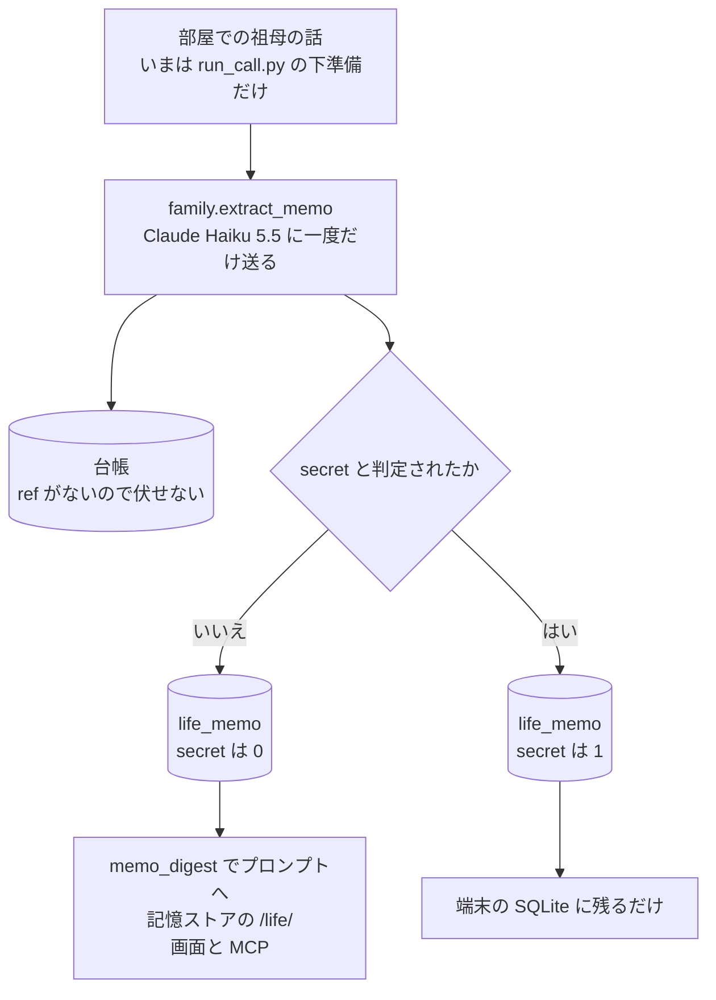
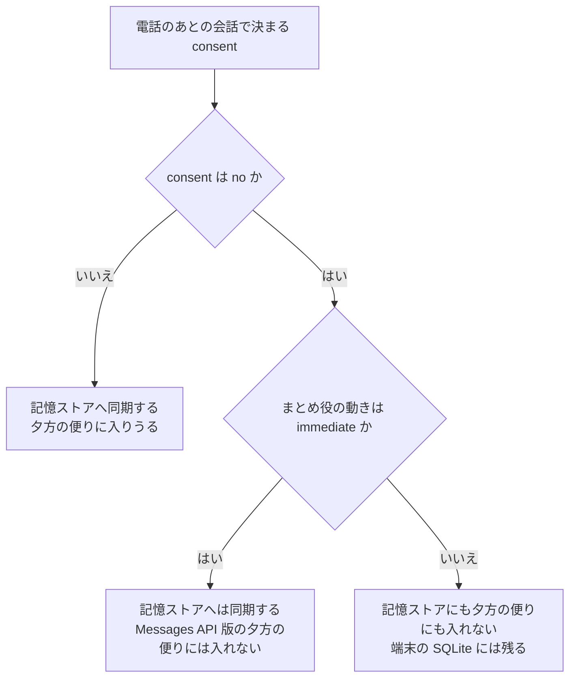
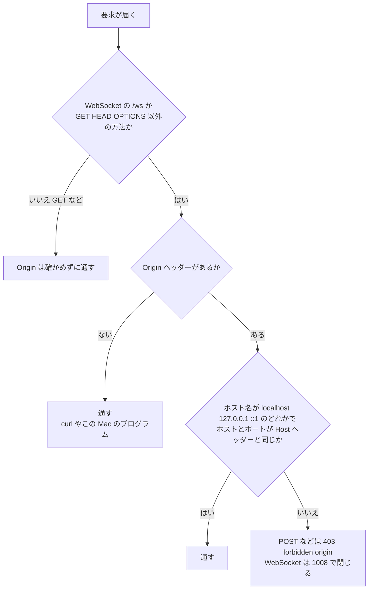
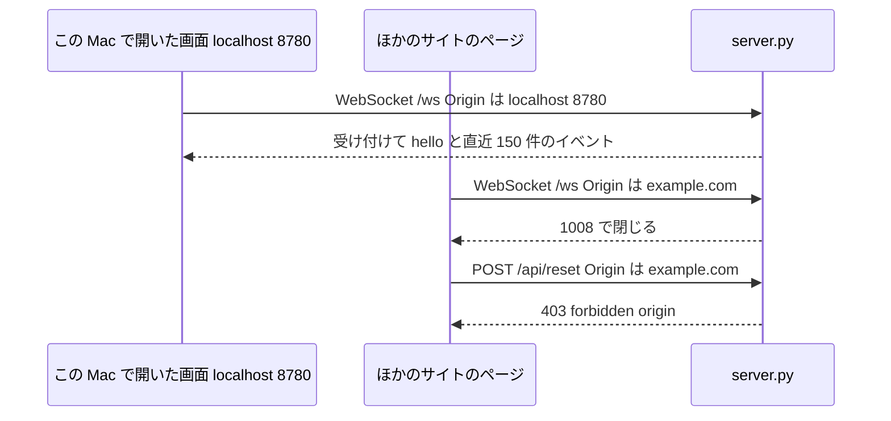
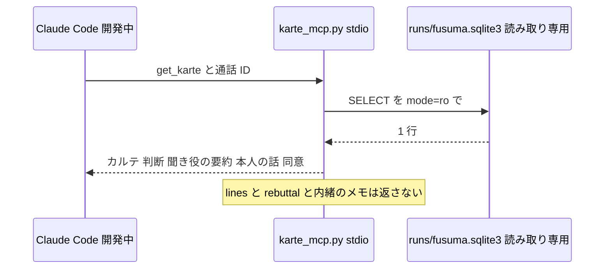
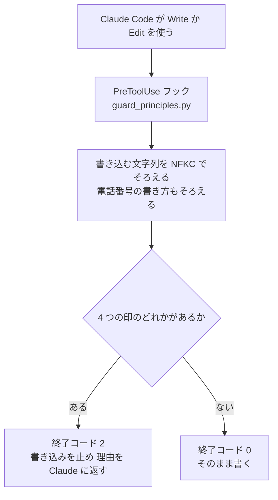

# プライバシーの仕組み

## 3 行で

- 祖母の声(音声)は Mac のメモリの中だけで文字にし、ファイルにも残さず、Claude にも送りません。Claude に送るのは文字と数値だけで、送った中身は台帳に残ります。
- 電話の文字起こしは、電話のあとの聞き取りが終わると消します。そのとき、同じ電話について台帳・記録・画面に残っている中身も伏せます。残るのは通話カルテ(要約と、判断の根拠になった短い言葉)と判断のほか、判定の要点と、声と「間」の数値です。
- 本人が「内緒」と言った話は、クラウドの記憶にも家族への便りにも入れません。「家族に伝えないで」と言った電話も同じです(お金やカードが今日動く・知らない人が訪ねてくるなどで、今すぐ家族に知らせた電話は別)。

---

ここから下はエンジニア向けです。数値・しきい値・ファイル名は、リンク先のコードの値です。例に出す通話・人・会社・住所はすべて架空で、祖母の声は合成音声です。全体の流れは [how-it-works.md](how-it-works.md)、耳の処理は [ear.md](ear.md)、電話のあとの会話は [dialog.md](dialog.md)、記憶ストアと夕方の便りは [managed-agents.md](managed-agents.md)、フックとテストの使い方は [development.md](development.md) にあります。

## 1. 全体像 — 3 つの場所と、その境目


処理は耳(Mac)・脳(Claude API)・便り(Claude Managed Agents)の 3 か所に分かれます。音声は Mac の外に出ません(文字にするのも同じ Mac の whisper-server)。Claude API へはテキストだけが、Managed Agents の記憶ストアへは要約と家族の文脈だけが出ます。



境目ごとの守り方:

| 境目 | 越えるもの | 守り方 | コード |
|---|---|---|---|
| 耳 → whisper-server | 発話区間の音声(メモリ上で作った WAV) | 送り先は同じ Mac の `127.0.0.1:8765`(`config.ASR_URL` の既定値。whisper-server も `--host 127.0.0.1` で起動) | [app/fusuma/ear/asr.py](../../app/fusuma/ear/asr.py) の `transcribe()`、[scripts/services.sh](../../scripts/services.sh) |
| 端末 → Claude API | テキストだけ | `llm._text_of()` が、`text` と `search_result` 以外のブロックを送る前に `ValueError` で止める。台帳の `audio_bytes` は常に 0 | [app/fusuma/brain/llm.py](../../app/fusuma/brain/llm.py) の `call()` |
| 端末 → 記憶ストア | その日のカルテ・内緒でない暮らしのメモ・家族の文脈(Markdown) | 送る項目を `_karte_md()` で決めた項目に絞る。送るたびに台帳へ記録する(`llm.record_sent()`) | [app/fusuma/brain/managed.py](../../app/fusuma/brain/managed.py) の `sync_memory()` |
| サーバー → 画面 | イベント(文字起こしを含む) | ブラウザからの WebSocket は、同じオリジンの localhost のページからだけ受ける(Origin のない接続は通す。8 章) | [app/fusuma/server.py](../../app/fusuma/server.py) の `_local_origin()` |

## 2. どこに、何が、いつまで

### 通話まわりのデータ

| データ | 置き場所 | いつまで | 見られる人・送り先 |
|---|---|---|---|
| **音声**(部屋の音・祖母の声) | 耳のメモリだけ。音イベント用の約 1 秒の窓(`Ear.ring`)と、発話区間の配列(`Segment.audio`)。文字にするときはメモリ上で WAV にする | その区間を処理し終えるまで。ファイルには書かない | 同じ Mac の whisper-server。Claude には送らない |
| **文字起こし(通話中から判断まで)** | メモリ(`Ear.call["lines"]`、`Fusuma.live`、通話の終わりのイベント) | 通話が終わって判断が出るまで | 聞き役(途中経過と最終判定)・反証役・まとめ役、画面(`utt` イベント)、台帳 |
| **文字起こし(通話が終わってから)** | SQLite `calls.lines`(通話が終わると `Fusuma._finalize()` の最初に書く一時保存) | `Fusuma._purge()` まで(問いかける電話なら、電話のあとの会話が終わるまで) | 画面(`GET /api/state` は消すまで `lines` を返す) |
| **声と「間」の数値** | SQLite `calls.ma`、`utt` イベントの数値、`[間の様子]` の行(`ma_line`) | 残す | 画面、Claude |
| **聞き役の判定・反証役の検討** | SQLite `calls.listener`・`calls.rebuttal` | 消すときに要約へ縮める(`slim_listener()`・`slim_rebuttal()`) | 画面、MCP(聞き役の要約だけ) |
| **通話カルテ・まとめ役の判断** | SQLite `calls.karte`・`calls.decision` | 残す(`POST /api/reset` まで)。根拠になった短い言葉が時刻つきで入る | 画面、以後のまとめ役(過去のカルテとして)、記憶ストア、便り、MCP |
| **電話のあとの会話** | メモリ(`Fusuma.dialog`)と `dialog` イベント。要点は SQLite の `told_by_person`・`diff`・`consent` | 会話の文は消すときに伏せる。要点は残す | 画面、電話のあとの会話の Claude、記憶ストアと便り(`told_by_person` と `consent`)、MCP(`diff` は返さない) |
| **プライバシー台帳** `runs/privacy_ledger.jsonl` | Claude に送ったテキスト(system の先頭 400 字とメッセージの全文)と、記憶ストアへ送った要約 | 行は消さない。消すとき、その通話の印(`ref`)が付いた行の `text` を空にして `purged: true` を付ける(役割・モデル・時刻・文字数は残る)。`ref` のない行(夕方の便り・暮らしのメモの抽出・記憶ストアへ送った暮らしのメモと家族の文脈・評価)は伏せない | この Mac のファイル、`GET /api/privacy`。`claude` イベントにも同じ中身の末尾 1600 字(`payload_preview`)が付くが、いまの画面は文字数と金額だけを使い、中身は出さない(8 章) |
| **イベントログ** `runs/events.jsonl` **と画面の履歴** | ファイルと、サーバーのメモリの `Hub.recent`(最大 400 件) | 行は消さない。消すとき、その通話のイベントを `redact_event()` で伏せる | 画面(WebSocket をつないだときに直近 150 件を `hello` で送る。いまの画面 [app.js](../../app/web/js/app.js)・[family.js](../../app/web/js/family.js) はこの 150 件を使わない) |
| **ふすまごしの声の録音** | `runs/speech/*_fusuma.wav` と `runs/speech/speech_log.jsonl`(話した文) | `FUSUMA_SAVE_SPEECH=1` のときだけ作る(既定は `0`。デモ動画の編集用)。消す処理の対象外 | この Mac のファイル |
| **暮らしのメモ(内緒でないもの)** | SQLite `life_memo`(要約 `text` と本人の言葉 `said`) | 残す | 画面、Claude(`Store.memo_digest()`)、記憶ストア `/life/日付.md`、MCP |
| **内緒と判定したメモ** | SQLite `life_memo`(`secret=1`) | 残す | 判定のために一度だけ Claude に送る(その中身は台帳に残る)。そのあとは記憶ストア・便り・以後のプロンプト・画面・MCP に出さない |
| **「家族に伝えないで」と言われた電話**(`consent=no`) | SQLite `calls.consent` | カルテは端末に残る | 記憶ストアと夕方の便りに入れない。ただし今すぐの便りにした電話は記憶ストアに入れる(Managed Agents の夕方の便りの材料になる)。端末の画面・MCP・以後のまとめ役のプロンプト(過去のカルテ)には入る |

置き場所のコード: [app/fusuma/ear/pipeline.py](../../app/fusuma/ear/pipeline.py)(`Ear`)、[app/fusuma/orchestrator.py](../../app/fusuma/orchestrator.py)(`Fusuma`)、[app/fusuma/store.py](../../app/fusuma/store.py)(`Store`)、[app/fusuma/brain/llm.py](../../app/fusuma/brain/llm.py)(台帳)、[app/fusuma/server.py](../../app/fusuma/server.py)(`Hub`)、[app/fusuma/devices.py](../../app/fusuma/devices.py)(`Speaker`)。

### そのほかのファイルと記憶

| 場所 | 中身 | 扱い |
|---|---|---|
| `runs/ledger.jsonl` | 呼び出しごとの役割・モデル・実際に答えたモデル(`served_model`)・トークン数・費用・`ref`。文字は入らない | 残す。予算の計算(`llm.spent_usd()`)と MCP の `api_spend` が読む |
| SQLite `family_context` | 家族の文脈(家族・予定・荷物・手続き・知り合い・伝える範囲のルール。表が空のときに `store.DEFAULT_CONTEXT` から入れる) | `POST /api/reset` でも消さない(`Store.reset()` が消すのは `calls`・`life_memo`・`letters`)。プロンプトと記憶ストア `/family/context.md` に入る |
| SQLite `letters`、`runs/letters/*_managed.json` | 便り(今すぐ・夕方) | 残す。家族の画面 `/family.html` に出す。これも同じサーバーのページで、スマホへ送る仕組みはまだない(README の「これから」) |
| 記憶ストア `fusuma-memory`(Managed Agents) | `/karte/日付/通話ID.md`・`/life/日付.md`・`/family/context.md`、便り係が書く `/letters/日付.md` | 端末が消すのは、その日のカルテの入れ替えと、`reset_day` のときのその日の便りだけ。前の日の分は残る。消した版も `memory_versions` に残る(`sync_memory()` の注記) |
| `logs/*.log` | whisper-server と TTS サーバーの標準出力([scripts/services.sh](../../scripts/services.sh)) | 消す処理の対象外 |
| `eval/ear_cache/`、`eval/result_v6*.json`、`runs/eval/` | 評価用の、架空のシナリオの文字起こしと判定(判定には発話の引用が入る) | 消す処理の対象外。評価([app/scripts/run_eval.py](../../app/scripts/run_eval.py))は `_purge()` を通らない |
| `video/assets/rec/`(デモの録画。[app/scripts/record_demo.py](../../app/scripts/record_demo.py) の `--out` の例) | 画面の録画 `screen.mp4`(通話中は文字起こしが映る)と、`runs/events.jsonl` から写したイベント `timing.json`(写したときに伏せる前なら中身を含む) | 消す処理の対象外。[.gitignore](../../.gitignore) でコミットから外している |

`runs/`・`data/`・`logs/` は [.gitignore](../../.gitignore) でコミットから外しています(「実行時に作られるもの(音声・記憶・台帳・モデル)はコミットしない」)。リポジトリに入っている文字起こしは、架空のシナリオの評価用のもの(耳の出力のキャッシュ [eval/ear_cache/](../../eval/ear_cache) と、発話の引用を含む評価結果 [eval/result_v6.json](../../eval/result_v6.json) ほか 3 ファイル)だけです。

## 3. Claude に送るもの

送るのはすべてテキストです。Messages API の呼び出しは、どれも [app/fusuma/brain/llm.py](../../app/fusuma/brain/llm.py) の `call()` を通ります。`call()` は送る前に `_text_of()` で台帳用の文字列を作り(テキスト以外があればここで止まる)、呼び出しが戻ったあとで台帳に 1 行書きます。記憶ストアへの同期だけは `call()` を通らず、送った中身を `llm.record_sent()` で同じ台帳に書きます。通話のための呼び出しには、`llm.REF`(contextvars)で通話 ID の印を付けます。印を付けるのは `Fusuma._interim()`・`Fusuma.finalize()`・`Fusuma._dialog_answer()` の中です。

| 呼ぶ関数 | モデル(`config`) | 送るもの | 台帳の `ref` |
|---|---|---|---|
| 聞き役 `listener.judge()` | `claude-haiku-5-5` | 祖母の発話の行(時刻・間・声の数値つき)、`[間の様子]` の行、前回の判定の要約。system に原則・役割・知識カード | 通話 ID |
| 反証役 `rebuttal.review()` | `claude-sonnet-5-5` | 知識カード(`search_result`)、家族の文脈、祖母の発話の行。聞き役の結論は渡さない | 通話 ID |
| まとめ役 `family.decide()` | `claude-sonnet-5-5` | 通話 ID・開始時刻・向き・長さ、発話の行、`[間の様子]`、聞き役の最終判定、反証役の意見、過去のカルテの要約(`Store.karte_digest()`、最大 12 件)、暮らしのメモ(内緒を除く)、家族の文脈 | 通話 ID |
| 電話のあとの会話 `family.postcall_turn()` | `claude-sonnet-5-5` | カルテ、まとめ役の動き、暮らしのメモ(内緒を除く)、ここまでの会話 | 通話 ID |
| 今すぐの便り `letters.write("immediate", …)` | `claude-opus-5-5` | 暮らしのメモ(内緒を除く)、その電話のカルテ・要約(`headline`)・理由(`why`)・本人の話・同意、家族の文脈、知識カード | 通話 ID(`_finalize()` の中で呼ぶため) |
| 夕方の便り(Messages API 版)`letters.write("evening", …)` | `claude-opus-5-5` | 同上。その日の電話のうち `consent=no` のものを除く | なし |
| 暮らしのメモの抽出 `family.extract_memo()` | `claude-haiku-5-5` | 家族の文脈と、部屋での祖母の発話 | なし |
| 記憶ストアへの同期 `managed.sync_memory()` | なし(記憶ストアの API) | その日のカルテ(`_karte_md()`)、暮らしのメモ(内緒を除く。日付では絞らず、新しい順に最大 50 件)、家族の文脈 | カルテは通話 ID、ほかはなし |

関数の場所: [listener.py](../../app/fusuma/brain/listener.py)、[rebuttal.py](../../app/fusuma/brain/rebuttal.py)、[family.py](../../app/fusuma/brain/family.py)、[letters.py](../../app/fusuma/brain/letters.py)、[managed.py](../../app/fusuma/brain/managed.py)。

記憶ストアへ送るカルテの項目(`_karte_md()`): 日時・向き・端末の判断と抑えた理由(`restraint_note`)・要約(`headline`)・電話のあと本人が話したこと・同意、それにカルテの `caller_normalized`・`category`・`product`・`amount`・`subscription`・`request`・`deadline`・`secrecy`・`response`・`stage_max`・`risk`・`risk_reason`・`linked_calls`・`storyline`・`life_link`・`contract`。カルテの `caller_claimed` と `to_ask`、まとめ役の `why` は送りません。

## 4. 文字起こしの一生

声を文字にするのは、通話中と、ふすまごしが話しかけた直後(14 秒の窓の中で話し始めた声)だけです(`Ear._segment()`)。台所の独り言は文字にしません。例外は下準備の [app/scripts/run_call.py](../../app/scripts/run_call.py) で、夕方のおしゃべり(R01)を話しかけたあとの会話として文字にし、暮らしのメモを作ります。



| 段階 | 時間 | コード |
|---|---|---|
| 判断が出てから、最初に話しかけようとするまで | 20 秒(`FUSUMA_POST_CALL_DELAY` で変えられる) | `config.POST_CALL_DELAY_SEC`、`Fusuma._finalize()` |
| 話しかけてよい静かさ | 部屋が 8 秒静か | `config.QUIET_BEFORE_OPENER_SEC`、`Ear.quiet_for()` |
| 静かにならないとき | 20 秒おきに試し、21 回目(判断から約 420 秒)に聞かずに消す | `Fusuma.start_dialog()` の `tries < 20` |
| 話しかけたあと、声を文字にする窓 | 14 秒(この間に話し始めた声) | `Fusuma._await_answer()`、`Ear.open_room_listen()` |
| 答えがない | 25 秒で会話を閉じて消す(まだ話しているか文字にしている途中なら、2 秒ずつ最大 12 秒待つ) | `config.DIALOG_IDLE_SEC`、`Fusuma._await_answer()` |
| 会話を閉じた直後の声 | 閉じてから 20 秒以内に文字になった声は、その通話の分として扱う(消すときに伏せる) | `Fusuma.on_ear()` の `_closed` |
| 同期モード(下準備の `run_call.py`) | 判断が出たらすぐ消す(会話はしない) | `Fusuma._finalize()` の `self.sync`(コメントは「評価・下準備」だが、評価の `run_eval.py` は `Fusuma` を使わない) |

## 5. 消す — `Fusuma._purge()`

端末(サーバー)では、[app/fusuma/orchestrator.py](../../app/fusuma/orchestrator.py) の `Fusuma._purge(cid)` が文字起こしを消す入口で、どの終わり方でもここを通ります。下準備の `run_call.py --reset` だけは、消し残しの通話に `Store.purge_transcript()` と `llm.redact()` を直接呼びます。コメントには「画面のログはサーバーが伏せる」とありますが、サーバーがイベントログを伏せるのは自分で `_purge()` を通したときだけで、この経路では `runs/events.jsonl` を伏せません(そのあと `Store.reset()` で通話が消えるので、次に起動したときの片づけにも入らない)。



| 関数 | 場所 | すること |
|---|---|---|
| `Fusuma._purge(cid)` | [orchestrator.py](../../app/fusuma/orchestrator.py) | `Store.purge_transcript()`・`llm.redact()`・`on_purge` のフックを順に呼び、最後に `{"type": "purged", "call_id": …, "ledger_redacted": 伏せた行数}` を出す。フックが失敗しても `error` イベントを出して続ける |
| `Store.purge_transcript(cid)` | [store.py](../../app/fusuma/store.py) | `lines` を NULL、`listener` を `slim_listener()`、`rebuttal` を `slim_rebuttal()` の結果に置き換え、`transcript_purged=1` にする |
| `llm.redact(cid)` | [llm.py](../../app/fusuma/brain/llm.py) | `_purged` に cid を足し、台帳を読み直して `ref == cid` の行の `text` を空にし `purged: true` を付ける。一時ファイルに書いてから置き換える |
| `Hub.redact(cid)`(`on_purge` に登録) | [server.py](../../app/fusuma/server.py) | `Hub.purged` に cid を足し、`Hub.recent` と `runs/events.jsonl` のうち `call_id` か `ref` が cid のイベントを `redact_event()` で伏せる |
| `_sync_memory(cid)`(`on_purge` に登録) | [server.py](../../app/fusuma/server.py) | Managed Agents を作ってあれば(`FUSUMA_MANAGED` が既定の `1` で、`app/managed/claude-lock.json` がある)、別のスレッドでその日のカルテ・暮らしのメモ・家族の文脈を記憶ストアへ同期する |
| `purged` の処理 | [app/web/js/app.js](../../app/web/js/app.js) の `handle()` | 台所の画面から言葉だけを消す。間・声の横棒・数字・注記・照合は残す(下の「画面の消え方」) |

起動したときは、`transcript_purged` が 0 のままの通話(前に止めたとき消し残したもの)を `_startup()` が `_purge()` で片づけます(`Store.pending_transcripts()`)。`POST /api/reset` も、記憶を消す前に同じことをします。

### 画面の消え方

台所の画面([app/web/js/app.js](../../app/web/js/app.js))は、`purged` イベントがいま描いている通話のものなら、言葉だけを消します。

| 場所 | 消すもの | 残すもの |
|---|---|---|
| 左の明細 | 発話の言葉(`text`・`line` を空にし、言葉の長さに合わせた灰色の帯に替える。見出しに「聞き取りのあとに消しました」) | 時刻、相手の時間と祖母の声の横棒、間の秒数、声量、注記(同じ発話の位置に)、段階の区切りの行、照合の ※ 番号 |
| 左の小計 | さいごの一行(「(この電話の文字起こしは消しました。残すのは短いカルテだけ)」に替える) | 数字(割合・最長の沈黙・5 秒以上の回数・断りの言葉の前半→後半) |
| 判定の聞き役 | 発話行為と根拠の引用(「判定は、段階と危険度だけを残しました。」と書く) | 段階・怪しい度・今すぐ家族へ |
| 判定の反証役 | 項目の本文(「検討の中身は伏せて、見立てと出典だけを残しました。」と書く) | 本物の可能性と出典 |
| 判定のまとめ役 | — | 動き・抑えた理由・いつ知らせるか |
| お話 | お返事と段(「電話のあとのお話は、短い要約をカルテに残して、消しました。」と書く) | — |

- 照合の欄は、一度決めたものを消したあとも変えません(`refsBuild()`)。※ 番号も、消す前に見つけた発話の位置に残します
- 行灯の言葉(ふすまごしが最後に話した一文)は、`purged` の処理では消していません。次の電話か、ページを読み直すまで残ります(イベントログと画面の履歴の `speak` は伏せる)
- 消すのは表示と、発話の `text`・`line` です。ページのメモリには、聞き役の判定のほかの項目(理由・開示した内容・聞くこと)、反証役の項目の本文、電話のあとの会話が、次の電話か、ページを読み直すまで残ります(画面には出さない)
- S05 の数字(祖母 29%・最長の沈黙 8.9 秒・5 秒以上 9 回・断りの言葉 1 → 0)は、消す前と同じです

### `redact_event()` が伏せるもの

[app/fusuma/store.py](../../app/fusuma/store.py) の `redact_event()` は、イベントの種類・時刻・数値を残し、文字起こしにあたる中身だけを伏せます。中身を伏せたイベントには `"redacted": true` が付きます。

| イベント | 伏せるもの | 残るもの |
|---|---|---|
| `utt`・`room_utt` | `text`・`line` を `(消去済み)` に | 時刻・間・声の数値 |
| `state`(`lines` を持つもの) | `lines` を空の配列に | `ma`・`ma_line` |
| `listener` | `out` を `slim_listener()` に | 段階・危険度・名乗り・商品・金額・期限などの項目と、発話行為の種類と時刻 |
| `rebuttal` | `out` を `slim_rebuttal()` に | 本物の可能性・出典(URL と題) |
| `dialog` | `history` の各 `text` を `(消去済み)` に、`turn` は `done` と `consent_to_share` だけに | 誰の発話か |
| `speak` | `text` を `(消去済み)` に | 長さ |
| `claude` | `payload_preview` を `(消去済み)` に | 役割・モデル・トークン数・文字数 |
| `decision`・`letter` など | 伏せない | カルテと判断 |

### 例: S05(架空の健康食品の電話勧誘)

評価([app/scripts/run_eval.py](../../app/scripts/run_eval.py))は `_purge()` を通らないので、[eval/result_v6.json](../../eval/result_v6.json) には消す前の形が入っています。下の「消したあと」は、その S05 の結果と [eval/ear_cache/ear_S05.json](../../eval/ear_cache/ear_S05.json) に、このリポジトリの `slim_listener()`・`slim_rebuttal()`・`redact_event()` をそのまま当てたものです。

画面とイベントログの 1 行(`utt` イベント。キャッシュには `utt` イベントそのものは入っていないので、ear_S05.json の行から組み立てた形。ほかの数値の項目は省略):

```json
{"type": "utt", "call_id": "20261106-1402-b348", "clock": "14:03:33", "text": "今日中なら半額なんですか?", "line": "14:03:33 祖母「今日中なら半額なんですか?」 間6.9s 声高+7% 声量-6dB 話速-16%", "pre_pause": 6.9}
```

消したあと:

```json
{"type": "utt", "call_id": "20261106-1402-b348", "clock": "14:03:33", "text": "(消去済み)", "line": "(消去済み)", "pre_pause": 6.9, "redacted": true}
```

聞き役の判定(消す前の抜粋。`speech_acts` は 9 件のうち 2 件、`evidence` は 5 件のうち 1 件、`to_ask` は 3 件のうち 1 件。住所の発話と開示した中身は、この文書では伏せた)。発話の引用・開示した内容・理由・聞くことが入っています:

```json
{"speech_acts": [{"t": "14:04:38", "kind": "promise", "text": "じゃあお願いします。"},
                 {"t": "14:04:42", "kind": "disclosure", "text": "住所は、…(伏せる)"}],
 "evidence": [{"t": "14:04:42", "note": "住所を開示"}],
 "disclosed": ["住所(…伏せる)"],
 "reason": "健康食品の定期購入を『今日だけ半額』で急かされ、…",
 "to_ask": ["春風健康から実際に届いた商品と納品書の内容(定期購入の条件)", "…"]}
```

消したあと(`slim_listener()`。`evidence`・`disclosed`・`reason`・`to_ask` を除き、発話行為は時刻と種類だけ):

```json
{"track": "solicitation", "stage": "支払い・定期購入の約束", "score": 0.85, "risk": "high",
 "claimed_caller": "春風健康", "product": "グルコサミン", "money": {"amount": 4980, "method": "届いたときに支払い"},
 "subscription": true, "deadline": "今日中", "visit": null, "secrecy": false, "notify_now": false,
 "speech_acts": [{"t": "14:03:04", "kind": "backchannel"}, {"t": "14:03:33", "kind": "repeat"},
                 {"t": "14:03:50", "kind": "refusal"}, {"t": "14:04:02", "kind": "repeat"},
                 {"t": "14:04:11", "kind": "repeat"}, {"t": "14:04:28", "kind": "pushed_over"},
                 {"t": "14:04:38", "kind": "promise"}, {"t": "14:04:42", "kind": "disclosure"},
                 {"t": "14:04:49", "kind": "promise"}]}
```

反証役の検討は、本物らしい点・らしくない点・別の説明・確かめ方(と、その引用 `verify_cites`)・原文(`raw`)を除き、見立てと出典(URL と題)だけになります(`slim_rebuttal()`。題は途中を省略):

```json
{"genuine_likelihood": "medium",
 "citations": [{"source": "https://www.no-trouble.caa.go.jp/what/telemarketing/", "title": "電話勧誘の名乗り義務と再勧誘の禁止(…)"},
               {"source": "https://www.kokusen.go.jp/news/data/n-20221130_2.html", "title": "電話注文で意図せず定期購入に(…)"}]}
```

残るカルテ(`karte.risk_reason`)。原則「断定せず、根拠を時刻つきで示す」(README の言い方。[principles.md](../../app/fusuma/brain/prompts/principles.md) の 3)のため、判断の根拠になった短い言葉が時刻つきで入ります。この回の `risk_reason` は住所そのものを書かず、「住所も伝えた」とだけ書いています(別の回では、まとめ役の `why` に住所の一部が入った。12 章):

```text
14:03:33「今日中なら半額なんですか?」「今日だけなんですね」と期限で急がされたように読める。14:03:50「息子に聞いてみないと」と言いながら、14:04:38「じゃあお願いします」と承諾し、14:04:42 住所も伝えた。…
```

台帳の 1 行(形の例。`…` は省略):

```json
{"ts": "…", "role": "listener", "model": "claude-haiku-5-5", "to": "messages", "audio_bytes": 0, "chars": …,
 "text": "SYSTEM:\n…\n\nUSER:\n【通話が終わりました。最終判定】\n祖母の発話(時刻順):\n14:03:00 [音] 受話器を上げる音\n…", "ref": "20261106-1402-b348"}
```

消したあと:

```json
{"ts": "…", "role": "listener", "model": "claude-haiku-5-5", "to": "messages", "audio_bytes": 0, "chars": …,
 "text": "", "ref": "20261106-1402-b348", "purged": true}
```

## 6. 消したあとに届いたもの

消したあとに戻ってきた Claude の呼び出しや、あとから届いたイベントも伏せます。どちらも、消した通話の ID をメモリの集合に覚えておきます。



- `llm.call()` は、`REF` が `_purged` にあれば、台帳の `text` を空にして `purged: true` を付けます(コメント「消したあとに戻ってきた呼び出し(中身は残さない)」)。
- `Hub.emit()` は、`call_id` か `ref` が `Hub.purged` にあれば(`purged` イベント自身は除く)、`redact_event()` を通してから保存と送信をします。
- 電話のあとの会話を閉じてから 20 秒以内に文字になった声は、`Fusuma.on_ear()` がその通話の ID を付けるので、同じように伏せられます。
- 記憶ストアへの同期の記録(`memory-sync`)は、消したあとに書くので中身が残ります。中身は残すことにしているカルテの Markdown です(`llm.record_sent()` は `_purged` を見ない)。

## 7. 内緒のメモと「伝えないで」

### 内緒のメモ



- 内緒かどうかは Claude が判定します。`family.extract_memo()` の指示は「本人が内緒にしたい話は secret=true」で、`said` には本人の言葉をそのまま入れます。判定のために、話は一度 Claude に送ります(台帳に残ります。[CLAUDE.md](../../CLAUDE.md) の原則 6)。下準備の `run_call.py` は、抜き出したメモを内緒のものも「内緒」の印つきでターミナルに表示します。
- 取り出すときは [app/fusuma/store.py](../../app/fusuma/store.py) の `Store.memos(include_secret=False)` が既定で、`WHERE secret=0` を付けます。これを使うのは、プロンプト用の `Store.memo_digest()`、記憶ストアへの `managed.sync_memory()`(`include_secret=False` を明示)、画面の `GET /api/state` です。MCP の `life_memos()` も SQL に `WHERE secret=0` を付けています。
- 暮らしのメモを作る流れ(夕方に話しかけて聞く)は、まだ端末に入っていません。デモのメモは [app/scripts/run_call.py](../../app/scripts/run_call.py) の `run_room()` が作りました(README の「限界と前提」)。

### 「家族に伝えないで」



- `consent` は電話のあとの会話の各回で、Claude の答えの `consent_to_share`(`yes`・`no`・`unknown`)から決めます。`unknown` のときは前の値を変えません(`Fusuma._dialog_turn()`)。
- 記憶ストアへの同期は `c.get("consent") != "no" or c.get("action") == "immediate"` の電話だけを送ります(`managed._sync_memory()`)。その日のカルテのうち送らなくなったものは、次の同期で記憶ストアから消します。
- Messages API 版の夕方の便りは、`urgency` が `immediate` でなければ `consent=no` の電話を外します(`letters.write()`)。
- 今すぐの便りは、本人に聞く前に家族へ送ります(`_finalize()` の中で書く)。電話のあとの会話では、同意は聞かずに、家族にもう知らせたことを正直に伝えます([app/fusuma/brain/prompts/postcall.md](../../app/fusuma/brain/prompts/postcall.md))。
- `consent=no` のカルテも、端末の SQLite・画面・MCP には残ります。`Store.karte_digest()` は同意で絞らないので、以後の電話のまとめ役のプロンプトにも「過去のカルテ」として入ります。

## 8. 画面 — 同じオリジンの localhost からだけ、書きとめないものもある

[app/fusuma/server.py](../../app/fusuma/server.py) の抜粋:

```python
LOCAL_HOSTS = {"localhost", "127.0.0.1", "::1"}

def _local_origin(origin: str | None, host: str | None = None) -> bool:
    if origin is None:
        return True
    u = urlparse(origin)
    return u.hostname in LOCAL_HOSTS and (host is None or u.netloc == host)
```

- HTTP: ミドルウェア `_only_local_pages()` が、`GET`・`HEAD`・`OPTIONS` 以外の要求で `_local_origin(Origin, Host)` が偽なら `403 {"error": "forbidden origin"}` を返します。
- WebSocket: `/ws` は受け付ける前に同じ確認をし、だめなら `close(code=1008)` で閉じます(コメント「この Mac の画面以外には、文字起こしを流さない」)。
- 「同じオリジン」は、Origin のホスト名が localhost・127.0.0.1・::1 のどれかで、ホストとポート(`netloc`)が Host ヘッダーと同じことです。localhost の別のポートで動くページからの要求も断ります。





| 経路 | 方法 | Origin の確認 | 返すもの・すること |
|---|---|---|---|
| `/ws` | WebSocket | する(だめなら 1008) | イベント(消す前は文字起こしを含む)。つないだときに直近 150 件(`hello`) |
| `/api/play`・`/api/say`・`/api/dialog/{call_id}`・`/api/letter`・`/api/reset` | POST | する(だめなら 403) | デモの音を流す・話す・会話を始める・便りを書く・記憶を消す |
| `/api/state` | GET | しない | 通話(消す前は `lines` も)・暮らしのメモ(内緒を除く)・便り・家族の文脈・「いつもの声」・利用額など |
| `/api/privacy` | GET | しない | 台帳の直近 `n` 行(既定 20) |
| `/api/cards` | GET | しない | 知識カード |
| `/`・`/{page}.html`・`/static`・`/media` | GET | しない | 画面のファイル。`/media` は `data/`(合成したデモの音声など) |

この仕組みで防げないこと:

- **GET は確かめません。** ほかのサイトのページが GET を送ることはできますが、CORS の許可ヘッダーを付けていない(`server.py` に CORS の設定はない)ので、ブラウザはそのページに応答を読ませません。ただし GET では Host ヘッダーも確かめないので、DNS リバインディングのような手口までは防いでいません(未対策)。
- **Origin のない要求は通します。** curl やこの Mac のほかのプログラムからの要求です。README のデモ操作(`curl -X POST localhost:8780/api/play …`)もこれを使います。認証はありません。
- **待ち受けるアドレスは起動のしかたで決まります。** README の起動コマンド(`uvicorn fusuma.server:app --port 8780`)は `--host` を付けていないので、uvicorn の既定の 127.0.0.1 で待ち受けます。`--host 0.0.0.0` などで起動すると、同じネットワークの機器から GET も、Origin のない POST も届きます。
- whisper-server(8765)と TTS サーバー(8766)も 127.0.0.1 で待ち受けます([scripts/services.sh](../../scripts/services.sh)、[app/tts_server/tts_engine.py](../../app/tts_server/tts_engine.py) の `serve()`)。こちらにも認証はありません。TTS サーバーは `log_level="warning"` で、受け取った文を書き出すコードはありません。

### 画面に書きとめないもの・出すもの

台所の画面([app/web/js/app.js](../../app/web/js/app.js))は、イベントに入っている文字を全部は描きません。

- **住所・番号などは書きとめない。** 発話の言葉が正規表現 `PRIVATE`(住所・番地・丁目・号室・郵便番号・電話番号・口座・暗証・カード番号・生年月日)に当たると、明細には最初の区切り(「、」「,」「は」)までの頭(6 字まで)と「…」だけを書き、「(住所・番号は書きとめません)」と添えます。S05 の住所の発話は「住所…(住所・番号は書きとめません)」になります。小計の「さいごの一行」も、当たればかぎかっこの中の発話を「…(住所・番号は書きとめません)」に置き換えます
- **伏せるのは表示だけ。** `utt` イベントの `text` と `line` はそのまま WebSocket で届き、聞き役にも同じ行が渡ります。イベントログと画面の履歴で伏せるのは、文字起こしを消すとき(5 章)です
- **`PRIVATE` をかけているのは 2 か所だけ。** 明細の発話と「さいごの一行」です。判定の聞き役の引用(断りと約束)、反証役の項目、電話のあとのお返事、照合(暮らしのメモの本人の言葉)、まとめ役の抑えた理由にはかけていません
- **送った中身は出さない。** `claude` イベントには送った中身の末尾 1600 字(`payload_preview`)が付きますが、画面が使うのは文字数(`chars`)と金額(`spent`)だけです。下の帯の台帳(音声 0 バイト ・ Claude に渡した文字 n 字 ・ 費用 $x)の文字数は、ページを開いてから届いた `claude` イベントの合計、金額は費用台帳 `runs/ledger.jsonl` の合計です。「音声 0 バイト」は画面に書いた決まった値で、0 であることは `llm._text_of()` がテキスト以外を送る前に止めることで守っています(台帳の `audio_bytes` も常に 0)
- **無音で終わった通話の集計。** `state` ended の `reason` が silence のときは、無音の尻尾を描かず、集計は最後の発話までの値(最後の `utt` に付いていた `ma`)を使います。25 秒の無音は、相手が話していた時間ではないからです([ear.md](ear.md) の 8 章)。聞き役とまとめ役に渡る `[間の様子]` の行と SQLite の `ma` は、ended の値のままです
- **字体は Google Fonts から読む。** index.html と family.html は、開くたびにブラウザが fonts.googleapis.com と fonts.gstatic.com から字体を取りに行きます。送るのは字体の要求だけで、文字起こしや音声は入りません。つながらないときは、CSS で指定した端末の字体で出ます
- 家族の画面([family.js](../../app/web/js/family.js))が描くのは便り(SQLite の `letters`)と、`managed` イベントの手順と採点役の説明だけで、文字起こしは使いません

## 9. 読み取り専用の MCP サーバー

開発中に、Claude Code から通話カルテ・暮らしのメモ・利用額を引くための MCP サーバーです([app/scripts/mcp/karte_mcp.py](../../app/scripts/mcp/karte_mcp.py)。[.mcp.json](../../.mcp.json) に `fusuma-karte` として登録。stdio)。端末の動作には使いません。

- SQLite を `file:{config.DB_PATH}?mode=ro` の URI で開くので、書き込みはできません。
- 返す列を決め打ちにしていて、文字起こし(`lines`)と反証役の検討(`rebuttal`)は返しません。聞き役の判定は `slim_listener()` を通してから返します(消す前の通話でも同じ)。
- 暮らしのメモは `WHERE secret=0` で、内緒のメモを返しません(docstring「Claude Code にも渡さない」)。



| ツール | 返すもの | 返さないもの |
|---|---|---|
| `list_calls(limit=20)` | `call_id`・`started`・`action`・`risk`・`scenario` | 中身 |
| `get_karte(call_id)` | `call_id`・`started`・`direction`・`duration`・`action`・`risk`・`told_by_person`・`consent`・`karte`・`decision`・`listener`(`slim_listener()` を通したもの) | `lines`・`rebuttal`・`ma`・`diff` |
| `search_kartes(query)` | `karte` の列に `query` を含む通話(最大 20 件)。形は `get_karte` と同じ | 同上 |
| `life_memos()` | `ts`・`kind`・`text`・`said`(`secret=0` だけ) | 内緒のメモ |
| `api_spend()` | `runs/ledger.jsonl` の合計と役割ごとの内訳、予算 | プライバシー台帳は読まない |

気をつけること: カルテと判断には根拠の短い言葉が時刻つきで入り、`told_by_person` は電話のあと本人が話したことの要点です。MCP の返り値は Claude Code を通じて Claude に渡りますが、この経路は台帳(`runs/privacy_ledger.jsonl`)には残りません。

## 10. 原則の番人フック(PreToolUse)

開発中の Claude Code が原則に反するコードを書き込む前に止める、簡易な番人です([app/scripts/hooks/guard_principles.py](../../app/scripts/hooks/guard_principles.py))。端末の動作時の守り(下の「動いているときの守り」)とは別のものです。

[.claude/settings.json](../../.claude/settings.json) の設定(抜粋):

```json
"PreToolUse": [
  {
    "matcher": "Write|Edit",
    "hooks": [{ "type": "command", "command": "python3 \"$CLAUDE_PROJECT_DIR/app/scripts/hooks/guard_principles.py\"" }]
  }
]
```



見るのは `tool_input` の `file_path` と、書き込む文字列(`content` か `new_string`)だけです。このフック自身(`/hooks/guard_principles.py`)とそのテスト(`/tests/test_principles.py`)は、止めるべき文字列をわざと持つので見ません。

| 印 | 対象のファイル | 止める書き方 |
|---|---|---|
| 1. 脳が音声を Claude に送る | パスに `/fusuma/brain/` を含むもの | `input_audio`・`audio/wav`・`audio/mpeg`・`"type": "audio"`・`media_type="audio`(`media_type=` と `audio` のあいだに 1 文字)、`open(` か `read(` で `.wav`・`.mp3`・`.m4a` を読む |
| 2. `Fusuma.say()` を通らずに話す | `/fusuma/` の `.py`。ただし `devices.py`・`ear/pipeline.py`・`config.py` は除く | `speaker.say(`・`sd.play`・`sounddevice`・`TTS_URL`・`OutputStream`・`.synth(`・`afplay`・`os.system(`・`simpleaudio`・`playsound`・`pyaudio` |
| 3. 実在しうる電話番号 | すべてのファイル | 0 から始まる 10〜11 桁。ハイフン・空白・全角・かっこ・点・`+81` の書き方もそろえて見る。先頭が `0000` の架空の番号は通す |
| 4. 内緒のメモを取り出す | `.py` | `include_secret=True`・`.memos(True)` |

止めたときは、理由を標準エラーに書いて終了コード 2 で終わります。手元で確かめるときは、たとえば次のようにします(Claude API は使いません):

```bash
echo '{"tool_input":{"file_path":"/x/app/fusuma/brain/managed.py","content":"store.memos(include_secret=True)"}}' \
  | python3 app/scripts/hooks/guard_principles.py; echo "exit=$?"
```

### 止めるもの・止めないもの

上と同じ形の入力をフックに与えて、終了コードを確かめた結果です。

| 書き込もうとしたもの | 結果 |
|---|---|
| `fusuma/brain/` の中の `{"type": "input_audio"}` | 止める |
| `fusuma/brain/` の中で `.wav` を `open` する | 止める |
| `fusuma/orchestrator.py` の中の `speaker.say(text)` | 止める |
| `fusuma/server.py` の中の `Fusuma(store, speak=speaker.say)`(関数を渡すだけ) | 通す(テストで確かめている書き方) |
| 全角数字・`+81`・かっこ・点・区切りなしで書いた、0 から始まる 10〜11 桁 | 止める |
| `include_secret=True`、`.memos(True)` | 止める |
| 音声を送る記述を `fusuma/brain/` の外(`app/scripts/` など)に書く | 通す |
| `"input_" + "audio"` のように文字列を分ける、変数に入れたパスで `open` する | 通す |
| `fusuma/` の中で subprocess から macOS の `say` コマンドを呼ぶ、`fusuma/` の外で `sd.play` を使う | 通す |
| 漢数字で書いた番号、スラッシュや中黒で区切った番号、先頭の 0 を省いた番号、文字列を足して作る番号 | 通す |
| `188` や `#9110` のような短い番号、先頭が `0000` の番号 | 通す(わざと) |
| `include_secret=1`、`include_secret=` に変数、`life_memo` を `secret` の条件なしに読む SQL、`.py` 以外のファイル | 通す |

フックの外にあるもの:

- Bash のリダイレクトや `sed` による書き換え、人がエディタで書いたものは見ません(`matcher` は `Write` と `Edit`)。入力に `content`・`new_string` を持たない道具(ノートブックの編集など)は、呼ばれても書き込む文字列が見えません。
- 書き込む文字列だけを見るので、2 回の Edit に分けて組み立てたものは見つけられません。意味までは読みません(フックの docstring「すり抜ける書き方はある」)。
- 実在の名前・会社・住所は判定できません。これは監査役のサブエージェント([.claude/agents/auditor.md](../../.claude/agents/auditor.md))が確かめます。

動いているときの守り(フックとは別に、コードの中にあるもの):

- [app/fusuma/brain/llm.py](../../app/fusuma/brain/llm.py) の `_text_of()` は、`text`・`search_result` 以外のブロックを送る前に止めます。`llm.call()` を通る呼び出しだけが対象です。
- 端末が声を出す経路は `Fusuma.say()` だけで、通話中は `SilenceViolation` で止まります([app/fusuma/orchestrator.py](../../app/fusuma/orchestrator.py))。
- `Store.memos()` は既定で内緒のメモを除きます。

## 11. テストで確かめていること

[app/tests/test_principles.py](../../app/tests/test_principles.py)(`cd app && ../.venv/bin/python tests/test_principles.py`。Claude API を呼ばない)のうち、この文書に関わるもの。テストは一時ディレクトリの台帳と `runs/` を使い、本物の `runs/` には触りません。

| テスト | 確かめること |
|---|---|
| `test_purge_removes_quotes_ledger_and_logs` | `lines` が消え、聞き役の引用(`speech_acts` の `text`・`evidence`・`disclosed`)が消え、段階と危険度は残る。反証役は `genuine_likelihood` と `citations`(`source`・`title`)だけ。カルテは残る。台帳のその通話の行は `text` が空で `chars` が残り、別の行はそのまま |
| `test_redact_event` | `utt`・`dialog`・`claude`・`state` の伏せ方 |
| `test_server_redacts_event_log_and_late_events` | `Hub.redact()` が `runs/events.jsonl` と `Hub.recent` を伏せる。伏せたあとに届いた `room_utt` も伏せる。別の通話のイベントは伏せない |
| `test_dialog_closes_and_purges_when_no_answer`、`test_dialog_answer_then_done_purges`、`test_tts_failure_closes_dialog_and_purges`、`test_tts_failure_mid_dialog_closes_and_purges`、`test_finalize_error_still_purges`、`test_never_quiet_room_purges_without_asking`、`test_older_call_is_not_asked_about`、`test_silent_call_gets_no_postcall_question` | 答えがない・会話が終わる・声が出ない・判断の途中で失敗・部屋が静かにならない・あとから別の電話・問いかけない電話の、どの終わり方でも `transcript_purged` が 1 になる |
| `test_speaker_stops_when_phone_rings_mid_speech` | `save=False` なら `speech_log.jsonl` を作らない |
| `test_guard_hook` | フックが止めるもの・通すもの(8 件) |

## 12. 限界

- **話者を区別しません。** スピーカーホンや大きな受話音量で相手の声が部屋に届くと、相手の言葉も祖母の発話として文字になります(README の「限界と前提」。未検証)。
- **ファイルは暗号化していません。** SQLite と JSONL はふつうのファイルで、この Mac でそのファイルを読める人は読めます。
- **台帳とイベントログは自動では小さくなりません。** 伏せるのは文字起こしにあたる中身だけで、行は残ります。`POST /api/reset` も、この 2 つの行は消しません。
- **例外で終わった呼び出しは台帳に残りません。** 台帳に書くのは呼び出しが戻ったあとなので、タイムアウトなどで `messages.create()` が例外を出したときは、その回の中身は記録されません。
- **伏せた通話の印はメモリにだけあります。** `llm._purged` と `Hub.purged` は起動し直すと空になります(起動したときは、消し残しの文字起こしを `_purge()` で片づけます)。
- **JSON として読めない行。** 台帳の `llm.redact()` はその行をそのまま残し、イベントログの `Hub.redact()` は書き戻しません(捨てます)。
- **カルテと判断の中身はプロンプトで決めています。** どの言葉を引くかは [principles.md](../../app/fusuma/brain/prompts/principles.md)・[family.md](../../app/fusuma/brain/prompts/family.md) の指示です。まとめ役のプロンプトで住所や番号を伏せる指示は、principles.md の 7(「家族向けの文では」)だけです(便りのプロンプト [letter.md](../../app/fusuma/brain/prompts/letter.md) には「住所や番号は書かない」もある)。コードでは確かめていません。評価の結果でも、まとめ役の `why` に住所の一部が入った回があります(v6-r3 の S06 と v6-r4 の S05。引用はこの文書では伏せる)。`why` は記憶ストアには送りませんが、SQLite・画面・MCP と、Messages API 版の便りの入力には入ります。Managed Agents の夕方の便りは、採点役のルーブリック(住所・電話番号・番地を書かない など。[deployment-evening.yaml](../../app/managed/agents/fusuma-family/deployment-evening.yaml))で確かめます。Messages API 版の便り(今すぐ・夕方)と電話のあとの一言を決まった規則で確かめるのは、言い切りと責める言葉だけです(`letters.violations()`)。
- **記憶ストアの保存期間は Managed Agents 側です。** 端末からは前の日の分を消しません。消した版も残ります。
- **Claude API に送ったテキストの保存期間は、このリポジトリでは決めていません。**
- **送り先は環境変数で変えられます。** `FUSUMA_ASR_URL`・`FUSUMA_TTS_URL` を別のホストに向ければ、音声や話す文はその先へ出ます。
- **MCP の返り値は台帳に残りません**(9 章)。
- **`FUSUMA_SAVE_SPEECH=1` で残した声と文は、消す処理の対象外です。**
- **フックは書き方の印を見るだけです**(10 章)。
- **画面の伏せ方は表示だけです**(8 章)。住所・番号の正規表現をかけるのは 2 か所だけで、行灯が最後に話した一文は、文字起こしを消したあとも画面に残ります(5 章)。画面(app.js・family.js)の動きを確かめるテストはありません。
